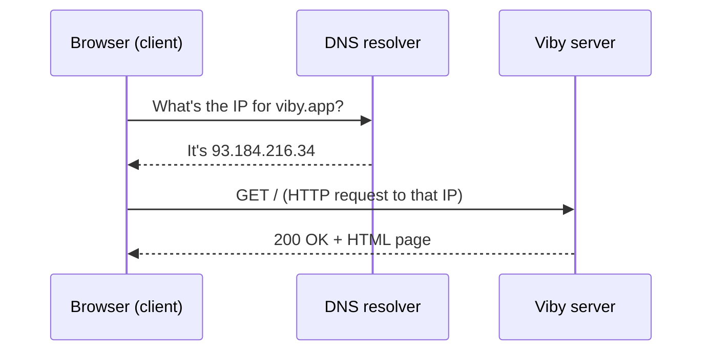

# Chapter 1 — How the Web Works

> Every app you'll ever build — including Viby — is just two computers having a polite, very fast conversation. Learn that conversation, and the whole web stops being magic.

## What you'll learn

- What "the internet" actually is, and how it's different from "the web"
- The difference between a **client** and a **server**, and why both matter
- How **IP addresses** and **DNS** turn `viby.app` into a real machine you can reach
- The anatomy of an **HTTP request and response**, including headers and bodies
- What **status codes** mean (200, 301, 404, 500…) and how to read them
- What a **browser** actually does when you press Enter
- The high-level split between **frontend** and **backend**, and where Viby's pieces live

## Prerequisites

This is the very first chapter, so you need **nothing** but curiosity and a computer with a browser. We'll set up your tools (Node.js, the editor, the Viby starter) in **Chapter 2 — Your Developer Toolkit**, and you'll write your first real Next.js page in **Chapter 3**. For now, just read, picture the analogies, and try the exercises in your browser.

---

## Theory

### The internet vs. the web

People say "the internet" and "the web" as if they're the same thing. They're not.

The **internet** is the *roads* — a global network of cables, fiber, routers, and Wi-Fi that lets any two computers send data to each other. The **web** is one kind of *traffic* that drives on those roads: web pages, apps, and APIs that speak a language called **HTTP**. Email, video calls, and online games also use the internet, but they're different vehicles.

When you build Viby, you're building for the web — but it rides on the internet underneath.

### Clients and servers: who asks, who answers

Almost everything on the web is a conversation between two roles:

- A **client** *asks* for something. Your phone's browser opening Viby is a client.
- A **server** *answers*. A computer in a data center that holds Viby's pages and data is a server.

**Analogy:** think of a restaurant. You (the **client**) read the menu and ask the waiter for a dish. The kitchen (the **server**) prepares it and sends it back. You don't walk into the kitchen — you make a polite *request*, and you get a *response*. The waiter shuttling between you is the network.

A server isn't a magic super-computer. It's just a normal computer running a program that *waits* for requests and knows how to reply. The same machine can be a client in one moment and a server in another.

### IP addresses and DNS: finding the right machine

The internet has billions of devices. How does your request find the *one* server that hosts Viby?

Every device on the internet has an **IP address** — a numeric label like `93.184.216.34` (IPv4) or a longer `2606:2800:220:1:248:1893:25c8:1946` (IPv6). It's the *street address* of a computer.

But nobody wants to type numbers. So we use friendly names like `viby.app`. The system that translates names into IP addresses is **DNS** (Domain Name System).

**Analogy:** DNS is the *phone book* (or your phone's contacts). You type a person's name; it looks up the actual number to dial. When you visit `viby.app`, your computer quietly asks DNS, "What's the IP address for this name?" DNS replies with a number, and *then* your request can travel to the right machine.



### HTTP: the language of requests and responses

Once your browser knows the server's address, it speaks **HTTP** (HyperText Transfer Protocol). HTTP is just a strict format for "I'd like this" and "here you go."

Every **request** has:

- A **method** — the *verb*, what you want to do:
  - `GET` — fetch something (load a profile page)
  - `POST` — create something (sign up a new user)
  - `PUT` / `PATCH` — update something (edit your bio)
  - `DELETE` — remove something (delete a post)
- A **path** — *which* thing: `/discover`, `/profile/maya`, `/api/posts`
- **Headers** — extra info *about* the request (who you are, what format you accept, your auth token)
- An optional **body** — the data you're sending (the JSON for a new Viby post)

Every **response** has:

- A **status code** — a 3-digit summary of how it went (more below)
- **Headers** — info about the response (content type, caching rules, cookies)
- A **body** — the actual content (HTML, JSON, an image)

**Analogy:** A request is an addressed envelope. The *method* is what you're asking the recipient to do, the *path* is the apartment number, the *headers* are notes on the envelope ("fragile," "I speak English"), and the *body* is the letter inside.

### Status codes: how the server says how it went

Status codes are grouped by their first digit:

- **2xx — success.** `200 OK` (here's your page), `201 Created` (your post was saved).
- **3xx — redirect.** `301 Moved Permanently`, `302 Found` — "go look over there instead." Viby uses these to send signed-out users to the login page.
- **4xx — *you* made a mistake.** `400 Bad Request`, `401 Unauthorized` (you're not logged in), `403 Forbidden` (logged in, but not allowed), `404 Not Found` (no such page).
- **5xx — *the server* made a mistake.** `500 Internal Server Error`, `503 Service Unavailable`.

A quick way to remember: **4xx is on you, 5xx is on the server.**

### What a browser actually does

When you type `viby.app` and hit Enter, your browser:

1. **Resolves DNS** — turns the name into an IP address.
2. **Opens a connection** — and (for HTTPS) sets up encryption so nobody can read your data.
3. **Sends an HTTP request** — `GET /` to that IP.
4. **Receives the response** — usually an HTML document.
5. **Parses the HTML** — builds an internal tree of the page (the DOM).
6. **Fetches more resources** — CSS, JavaScript, images, fonts referenced by the HTML, each its own request.
7. **Renders** — paints pixels on the screen, then runs the JavaScript that makes the page interactive.

That whole dance often happens in under a second.

### Frontend vs. backend

- The **frontend** is everything that runs *in the browser* — the HTML you see, the Tailwind styles, the React components, the animations. In Viby, this is the pink Discover feed, the profile cards, the buttons.
- The **backend** is everything that runs *on the server* — checking passwords, saving posts to the database, deciding who's allowed to see what. In Viby, this is Supabase (auth, database, storage) plus the server-side code in Next.js.

The beautiful part of our stack: **Next.js lets you write both in one project**, in the same language (TypeScript). Some components render on the server (close to the data), others run in the browser (close to the user).

---

## In practice

Let's make this real with the Viby stack. Don't worry about installing anything yet — read the code and notice the *shape* of request and response.

### A Server Component fetching data (runs on the backend)

In Next.js 16's App Router, components are **Server Components by default**. This page runs on the server, talks to Supabase, and sends finished HTML to the browser — the database password never reaches the client.

```tsx
// app/discover/page.tsx
import { createServerClient } from "@supabase/ssr";
import { cookies } from "next/headers";

export default async function DiscoverPage() {
  // In Next.js 16, cookies() is async — await it.
  const cookieStore = await cookies();

  const supabase = createServerClient(
    process.env.NEXT_PUBLIC_SUPABASE_URL!,
    process.env.NEXT_PUBLIC_SUPABASE_ANON_KEY!,
    {
      cookies: {
        getAll() {
          return cookieStore.getAll();
        },
        setAll() {
          // Read-only in a Server Component; writes happen in proxy.ts.
        },
      },
    }
  );

  // This is an HTTP request to Supabase, made from the server.
  const { data: people } = await supabase
    .from("profiles")
    .select("username, hobby")
    .limit(10);

  return (
    <main className="mx-auto max-w-md p-4">
      <h1 className="text-2xl font-bold text-brand">Discover your people</h1>
      <ul className="mt-4 space-y-2">
        {people?.map((p) => (
          <li key={p.username} className="rounded-xl bg-white p-3 shadow-sm">
            <span className="font-semibold">@{p.username}</span> loves {p.hobby}
          </li>
        ))}
      </ul>
    </main>
  );
}
```

### Reading an async route param

A dynamic route like `/profile/[username]` receives its params as a **Promise** in Next.js 16. Await them:

```tsx
// app/profile/[username]/page.tsx
export default async function ProfilePage({
  params,
}: {
  params: Promise<{ username: string }>;
}) {
  const { username } = await params; // the path segment becomes data
  return <h1 className="text-brand">@{username}</h1>;
}
```

### Tailwind v4 brand tokens (the frontend's look)

No `tailwind.config.js`. In Tailwind CSS v4 you define design tokens right in your CSS with `@theme`. That `text-brand` class above comes from here:

```css
/* app/globals.css */
@import "tailwindcss";

@theme {
  --color-brand: #ff6fb5; /* Viby bubblegum pink */
  --color-brand-ink: #1a1a1a;
}

body {
  background: white;
  color: var(--color-brand-ink);
}
```

### A Client Component that *makes a request* on click

`"use client"` opts a component into running in the browser, where it can use state, gestures, and animation. Here, a button sends an HTTP `POST`.

```tsx
// app/discover/WaveButton.tsx
"use client";

import { useState } from "react";
import { motion } from "framer-motion";

export function WaveButton({ username }: { username: string }) {
  const [sent, setSent] = useState(false);

  async function sendWave() {
    // A real HTTP request leaving the browser:
    const res = await fetch("/api/wave", {
      method: "POST",
      headers: { "Content-Type": "application/json" },
      body: JSON.stringify({ to: username }),
    });
    if (res.ok) setSent(true); // res.ok is true for any 2xx status
  }

  return (
    <motion.button
      whileTap={{ scale: 0.92 }}
      onClick={sendWave}
      className="rounded-full bg-brand px-4 py-2 font-semibold text-white"
    >
      {sent ? "Waved 👋" : `Wave at @${username}`}
    </motion.button>
  );
}
```

Notice `res.ok` — that's the browser reading the **status code** for us. It's `true` for 200–299 and `false` for 4xx/5xx.

---

## Architecture / diagram

Here's the full round trip when a signed-in user opens Viby's Discover feed:

```
  ┌────────────┐        1. DNS: viby.app -> 93.184.216.34
  │  BROWSER   │  ─────────────────────────────────────────┐
  │  (client)  │                                            ▼
  │            │        2. HTTP GET /discover         ┌───────────────┐
  │  Pink UI,  │ ───────────────────────────────────▶ │  NEXT.JS app  │
  │  React,    │                                      │  on Vercel    │
  │  Tailwind  │ ◀─────────────────────────────────── │  (server)     │
  └────────────┘    5. 200 OK + HTML (the feed)        └──────┬────────┘
        ▲                                                     │ 3. query
        │ 6. browser renders + hydrates                       ▼
        │    JS, then user taps "Wave"                  ┌───────────────┐
        └──────── 7. POST /api/wave ──────────────────▶ │   SUPABASE    │
                                                        │  auth + DB +  │
                  ◀──── 201 Created ───────────────────│   storage     │
                                                        └───────────────┘
                                            4. rows come back to Next.js
```

The key insight: the **browser never talks to the database directly**. It talks to Next.js; Next.js talks to Supabase. Each arrow is an HTTP request with a method, headers, a body, and a status code coming back.

---

## Best practices & pitfalls

- **Do** read status codes before trusting a response. `fetch` does *not* throw on `404` or `500` — always check `res.ok`.
- **Do** keep secrets on the server. Anything prefixed `NEXT_PUBLIC_` is shipped to the browser; your Supabase **anon** key is fine there, but a service-role key never is.
- **Do** use the right method for the job: `GET` to read, `POST` to create. `GET` requests should never change data.
- **Don't** confuse `401` and `403`. `401` = "we don't know who you are" (log in). `403` = "we know you, you just can't do this."
- **Don't** assume the network is fast or reliable. Requests fail, time out, and arrive out of order. Build for it.
- **Don't** put `"use client"` on everything. It ships more JavaScript and loses server-side data access. Start on the server; reach for the client only when you need interactivity.
- **Pitfall:** forgetting that `cookies()` and `params` are **async** in Next.js 16. Always `await` them.
- **Pitfall:** thinking HTTPS is optional. The `S` (encryption) is why your login password isn't readable by the coffee-shop Wi-Fi. Always use HTTPS in production.

---

## Exercises

1. **Read the verbs.** Open any website, press `F12` to open DevTools, click the **Network** tab, and reload. Find one `GET` request and note its status code. *(Easy)*
2. **Trace a name to a number.** In your terminal, run `nslookup viby.app` (or any site you like). Write down the IP address DNS returns. *(Easy)*
3. **Trigger a 404.** Visit a real site and add `/this-page-does-not-exist` to the URL. Check the Network tab — what status code came back, and what did the body show? *(Medium)*
4. **Inspect headers.** In DevTools, click a single request and find its **Request Headers** and **Response Headers**. Identify the `Content-Type` of the response. *(Medium)*
5. **Map Viby.** On paper, draw the round trip for a user *signing up*: which method, which path, client → Next.js → Supabase, and what status code signals success. *(Harder)*

---

## Mini-project: a request inspector for Viby

Build a tiny page that shows the anatomy of a real HTTP request — a teaching tool you'll reuse to debug Viby later. No database needed.

Create a Server Component route that inspects the request's own headers:

```tsx
// app/inspect/page.tsx
import { headers } from "next/headers";

export default async function InspectPage() {
  const h = await headers(); // async in Next.js 16
  const ua = h.get("user-agent") ?? "unknown";
  const accept = h.get("accept") ?? "unknown";

  return (
    <main className="mx-auto max-w-md p-6">
      <h1 className="text-2xl font-bold text-brand">Request inspector</h1>
      <dl className="mt-4 space-y-3">
        <div className="rounded-xl bg-white p-3 shadow-sm">
          <dt className="text-sm text-gray-500">Your browser (User-Agent)</dt>
          <dd className="break-words font-mono text-sm">{ua}</dd>
        </div>
        <div className="rounded-xl bg-white p-3 shadow-sm">
          <dt className="text-sm text-gray-500">Formats you accept</dt>
          <dd className="break-words font-mono text-sm">{accept}</dd>
        </div>
      </dl>
      <p className="mt-4 text-sm text-gray-600">
        Everything above arrived on the <strong>request headers</strong> — proof
        that your browser tells the server about itself on every visit.
      </p>
    </main>
  );
}
```

When you can run the Viby starter (Chapter 2), open `/inspect`, then watch the same request in the DevTools Network tab. Seeing the *same headers* in your UI and in the browser's tooling is the moment HTTP clicks. **Stretch goal:** add a `WaveButton`-style client component that `fetch`es `/inspect` and prints the returned status code.

---

## Key takeaways

- The **internet** is the roads; the **web** (HTTP) is one kind of traffic on it.
- The web is a **client asking** and a **server answering** — request in, response out.
- **DNS** turns human names (`viby.app`) into machine **IP addresses**.
- Every **HTTP request** has a method, path, headers, and optional body; every **response** has a status code, headers, and body.
- **Status codes:** 2xx success, 3xx redirect, **4xx your fault**, **5xx server's fault**.
- The **frontend** runs in the browser; the **backend** runs on the server. In Viby, Next.js spans both and the browser never touches the database directly.

**Up next — Chapter 2: Your Developer Toolkit.** We'll install Node.js, your editor, and the Viby starter, then run your first server so all this theory starts breathing on your own machine.
