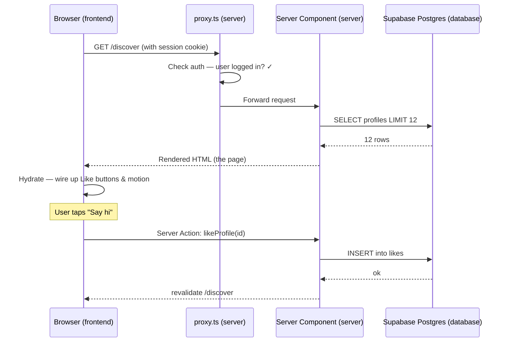

# Chapter 2 — Frontend, Backend & Where Code Runs

> Every line of code you write lives *somewhere* — and knowing *where* is the single biggest unlock between "tutorial coder" and "engineer who ships."

## What you'll learn

- The mental model of **where code runs**: the browser, the server, and the database — and why it matters.
- The **request lifecycle**: what actually happens between a user tapping a button and seeing a result.
- An overview of **rendering strategies** (SSR, SSG, CSR, streaming) without the jargon fog.
- How **Viby** — our social-discovery app — is split cleanly across these layers in Next.js 16.

## Prerequisites

- **Chapter 1** (Welcome to Viby & Your Toolkit): you have Node installed, the Viby repo cloned, and `npm run dev` working.
- Comfort opening a terminal and a code editor. That's genuinely all. We assume *no* prior web theory.

---

## Theory

Let's start with a story, not a spec.

Imagine Viby is a hip neighborhood café where people meet others who share their hobbies. Walk through it with me, because this café *is* the architecture.

**The browser is the front counter and dining area.** It's everything the customer sees and touches: the menu, the chairs, the music, the smile of the barista. In web terms, the **browser** (Chrome, Safari) renders the buttons, the pink Viby logo, the animations. Code that runs here is the **frontend**. It runs on *the user's own device* — their phone or laptop.

**The server is the kitchen.** Customers never walk into the kitchen. They place an order at the counter, and the kitchen does the real work: checking the recipe, cooking, plating. In web terms, the **server** is a computer *you control* (in Viby's case, running on Vercel) that does trusted work: checking if someone is logged in, deciding what data they're allowed to see, talking to the database. Code that runs here is the **backend**.

**The database is the pantry and the recipe book.** It's where all the durable stuff lives: the ingredients, the inventory, the records. Nobody eats raw out of the pantry — the kitchen fetches from it. In Viby, the **database** is Supabase's PostgreSQL: every user profile, every hobby tag, every friend connection is stored there permanently.

Here's the crucial insight beginners miss: **the same JavaScript/TypeScript can run in any of these places, and *where* it runs changes everything.**

- Code in the **browser** is fast to react to taps but **completely untrustworthy** — the user can open dev tools and read or change it. Never put secrets here.
- Code on the **server** is trusted and private. Your database password lives here. The user never sees it.
- Code in the **database** is the source of truth — slow to change, but reliable.

### Why "where" matters so much

A beginner writes a "filter profiles by city" feature and thinks: *I'll fetch all profiles into the browser and filter them with JavaScript.* That works for 10 profiles. At 100,000 profiles it ships your entire user table to a stranger's phone — slow, expensive, and a privacy disaster. An engineer asks the *database* to filter, on the *server*, and sends only the 12 results the user needs.

Same logic. Different *where*. Wildly different outcome.

### The request lifecycle

When a user opens `viby.app/discover`, here's the real sequence — the heartbeat of every web app:

1. **Browser sends a request.** "GET me the /discover page, please." It includes cookies (which may carry a login session).
2. **The request travels the network** to Vercel, where Viby's server lives.
3. **The server runs your backend code.** It reads the session cookie, asks Supabase "who is this user, and what profiles should they see?", and gets data back.
4. **The server builds a response** — usually HTML, sometimes JSON.
5. **The response travels back** across the network to the browser.
6. **The browser renders** the HTML, then "hydrates" it — wiring up the interactive bits (buttons, animations) with frontend JavaScript.
7. **Later interactions** (liking a profile, opening a chat) may repeat a smaller version of this loop without a full page reload.

Every performance problem, every security bug, every "why is this slow" question maps back to one of these seven steps.

### Rendering strategies — the 60-second tour

"Rendering" just means *turning your code into the HTML the user sees*. Where and when that happens is the strategy:

- **CSR (Client-Side Rendering):** The server sends a near-empty page; the browser builds everything with JavaScript. Fast to navigate once loaded, but slow first paint and bad for SEO. The old default.
- **SSR (Server-Side Rendering):** The server builds the full HTML *per request*. Great for personalized, always-fresh pages — like Viby's feed, which differs for every logged-in user.
- **SSG (Static Site Generation):** HTML is built *once at deploy time* and served to everyone. Blazing fast. Perfect for Viby's marketing landing page and `/about`.
- **Streaming:** The server sends HTML *in chunks* as it's ready, so the user sees the shell instantly and the slow parts (a heavy recommendations list) fill in after.

Next.js 16's App Router lets you mix all of these *per route* and even *per component*. You don't pick one for the whole app — you pick the right one for each screen. That's the superpower.

---

## In practice

In Next.js 16's App Router, **every component is a Server Component by default**. That means it runs on the server (the kitchen) — it can talk to the database directly, and its code never ships to the browser. You only opt into the browser with the `"use client"` directive when you need interactivity (clicks, state, animations).

### A Server Component: Viby's Discover page

This runs on the server. Notice it `await`s data directly — no loading spinner, no `useEffect`. The user gets fully-formed HTML.

```tsx
// app/discover/page.tsx  (Server Component — runs on the server)
import { createClient } from "@/lib/supabase/server";
import { ProfileCard } from "@/components/profile-card";

export default async function DiscoverPage() {
  const supabase = await createClient();

  // This query runs on the SERVER, talking straight to Supabase.
  // The browser never sees this code or the DB credentials.
  const { data: profiles } = await supabase
    .from("profiles")
    .select("id, display_name, avatar_url, hobbies")
    .limit(12);

  return (
    <main className="mx-auto max-w-2xl p-4">
      <h1 className="text-2xl font-bold text-brand">Discover your people</h1>
      <div className="mt-4 grid grid-cols-2 gap-3">
        {profiles?.map((p) => (
          <ProfileCard key={p.id} profile={p} />
        ))}
      </div>
    </main>
  );
}
```

The `text-brand` class comes from a Tailwind v4 theme token — defined in CSS, no `tailwind.config.js`:

```css
/* app/globals.css */
@import "tailwindcss";

@theme {
  --color-brand: #ff6fb5;       /* Viby bubblegum pink */
  --color-brand-foreground: #ffffff;
}
```

### The Supabase server client (runs on the server)

This is the trusted kitchen helper. It reads cookies using the modern `getAll`/`setAll` handlers from `@supabase/ssr`:

```ts
// lib/supabase/server.ts
import { createServerClient } from "@supabase/ssr";
import { cookies } from "next/headers";

export async function createClient() {
  const cookieStore = await cookies(); // async in Next.js 16

  return createServerClient(
    process.env.NEXT_PUBLIC_SUPABASE_URL!,
    process.env.NEXT_PUBLIC_SUPABASE_ANON_KEY!,
    {
      cookies: {
        getAll() {
          return cookieStore.getAll();
        },
        setAll(cookiesToSet) {
          cookiesToSet.forEach(({ name, value, options }) =>
            cookieStore.set(name, value, options)
          );
        },
      },
    }
  );
}
```

### A Client Component: the interactive Like button

This needs to run in the *browser* — it responds to taps and animates. So it declares `"use client"` and uses Framer Motion.

```tsx
// components/like-button.tsx
"use client";

import { useState } from "react";
import { motion } from "framer-motion";
import { likeProfile } from "@/app/actions/like";

export function LikeButton({ profileId }: { profileId: string }) {
  const [liked, setLiked] = useState(false);

  return (
    <motion.button
      whileTap={{ scale: 0.85 }}
      onClick={async () => {
        setLiked(true);             // instant UI feedback in the browser
        await likeProfile(profileId); // trusted write happens on the server
      }}
      className="rounded-full px-4 py-2 text-brand"
      aria-pressed={liked}
    >
      {liked ? "✨ Vibing" : "Say hi"}
    </motion.button>
  );
}
```

### A Server Action: the trusted write (runs on the server)

The button *called* this, but the code runs back on the server. The `"use server"` directive is the magic bridge — Next.js wires up the network request for you. The database write happens where it's safe.

```ts
// app/actions/like.ts
"use server";

import { createClient } from "@/lib/supabase/server";
import { revalidatePath } from "next/cache";

export async function likeProfile(profileId: string) {
  const supabase = await createClient();

  const {
    data: { user },
  } = await supabase.auth.getUser();
  if (!user) throw new Error("You must be signed in to vibe.");

  await supabase.from("likes").insert({
    from_user: user.id,
    to_user: profileId,
  });

  revalidatePath("/discover");
}
```

### Edge logic with `proxy.ts` (runs before your page, on the server)

Need to guard routes — say, bounce logged-out users away from `/discover`? In Next.js 16 this lives in `proxy.ts` (not the old `middleware.ts`):

```ts
// proxy.ts  (runs on the server, before the request reaches your page)
import { createServerClient } from "@supabase/ssr";
import { NextResponse, type NextRequest } from "next/server";

export async function proxy(request: NextRequest) {
  const response = NextResponse.next();

  const supabase = createServerClient(
    process.env.NEXT_PUBLIC_SUPABASE_URL!,
    process.env.NEXT_PUBLIC_SUPABASE_ANON_KEY!,
    {
      cookies: {
        getAll() {
          return request.cookies.getAll();
        },
        setAll(cookiesToSet) {
          cookiesToSet.forEach(({ name, value, options }) =>
            response.cookies.set(name, value, options)
          );
        },
      },
    }
  );

  const {
    data: { user },
  } = await supabase.auth.getUser();

  if (!user && request.nextUrl.pathname.startsWith("/discover")) {
    return NextResponse.redirect(new URL("/login", request.url));
  }

  return response;
}

export const config = {
  matcher: ["/discover/:path*", "/chat/:path*"],
};
```

Read it top to bottom and you can *feel* the layers: server fetches data, server guards routes, browser handles taps, server handles writes. Every piece in its right home.

---

## Architecture / diagram

Here's the full Viby request lifecycle for a logged-in user opening Discover and tapping "Say hi":



And the layered "where does it live" map:

```
┌─────────────────────────────────────────────────────────┐
│  BROWSER (user's phone)         — untrusted, interactive  │
│  "use client" components, Framer Motion, Zustand store    │
└───────────────▲───────────────────────────┬──────────────┘
                │ HTML / Server Action calls │
┌───────────────┴───────────────────────────▼──────────────┐
│  SERVER (Vercel)                — trusted, has secrets     │
│  Server Components, Server Actions, proxy.ts, Supabase key │
└───────────────▲───────────────────────────┬──────────────┘
                │ SQL queries                │
┌───────────────┴───────────────────────────▼──────────────┐
│  DATABASE (Supabase Postgres)   — source of truth          │
│  profiles, likes, hobbies, messages + Row Level Security   │
└────────────────────────────────────────────────────────────┘
```

---

## Best practices & pitfalls

**Do:**

- **Default to Server Components.** Only add `"use client"` when you truly need interactivity, state, or browser-only APIs. This keeps your JavaScript bundle tiny and fast.
- **Fetch data on the server, close to the database.** Filter and limit *in the SQL query*, not in the browser.
- **Keep secrets server-side.** Anything in a Server Component, Server Action, or `proxy.ts` is safe. Anything in a `"use client"` file ships to the user.
- **Use Server Actions for writes** — they're typed, secure, and need no hand-rolled API route.

**Don't:**

- **Don't put your Supabase *service-role* key in a `NEXT_PUBLIC_` variable.** The `NEXT_PUBLIC_` prefix literally means "ship this to the browser." Only the public anon key belongs there.
- **Don't `useEffect` + fetch for initial page data** when a Server Component can `await` it directly. That's the old CSR habit; it causes loading spinners and slow first paint.
- **Don't trust client-side checks for security.** A disabled button is UX, not protection. Always re-check auth inside the Server Action (note our `getUser()` guard above).
- **Don't reach for `proxy.ts` for heavy work.** It runs on *every* matched request — keep it to fast auth/redirect logic.

---

## Exercises

1. **Trace the layers.** Open `app/discover/page.tsx`. Write a one-sentence comment above each block stating *where* it runs (browser / server / database). Confirm the data fetch is server-side.
2. **Prove the boundary.** Add a `console.log("hello from where?")` to the Discover Server Component and to the `LikeButton` client component. Run `npm run dev`, open the page, and find which log appears in your *terminal* versus your *browser console*. Explain why.
3. **Static vs dynamic.** Create a static `app/about/page.tsx` that returns hard-coded JSX (no data fetch). Compare its behavior to `/discover`. Which is SSG-friendly and why?
4. **Tighten a query.** Modify the Discover query to also filter `.eq("city", "Berlin")`. Notice you changed *where* the filtering happens (database) — never the browser.
5. **(Stretch)** Add a second `matcher` route to `proxy.ts` protecting `/profile/edit`, and verify a logged-out user gets redirected to `/login`.

---

## Mini-project: The "Where Am I Running?" badge

Build a tiny diagnostic that makes the frontend/backend split *visible*.

1. Create a Server Component `app/where/page.tsx` that fetches the current time on the server and renders it, plus a heading "Server rendered at: …".
2. Create a Client Component `components/client-clock.tsx` (`"use client"`) that shows a live ticking clock using `useState` + `useEffect`, labelled "Browser time: …".
3. Render the client clock inside the server page.

```tsx
// app/where/page.tsx (Server Component)
import { ClientClock } from "@/components/client-clock";

export default function WherePage() {
  const serverTime = new Date().toLocaleTimeString();
  return (
    <main className="mx-auto max-w-md p-6 space-y-2">
      <p className="font-semibold text-brand">Server rendered at: {serverTime}</p>
      <ClientClock />
    </main>
  );
}
```

```tsx
// components/client-clock.tsx (Client Component)
"use client";
import { useEffect, useState } from "react";

export function ClientClock() {
  const [now, setNow] = useState<string>("");
  useEffect(() => {
    const id = setInterval(() => setNow(new Date().toLocaleTimeString()), 1000);
    return () => clearInterval(id);
  }, []);
  return <p className="text-gray-500">Browser time (live): {now}</p>;
}
```

**What you'll observe:** the server line is *frozen* at the moment the page was built on the server. The browser line *ticks* because that code runs live on your device. You've just *seen* the boundary between backend and frontend — the whole chapter in one screen.

---

## Key takeaways

- Code runs in one of three places — **browser (frontend), server (backend), database** — and *where* drives speed, security, and cost.
- The **request lifecycle** is a predictable seven-step loop; every bug and slowdown maps to one step.
- Next.js 16 components are **Server Components by default**; opt into the browser with `"use client"` only for interactivity.
- **Server Actions** (`"use server"`) and **`proxy.ts`** keep trusted logic and secrets on the server, away from prying eyes.
- Pick rendering strategy **per route**: SSG for marketing, SSR for the personalized feed, streaming for slow sections.

**Up next — Chapter 3: HTML, CSS & the Box Model, the Viby Way.** Now that you know *where* your UI is built, we'll learn how to actually *build* it — pixel by pixel, in Viby's signature pink.
