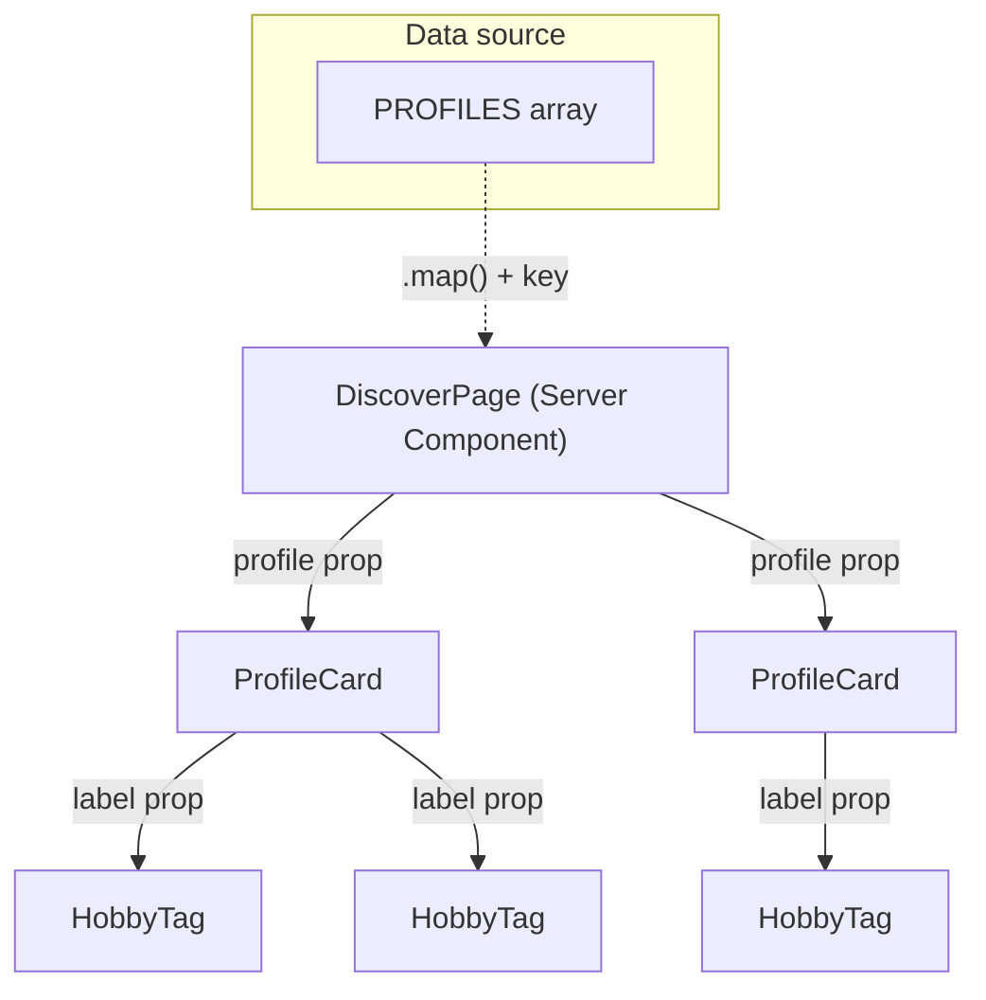

# Chapter 3 — React Fundamentals: Components, JSX & Props

> Every screen in Viby — from a profile card to the whole feed — is just small pieces of UI snapped together like LEGO. Today you learn how to make those pieces.

## What you'll learn

- What React actually is, and *why* it beats hand-writing HTML and DOM updates
- JSX: writing UI that looks like HTML but is really JavaScript
- Components as plain functions that return UI
- Props: passing data *into* a component so it can be reused
- Composition: building big screens out of small components
- Rendering lists with `key`, and conditional rendering (show/hide UI)
- Building real Viby UI pieces: a `HobbyTag`, a `ProfileCard`, and a card grid

## Prerequisites

- Chapter 1 — your environment and the Viby Next.js 16 project are set up
- Chapter 2 — comfortable with JavaScript basics: variables, functions, arrays, `.map()`, and objects

If `npm run dev` starts the app and you can edit a page, you're ready.

## Theory

### What is React, and why?

Imagine you're decorating a wall with hundreds of sticky notes. The old way (plain HTML + JavaScript) is like writing every note by hand, then every time one number changes, hunting through the whole wall to find that exact note and rewrite it. Tedious, and easy to update the wrong one.

**React** is a librarian for your UI. You describe *what the wall should look like* for the current data — "here are the notes" — and React figures out the smallest set of changes needed to make the real wall match. You stop manually touching the page (the "DOM"); you just describe the result, and React keeps the screen in sync with your data.

That single idea — **UI is a function of your data** — is why React scales from a tiny button to an app like Viby with feeds, profiles, and chat.

### JSX: HTML that's secretly JavaScript

React lets you write markup *inside* JavaScript using **JSX**:

```tsx
const greeting = <h1>Welcome to Viby</h1>;
```

That looks like HTML, but it isn't — it's JavaScript that React turns into UI. Because it's JavaScript, a few things differ from HTML:

- `class` becomes `className` (because `class` is a reserved word in JS)
- Attributes are camelCase: `onClick`, `tabIndex`
- You drop *values* in with **curly braces** `{ }`:

```tsx
const name = "Aanya";
const tag = <p>Hey {name}, find your people 💖</p>;
```

Anything inside `{ }` is real JavaScript: a variable, `user.name`, `2 + 2`, or a function call. A component must return **one** top-level element; when you need siblings without an extra wrapper, use a **Fragment** `<>...</>`.

### Components are just functions

A **component** is a function that returns JSX. That's the whole secret.

```tsx
function HobbyTag() {
  return <span>Climbing</span>;
}
```

Think of a component like a **cookie cutter**. Define the shape once, then stamp out as many cookies as you want. The function is the cutter; each time you write `<HobbyTag />` you stamp one cookie onto the screen. Component names **must start with a capital letter** — that's how React tells your components apart from regular HTML tags like `<span>`.

### Props: passing data in

A cookie cutter that only makes "Climbing" cookies is useless. We want *any* hobby. **Props** ("properties") are the inputs you hand a component, exactly like arguments to a function:

```tsx
function HobbyTag({ label }: { label: string }) {
  return <span>{label}</span>;
}

// Used like HTML attributes:
<HobbyTag label="Climbing" />
<HobbyTag label="Lo-fi beats" />
```

Props flow **one direction**: parent → child, like passing a note down a row of desks. A child reads its props but never edits them — props are read-only.

### Composition: small pieces, big screens

You don't build a `ProfileCard` as one giant function. You **compose** it: a card *contains* an avatar, a name, and several `HobbyTag`s. Small, focused components snap together into screens — the LEGO model. This keeps each piece simple, testable, and reusable across the app.

### Lists and keys

Viby shows *many* profiles. You render a list by mapping an array to components, giving each a stable **`key`** so React can track items as they're added, removed, or reordered:

```tsx
{hobbies.map((h) => <HobbyTag key={h} label={h} />)}
```

The `key` is React's name tag for each item. Use a stable unique id (a database id is ideal) — **never the array index** if the list can change order, or React may reuse the wrong item.

### Conditional rendering

Sometimes UI should appear only *sometimes* — a "verified" badge, an empty state when there are no results. Because JSX is JavaScript, you just use normal logic:

```tsx
{isVerified && <VerifiedBadge />}        // show only if true
{count > 0 ? <Feed /> : <EmptyState />}  // either / or
```

## In practice

These are real Viby pieces. In **Next.js 16** with the App Router, components are **Server Components by default** — they render on the server, which is perfect for static, data-driven UI like cards. You only add the `"use client"` directive when a component needs interactivity (clicks, state, animation). Our display components below need none of that, so they stay server components.

First, our Tailwind v4 brand tokens live in CSS via `@theme` — **no `tailwind.config.js`**:

```css
/* app/globals.css */
@import "tailwindcss";

@theme {
  --color-bubblegum: #ff6fb5;
  --color-ink: #1a1a1a;
  --radius-card: 1.25rem;
}
```

Now a typed, reusable `HobbyTag`:

```tsx
// components/hobby-tag.tsx
type HobbyTagProps = {
  label: string;
};

export function HobbyTag({ label }: HobbyTagProps) {
  return (
    <span className="rounded-full bg-bubblegum/10 px-3 py-1 text-sm font-medium text-bubblegum">
      {label}
    </span>
  );
}
```

A `ProfileCard` that **composes** `HobbyTag`, renders a **list with keys**, and uses **conditional rendering** for the verified badge:

```tsx
// components/profile-card.tsx
import { HobbyTag } from "./hobby-tag";

export type Profile = {
  id: string;
  name: string;
  city: string;
  isVerified: boolean;
  hobbies: string[];
};

export function ProfileCard({ profile }: { profile: Profile }) {
  return (
    <article className="rounded-card bg-white p-5 shadow-sm ring-1 ring-black/5">
      <header className="flex items-center gap-2">
        <h3 className="text-lg font-bold text-ink">{profile.name}</h3>
        {profile.isVerified && (
          <span aria-label="Verified" className="text-bubblegum">✓</span>
        )}
      </header>

      <p className="text-sm text-ink/60">{profile.city}</p>

      <div className="mt-3 flex flex-wrap gap-2">
        {profile.hobbies.map((hobby) => (
          <HobbyTag key={hobby} label={hobby} />
        ))}
      </div>
    </article>
  );
}
```

A page that maps over data and handles the **empty state** — note the async `searchParams` is awaited, as required in Next.js 16:

```tsx
// app/discover/page.tsx
import { ProfileCard, type Profile } from "@/components/profile-card";

const PROFILES: Profile[] = [
  { id: "u1", name: "Aanya", city: "Mumbai", isVerified: true,
    hobbies: ["Climbing", "Lo-fi beats", "Ceramics"] },
  { id: "u2", name: "Rohan", city: "Pune", isVerified: false,
    hobbies: ["Cycling", "Board games"] },
];

export default async function DiscoverPage(props: {
  searchParams: Promise<{ city?: string }>;
}) {
  const { city } = await props.searchParams;

  const profiles = city
    ? PROFILES.filter((p) => p.city.toLowerCase() === city.toLowerCase())
    : PROFILES;

  return (
    <main className="mx-auto max-w-2xl p-4">
      <h1 className="mb-4 text-2xl font-extrabold text-ink">Discover your people</h1>

      {profiles.length > 0 ? (
        <div className="grid gap-4 sm:grid-cols-2">
          {profiles.map((profile) => (
            <ProfileCard key={profile.id} profile={profile} />
          ))}
        </div>
      ) : (
        <p className="text-ink/60">No one here yet — try a different city 🌎</p>
      )}
    </main>
  );
}
```

Run `npm run dev`, open `/discover`, and you'll see two profile cards. Visit `/discover?city=pune` and the list filters to one — conditional rendering and props doing real work.

## Architecture / diagram

How data flows down and UI composes up:



Props flow strictly **downward** (parent → child). Each arrow is one prop handed to a child. The page owns the data; children just receive and render it.

## Best practices & pitfalls

- **Do** name components with a Capital letter (`ProfileCard`), or React treats them as HTML tags.
- **Do** give every list item a stable `key` (a database `id`). **Don't** use the array index for lists that can reorder, filter, or grow.
- **Do** type your props with a `type`/`interface` — it documents the component and catches mistakes early.
- **Don't** mutate props inside a child. Props are read-only inputs; if data must change, that's *state* (next chapter).
- **Do** keep components small and single-purpose. If a function is hard to name, it's probably doing two jobs — split it.
- **Don't** add `"use client"` to a component that doesn't need interactivity — keep display components as Server Components for speed.
- **Watch out**: `{0 && <X/>}` renders a literal `0`. Guard with a real boolean: `{count > 0 && <X/>}`.
- **Remember** `className`, not `class`; camelCase event names like `onClick`.

## Exercises

1. **Warm-up:** Create a `CityBadge` component that takes a `city` prop and renders it as a small grey pill. Use it inside `ProfileCard` in place of the plain `<p>`.
2. **Props + conditional:** Add an optional `mutualFriends?: number` prop to `ProfileCard`. Show `🤝 {n} mutual` only when `n` is greater than 0.
3. **Lists:** Add a third profile to the `PROFILES` array with four hobbies. Confirm no `key` warning appears in the console, then deliberately remove a `key` to see the warning.
4. **Composition:** Extract the card header (name + verified check) into its own `ProfileHeader` component and compose it inside `ProfileCard`.
5. **Stretch:** Make `HobbyTag` accept an optional `tone?: "pink" | "grey"` prop and switch `className` accordingly using a conditional expression.

## Mini-project — Viby "People Near You" strip

Build a horizontally scrolling strip of profile cards for the Viby home screen.

**Requirements:**

- A `PeopleStrip` component that takes a `profiles: Profile[]` prop.
- Render the cards in a horizontal, scrollable row (Tailwind: `flex gap-4 overflow-x-auto`).
- Reuse the existing `ProfileCard` — no copy-paste.
- Show a heading "People near you" and a count: "12 nearby" using conditional logic for singular/plural ("1 nearby" vs "N nearby").
- If the array is empty, render a friendly empty state instead of the strip.

```tsx
// components/people-strip.tsx
import { ProfileCard, type Profile } from "./profile-card";

export function PeopleStrip({ profiles }: { profiles: Profile[] }) {
  const count = profiles.length;

  return (
    <section className="space-y-3">
      <div className="flex items-baseline justify-between">
        <h2 className="text-xl font-bold text-ink">People near you</h2>
        {count > 0 && (
          <span className="text-sm text-ink/50">
            {count} nearby
          </span>
        )}
      </div>

      {count > 0 ? (
        <div className="flex gap-4 overflow-x-auto pb-2">
          {profiles.map((profile) => (
            <div key={profile.id} className="w-64 shrink-0">
              <ProfileCard profile={profile} />
            </div>
          ))}
        </div>
      ) : (
        <p className="text-ink/60">No one nearby yet — check back soon 💖</p>
      )}
    </section>
  );
}
```

Drop `<PeopleStrip profiles={PROFILES} />` onto your home page and you've shipped a real, reusable Viby feature using nothing but components, props, lists, and conditionals.

## Key takeaways

- React keeps the screen in sync with your data: **UI is a function of data**.
- **JSX** is JavaScript that looks like HTML; use `{ }` to drop in values, `className` not `class`.
- **Components are functions** that return JSX; capitalize their names.
- **Props** pass data parent → child and are **read-only**.
- **Compose** small components into big screens; map arrays to lists with a stable **`key`**.
- Use plain JS (`&&`, ternary) for **conditional rendering**; keep display UI as Server Components.

**Up next — Chapter 4: State & Events** — making components *remember* and *react* to clicks, so your Viby UI comes alive.
