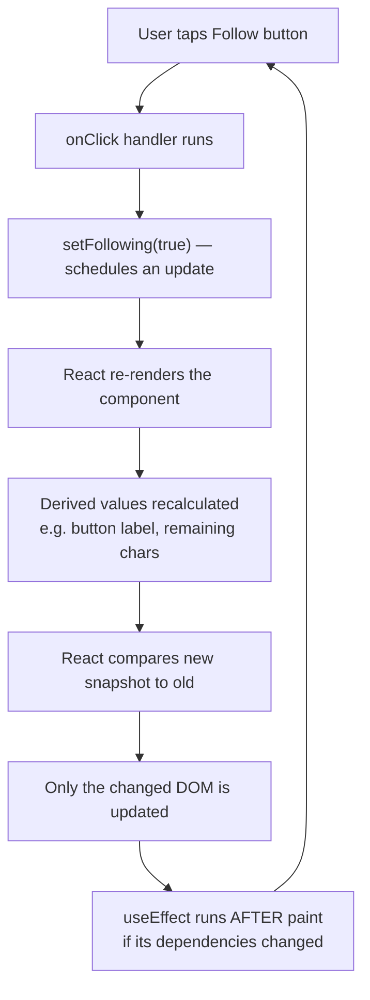

# Chapter 4 — State, Events & Effects

> Your Viby screen is about to stop being a poster on a wall and start being a living thing that *remembers, reacts, and breathes.*

## What you'll learn

- **State** with `useState` — how a component remembers things (like how many people you've followed)
- **Event handling** — making buttons, taps, and typing actually *do* something
- **Controlled inputs** — owning every keystroke in a text field
- **Lifting state up** — letting two components share one source of truth
- **`useEffect`** — talking to the outside world, and the bigger lesson: *when NOT to use it*
- **Derived state** — values you calculate instead of store (a beginner superpower)
- **The React render model** — the mental model that makes all of the above click

## Prerequisites

You should have finished **Chapter 2 (Components & JSX)** and **Chapter 3 (Props & Composition)**. You need to be comfortable writing a component, passing props into it, and reading them. We'll also lean on the `"use client"` boundary idea from Chapter 3 — in Next.js 16 everything is a **Server Component** until you opt into the browser. State and events live in the browser, so this is our first heavily client-side chapter.

---

## Theory

### A component is a snapshot, not a whiteboard

Beginners usually imagine a component as a whiteboard: you draw something, then you walk back up and erase a number and rewrite it. That is **not** how React works, and unlearning the whiteboard is the single most important thing in this chapter.

Instead, think of a React component as a **photographer**. Every time something changes, React doesn't edit the old photo — it asks your component to take a brand-new photo of how things look *right now*. That new snapshot replaces the old one on screen. This taking-a-new-photo is called a **render**.

So the real question becomes: *what makes React take a new photo?* The answer is **state**.

### State: the component's memory

**State** is data that a component remembers between renders, and that — when changed — tells React "take a new photo."

Analogy: state is the **counter on a coffee shop's "now serving" sign**. The number lives somewhere persistent. When the barista bumps it, the sign visibly updates. In React, `useState` is that sign.

```tsx
const [following, setFollowing] = useState(false);
```

Read this left to right:

- `following` — the current value (the photo you're looking at right now)
- `setFollowing` — the **only** legal way to change it ("bump the sign")
- `useState(false)` — the starting value

The golden rule: **never reassign the variable directly** (`following = true` does nothing useful). You call `setFollowing(true)`, which tells React to re-render with the new value. The setter is the doorbell; reassigning is knocking on the window and hoping someone hears.

### Events: how the user talks to your app

An **event** is something the user does — a tap, a click, a keystroke, a hover. In React you respond to events with **handlers**: functions you hand to JSX like `onClick={...}`.

Analogy: an event handler is a **doorbell wired to an action**. You don't run the action now; you *connect the wire* and wait. That's why you pass the function (`onClick={handleClick}`) instead of calling it (`onClick={handleClick()}` — wrong, that rings the bell immediately at render time).

### Derived state: don't store what you can calculate

Here's a trap every beginner falls into: storing things in state that you could just *compute*.

Analogy: if you know someone's birthday, you don't keep a sticky note with their age and update it every year — you calculate age from the birthday whenever you need it. The birthday is the source of truth; the age is **derived**.

In Viby: if you store a `members` array, the count of members is `members.length`. Don't keep a separate `memberCount` state — it will drift out of sync the moment you forget to update it. **Derived state means: calculate during render, don't store.**

### Lifting state up: one source of truth

When two components need the same piece of data, you don't give each its own copy — they'd disagree. You move the state **up** to their closest common parent, and pass it down as props.

Analogy: two roommates shouldn't each keep a private grocery list. You put **one** shared list on the fridge (the parent), and both read and write to it.

### `useEffect`: a fire escape, not a front door

`useEffect` lets you run code that reaches **outside** React — fetching data, setting up a subscription, syncing with a non-React system. It runs *after* the render, as a side effect.

The crucial beginner lesson: **most things you reach for `useEffect` for don't need it.** Calculating a value? That's derived state, do it in render. Responding to a click? That's an event handler. `useEffect` is the *fire escape* — there for genuine outside-world syncing (a Supabase Realtime subscription, a browser timer), not the everyday front door.

---

## In practice

Let's build real Viby pieces. These are client components, so they start with `"use client"`.

### 1. `useState` + an event: the Follow button

```tsx
"use client";

import { useState } from "react";

export function FollowButton({ name }: { name: string }) {
  const [following, setFollowing] = useState(false);

  function toggleFollow() {
    setFollowing((prev) => !prev); // flip based on the latest value
  }

  return (
    <button
      onClick={toggleFollow}
      className={`rounded-full px-5 py-2 text-sm font-semibold transition ${
        following
          ? "bg-white text-pink-600 ring-2 ring-pink-500"
          : "bg-pink-500 text-white hover:bg-pink-600"
      }`}
    >
      {following ? `Following ${name}` : `Follow ${name}`}
    </button>
  );
}
```

Notice `setFollowing((prev) => !prev)`. When your new value depends on the old one, **pass a function**. React hands you the freshest value, which sidesteps a whole class of stale-value bugs.

> **Tailwind v4 note:** there's no `tailwind.config.js`. Your brand pink lives in CSS via `@theme`. In `app/globals.css`:
>
> ```css
> @import "tailwindcss";
>
> @theme {
>   --color-pink-500: #ff6fb5; /* Viby bubblegum */
>   --color-pink-600: #ff4fa3;
> }
> ```
>
> Now `bg-pink-500` is on-brand everywhere — define the token once, use it forever.

### 2. Controlled input: the "set your vibe" field

A **controlled input** means React state is the single source of truth for what's in the box. The input shows `value`, and every keystroke calls `onChange` to update that value.

```tsx
"use client";

import { useState } from "react";

export function VibeInput() {
  const [vibe, setVibe] = useState("");

  const MAX = 60;
  const remaining = MAX - vibe.length; // derived — not stored!

  return (
    <div className="space-y-1">
      <input
        type="text"
        value={vibe}
        onChange={(e) => setVibe(e.target.value)}
        maxLength={MAX}
        placeholder="late-night ramen + lo-fi beats"
        className="w-full rounded-xl border border-pink-200 px-4 py-2 outline-none focus:ring-2 focus:ring-pink-500"
      />
      <p className={`text-xs ${remaining < 10 ? "text-pink-600" : "text-gray-400"}`}>
        {remaining} characters left
      </p>
    </div>
  );
}
```

`remaining` is **derived state** in the wild: we never store the count, we compute it from `vibe` on every render. It can never be wrong.

### 3. Lifting state up: a hobby picker that talks to a preview

The picker and the preview both care about *which hobbies are selected*. So the parent owns the state and passes it down.

```tsx
"use client";

import { useState } from "react";

const HOBBIES = ["Bouldering", "Vinyl", "Matcha", "Film photography", "D&D"];

export function HobbyPicker() {
  // State lives in the PARENT — the single source of truth.
  const [selected, setSelected] = useState<string[]>([]);

  function toggle(hobby: string) {
    setSelected((prev) =>
      prev.includes(hobby)
        ? prev.filter((h) => h !== hobby)
        : [...prev, hobby]
    );
  }

  return (
    <div className="space-y-4">
      <ChipGrid hobbies={HOBBIES} selected={selected} onToggle={toggle} />
      <ProfilePreview selected={selected} />
    </div>
  );
}

function ChipGrid({
  hobbies,
  selected,
  onToggle,
}: {
  hobbies: string[];
  selected: string[];
  onToggle: (hobby: string) => void;
}) {
  return (
    <div className="flex flex-wrap gap-2">
      {hobbies.map((hobby) => {
        const isOn = selected.includes(hobby);
        return (
          <button
            key={hobby}
            onClick={() => onToggle(hobby)}
            className={`rounded-full px-4 py-1.5 text-sm transition ${
              isOn ? "bg-pink-500 text-white" : "bg-pink-50 text-pink-700"
            }`}
          >
            {hobby}
          </button>
        );
      })}
    </div>
  );
}

function ProfilePreview({ selected }: { selected: string[] }) {
  // Reads the same lifted state via props — always in sync.
  return (
    <p className="text-sm text-gray-600">
      {selected.length === 0
        ? "Pick a few things you're into ✨"
        : `Your people love: ${selected.join(", ")}`}
    </p>
  );
}
```

The child `ChipGrid` doesn't own anything — it reports clicks **up** via `onToggle`, and the parent updates the shared state. Both children re-render from one truth.

### 4. `useEffect` done right: a live Supabase Realtime subscription

Now a *legitimate* effect. We subscribe to new messages in a Viby chat room. This syncs with an external system (Supabase Realtime), so an effect is correct — and we **clean up** when the component unmounts.

```tsx
"use client";

import { useEffect, useState } from "react";
import { createBrowserClient } from "@supabase/ssr";

type Message = { id: string; body: string };

const supabase = createBrowserClient(
  process.env.NEXT_PUBLIC_SUPABASE_URL!,
  process.env.NEXT_PUBLIC_SUPABASE_ANON_KEY!
);

export function RoomFeed({ roomId }: { roomId: string }) {
  const [messages, setMessages] = useState<Message[]>([]);

  useEffect(() => {
    const channel = supabase
      .channel(`room:${roomId}`)
      .on(
        "postgres_changes",
        { event: "INSERT", schema: "public", table: "messages", filter: `room_id=eq.${roomId}` },
        (payload) => {
          setMessages((prev) => [...prev, payload.new as Message]);
        }
      )
      .subscribe();

    // Cleanup: React runs this when roomId changes or the component unmounts.
    return () => {
      supabase.removeChannel(channel);
    };
  }, [roomId]); // dependency array: re-subscribe only when the room changes

  return (
    <ul className="space-y-2">
      {messages.map((m) => (
        <li key={m.id} className="rounded-lg bg-pink-50 px-3 py-2 text-sm">
          {m.body}
        </li>
      ))}
    </ul>
  );
}
```

Three things make this a *correct* effect: it touches an external system, it has a **dependency array** (`[roomId]`) so it doesn't re-run on every render, and it **returns a cleanup function** so we don't leak subscriptions.

### 5. The thing you should NOT use an effect for

Beginners often write this:

```tsx
// 🚫 ANTI-PATTERN — do not do this
const [members, setMembers] = useState<string[]>([]);
const [count, setCount] = useState(0);

useEffect(() => {
  setCount(members.length); // syncing state from state — causes an extra render
}, [members]);
```

Delete all of it. The count is derived:

```tsx
// ✅ Just calculate it during render
const [members, setMembers] = useState<string[]>([]);
const count = members.length;
```

No effect, no second state, no chance of drift, no extra render. If you can compute it from existing props or state, **compute it** — don't mirror it into `useEffect`.

---

## Architecture / diagram

How a click becomes a new photo on screen — the React render loop:



And lifting state up, visually:

```
                 ┌──────────────────────────┐
                 │   HobbyPicker (parent)   │
                 │   state: selected[]      │  ◄── single source of truth
                 └───────────┬──────────────┘
              props ↓ selected, onToggle      props ↓ selected
        ┌───────────────────┐         ┌────────────────────┐
        │   ChipGrid        │         │  ProfilePreview    │
        │ (reports clicks ↑)│         │  (reads only)      │
        └───────────────────┘         └────────────────────┘
```

---

## Best practices & pitfalls

- **Do** update state with the setter, never by reassigning the variable. `setX(...)`, not `x = ...`.
- **Do** use the updater function (`setX((prev) => ...)`) whenever the next value depends on the previous one.
- **Don't** mutate state directly. `arr.push(x)` then `setArr(arr)` won't re-render reliably — make a *new* array: `setArr([...arr, x])`.
- **Do** prefer **derived state** over storing computed values. If it can be calculated, calculate it.
- **Don't** use `useEffect` to sync one piece of state from another — that's a derived-state smell.
- **Do** pass the handler, not the call: `onClick={handle}` ✅, `onClick={handle()}` 🚫 (the second runs at render).
- **Do** give a `key` to every item in a `.map()` — a stable ID, not the array index when the list reorders.
- **Don't** forget the **cleanup function** in effects that subscribe or set timers — leaks cause ghost updates and warnings.
- **Do** keep the dependency array honest: list every value from the component the effect reads. Lying to it causes stale data.
- **Remember**: `useState`/`useEffect` only work in `"use client"` components. Server Components (the Next.js 16 default) have no state.

---

## Exercises

1. **Warm-up.** Add a `LikeButton` to a Viby post that shows a heart and a count. Tapping toggles liked/unliked and bumps the count up or down. Use one `useState` and the updater function.

2. **Controlled + derived.** Build a `BioField` (textarea) capped at 150 characters. Show a live counter that turns pink when fewer than 20 remain. The counter must be **derived**, not stored.

3. **Lift it up.** Make a `RoomFilter` with a search box and a `RoomList` below it. The typed query lives in the **parent**; the list shows only rooms whose name includes the query (case-insensitive). Filtering is derived state.

4. **Effect with cleanup.** Build an `OnlineDot` that flips between "online" and "away" every 5 seconds using `setInterval` inside `useEffect`. Clear the interval in the cleanup function. (Then ask yourself: could a timer like this ever be derived? Why not?)

5. **Spot the anti-pattern.** Take exercise 2 and *intentionally* rewrite the counter using `useState` + `useEffect`. Notice the extra render and the risk of drift, then revert. Naming the smell is half of avoiding it.

---

## Mini-project: the "Find Your People" onboarding card

Build one polished client component, `FindYourPeople`, combining everything:

- A **controlled** name input and a **controlled** vibe input.
- A row of hobby chips (**lifted state**, multi-select) — reuse the pattern from In Practice #3.
- A live **derived** readiness check: the "Done" button is enabled only when name is non-empty **and** at least 2 hobbies are picked. Compute `const canFinish = name.trim() !== "" && selected.length >= 2;` — no extra state.
- A Framer Motion flourish: animate each selected chip in with `AnimatePresence`, and pop the "Done" button when it becomes enabled.

```tsx
"use client";

import { useState } from "react";
import { motion, AnimatePresence } from "framer-motion";

const HOBBIES = ["Bouldering", "Vinyl", "Matcha", "Film", "D&D", "Running"];

export function FindYourPeople() {
  const [name, setName] = useState("");
  const [selected, setSelected] = useState<string[]>([]);

  const canFinish = name.trim() !== "" && selected.length >= 2; // derived

  function toggle(hobby: string) {
    setSelected((prev) =>
      prev.includes(hobby) ? prev.filter((h) => h !== hobby) : [...prev, hobby]
    );
  }

  return (
    <div className="mx-auto max-w-sm space-y-4 rounded-2xl bg-white p-6 shadow-lg">
      <input
        value={name}
        onChange={(e) => setName(e.target.value)}
        placeholder="Your name"
        className="w-full rounded-xl border border-pink-200 px-4 py-2 outline-none focus:ring-2 focus:ring-pink-500"
      />

      <div className="flex flex-wrap gap-2">
        {HOBBIES.map((hobby) => {
          const isOn = selected.includes(hobby);
          return (
            <button
              key={hobby}
              onClick={() => toggle(hobby)}
              className={`rounded-full px-3 py-1.5 text-sm transition ${
                isOn ? "bg-pink-500 text-white" : "bg-pink-50 text-pink-700"
              }`}
            >
              {hobby}
            </button>
          );
        })}
      </div>

      <AnimatePresence>
        {selected.length > 0 && (
          <motion.p
            initial={{ opacity: 0, y: 4 }}
            animate={{ opacity: 1, y: 0 }}
            exit={{ opacity: 0 }}
            className="text-sm text-gray-600"
          >
            Matching you with people who love {selected.join(", ")}
          </motion.p>
        )}
      </AnimatePresence>

      <motion.button
        disabled={!canFinish}
        animate={{ scale: canFinish ? 1.03 : 1 }}
        className="w-full rounded-full bg-pink-500 py-2 font-semibold text-white disabled:opacity-40"
      >
        Find my people
      </motion.button>
    </div>
  );
}
```

Ship it, tap around, and watch how *one* change to state ripples through derived values and animations — with zero `useEffect` needed.

---

## Key takeaways

- A render is React **taking a new photo**; state changes are what trigger it.
- `useState` gives you `[value, setter]` — change state only through the setter, and use the updater function when the next value depends on the old.
- Event handlers are wires you connect (`onClick={fn}`), not actions you run now.
- **Controlled inputs** make React state the single source of truth for form fields.
- **Lift state up** to the closest common parent when components must share it.
- **Derived state** > stored state: if you can calculate it, don't store it.
- `useEffect` is for syncing with the **outside world** (subscriptions, timers) — and it usually needs a dependency array *and* a cleanup function. Most "effects" beginners write should be derived state or event handlers instead.

**Up next — Chapter 5: Data Fetching & Server Actions**, where we leave in-memory state behind and start reading and writing real Viby data with Supabase, Server Components, and the `"use server"` directive.
