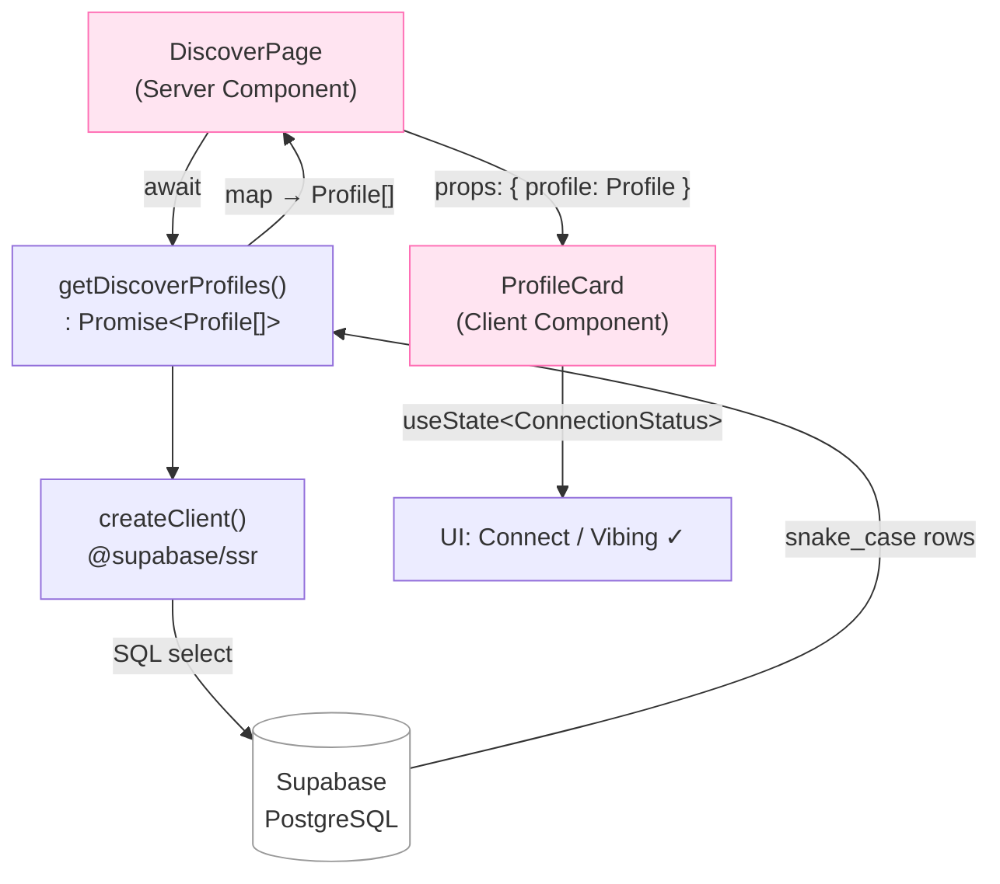

# Chapter 5 — TypeScript for React + Talking to APIs

> Give your code a memory and a conscience: types catch your mistakes before your users ever do.

## What you'll learn

- What TypeScript is and *why* it makes you a faster, calmer developer
- Core building blocks: `type`, `interface`, **union types**, and **generics**
- How to type React **props** and **state** so your components can't be misused
- `fetch`, `async/await`, promises, and JSON — how the browser talks to a server
- How to describe an API response with types and build a small, fully-typed **data layer** for Viby

## Prerequisites

- Chapter 2 (JavaScript fundamentals — variables, functions, objects, arrays)
- Chapter 3 (your first React components and JSX)
- Chapter 4 (props, state with `useState`, and the component tree)

You don't need to have written a single line of TypeScript before. We start from zero.

---

## Theory

### Why types? The "labeled jars" analogy

Imagine a kitchen where every jar is unlabeled. One looks like sugar but is salt. You only find out when the cake is ruined. JavaScript is that kitchen — a variable can hold a number now and a string five lines later, and nobody warns you until everything's in the oven (production).

**TypeScript adds labels to the jars.** You say "this jar holds `string`," and if you ever try to pour a `number` in, TypeScript stops you *while you're cooking* — in your editor, with a red squiggle — not after a user has already tasted the result.

TypeScript is just JavaScript with a type-checker bolted on. The browser never runs TypeScript directly; it gets *compiled* to plain JavaScript first. The types are a safety net for **you**, the developer, and they vanish at runtime.

### Types and interfaces — describing the shape of things

The smallest labels are the **primitive types**: `string`, `number`, `boolean`.

```ts
let displayName: string = "Aria";
let age: number = 24;
let isOnline: boolean = true;
```

But Viby is full of *objects* — a user, a hobby, a message. To describe an object's shape, we use a `type` or an `interface`. Think of them as a **form template**: every field is named, and every field has an expected kind of value.

```ts
type Hobby = {
  id: string;
  label: string;        // e.g. "Bouldering"
  emoji: string;        // e.g. "🧗"
};
```

`interface` does almost the same job and reads nearly identically:

```ts
interface Profile {
  id: string;
  username: string;
  bio: string;
  hobbies: Hobby[];     // an array of Hobby objects
}
```

**Rule of thumb:** use `interface` for object shapes (especially things others might extend), and `type` when you need unions, intersections, or to name something that isn't a plain object. In practice they're interchangeable for most day-to-day work — pick one and stay consistent.

### Union types — "one of these, exactly"

Sometimes a value is one of a small, fixed set of options. A Viby connection request is `"pending"`, `"accepted"`, or `"declined"` — never `"banana"`. A **union** (the `|` symbol, read as "or") expresses exactly that:

```ts
type ConnectionStatus = "pending" | "accepted" | "declined";

let status: ConnectionStatus = "pending"; // ✅
// let status: ConnectionStatus = "maybe"; // ❌ red squiggle — not allowed
```

Unions are like a vending machine with three buttons. You can press A, B, or C. There is no button for "whatever I feel like." This single feature eliminates a whole category of typo bugs.

### Generics — a type with a blank to fill in

Here's the analogy that makes generics click: a generic is a **shipping box that takes a label**. The box is always the same shape, but you write on the side what's inside — "📦 of shoes," "📦 of books." In TypeScript, that label is written in angle brackets `<T>`, where `T` is a placeholder you fill in later.

You already use generics without knowing it: `Hobby[]` is shorthand for `Array<Hobby>` — "an array **of** Hobby."

Generics let you write *one* reusable function or type that works for *any* content while still keeping it precisely typed:

```ts
// A box that wraps any successful API result alongside a count.
type ApiList<T> = {
  data: T[];
  count: number;
};

type HobbyList = ApiList<Hobby>;    // data is Hobby[]
type ProfileList = ApiList<Profile>; // data is Profile[]
```

One template, infinite specific shapes. That's the power.

### Talking to APIs — the restaurant model

Your React app is the customer. The server (Supabase, in Viby) is the kitchen. Between them, a **waiter** carries your order out and the food back. That waiter is `fetch`.

The catch: the kitchen takes *time*. You don't freeze at the table staring at the wall — you chat, you wait, the food arrives later. In code, that "later" is a **Promise**: an IOU that says "I'll give you a value eventually — either the data, or an error."

`async/await` is the polite way to wait for a Promise. `await` means "pause here until the IOU is fulfilled, then continue with the real value."

```ts
async function getJoke() {
  const response = await fetch("https://api.example.com/joke");
  const data = await response.json(); // parse the JSON body
  return data;
}
```

**JSON** (JavaScript Object Notation) is the universal language servers and browsers use to exchange data — basically a JavaScript object written as text. `response.json()` turns that text back into a usable object. Crucially, `fetch` gives back `any`/`unknown` shaped data — TypeScript can't *know* what the server sent, so **we** must describe it. That's the bridge between this chapter's two halves.

---

## In practice

Let's build a small, real **data layer** for Viby: typed models, a typed fetch helper, and a Supabase-backed query — the exact pattern you'll reuse all book long.

### 1. Define the domain models

Create `lib/types.ts`. This is the single source of truth for what a Viby user looks like.

```ts
// lib/types.ts
export interface Hobby {
  id: string;
  label: string;
  emoji: string;
}

export type ConnectionStatus = "pending" | "accepted" | "declined";

export interface Profile {
  id: string;
  username: string;
  bio: string;
  avatarUrl: string | null; // null when no photo uploaded yet
  hobbies: Hobby[];
}

// A reusable, generic envelope for any list response.
export interface ApiList<T> {
  data: T[];
  count: number;
}
```

### 2. A typed `fetch` helper using generics

`fetch` returns untyped data. We wrap it once so every call site gets full type safety for free. The generic `<T>` is the "label on the box."

```ts
// lib/api.ts
export async function fetchJson<T>(url: string): Promise<T> {
  const res = await fetch(url);

  if (!res.ok) {
    // Always handle the unhappy path — servers fail.
    throw new Error(`Request failed: ${res.status} ${res.statusText}`);
  }

  const json = (await res.json()) as T;
  return json;
}
```

Now calling it tells TypeScript exactly what comes back:

```ts
import { fetchJson } from "@/lib/api";
import type { ApiList, Profile } from "@/lib/types";

// `discover` is now fully typed as ApiList<Profile> — autocomplete everywhere.
const discover = await fetchJson<ApiList<Profile>>("/api/discover");
console.log(discover.count, discover.data[0].username);
```

### 3. The real Viby data layer with Supabase (Server Component)

In Next.js 16, components are **Server Components by default** — they can talk to the database directly, no `fetch` round-trip needed. We use `@supabase/ssr` with the `getAll`/`setAll` cookie handlers.

```ts
// lib/supabase/server.ts
import { createServerClient } from "@supabase/ssr";
import { cookies } from "next/headers";

export async function createClient() {
  const cookieStore = await cookies(); // async in Next.js 16

  return createServerClient(
    process.env.NEXT_PUBLIC_SUPABASE_URL!,
    process.env.NEXT_PUBLIC_SUPABASE_ANON_KEY!,
    {
      cookies: {
        getAll() {
          return cookieStore.getAll();
        },
        setAll(cookiesToSet) {
          cookiesToSet.forEach(({ name, value, options }) =>
            cookieStore.set(name, value, options)
          );
        },
      },
    }
  );
}
```

Now a typed data-access function. Notice the return type `Promise<Profile[]>` — the contract is explicit:

```ts
// lib/queries.ts
import { createClient } from "@/lib/supabase/server";
import type { Profile } from "@/lib/types";

export async function getDiscoverProfiles(): Promise<Profile[]> {
  const supabase = await createClient();

  const { data, error } = await supabase
    .from("profiles")
    .select("id, username, bio, avatar_url, hobbies")
    .limit(20);

  if (error) {
    throw new Error(`Failed to load profiles: ${error.message}`);
  }

  // Map the DB's snake_case row to our camelCase Profile model.
  return (data ?? []).map((row) => ({
    id: row.id,
    username: row.username,
    bio: row.bio,
    avatarUrl: row.avatar_url,
    hobbies: row.hobbies ?? [],
  }));
}
```

### 4. Typing props and state in a component

Here's a `ProfileCard` that consumes our `Profile` type. Props get an `interface`; the Server Component awaits the data layer.

```tsx
// app/discover/page.tsx  (Server Component — no "use client")
import { getDiscoverProfiles } from "@/lib/queries";
import { ProfileCard } from "@/components/profile-card";

export default async function DiscoverPage() {
  const profiles = await getDiscoverProfiles();

  return (
    <main className="mx-auto max-w-md space-y-4 p-4">
      <h1 className="text-2xl font-bold text-brand">Discover your people</h1>
      {profiles.map((profile) => (
        <ProfileCard key={profile.id} profile={profile} />
      ))}
    </main>
  );
}
```

```tsx
// components/profile-card.tsx
"use client";

import { useState } from "react";
import { motion } from "framer-motion";
import type { Profile, ConnectionStatus } from "@/lib/types";

interface ProfileCardProps {
  profile: Profile;
}

export function ProfileCard({ profile }: ProfileCardProps) {
  // State is typed by the union — only valid statuses allowed.
  const [status, setStatus] = useState<ConnectionStatus>("pending");

  return (
    <motion.article
      whileHover={{ scale: 1.02 }}
      whileTap={{ scale: 0.98 }}
      className="rounded-2xl bg-white p-4 shadow-sm ring-1 ring-pink-100"
    >
      <h2 className="text-lg font-semibold">@{profile.username}</h2>
      <p className="mt-1 text-sm text-gray-600">{profile.bio}</p>

      <ul className="mt-3 flex flex-wrap gap-2">
        {profile.hobbies.map((hobby) => (
          <li
            key={hobby.id}
            className="rounded-full bg-pink-50 px-3 py-1 text-sm"
          >
            {hobby.emoji} {hobby.label}
          </li>
        ))}
      </ul>

      <button
        onClick={() => setStatus("accepted")}
        disabled={status === "accepted"}
        className="mt-4 w-full rounded-full bg-brand py-2 font-medium text-white disabled:opacity-50"
      >
        {status === "accepted" ? "Vibing ✓" : "Connect"}
      </button>
    </motion.article>
  );
}
```

The brand token comes from Tailwind v4's CSS-first config — no `tailwind.config.js`:

```css
/* app/globals.css */
@import "tailwindcss";

@theme {
  --color-brand: #ff6fb5;
}
```

---

## Architecture / diagram

How a typed request flows through Viby, from page render to database and back — with types guarding every boundary:



Notice the type annotations sitting on the *edges*: `Promise<Profile[]>` at the data layer, `{ profile: Profile }` at the prop boundary, `ConnectionStatus` at the state. Each is a checkpoint where TypeScript verifies the data is the right shape before it's allowed through.

---

## Best practices & pitfalls

- **Do** define your domain models once in `lib/types.ts` and import them everywhere. One source of truth = no drift.
- **Do** type the return value of every data-layer function (`Promise<Profile[]>`). It documents intent and catches mistakes at the source.
- **Do** handle the error path of every `fetch`/Supabase call. Networks fail; `res.ok` and `error` exist for a reason.
- **Don't** reach for `any`. It silences the type-checker and re-introduces the unlabeled-jar problem. Prefer `unknown` and then narrow.
- **Don't** annotate what TypeScript already infers. `const name = "Aria"` is already `string` — adding `: string` is noise. Let inference do the work; annotate boundaries (props, returns, state) explicitly.
- **Don't** forget `key` on mapped lists, and don't put `"use client"` on a component that doesn't need interactivity — Server Components are the default for a reason.
- **Pitfall:** `await cookies()` and `await params` are *async* in Next.js 16. Forgetting the `await` is a common early bug.

---

## Exercises

1. **Warm-up.** In `lib/types.ts`, add an `interface Message` with `id: string`, `senderId: string`, `body: string`, and `sentAt: string`. Export it.
2. **Unions.** Add a union type `Vibe = "chill" | "adventurous" | "creative" | "social"` and add an optional `vibe?: Vibe` field to `Profile`. Why does the `?` matter?
3. **Generics.** Write a generic function `first<T>(items: T[]): T | undefined` that returns the first element of any array, or `undefined` if it's empty. Test it on a `Profile[]` and a `Hobby[]`.
4. **Async + types.** Using `fetchJson<T>`, write `getProfile(id: string): Promise<Profile>` that calls `/api/profiles/${id}`. Add proper error handling.
5. **Stretch.** Make `ProfileCard` accept an optional `onConnect?: (id: string) => void` prop and call it inside the button's `onClick`. Type the prop precisely.

---

## Mini-project: a typed "Hobby Match" badge

Build a small client component, `HobbyMatch`, that takes the current user's hobbies and another profile, computes how many hobbies they share, and renders an animated match badge.

```tsx
// components/hobby-match.tsx
"use client";

import { motion, AnimatePresence } from "framer-motion";
import type { Hobby, Profile } from "@/lib/types";

interface HobbyMatchProps {
  myHobbies: Hobby[];
  profile: Profile;
}

function countShared(mine: Hobby[], theirs: Hobby[]): number {
  const myIds = new Set(mine.map((h) => h.id));
  return theirs.filter((h) => myIds.has(h.id)).length;
}

export function HobbyMatch({ myHobbies, profile }: HobbyMatchProps) {
  const shared = countShared(myHobbies, profile.hobbies);

  return (
    <AnimatePresence>
      {shared > 0 && (
        <motion.span
          initial={{ scale: 0, opacity: 0 }}
          animate={{ scale: 1, opacity: 1 }}
          exit={{ scale: 0, opacity: 0 }}
          className="inline-block rounded-full bg-brand px-3 py-1 text-sm font-semibold text-white"
        >
          ✨ {shared} shared {shared === 1 ? "hobby" : "hobbies"}
        </motion.span>
      )}
    </AnimatePresence>
  );
}
```

**Your task:** wire `HobbyMatch` into `ProfileCard`, passing a hard-coded `myHobbies` array for now. Confirm that:
- TypeScript refuses to compile if you pass a `string[]` instead of `Hobby[]`.
- The badge animates in only when there's at least one shared hobby.

You've just shipped a typed, animated, data-driven feature — the same loop you'll repeat for every Viby screen.

---

## Key takeaways

- TypeScript = JavaScript + labeled jars: errors surface in your editor, not in production.
- `type`/`interface` describe object shapes; **unions** (`|`) lock a value to a fixed set; **generics** (`<T>`) make one template work for any content.
- Annotate the **boundaries** — props, state, and function returns — and let inference handle the rest.
- `fetch` + `async/await` + Promises are how your app talks to a server; **you** must type what comes back, because the server can't.
- A typed data layer (`lib/types.ts`, `lib/queries.ts`) is the backbone of a maintainable app.

**Up next — Chapter 6:** styling Viby with Tailwind CSS v4, design tokens via `@theme`, and building our first polished, on-brand component library.
