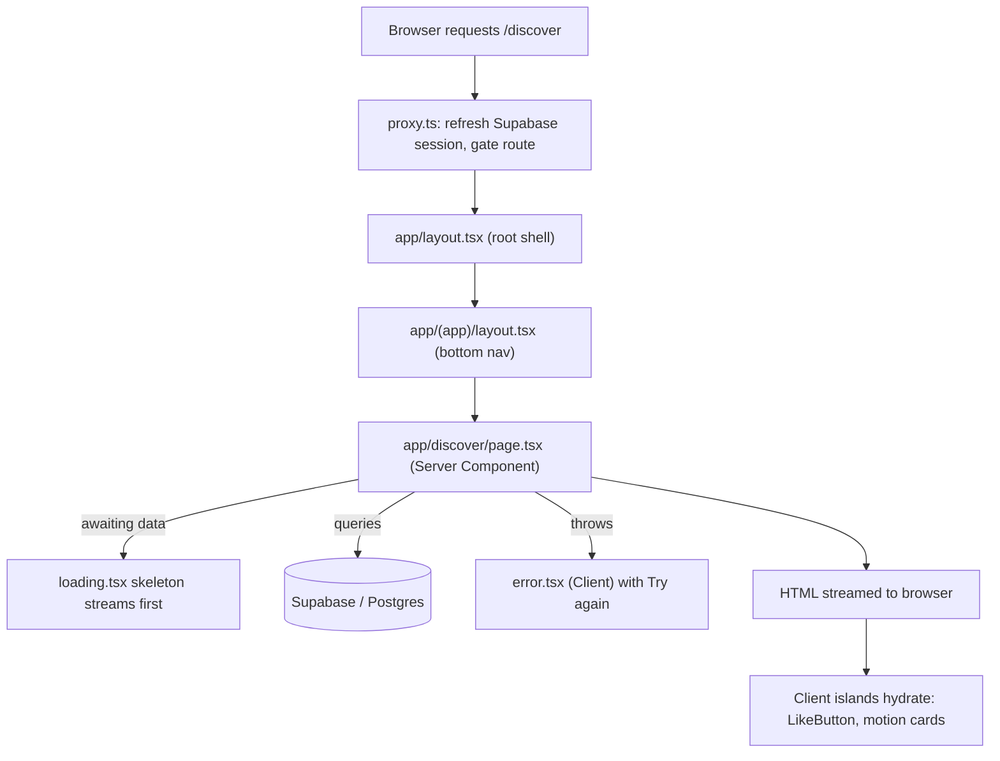

# Chapter 6 — Next.js & the App Router

> You already know React. This chapter is where React grows up, moves to the city, and gets a real job shipping a production app.

## What you'll learn

- Why we reach for a *framework* like Next.js instead of wiring React together by hand
- How the **App Router** turns folders and files into routes — no router config, ever
- The job of each special file: `page`, `layout`, `loading`, `error`, and `route`
- The difference between **Server Components** (the default) and **Client Components** (`"use client"`)
- How async `params`, **Server Actions**, and `proxy.ts` fit together
- How the real **Viby** project is organized so you can navigate it like a local

## Prerequisites

- Chapter 3 (HTML/CSS fundamentals) and Chapter 4 (modern JavaScript & TypeScript)
- Chapter 5 (React 19: components, props, hooks, the client/server mental model)
- A working Node.js + pnpm setup from Chapter 2, and the Viby repo cloned locally

---

## Theory

### Why a framework at all?

Plain React gives you components and a way to render them into a `<div>`. That's it. The moment you ship a *real* product, you discover a long list of things React deliberately does **not** solve:

- Routing (which URL shows which screen?)
- Server rendering for fast first paint and SEO
- Data fetching that doesn't waterfall into a loading-spinner swamp
- Bundling, code-splitting, image optimization, caching
- A safe place to run secret code (API keys, database queries) that never reaches the browser

You *can* assemble all of this yourself with Vite + React Router + a custom Express server + a dozen config files. People did, for years. It's a part-time job to maintain.

**A framework is a set of strong, well-tested decisions made for you.** Think of plain React as a pile of premium car parts: a great engine, great seats, great wheels. **Next.js is the assembled car** — the parts are bolted together in the right order, the wiring works, and you can just *drive*. You give up a little freedom in exchange for a lot of speed and a lot fewer 2 a.m. bugs.

### The big idea: the server is back

For a decade, the trend was "ship everything to the browser." React apps became huge JavaScript bundles that downloaded, then ran, then *finally* fetched data, then *finally* showed pixels.

The App Router flips this. By default, **your components run on the server**, render to HTML, and stream that HTML to the browser instantly. JavaScript is shipped only for the *interactive* parts. These server-by-default components are called **React Server Components (RSC)**.

Analogy: the old way mailed customers a flat-pack and an Allen key — "assemble the page yourself." The App Router ships the furniture **already built**, and only includes a screwdriver for the one drawer that needs to open and close.

### Folders are routes

The App Router's central trick: **the file system *is* the router.** A folder inside `app/` becomes a URL segment. Drop a `page.tsx` in it and that URL becomes visitable. No route table, no `<Route path=...>` — the structure on disk *is* the structure of your site.

```
app/discover/page.tsx   →   /discover
app/profile/page.tsx    →   /profile
```

### Server vs. Client Components

This is the single most important mental model in modern Next.js:

| | Server Component (default) | Client Component (`"use client"`) |
|---|---|---|
| Runs where | On the server | In the browser (and once on the server for the initial HTML) |
| Can do | `await` data, read DB/secrets, big deps | `useState`, `useEffect`, `onClick`, browser APIs |
| Ships JS to browser | No | Yes |
| Use for | Pages, layouts, data fetching | Buttons, forms, animations, anything interactive |

Rule of thumb: **stay on the server until you can't.** Add `"use client"` only at the leaf where you actually need interactivity (a like button, an animated card), and keep that island as small as possible.

---

## In practice

Let's build the real Viby pieces. We'll assume Next.js 16, React 19, Tailwind v4, and Supabase via `@supabase/ssr`.

### A page (Server Component, the default)

No directive needed — this runs on the server and can `await` data directly.

```tsx
// app/discover/page.tsx
import { createClient } from "@/lib/supabase/server";
import { VibeCard } from "@/components/vibe-card";

export default async function DiscoverPage() {
  const supabase = await createClient();
  const { data: people } = await supabase
    .from("profiles")
    .select("id, display_name, avatar_url, hobbies")
    .limit(20);

  return (
    <main className="mx-auto max-w-md px-4 py-6">
      <h1 className="text-2xl font-bold text-brand">Discover your people</h1>
      <div className="mt-4 grid gap-4">
        {people?.map((p) => (
          <VibeCard key={p.id} profile={p} />
        ))}
      </div>
    </main>
  );
}
```

Notice `text-brand` — that's our bubblegum pink, defined once in Tailwind v4's CSS theme (no `tailwind.config.js`):

```css
/* app/globals.css */
@import "tailwindcss";

@theme {
  --color-brand: #ff6fb5;
  --color-brand-foreground: #ffffff;
  --font-display: "Clash Display", ui-sans-serif, system-ui;
}
```

### The Supabase server client (`@supabase/ssr`)

The modern pattern uses `createServerClient` with `getAll` / `setAll` cookie handlers — never the deprecated single-cookie API.

```ts
// lib/supabase/server.ts
import { createServerClient } from "@supabase/ssr";
import { cookies } from "next/headers";

export async function createClient() {
  const cookieStore = await cookies();

  return createServerClient(
    process.env.NEXT_PUBLIC_SUPABASE_URL!,
    process.env.NEXT_PUBLIC_SUPABASE_ANON_KEY!,
    {
      cookies: {
        getAll: () => cookieStore.getAll(),
        setAll: (cookiesToSet) => {
          try {
            cookiesToSet.forEach(({ name, value, options }) =>
              cookieStore.set(name, value, options)
            );
          } catch {
            // Called from a Server Component — safe to ignore; proxy refreshes.
          }
        },
      },
    }
  );
}
```

And the browser client for Client Components:

```ts
// lib/supabase/client.ts
import { createBrowserClient } from "@supabase/ssr";

export function createClient() {
  return createBrowserClient(
    process.env.NEXT_PUBLIC_SUPABASE_URL!,
    process.env.NEXT_PUBLIC_SUPABASE_ANON_KEY!
  );
}
```

### A layout (shared shell)

Layouts wrap every page beneath them and **persist across navigation** — they don't re-render or unmount when you move between child routes. Perfect for nav bars.

```tsx
// app/layout.tsx — the root layout
import type { Metadata } from "next";
import "./globals.css";

export const metadata: Metadata = {
  title: "Viby — find your people",
  description: "Make friends through shared hobbies and lifestyle.",
};

export default function RootLayout({
  children,
}: {
  children: React.ReactNode;
}) {
  return (
    <html lang="en">
      <body className="bg-white text-neutral-900 antialiased">{children}</body>
    </html>
  );
}
```

```tsx
// app/(app)/layout.tsx — shared shell for the signed-in experience
import { BottomNav } from "@/components/bottom-nav";

export default function AppLayout({
  children,
}: {
  children: React.ReactNode;
}) {
  return (
    <div className="min-h-dvh pb-16">
      {children}
      <BottomNav />
    </div>
  );
}
```

`(app)` is a **route group** — the parentheses mean "group these routes for layout/organization, but don't add `app` to the URL."

### `loading.tsx` — instant skeletons

Drop a `loading.tsx` next to a page and Next.js automatically wraps it in a `<Suspense>` boundary. While the server component awaits data, the user sees this instead of a frozen screen.

```tsx
// app/discover/loading.tsx
export default function Loading() {
  return (
    <div className="mx-auto max-w-md px-4 py-6">
      <div className="h-8 w-48 animate-pulse rounded-full bg-neutral-200" />
      <div className="mt-4 grid gap-4">
        {Array.from({ length: 4 }).map((_, i) => (
          <div key={i} className="h-32 animate-pulse rounded-2xl bg-neutral-100" />
        ))}
      </div>
    </div>
  );
}
```

### `error.tsx` — graceful recovery

Error files **must** be Client Components (they receive a `reset` function and need state).

```tsx
// app/discover/error.tsx
"use client";

export default function Error({
  error,
  reset,
}: {
  error: Error & { digest?: string };
  reset: () => void;
}) {
  return (
    <div className="mx-auto max-w-md px-4 py-12 text-center">
      <p className="text-lg font-semibold">That vibe didn&apos;t load.</p>
      <p className="mt-1 text-sm text-neutral-500">{error.message}</p>
      <button
        onClick={reset}
        className="mt-4 rounded-full bg-brand px-5 py-2 font-medium text-brand-foreground"
      >
        Try again
      </button>
    </div>
  );
}
```

### Dynamic routes & async `params`

In Next.js 16, `params` is a **Promise** — you `await` it (or unwrap it with React's `use()` in a Client Component).

```tsx
// app/profile/[username]/page.tsx
import { createClient } from "@/lib/supabase/server";
import { notFound } from "next/navigation";

export default async function ProfilePage({
  params,
}: {
  params: Promise<{ username: string }>;
}) {
  const { username } = await params;
  const supabase = await createClient();

  const { data: profile } = await supabase
    .from("profiles")
    .select("*")
    .eq("username", username)
    .single();

  if (!profile) notFound();

  return <h1 className="text-2xl font-bold">{profile.display_name}</h1>;
}
```

### A Client Component with Framer Motion

Here's a Viby "like" button — interactive, animated, and a small island of client JS.

```tsx
// components/like-button.tsx
"use client";

import { useState } from "react";
import { motion } from "framer-motion";

export function LikeButton({ initialLiked = false }: { initialLiked?: boolean }) {
  const [liked, setLiked] = useState(initialLiked);

  return (
    <motion.button
      whileTap={{ scale: 0.85 }}
      onClick={() => setLiked((v) => !v)}
      aria-pressed={liked}
      className="rounded-full p-2"
    >
      <motion.span
        animate={{ scale: liked ? [1, 1.4, 1] : 1, color: liked ? "#ff6fb5" : "#a3a3a3" }}
        transition={{ duration: 0.25 }}
        className="text-2xl"
      >
        ♥
      </motion.span>
    </motion.button>
  );
}
```

### A Server Action (`"use server"`)

Server Actions let a form mutate data **without** writing an API route. Define the function with `"use server"`, pass it straight to a `<form>`.

```tsx
// app/onboarding/page.tsx
import { createClient } from "@/lib/supabase/server";
import { revalidatePath } from "next/cache";
import { redirect } from "next/navigation";

export default function OnboardingPage() {
  async function saveHobbies(formData: FormData) {
    "use server";
    const hobbies = formData.getAll("hobby").map(String);
    const supabase = await createClient();
    const { data: { user } } = await supabase.auth.getUser();
    if (!user) redirect("/login");

    await supabase.from("profiles").update({ hobbies }).eq("id", user.id);
    revalidatePath("/discover");
    redirect("/discover");
  }

  return (
    <form action={saveHobbies} className="mx-auto max-w-md space-y-4 p-6">
      {["Climbing", "Vinyl", "Ramen", "Film photography"].map((h) => (
        <label key={h} className="flex items-center gap-2">
          <input type="checkbox" name="hobby" value={h} /> {h}
        </label>
      ))}
      <button className="rounded-full bg-brand px-5 py-2 text-brand-foreground">
        Save & continue
      </button>
    </form>
  );
}
```

### A Route Handler (`route.ts`)

When you need a raw HTTP endpoint (webhooks, third-party callbacks), use `route.ts` with named exports per method. Viby uses one for the Supabase auth callback:

```ts
// app/auth/callback/route.ts
import { NextResponse } from "next/server";
import { createClient } from "@/lib/supabase/server";

export async function GET(request: Request) {
  const { searchParams, origin } = new URL(request.url);
  const code = searchParams.get("code");

  if (code) {
    const supabase = await createClient();
    await supabase.auth.exchangeCodeForSession(code);
  }
  return NextResponse.redirect(`${origin}/discover`);
}
```

> A folder can contain **either** a `page.tsx` **or** a `route.ts` for the same segment — not both. Pages render UI; route handlers return data.

### Middleware-style logic with `proxy.ts`

For cross-cutting logic that runs *before* a request resolves — refreshing the Supabase session, gating protected routes — Viby uses a root **`proxy.ts`** (the modern replacement for the old `middleware.ts`).

```ts
// proxy.ts
import { type NextRequest, NextResponse } from "next/server";
import { createServerClient } from "@supabase/ssr";

export async function proxy(request: NextRequest) {
  const response = NextResponse.next({ request });

  const supabase = createServerClient(
    process.env.NEXT_PUBLIC_SUPABASE_URL!,
    process.env.NEXT_PUBLIC_SUPABASE_ANON_KEY!,
    {
      cookies: {
        getAll: () => request.cookies.getAll(),
        setAll: (cookiesToSet) => {
          cookiesToSet.forEach(({ name, value, options }) =>
            response.cookies.set(name, value, options)
          );
        },
      },
    }
  );

  // Refresh the session so Server Components always see a fresh token.
  const { data: { user } } = await supabase.auth.getUser();

  if (!user && request.nextUrl.pathname.startsWith("/discover")) {
    return NextResponse.redirect(new URL("/login", request.url));
  }

  return response;
}

export const config = {
  matcher: ["/((?!_next/static|_next/image|favicon.ico).*)"],
};
```

---

## Architecture / diagram

How a request to `/discover` flows through Viby:



And the folder structure that produces it:

```
app/
├── layout.tsx            → root layout (html/body, metadata)
├── globals.css           → Tailwind v4 @theme tokens
├── page.tsx              → /  (marketing landing)
├── (app)/                → route group (no URL segment)
│   ├── layout.tsx        → signed-in shell + <BottomNav/>
│   ├── discover/
│   │   ├── page.tsx      → /discover
│   │   ├── loading.tsx   → skeleton
│   │   └── error.tsx     → error boundary (Client)
│   └── profile/
│       └── [username]/
│           └── page.tsx  → /profile/:username
├── onboarding/page.tsx   → Server Action form
└── auth/
    └── callback/route.ts → OAuth code exchange
proxy.ts                  → session refresh + route gating
lib/supabase/{server,client}.ts
components/{vibe-card,like-button,bottom-nav}.tsx
```

---

## Best practices & pitfalls

**Do**

- Keep components on the **server by default**; push `"use client"` to the smallest leaf that needs it.
- Co-locate `loading.tsx` and `error.tsx` with the pages they protect — instant UX wins for free.
- `await params` (and `searchParams`) in Next.js 16 — they're Promises now.
- Use Server Actions for mutations from forms before reaching for a route handler.
- Put your secrets in env vars and only read them inside server code.

**Don't**

- Don't slap `"use client"` on a `layout.tsx` or `page.tsx` — it forces the whole subtree to ship as client JS.
- Don't import server-only code (the Supabase server client, `next/headers`) into a Client Component. It'll either error or leak.
- Don't create a `tailwind.config.js` — in v4, tokens live in CSS via `@theme`.
- Don't reach for `useEffect` + `fetch` to load page data; `await` it in a Server Component instead.
- Don't name the middleware file `middleware.ts` in this project — Viby standardizes on `proxy.ts`.
- Don't put both `page.tsx` and `route.ts` in one folder.

---

## Exercises

1. **Warm-up.** Create `app/about/page.tsx` so visiting `/about` shows a short "Why Viby exists" blurb. Confirm it inherits the root layout.
2. **Skeletons.** Add a `loading.tsx` to your `/profile/[username]` route that mimics the profile layout with `animate-pulse` placeholders.
3. **Dynamic + not-found.** In the profile page, call `notFound()` when no profile matches, then add a sibling `not-found.tsx` with a friendly "This person ghosted us" message.
4. **Server Action.** Build a `app/feedback/page.tsx` form with a single textarea that writes to a `feedback` table via a `"use server"` action, then `revalidatePath`.
5. **Stretch.** Add a route group `(marketing)` with its own layout (no bottom nav) for `/`, `/about`, and `/pricing`, while keeping `(app)` for the signed-in screens.

---

## Mini-project: the Viby Discover shell

Build a working `/discover` route end-to-end:

1. Create the `(app)` route group with a `layout.tsx` that renders `children` plus a fixed `<BottomNav>` (Discover · Profile).
2. Add `app/(app)/discover/page.tsx` as a Server Component that fetches up to 12 profiles from Supabase and renders them in a responsive grid of `VibeCard`s (avatar, name, top 3 hobbies as pink pills).
3. Add a `loading.tsx` with shimmering skeleton cards.
4. Add an `error.tsx` (Client) with a **Try again** button wired to `reset()`.
5. Make each `VibeCard` include a client `LikeButton` using Framer Motion's `whileTap` and a heart pop animation.
6. Wire `proxy.ts` to redirect signed-out users hitting `/discover` to `/login`.

When you're done you'll have touched **every** special file in the App Router — and it'll look and feel like a real product, not a tutorial.

---

## Key takeaways

- A framework trades a little freedom for assembled, battle-tested defaults — Next.js is "React, with the car already built."
- In the App Router, **folders are routes** and **components are Server Components by default**.
- Master the five special files: `page` (UI), `layout` (persistent shell), `loading` (Suspense skeleton), `error` (Client boundary), `route` (HTTP endpoint).
- Reach for `"use client"` only at small interactive leaves; keep data fetching on the server with `await`.
- Use modern APIs: async `params`, Server Actions (`"use server"`), `@supabase/ssr` with `getAll`/`setAll`, Tailwind v4 `@theme`, and `proxy.ts` instead of `middleware.ts`.

**Up next — Chapter 7: Styling with Tailwind CSS v4**, where we turn these bare bones into the polished bubblegum-pink Viby aesthetic with design tokens, dark mode, and reusable UI primitives.
