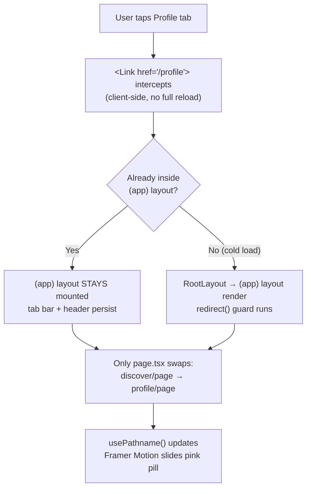

# Chapter 7 — Routing, Layouts & Navigation

> A great app feels like one room you never leave — you move, things change, but the walls, the lights, and your friends stay put. That's routing done right.

By now Viby has a brand, components, and state. But a social app is a *place* — and places have rooms: a Discover feed, a profile, a chat, a settings drawer. This chapter is where Viby stops being a single page and becomes a navigable product.

## What you'll learn

- How the App Router maps **folders to URLs**, and why that's a superpower
- **Nested layouts** that persist across navigation (no flicker, no re-mount)
- **Route groups** `(app)` to share a shell without polluting the URL
- **Dynamic routes** with **async `params`** in Next.js 16 (`await` in Server Components, `use()` in Client Components)
- Client navigation with `<Link>`, programmatic moves with `useRouter`, and `redirect()` on the server
- Building the real **Viby `(app)` shell + mobile tab bar** with an animated active indicator

## Prerequisites

- **Chapter 3** — Next.js 16 App Router fundamentals (Server vs Client Components)
- **Chapter 4** — Tailwind CSS v4 `@theme` tokens and the Viby brand palette
- **Chapter 5** — shadcn-style UI primitives (`Button`, `cn` helper)
- **Chapter 6** — Framer Motion basics (`motion`, layout animations)

---

## Theory

### Folders are your router

In the App Router, **the file system *is* the route table**. There is no `routes.tsx`, no `<Route path=...>` config. You create a folder, drop a `page.tsx` inside, and that folder's path becomes a URL.

```
app/discover/page.tsx   →  /discover
app/profile/page.tsx    →  /profile
```

Think of it like a building. Each **folder is a room**, and `page.tsx` is the furniture *inside* that room — the unique content you came to see. A `layout.tsx` is the room's **architecture**: the walls, the doorway, the lighting that wrap whatever furniture is inside.

### Layouts persist; pages swap

Here's the idea that makes the App Router click: **layouts don't re-render when you navigate between their children.** The root layout wraps everything. A nested layout wraps a subtree. When you move from `/discover` to `/profile`, if both live under the same layout, that layout *stays mounted* — only the `page` swaps out.

This is why a music app can keep playing while you browse, and why Viby's tab bar won't flicker or reset as you hop between tabs. The shell is stable; the contents flow through it.

```
RootLayout  (html, body, fonts, theme — never unmounts)
  └─ (app) layout  (top bar + bottom tab bar — stays put)
        └─ page  (Discover / Profile / Chat — this is what changes)
```

### Route groups: structure without URL noise

Sometimes you want files **organized together and sharing a layout**, but you *don't* want that folder name to appear in the URL. Enter the **route group**: a folder wrapped in parentheses, like `(app)`.

`(app)` is invisible to the URL. `app/(app)/discover/page.tsx` is still just `/discover`. We use it to draw a boundary: "everything in here is the logged-in app shell — give it the tab bar." Meanwhile `app/(auth)/login/page.tsx` lives in a *different* group with a clean, chrome-free layout. Same URL space, two completely different shells.

### Dynamic routes and the async-params shift

A profile page can't have one folder per user. Instead we use a **dynamic segment**: a folder named `[username]`. Anything matching that slot — `/u/maya`, `/u/devon` — renders the same `page.tsx`, and the matched value arrives as `params`.

The big Next.js 16 change: **`params` is now a Promise.** Routing values resolve asynchronously so the framework can stream and stay fast. In a Server Component you `await` it; in a Client Component you unwrap it with React's `use()` hook. Memorize that fork — it trips up everyone migrating from older Next.

### Three ways to move

- **`<Link>`** — declarative, for things users click. Prefetches in the background; feels instant.
- **`useRouter()`** — imperative, for code-driven moves ("after this save, go to the new chat"). Client-only.
- **`redirect()`** — server-side, for guarding routes ("not logged in? bounce them to `/login`"). Throws, so put it before your JSX.

---

## In practice

### 1. The route map for Viby

```
app/
├─ layout.tsx                 # RootLayout: html/body, fonts, theme
├─ page.tsx                   # marketing landing  →  /
├─ (auth)/
│  ├─ layout.tsx              # centered, no tab bar
│  └─ login/page.tsx          # →  /login
└─ (app)/
   ├─ layout.tsx              # APP SHELL: top bar + bottom tab bar
   ├─ discover/page.tsx       # →  /discover
   ├─ chat/page.tsx           # →  /chat
   ├─ profile/page.tsx        # →  /profile   (your own)
   └─ u/[username]/page.tsx   # →  /u/maya    (anyone's)
```

### 2. The root layout

Defined once. Fonts and the global stylesheet (where our `@theme` tokens live, from Chapter 4) hang here.

```tsx
// app/layout.tsx
import type { Metadata } from "next";
import "./globals.css";

export const metadata: Metadata = {
  title: "Viby — find your people",
  description: "Make friends through shared hobbies and lifestyle.",
};

export default function RootLayout({
  children,
}: {
  children: React.ReactNode;
}) {
  return (
    <html lang="en">
      <body className="min-h-dvh bg-white text-neutral-900 antialiased">
        {children}
      </body>
    </html>
  );
}
```

### 3. The `(app)` shell layout

This is the heart of the chapter. One layout, shared by every logged-in screen, holding the persistent tab bar. Because it's a layout, it **never unmounts** as you switch tabs.

```tsx
// app/(app)/layout.tsx
import { redirect } from "next/navigation";
import { createClient } from "@/lib/supabase/server";
import { TabBar } from "@/components/nav/tab-bar";

export default async function AppLayout({
  children,
}: {
  children: React.ReactNode;
}) {
  // Server-side guard: no session → bounce to login.
  const supabase = await createClient();
  const {
    data: { user },
  } = await supabase.auth.getUser();
  if (!user) redirect("/login");

  return (
    <div className="mx-auto flex min-h-dvh w-full max-w-md flex-col">
      <header className="sticky top-0 z-10 flex h-14 items-center justify-center border-b border-neutral-100 bg-white/80 backdrop-blur">
        <span className="text-lg font-extrabold tracking-tight text-brand">
          Viby
        </span>
      </header>

      <main className="flex-1 overflow-y-auto pb-20">{children}</main>

      <TabBar />
    </div>
  );
}
```

Our Supabase server client (introduced in Chapter 6, using `@supabase/ssr`) looks like this — note the **`getAll`/`setAll`** cookie handlers, the modern API:

```ts
// lib/supabase/server.ts
import { createServerClient } from "@supabase/ssr";
import { cookies } from "next/headers";

export async function createClient() {
  const cookieStore = await cookies();

  return createServerClient(
    process.env.NEXT_PUBLIC_SUPABASE_URL!,
    process.env.NEXT_PUBLIC_SUPABASE_ANON_KEY!,
    {
      cookies: {
        getAll() {
          return cookieStore.getAll();
        },
        setAll(cookiesToSet) {
          try {
            cookiesToSet.forEach(({ name, value, options }) =>
              cookieStore.set(name, value, options)
            );
          } catch {
            // Called from a Server Component — safe to ignore;
            // proxy.ts refreshes the session cookie instead.
          }
        },
      },
    }
  );
}
```

### 4. The animated tab bar

A Client Component (it reads the current path and animates). `usePathname` tells us which tab is active; Framer Motion's shared `layoutId` slides the pink pill between tabs.

```tsx
// components/nav/tab-bar.tsx
"use client";

import Link from "next/link";
import { usePathname } from "next/navigation";
import { motion } from "framer-motion";
import { Compass, MessageCircle, User } from "lucide-react";
import { cn } from "@/lib/utils";

const TABS = [
  { href: "/discover", label: "Discover", Icon: Compass },
  { href: "/chat", label: "Chat", Icon: MessageCircle },
  { href: "/profile", label: "You", Icon: User },
] as const;

export function TabBar() {
  const pathname = usePathname();

  return (
    <nav className="fixed inset-x-0 bottom-0 z-20 mx-auto flex w-full max-w-md items-center justify-around border-t border-neutral-100 bg-white/90 px-2 py-2 backdrop-blur">
      {TABS.map(({ href, label, Icon }) => {
        const active = pathname === href || pathname.startsWith(href + "/");
        return (
          <Link
            key={href}
            href={href}
            className="relative flex flex-1 flex-col items-center gap-0.5 py-1.5 text-xs font-medium"
          >
            {active && (
              <motion.span
                layoutId="tab-pill"
                className="absolute inset-0 rounded-2xl bg-brand/10"
                transition={{ type: "spring", stiffness: 500, damping: 35 }}
              />
            )}
            <Icon
              className={cn(
                "relative size-6 transition-colors",
                active ? "text-brand" : "text-neutral-400"
              )}
            />
            <span
              className={cn(
                "relative",
                active ? "text-brand" : "text-neutral-500"
              )}
            >
              {label}
            </span>
          </Link>
        );
      })}
    </nav>
  );
}
```

A reminder from Chapter 4 — `text-brand` and `bg-brand/10` come from our token, defined in CSS, **no `tailwind.config.js`**:

```css
/* app/globals.css */
@import "tailwindcss";

@theme {
  --color-brand: #ff6fb5;
}
```

### 5. Dynamic profile route — async `params` in a Server Component

```tsx
// app/(app)/u/[username]/page.tsx
import { notFound } from "next/navigation";
import { createClient } from "@/lib/supabase/server";

export default async function ProfilePage({
  params,
}: {
  params: Promise<{ username: string }>;
}) {
  const { username } = await params; // ← await: params is a Promise

  const supabase = await createClient();
  const { data: profile } = await supabase
    .from("profiles")
    .select("username, display_name, bio, vibes")
    .eq("username", username)
    .single();

  if (!profile) notFound();

  return (
    <section className="p-5">
      <h1 className="text-2xl font-extrabold">{profile.display_name}</h1>
      <p className="text-sm text-neutral-500">@{profile.username}</p>
      <p className="mt-3 text-neutral-800">{profile.bio}</p>
      <ul className="mt-4 flex flex-wrap gap-2">
        {profile.vibes?.map((v: string) => (
          <li
            key={v}
            className="rounded-full bg-brand/10 px-3 py-1 text-sm text-brand"
          >
            {v}
          </li>
        ))}
      </ul>
    </section>
  );
}
```

### 6. Same params, but in a Client Component — `use()`

When a route needs client interactivity and still wants `params`, unwrap the Promise with React's `use()`:

```tsx
// app/(app)/u/[username]/edit/page.tsx
"use client";

import { use, useState } from "react";

export default function EditVibes({
  params,
}: {
  params: Promise<{ username: string }>;
}) {
  const { username } = use(params); // ← use(): unwrap in Client Components
  const [draft, setDraft] = useState("");

  return (
    <form className="p-5">
      <h1 className="font-bold">Editing @{username}</h1>
      <input
        value={draft}
        onChange={(e) => setDraft(e.target.value)}
        className="mt-3 w-full rounded-xl border border-neutral-200 p-2"
        placeholder="Add a vibe…"
      />
    </form>
  );
}
```

### 7. Programmatic navigation with `useRouter`

Use this when *code* decides to move — e.g. after starting a chat with someone.

```tsx
// components/profile/start-chat-button.tsx
"use client";

import { useRouter } from "next/navigation";
import { useTransition } from "react";
import { Button } from "@/components/ui/button";
import { createChat } from "@/app/(app)/chat/actions";

export function StartChatButton({ targetId }: { targetId: string }) {
  const router = useRouter();
  const [pending, startTransition] = useTransition();

  function handleClick() {
    startTransition(async () => {
      const chatId = await createChat(targetId); // Server Action
      router.push(`/chat/${chatId}`); // jump into the new conversation
    });
  }

  return (
    <Button onClick={handleClick} disabled={pending}>
      {pending ? "Starting…" : "Say hi"}
    </Button>
  );
}
```

The matching Server Action — note the `"use server"` directive:

```ts
// app/(app)/chat/actions.ts
"use server";

import { createClient } from "@/lib/supabase/server";

export async function createChat(targetId: string): Promise<string> {
  const supabase = await createClient();
  const {
    data: { user },
  } = await supabase.auth.getUser();

  const { data, error } = await supabase
    .from("chats")
    .insert({ a: user!.id, b: targetId })
    .select("id")
    .single();

  if (error) throw new Error(error.message);
  return data.id;
}
```

### 8. Session-refresh logic in `proxy.ts` (not `middleware.ts`)

In Next.js 16, the project-root **`proxy.ts`** replaces the old `middleware.ts` for request-time logic. We use it to keep the Supabase session cookie fresh on every navigation.

```ts
// proxy.ts
import { createServerClient } from "@supabase/ssr";
import { NextResponse, type NextRequest } from "next/server";

export async function proxy(request: NextRequest) {
  const response = NextResponse.next({ request });

  const supabase = createServerClient(
    process.env.NEXT_PUBLIC_SUPABASE_URL!,
    process.env.NEXT_PUBLIC_SUPABASE_ANON_KEY!,
    {
      cookies: {
        getAll() {
          return request.cookies.getAll();
        },
        setAll(cookiesToSet) {
          cookiesToSet.forEach(({ name, value, options }) =>
            response.cookies.set(name, value, options)
          );
        },
      },
    }
  );

  await supabase.auth.getUser(); // refreshes the token if expired
  return response;
}

export const config = {
  matcher: ["/((?!_next/static|_next/image|favicon.ico).*)"],
};
```

---

## Architecture / diagram

How a tap on the **Profile** tab flows through the persistent shell:



```
URL space            File system                         Shell applied
──────────           ───────────                         ─────────────
/login        ←→     app/(auth)/login/page.tsx           centered, no tabs
/discover     ←→     app/(app)/discover/page.tsx         app shell + tabs
/u/maya       ←→     app/(app)/u/[username]/page.tsx     app shell + tabs
                            └── (app) and (auth) vanish from the URL
```

---

## Best practices & pitfalls

**Do**

- Put **shared, stable chrome** (tab bar, header) in a layout — never re-render it per page.
- Guard protected subtrees with `redirect()` in the `(app)/layout.tsx`, *and* keep `proxy.ts` refreshing the session.
- Type dynamic params as `Promise<{ … }>` and `await` (server) or `use()` (client).
- Use `<Link>` for anything clickable — you get prefetching for free.
- Call `notFound()` when a dynamic record doesn't exist; it renders your `not-found.tsx`.

**Don't**

- Don't reach for `useRouter().push()` where a `<Link>` works — you lose prefetch and accessibility.
- Don't destructure `params` synchronously (`{ params: { username } }`) — that's the old API and now throws.
- Don't create a `middleware.ts` in Next.js 16 — use **`proxy.ts`**.
- Don't add a `tailwind.config.js` for tokens — define them in `@theme` (Chapter 4).
- Don't call `redirect()` inside a `try/catch` that swallows errors — it works *by* throwing.
- Don't forget `redirect()` returns `never`; place it before any JSX so TypeScript narrows correctly.

---

## Exercises

1. **Settings tab (easy).** Add `app/(app)/settings/page.tsx` and a fourth tab to `TabBar` with a `Settings` icon. Confirm the active pill animates to it.
2. **Loading UI (easy–medium).** Add `app/(app)/u/[username]/loading.tsx` showing a skeleton card while the profile query resolves. Throttle your network and watch it appear.
3. **Not-found (medium).** Create `app/(app)/u/[username]/not-found.tsx` with a friendly "No Viber by that name" message and a `<Link>` back to `/discover`.
4. **Search params (medium).** On `/discover`, read `searchParams` (also a Promise now) to support `/discover?vibe=hiking`, filtering the feed server-side.
5. **Nested layout (hard).** Give `/chat` its own nested `layout.tsx` with a conversations sidebar that persists while `/chat/[chatId]` pages swap inside it.

---

## Mini-project — The Viby app shell

Ship the navigable skeleton of Viby end to end.

**Goal:** a logged-in user can tap between Discover, Chat, and You; the shell never flickers; tapping a profile card opens `/u/[username]`; visiting any `(app)` route while logged out bounces to `/login`.

**Build steps**

1. Scaffold the `(app)` and `(auth)` route groups exactly as in the route map above.
2. Implement `app/(app)/layout.tsx` with the Supabase guard + `redirect("/login")` and mount `<TabBar />`.
3. Drop in the animated `TabBar` with the `layoutId="tab-pill"` indicator.
4. Build three stub pages (`discover`, `chat`, `profile`) — even just an `<h1>` each — to prove the shell persists across navigation.
5. Add the dynamic `u/[username]/page.tsx` reading async `params` and querying `profiles`.
6. On `discover`, render a few profile cards as `<Link href={`/u/${p.username}`}>`.
7. Wire `proxy.ts` for session refresh.

**Done when:** switching tabs animates the pink pill with zero layout flash, the header/tab bar stay mounted (drop a `console.log` in `TabBar` — it should log once, not per navigation), and a logged-out visit to `/discover` lands on `/login`.

---

## Key takeaways

- **Folders are routes; `page.tsx` is content; `layout.tsx` is persistent chrome.**
- **Layouts don't re-mount on navigation** — that's what keeps Viby's shell stable.
- **Route groups `(app)` / `(auth)`** share layouts without touching the URL.
- **`params` is a Promise in Next.js 16** — `await` on the server, `use()` on the client.
- **`<Link>` to click, `useRouter` to move in code, `redirect()` to guard on the server.**
- Use **`proxy.ts`**, not `middleware.ts`, for request-time session work.

**Up next — Chapter 8: Data Fetching & Server Components**, where those stub pages start pulling real Vibers from Supabase, with caching, streaming, and loading states that feel instant.
