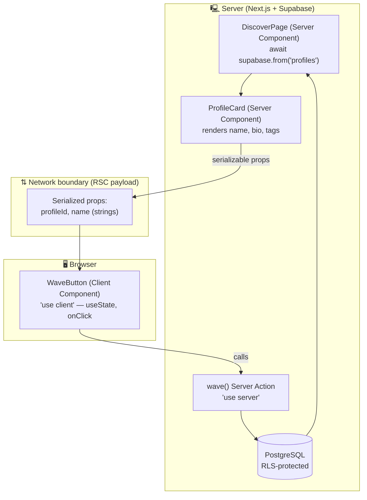

# Chapter 8 — Server vs Client Components & Data

> The single biggest "aha" of the App Router: most of your UI never has to ship to the browser at all.

## What you'll learn

- Why **Server Components are the default** in Next.js 16, and what `"use client"` actually does.
- How to decide — on a per-component basis — whether something runs on the server or in the browser.
- How to **fetch data directly inside Server Components** (no `useEffect`, no loading spinner gymnastics).
- How to **pass data across the server → client boundary**, and the *serialization* rules that govern it.
- How to compose the two worlds: server shells with small interactive client "islands."
- The real performance and security wins — and the traps that bite beginners.

## Prerequisites

- Chapter 4 (TypeScript fundamentals) — we lean on typed props.
- Chapter 6 (Next.js App Router, routing & layouts) — you should know what a `page.tsx` and `layout.tsx` are.
- Chapter 7 (Tailwind v4 & our UI primitives) — we'll style with `@theme` tokens.
- A running Viby project with Supabase wired via `@supabase/ssr` (set up at the end of Chapter 6).

---

## Theory

Imagine Viby's **Discover** page: a grid of people near you who share your hobbies. Some of that page is *static structure* — headings, a profile card's name, avatar, and bio, the shared-interest tags. Other parts are *alive* — a "Wave 👋" button that reacts to your tap, a follow toggle, a hover animation.

For years, React shipped **all** of that to the browser as JavaScript. The browser downloaded your components, re-ran them, and re-built the DOM the server had already described. We paid the "JavaScript tax" even on parts that never change after they render.

React Server Components (RSC) split the work. Think of it like a **restaurant kitchen vs. the dining table**:

- The **kitchen (server)** does the heavy prep: it talks to the database, reads secrets, assembles the dish. Customers never see the kitchen, and the kitchen's tools (knives, the safe with the recipes) never leave it.
- The **table (client/browser)** is where interaction happens: you cut your food, react, ask for more. It needs cutlery (JavaScript), but only for the things you actually touch.

In Next.js 16's App Router, **every component is a Server Component by default**. It runs once, on the server, during the request. Its output isn't HTML strings and it isn't "a bundle" — it's a serialized description of the UI (the *RSC payload*) that React streams to the browser and stitches into the page. That component's *code* never ships to the browser.

When you need real interactivity — state, effects, event handlers, browser APIs — you opt a component into the client with the **`"use client"`** directive at the top of the file. That marks the boundary: this component, and everything it imports, becomes part of the browser bundle.

### The mental model that matters

`"use client"` is not "this code runs only in the browser." It's a **boundary marker**. A client component still pre-renders on the server for the initial HTML (that's SSR), then *hydrates* in the browser so it can become interactive. The directive's real job is: *"from here down, ship the JavaScript and wire up interactivity."*

Two rules follow from this, and they trip up everyone at first:

1. **Server Components can import and render Client Components.** (Kitchen plates the dish, then hands it to the table.)
2. **Client Components cannot import Server Components** — but they *can* receive them as `children` / props. (The table can't reach into the kitchen, but the kitchen can place something on the table.)

### The serialization boundary

When a Server Component passes props *into* a Client Component, those props cross the network. They get **serialized** (turned into the RSC payload), shipped, and deserialized in the browser. So props must be serializable: strings, numbers, booleans, `null`, arrays, plain objects, `Date`, `Map`, `Set`, and — importantly — **other Server Components passed as `children`**.

What you **cannot** pass across that boundary: functions (except Server Actions, which we'll meet), class instances, Symbols, database clients, anything with methods. Pass the *data*, not the *machinery*.

---

## In practice

Let's build a slice of Viby's Discover page the right way.

### A Server Component that fetches data

No `"use client"`, no `useEffect`, no spinner. We `await` the data right in the component. This file's code never reaches the browser — which is exactly why it's safe to use the server-side Supabase client (with cookies) here.

```tsx
// app/discover/page.tsx  — Server Component (default)
import { createClient } from "@/lib/supabase/server";
import { ProfileCard } from "@/components/profile-card";

export default async function DiscoverPage() {
  const supabase = await createClient();

  const { data: profiles } = await supabase
    .from("profiles")
    .select("id, display_name, bio, avatar_url, interests")
    .limit(24);

  return (
    <main className="mx-auto max-w-5xl px-4 py-8">
      <h1 className="text-2xl font-bold text-ink">Find your people</h1>
      <p className="mt-1 text-muted">People near you who share your vibe.</p>

      <ul className="mt-6 grid grid-cols-1 gap-4 sm:grid-cols-2 lg:grid-cols-3">
        {profiles?.map((p) => (
          <li key={p.id}>
            <ProfileCard profile={p} />
          </li>
        ))}
      </ul>
    </main>
  );
}
```

Here's the server Supabase client it uses — note the `getAll`/`setAll` cookie handlers required by `@supabase/ssr`:

```ts
// lib/supabase/server.ts
import { createServerClient } from "@supabase/ssr";
import { cookies } from "next/headers";

export async function createClient() {
  const cookieStore = await cookies(); // async in Next.js 16

  return createServerClient(
    process.env.NEXT_PUBLIC_SUPABASE_URL!,
    process.env.NEXT_PUBLIC_SUPABASE_ANON_KEY!,
    {
      cookies: {
        getAll() {
          return cookieStore.getAll();
        },
        setAll(cookiesToSet) {
          try {
            cookiesToSet.forEach(({ name, value, options }) =>
              cookieStore.set(name, value, options)
            );
          } catch {
            // Called from a Server Component render — safe to ignore;
            // cookie writes happen in Server Actions / proxy.ts.
          }
        },
      },
    }
  );
}
```

### A mostly-server card with a small client island

`ProfileCard` is a Server Component — it just renders data. The only interactive bit, the **Wave** button, is a separate Client Component. We keep the JavaScript footprint tiny by isolating interactivity.

```tsx
// components/profile-card.tsx  — Server Component
import { WaveButton } from "@/components/wave-button";

type Profile = {
  id: string;
  display_name: string;
  bio: string | null;
  avatar_url: string | null;
  interests: string[];
};

export function ProfileCard({ profile }: { profile: Profile }) {
  return (
    <article className="rounded-2xl border border-black/5 bg-white p-5 shadow-sm">
      <div className="flex items-center gap-3">
        
        <h2 className="font-semibold text-ink">{profile.display_name}</h2>
      </div>

      {profile.bio && <p className="mt-3 text-sm text-muted">{profile.bio}</p>}

      <ul className="mt-3 flex flex-wrap gap-2">
        {profile.interests.map((tag) => (
          <li
            key={tag}
            className="rounded-full bg-brand/10 px-2.5 py-1 text-xs font-medium text-brand"
          >
            {tag}
          </li>
        ))}
      </ul>

      {/* Pass plain, serializable data across the boundary */}
      <WaveButton profileId={profile.id} name={profile.display_name} />
    </article>
  );
}
```

### The Client Component (the island)

`"use client"` sits at the very top. This component owns state, an event handler, and a Framer Motion gesture — none of which can exist in a Server Component.

```tsx
// components/wave-button.tsx
"use client";

import { useState } from "react";
import { motion } from "framer-motion";
import { wave } from "@/app/discover/actions";

export function WaveButton({
  profileId,
  name,
}: {
  profileId: string;
  name: string;
}) {
  const [waved, setWaved] = useState(false);

  async function handleWave() {
    setWaved(true); // optimistic UI
    await wave(profileId); // calls a Server Action
  }

  return (
    <motion.button
      whileTap={{ scale: 0.92 }}
      onClick={handleWave}
      disabled={waved}
      aria-label={`Wave at ${name}`}
      className="mt-4 w-full rounded-xl bg-brand py-2.5 font-semibold text-white disabled:opacity-60"
    >
      {waved ? "Waved 👋" : "Wave 👋"}
    </motion.button>
  );
}
```

### The bridge back: a Server Action

How does the client *send data back*? Not by importing the database client (that would leak secrets into the bundle). Instead it calls a **Server Action** — a function marked `"use server"` that runs on the server but can be called like a normal async function from the client. This is the *one* kind of "function" allowed to cross the boundary.

```ts
// app/discover/actions.ts
"use server";

import { createClient } from "@/lib/supabase/server";
import { revalidatePath } from "next/cache";

export async function wave(targetProfileId: string) {
  const supabase = await createClient();

  const {
    data: { user },
  } = await supabase.auth.getUser();
  if (!user) throw new Error("Not signed in");

  await supabase.from("waves").insert({
    from_user: user.id,
    to_user: targetProfileId,
  });

  revalidatePath("/discover");
}
```

### Passing a Server Component as `children` (composition pattern)

When you *do* need a client wrapper (say, an animated container) around server-rendered content, don't drag the content into the client bundle. Pass it as `children`:

```tsx
// components/reveal.tsx
"use client";
import { motion } from "framer-motion";

export function Reveal({ children }: { children: React.ReactNode }) {
  return (
    <motion.div
      initial={{ opacity: 0, y: 12 }}
      whileInView={{ opacity: 1, y: 0 }}
      viewport={{ once: true }}
    >
      {children}
    </motion.div>
  );
}
```

```tsx
// usage in a Server Component — ProfileCard stays on the server
<Reveal>
  <ProfileCard profile={p} />
</Reveal>
```

`Reveal` is a client island, but `ProfileCard` it wraps is still rendered on the server and slotted in as already-finished UI. Best of both worlds.

---

## Architecture / diagram



The dashed lesson: **data flows down through serialization; actions flow back up through the `"use server"` channel.** Database access never crosses into the browser box.

---

## Best practices & pitfalls

**Do**

- **Keep `"use client"` as low in the tree as possible.** Push interactivity to leaf "islands" (a button, a toggle), not whole pages.
- **Fetch in Server Components** with `await`. It's simpler, faster, and keeps queries off the network-tab radar.
- **Pass only serializable data** across the boundary — plain objects and primitives.
- **Use Server Actions** (`"use server"`) for mutations instead of building API routes for every form.
- **Put secrets and the service-role Supabase client server-side only.** Anything not prefixed `NEXT_PUBLIC_` stays out of the bundle.

**Don't**

- **Don't slap `"use client"` at the top of a layout or page "just in case."** It turns the whole subtree into client code and kills the RSC win.
- **Don't `await` data inside a Client Component** — you can't make a client component `async`. Fetch on the server and pass it down, or use a data library / `use()` on a passed-in promise.
- **Don't pass functions, class instances, or a Supabase client as props** to a client component. They aren't serializable. (Server Actions are the only exception.)
- **Don't reach for `useEffect` + `fetch` for initial data.** That's the old SPA pattern; it reintroduces spinners and waterfalls the App Router eliminates.
- **Don't read `params`/`searchParams` synchronously.** In Next.js 16 they're async: `const { id } = await params;` (or `use(params)` in a client component).

---

## Exercises

1. **Spot the boundary.** Open Viby's profile page. List which parts *must* be client (need state/events/browser APIs) and which can stay server. Justify each.
2. **Shrink the bundle.** Find a component in your project that has `"use client"` but contains a large chunk of non-interactive markup. Split the interactive bit into its own island and keep the rest on the server.
3. **Server fetch.** Build `app/profile/[id]/page.tsx` as an async Server Component that reads `id` via `await params` and fetches that profile from Supabase.
4. **Serialization error on purpose.** Try passing a function as a prop from a Server Component to a Client Component. Read the error Next.js gives you, then fix it by converting the function into a Server Action.
5. **Composition challenge (hard).** Wrap a server-rendered list in an `AnimatePresence` client wrapper so items animate on mount — *without* moving the list items into the client bundle.

---

## Mini-project: "Vibe Match" spotlight card

Build a single-card feature for the Discover page that shows one suggested person and lets the user act on it.

**Requirements**

1. **`app/discover/spotlight/page.tsx`** — a Server Component that fetches one random profile from Supabase (`profiles` table) and renders it. No client directive in this file.
2. **`<MatchActions />`** — a Client Component island with two buttons: **"Wave 👋"** and **"Skip"**. Use `useState` to track which action was taken and a Framer Motion `whileTap` gesture for feedback.
3. **`waveAction` / `skipAction`** — Server Actions (`"use server"`) that record the choice in Supabase and call `revalidatePath("/discover/spotlight")` so the next render shows a fresh face.
4. **Boundary discipline** — the page passes only `{ id, display_name, avatar_url }` (plain serializable props) into `<MatchActions />`. No Supabase client crosses the line.
5. **Polish** — style with your `@theme` tokens (`bg-brand`, `text-ink`), and wrap the card in a `Reveal` client component so it fades in on mount while staying server-rendered inside.

**Stretch:** add an optimistic "It's a vibe!" toast that appears instantly on Wave, before the Server Action resolves.

You'll know it works when: the page loads with zero loading spinner, the network tab shows no client-side profile fetch, and the buttons still feel snappy.

---

## Key takeaways

- **Server Components are the default**; `"use client"` is an opt-in *boundary*, not a "run in browser only" switch.
- Server Components **fetch data directly** with `await` and keep secrets and DB access off the client.
- Props from server → client **must be serializable**; pass *data*, not *machinery*.
- **Server Components can render Client Components**; clients receive servers only as `children`/props.
- **Server Actions** (`"use server"`) are the sanctioned channel for sending work back to the server.
- Keep client islands **small and low** in the tree to ship less JavaScript and load faster.

**Up next — Chapter 9:** *Data Fetching, Caching & Streaming* — `loading.tsx`, Suspense boundaries, and how Next.js 16 caches and revalidates your Viby feed so it stays fast *and* fresh.
