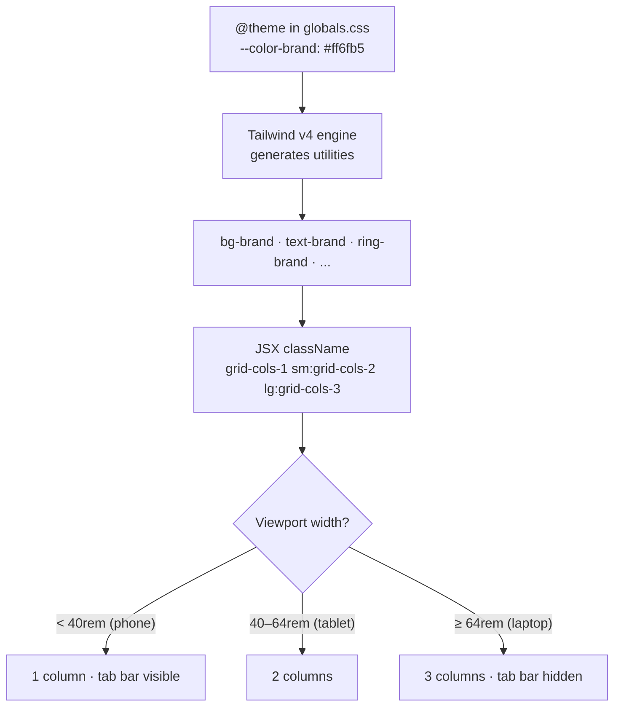

# Chapter 9 — Tailwind CSS & Mobile-First Responsive Design

> Your users meet Viby on a 390px phone screen first — so that's where *we* start too.

## What you'll learn

- Why **utility-first CSS** beats hand-rolled stylesheets for product teams shipping fast.
- How **Tailwind CSS v4** works with zero config — design tokens live in your CSS via `@theme`, not a `tailwind.config.js`.
- The **mobile-first** mental model and how Tailwind's responsive breakpoints encode it.
- The **device-frame approach**: designing inside a phone shell so every screen feels native on mobile.
- Building real **Viby layouts** — a discovery feed, profile cards, and a sticky mobile tab bar — that scale gracefully up to desktop.

## Prerequisites

- **Chapter 6** (Next.js 16 App Router) — you should be comfortable with Server vs. Client Components and the `app/` directory.
- **Chapter 7** (React 19 fundamentals) — props, composition, `use client`.
- **Chapter 8** (TypeScript for components) — typed props and `tsx` files.
- A running Viby Next.js project with Tailwind v4 installed (we set this up at the end of Chapter 6).

---

## Theory

### Why utility-first at all?

Imagine you're decorating a room. The traditional CSS approach is like hiring a carpenter to **build a custom piece of furniture for every wall** — beautiful, but slow, and the moment you want to rearrange, you're back to the workshop. Over months, your `styles.css` grows into a graveyard of `.card-wrapper-v2-final` classes nobody dares delete.

**Utility-first** is like having a wall of perfectly labelled drawers: `flex`, `gap-4`, `rounded-2xl`, `bg-brand`. You compose furniture *in place*, in your markup, from tiny single-purpose pieces. The genius isn't that you type more classes — it's that you **stop inventing names** and **stop context-switching** between files. The styling lives where the structure lives.

Three concrete wins for a product team:

1. **No naming fatigue.** `mt-4` always means the same thing. You never debate whether it's `.card__title` or `.cardTitle`.
2. **Dead-code-free by construction.** Delete a component and its styles vanish with it — there's no orphaned CSS.
3. **Constrained by design.** You pick from a *scale* (`gap-2`, `gap-4`, `gap-6`), not arbitrary `gap: 13px`. That constraint is what makes a UI look consistent and "designed."

The honest trade-off: your HTML gets longer. We tame that with **components** (extract a `<Button>` once, reuse everywhere) — not by abandoning utilities.

### Tailwind v4: the CSS *is* the config

If you've seen older Tailwind tutorials, burn the `tailwind.config.js` from your memory. **Tailwind v4 is CSS-first.** You import the engine and declare your design tokens in a special `@theme` block right in your stylesheet:

```css
@import "tailwindcss";

@theme {
  --color-brand: #ff6fb5;
}
```

That single line does something magical: it **generates utilities**. Because you named a token `--color-brand`, Tailwind now hands you `bg-brand`, `text-brand`, `border-brand`, `ring-brand`, and friends — automatically. Tokens are the *source*; utilities are the *output*. This is the whole model.

Analogy: `@theme` is the **brand style guide** for the whole app. Designers hand you "our pink is `#FF6FB5`, our base radius is 1rem." You write that down once in CSS, and every utility across the codebase speaks that vocabulary.

### Mobile-first: small screen is the default, not an afterthought

Here's the rule that trips up everyone coming from desktop-era CSS:

> **An unprefixed utility applies to *every* screen size. A prefixed utility (`md:`, `lg:`) applies *from that breakpoint up*.**

So `p-4 md:p-8` means: "4 units of padding everywhere, bumping to 8 from the medium breakpoint onward." You **never** write `sm:` to target *only* phones — phones get the unprefixed value. You layer enhancements *upward*.

Why design up instead of down? A phone is the **constrained** environment: one column, thumb-reachable, limited width. If your design survives there, widening it is easy — you have *more* room, not less. Start wide and you'll be forever amputating layouts to fit small screens. Viby is a social app; the overwhelming majority of sessions happen on phones, so mobile-first isn't just tidy — it's where the product actually lives.

Tailwind v4's default breakpoints (defined as `--breakpoint-*` tokens you can override):

| Prefix | Min-width | Typical device |
|--------|-----------|----------------|
| (none) | 0         | phones         |
| `sm:`  | 40rem     | large phones / small tablets |
| `md:`  | 48rem     | tablets        |
| `lg:`  | 64rem     | laptops        |
| `xl:`  | 80rem     | desktops       |

---

## In practice

### 1. The Viby theme

This is the heart of your design system. Create `app/globals.css`:

```css
@import "tailwindcss";

@theme {
  /* Brand */
  --color-brand: #ff6fb5;
  --color-brand-soft: #ffe3f1;
  --color-ink: #1b1320;
  --color-muted: #7a7080;

  /* Radii & shadows tuned for a soft, premium feel */
  --radius-card: 1.25rem;
  --shadow-pop: 0 10px 30px -12px rgb(255 111 181 / 0.45);

  /* A friendly display font (loaded via next/font in layout) */
  --font-display: var(--font-grotesk), system-ui, sans-serif;
}
```

Now `bg-brand`, `text-ink`, `rounded-card`, `shadow-pop`, and `font-display` all exist as utilities — typed nowhere, available everywhere.

### 2. A reusable Button (extract once, reuse forever)

This is how we keep markup short *without* leaving utility-land. It's a Server Component — no interactivity needed, so no `"use client"`.

```tsx
// components/ui/button.tsx
import { type ComponentProps } from "react";

type ButtonProps = ComponentProps<"button"> & {
  variant?: "primary" | "ghost";
};

export function Button({ variant = "primary", className = "", ...props }: ButtonProps) {
  const base =
    "inline-flex h-11 items-center justify-center rounded-full px-6 " +
    "text-sm font-semibold transition active:scale-95 disabled:opacity-50";
  const variants = {
    primary: "bg-brand text-white shadow-pop hover:brightness-105",
    ghost: "bg-brand-soft text-brand hover:bg-brand/15",
  };
  return <button className={`${base} ${variants[variant]} ${className}`} {...props} />;
}
```

> Note the `h-11` (44px) min target — that's the accessible minimum tap size for thumbs. Mobile-first thinking shows up in *sizing*, not just layout.

### 3. The discovery feed — mobile-first grid

The Viby feed is **one column on phones**, two on tablets, three on laptops. Watch how the breakpoint prefixes layer upward:

```tsx
// app/discover/page.tsx  (Server Component by default)
import { PersonCard } from "@/components/person-card";
import { getDiscoveryProfiles } from "@/lib/profiles";

export default async function DiscoverPage() {
  const profiles = await getDiscoveryProfiles();

  return (
    <main className="mx-auto w-full max-w-5xl px-4 pb-24 pt-6">
      <h1 className="font-display text-2xl font-bold text-ink md:text-3xl">
        Find your people
      </h1>
      <p className="mt-1 text-sm text-muted">
        People near you who love what you love.
      </p>

      <section className="mt-6 grid grid-cols-1 gap-4 sm:grid-cols-2 lg:grid-cols-3">
        {profiles.map((p) => (
          <PersonCard key={p.id} profile={p} />
        ))}
      </section>
    </main>
  );
}
```

`grid-cols-1` is the phone default; `sm:grid-cols-2` and `lg:grid-cols-3` are the upgrades. `max-w-5xl` plus `mx-auto` keeps the feed from sprawling on huge monitors. `pb-24` reserves room for the mobile tab bar we add below.

### 4. A profile card with a gesture (Client Component)

Cards have a tap animation and an interest-tag row that scrolls horizontally on small screens. Interactivity + Framer Motion means this one needs `"use client"`.

```tsx
// components/person-card.tsx
"use client";

import { motion } from "framer-motion";
import Image from "next/image";

type Profile = {
  id: string;
  name: string;
  age: number;
  city: string;
  avatarUrl: string;
  interests: string[];
};

export function PersonCard({ profile }: { profile: Profile }) {
  return (
    <motion.article
      whileTap={{ scale: 0.98 }}
      className="overflow-hidden rounded-card bg-white shadow-pop ring-1 ring-black/5"
    >
      <div className="relative aspect-4/5 w-full">
        <Image
          src={profile.avatarUrl}
          alt={profile.name}
          fill
          sizes="(max-width: 640px) 100vw, 33vw"
          className="object-cover"
        />
        <div className="absolute inset-x-0 bottom-0 bg-gradient-to-t from-ink/70 to-transparent p-4">
          <p className="text-base font-semibold text-white">
            {profile.name}, {profile.age}
          </p>
          <p className="text-xs text-white/80">{profile.city}</p>
        </div>
      </div>

      {/* Tags scroll sideways on phones, wrap-free, no scrollbar */}
      <ul className="flex gap-2 overflow-x-auto p-3 [scrollbar-width:none]">
        {profile.interests.map((tag) => (
          <li
            key={tag}
            className="shrink-0 rounded-full bg-brand-soft px-3 py-1 text-xs font-medium text-brand"
          >
            {tag}
          </li>
        ))}
      </ul>
    </motion.article>
  );
}
```

Two mobile-first details worth internalizing: `aspect-4/5` keeps the image a consistent portrait shape at any width (no layout shift), and the `overflow-x-auto` tag row is a classic phone pattern — horizontal scroll where vertical space is precious.

### 5. The sticky mobile tab bar (and why it hides on desktop)

Phones get a thumb-friendly bottom bar; laptops don't need it. `fixed` + `bottom-0` on mobile, `lg:hidden` to remove it on large screens.

```tsx
// components/mobile-tab-bar.tsx
import Link from "next/link";
import { Compass, MessageCircle, User } from "lucide-react";

const tabs = [
  { href: "/discover", label: "Discover", icon: Compass },
  { href: "/messages", label: "Messages", icon: MessageCircle },
  { href: "/profile", label: "Profile", icon: User },
];

export function MobileTabBar() {
  return (
    <nav
      className="fixed inset-x-0 bottom-0 z-50 flex justify-around border-t border-black/5
                 bg-white/90 pb-[env(safe-area-inset-bottom)] backdrop-blur lg:hidden"
    >
      {tabs.map(({ href, label, icon: Icon }) => (
        <Link
          key={href}
          href={href}
          className="flex flex-1 flex-col items-center gap-1 py-3 text-muted
                     transition active:text-brand"
        >
          <Icon className="size-5" />
          <span className="text-[11px] font-medium">{label}</span>
        </Link>
      ))}
    </nav>
  );
}
```

`pb-[env(safe-area-inset-bottom)]` is a real-world must: it pushes the bar above the iPhone home indicator. This is an *arbitrary value* — square-bracket syntax for the rare case the design scale doesn't cover.

### 6. The device-frame approach

When building mobile-first, it helps to *develop inside a phone shell* so you're never tempted to design for the full browser width. Wrap your dev preview in a frame:

```tsx
// components/device-frame.tsx
export function DeviceFrame({ children }: { children: React.ReactNode }) {
  return (
    <div className="grid min-h-dvh place-items-center bg-brand-soft p-4 lg:p-8">
      <div
        className="relative h-[844px] w-[390px] overflow-hidden rounded-[2.5rem]
                   border-8 border-ink bg-white shadow-2xl"
      >
        <div className="h-full overflow-y-auto">{children}</div>
      </div>
    </div>
  );
}
```

`390x844` is the iPhone 14 viewport. Building inside this frame keeps your hands honest — but remember it's a **development aid**, not your production layout. The real app uses fluid widths and the breakpoints above; the frame just disciplines your eye.

---

## Architecture / diagram

How a token becomes a responsive, rendered pixel:



The flow is one-directional: **tokens → utilities → markup → breakpoint-resolved layout**. Change the token, and every screen updates.

---

## Best practices & pitfalls

- **Do** start every layout from the unprefixed (phone) state, then add `md:`/`lg:` enhancements. **Don't** write desktop CSS and patch downward.
- **Do** define design decisions as `@theme` tokens (`--color-brand`, `--radius-card`). **Don't** scatter hex codes and pixel values across components.
- **Don't** reach for arbitrary values like `mt-[13px]` reflexively — they're an escape hatch, not the norm. Stick to the scale; it's what keeps the UI coherent.
- **Do** extract repeated utility clusters into components (`<Button>`, `<PersonCard>`). **Don't** copy-paste 12-class strings — and don't prematurely abstract `@apply` either; component composition is the v4 idiom.
- **Do** size tap targets at `h-11`/`size-11` (44px) minimum and honor `env(safe-area-inset-*)` on phones.
- **Don't** forget `"use client"` is only for interactivity (motion, hooks, events). Keep layout components on the server — Framer Motion and event handlers force client mode, plain markup does not.
- **Do** test at real breakpoints (resize the browser, use device toolbar). The device frame is a guide, not a guarantee.
- **Don't** misuse `sm:` thinking it means "small/phones." It means "small breakpoint **and up**."

---

## Exercises

1. **Token swap.** Add a `--color-brand-deep: #d94f93` token and use it for `:hover` on the primary `Button`. Confirm `hover:bg-brand-deep` works with zero config changes.
2. **Two-up bio.** On the profile page, make the avatar and bio stack vertically on phones but sit side-by-side from `md:` up using `flex-col md:flex-row`.
3. **Responsive type.** Make the `Find your people` heading `text-2xl` on phones, `text-3xl` on `md`, and `text-4xl` on `lg`. Eyeball it in the device toolbar.
4. **Hide & show.** Add a left sidebar nav that is `hidden lg:block`, complementing the mobile tab bar that is `lg:hidden`. Only one should ever be visible.
5. **Safe-area polish.** Add `pt-[env(safe-area-inset-top)]` to a sticky top header and verify it doesn't collide with a notch in the device frame.

---

## Mini-project — the Viby Discover screen

Build a complete, responsive **Discover** screen that ties the chapter together.

**Requirements**

1. Add the full Viby `@theme` block (Section 1) to `app/globals.css`.
2. Build `PersonCard` (Section 4) and render a feed of at least 6 mock profiles in the responsive grid (Section 3): 1 column on phones, 2 on tablets, 3 on laptops.
3. Add the `MobileTabBar` (Section 5), fixed to the bottom and hidden from `lg:` up. Reserve space with `pb-24` on the feed so cards aren't covered.
4. During development, wrap the page in `DeviceFrame` to verify the phone experience first, then remove it and resize the real browser to confirm it scales to 2 and 3 columns.

**Stretch:** add a horizontally-scrolling "interest filter" chip row above the feed (sticky on scroll with `sticky top-0`), reusing the tag styling from `PersonCard`.

You'll know you're done when the screen feels like a native app at 390px **and** a polished web app at 1280px — from the *same* markup.

---

## Key takeaways

- **Utility-first** trades long markup for zero naming, zero dead CSS, and built-in design constraints.
- **Tailwind v4 is CSS-first**: declare tokens in `@theme`, and utilities are generated automatically — no `tailwind.config.js`.
- **Mobile-first** means unprefixed = phone; `md:`/`lg:` layer enhancements *upward*. `sm:` means "and up," never "phones only."
- The **device-frame approach** keeps your eye honest during development without dictating production layout.
- Real Viby layouts — responsive grids, gesture cards, safe-area tab bars — all flow from the same tokens.

**Up next — Chapter 10: shadcn-style UI Primitives & Framer Motion**, where we turn these raw utilities into a polished, animated component library Viby can ship on.
