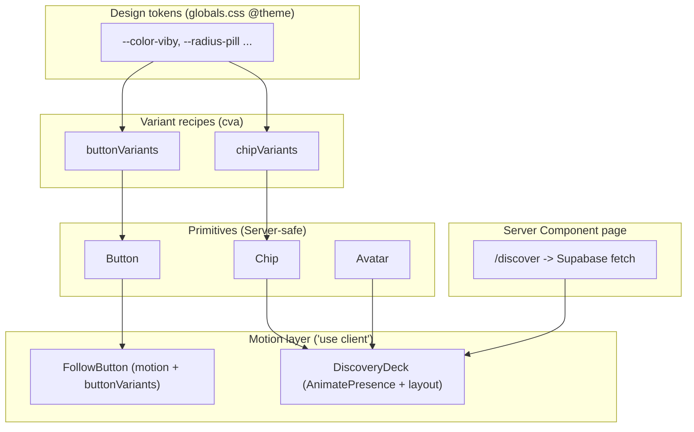

# Chapter 10 — Reusable Components, shadcn Patterns & Framer Motion

> One great `<Button />` beats a hundred copy-pasted divs — this is the chapter where Viby stops looking like a tutorial and starts feeling like a real product.

## What you'll learn

- How to design a **component API** that's a joy to use: small, predictable, composable.
- How to build **variants** with `cva` (class-variance-authority) and merge classes safely with `cn()`.
- How to compose **primitives** — `Button`, `Chip`, `Avatar` — that the rest of Viby is built on.
- How to add **premium motion** with Framer Motion: `motion` components, `AnimatePresence` for mount/unmount, gestures (`whileHover`/`whileTap`), and `layout` animations.
- When a component should be a **Server Component** and when it earns a `"use client"`.

## Prerequisites

- Chapter 6 (Tailwind CSS v4 and the `@theme` tokens that define our bubblegum-pink brand).
- Chapter 7 (TypeScript fundamentals — generics, unions, and `React.ComponentProps`).
- Chapter 9 (the Next.js 16 App Router: Server Components by default, `"use client"` only when needed).

You should have the Viby app running locally with the brand tokens already defined in `globals.css`.

---

## Theory

### Why components at all?

Imagine you run a bakery. You *could* hand-pipe every cupcake from scratch, but you'd never ship a hundred a day with a consistent look. Instead you build a **piping nozzle** — one tool, used everywhere, that guarantees the same swirl every time. A reusable component is that nozzle. You design the interface once (the shape of the swirl), and every cupcake in the shop inherits it for free.

A good component has a **narrow, honest API**: the props you can pass are exactly the things that *should* change, and nothing else. If your `Button` accepts twelve boolean flags, callers will combine them in nonsensical ways. If it accepts one `variant` prop with a closed set of values, the design system stays coherent.

### The two axes of a component API

Every primitive varies along two axes:

1. **Appearance** — discrete, designer-chosen looks: `primary`, `secondary`, `ghost`, sizes `sm`/`md`/`lg`. These are *enumerable*. You want autocomplete and type errors when someone passes `variant="purple"`.
2. **Behaviour & passthrough** — everything a native element already does: `onClick`, `disabled`, `aria-label`, `type`. You should *not* re-invent these; you forward them.

`cva` handles axis 1. `React.ComponentProps<"button">` handles axis 2.

### Why `cva` + `cn()`?

Tailwind is utility classes as strings. Strings are easy to mess up: duplicate classes, conflicting ones (`px-2 px-4` — who wins?), and sprawling ternaries. Two small libraries fix this:

- **`cva`** (class-variance-authority) turns "variant → class string" into a typed, declarative map. Think of it as a *recipe card*: base ingredients plus a table of variations.
- **`cn()`** is our tiny helper that runs `clsx` (conditional joining) through `tailwind-merge` (last-conflicting-class-wins). So `cn("px-2", "px-4")` correctly yields `"px-4"`. It's the *referee* that resolves class fights.

### Composition over configuration

The deepest idea in this chapter: **build small primitives, then compose them**. A profile card isn't a giant `<ProfileCard configEverything />`. It's an `Avatar`, a few `Chip`s, and a `Button`, arranged together. Small pieces compose into infinite layouts; one giant configurable component composes into nothing.

### Why animate?

Motion is *feedback*. When a user taps "Follow" on Viby and the button springs slightly, their brain registers "it worked" before any network call returns. Framer Motion gives us this with almost no code — and crucially, it animates **enter and exit** (plain CSS can't animate an element that's being removed from the DOM). That's what makes a Gen-Z social app feel alive instead of clinical.

---

## In practice

### The `cn()` helper

This lives once, in `src/lib/utils.ts`, and is imported everywhere.

```ts
// src/lib/utils.ts
import { clsx, type ClassValue } from "clsx";
import { twMerge } from "tailwind-merge";

export function cn(...inputs: ClassValue[]) {
  return twMerge(clsx(inputs));
}
```

Install the deps:

```bash
npm install class-variance-authority clsx tailwind-merge framer-motion
```

### Brand tokens (recap from Chapter 6)

Our variants reference these Tailwind v4 theme tokens. No `tailwind.config.js` — it's all CSS:

```css
/* src/app/globals.css */
@import "tailwindcss";

@theme {
  --color-viby: #ff6fb5;          /* bubblegum pink */
  --color-viby-ink: #1b1320;      /* near-black text */
  --color-viby-soft: #fff0f7;     /* pink tint surface */
  --radius-pill: 9999px;
}
```

These generate utilities like `bg-viby`, `text-viby-ink`, and `rounded-pill` automatically.

### The `Button` primitive

A Server Component-safe button (no hooks, no state) using `cva`:

```tsx
// src/components/ui/button.tsx
import { cva, type VariantProps } from "class-variance-authority";
import { cn } from "@/lib/utils";

const buttonVariants = cva(
  // base: applies to every button
  "inline-flex items-center justify-center gap-2 font-medium whitespace-nowrap " +
    "transition-colors focus-visible:outline-none focus-visible:ring-2 " +
    "focus-visible:ring-viby/50 disabled:pointer-events-none disabled:opacity-50",
  {
    variants: {
      variant: {
        primary: "bg-viby text-white hover:bg-viby/90",
        secondary: "bg-viby-soft text-viby-ink hover:bg-viby-soft/70",
        ghost: "bg-transparent text-viby-ink hover:bg-viby-soft",
        outline: "border border-viby text-viby hover:bg-viby-soft",
      },
      size: {
        sm: "h-8 px-3 text-sm rounded-pill",
        md: "h-10 px-5 text-sm rounded-pill",
        lg: "h-12 px-7 text-base rounded-pill",
      },
    },
    defaultVariants: { variant: "primary", size: "md" },
  }
);

export interface ButtonProps
  extends React.ComponentProps<"button">,
    VariantProps<typeof buttonVariants> {}

export function Button({ className, variant, size, ...props }: ButtonProps) {
  return (
    <button
      className={cn(buttonVariants({ variant, size }), className)}
      {...props}
    />
  );
}

export { buttonVariants };
```

Why this is good:

- `VariantProps<typeof buttonVariants>` *derives* the `variant`/`size` types from the recipe — they can never drift out of sync.
- `React.ComponentProps<"button">` forwards `onClick`, `disabled`, `type`, `aria-*` for free.
- `className` is merged **last** via `cn()`, so a caller can override anything without specificity wars.

Usage anywhere, including Server Components:

```tsx
<Button variant="primary" size="lg">Find my people</Button>
<Button variant="ghost" size="sm" aria-label="Skip">Skip</Button>
```

### The `Chip` primitive (Viby hobby tags)

Chips are how Viby surfaces shared interests — "Bouldering", "Lo-fi", "Matcha".

```tsx
// src/components/ui/chip.tsx
import { cva, type VariantProps } from "class-variance-authority";
import { cn } from "@/lib/utils";

const chipVariants = cva(
  "inline-flex items-center gap-1 rounded-pill px-3 py-1 text-xs font-medium transition-colors",
  {
    variants: {
      tone: {
        neutral: "bg-viby-soft text-viby-ink",
        active: "bg-viby text-white",
        muted: "bg-zinc-100 text-zinc-500",
      },
    },
    defaultVariants: { tone: "neutral" },
  }
);

export interface ChipProps
  extends React.ComponentProps<"span">,
    VariantProps<typeof chipVariants> {}

export function Chip({ className, tone, ...props }: ChipProps) {
  return <span className={cn(chipVariants({ tone }), className)} {...props} />;
}
```

### The `Avatar` primitive (composing primitives)

`Avatar` shows a user photo, falling back to initials. It uses `next/image` and stays a Server Component:

```tsx
// src/components/ui/avatar.tsx
import Image from "next/image";
import { cn } from "@/lib/utils";

interface AvatarProps {
  src?: string | null;
  name: string;
  size?: number; // px
  className?: string;
}

export function Avatar({ src, name, size = 40, className }: AvatarProps) {
  const initials = name
    .split(" ")
    .map((p) => p[0])
    .slice(0, 2)
    .join("")
    .toUpperCase();

  return (
    <span
      className={cn(
        "relative inline-flex shrink-0 items-center justify-center overflow-hidden rounded-pill bg-viby-soft text-viby-ink font-semibold",
        className
      )}
      style={{ width: size, height: size, fontSize: size * 0.4 }}
    >
      {src ? (
        <Image src={src} alt={name} fill sizes={`${size}px`} className="object-cover" />
      ) : (
        initials
      )}
    </span>
  );
}
```

### Adding motion: the `FollowButton`

Now the fun part. A button that springs on tap needs client-side JS, so it gets `"use client"`. We compose our existing `Button` styles with a `motion.button`. Notice we reuse `buttonVariants` rather than duplicating classes:

```tsx
// src/components/follow-button.tsx
"use client";

import { motion } from "framer-motion";
import { useState } from "react";
import { cn } from "@/lib/utils";
import { buttonVariants } from "@/components/ui/button";

export function FollowButton({ initial = false }: { initial?: boolean }) {
  const [following, setFollowing] = useState(initial);

  return (
    <motion.button
      whileTap={{ scale: 0.94 }}
      whileHover={{ scale: 1.03 }}
      transition={{ type: "spring", stiffness: 400, damping: 25 }}
      onClick={() => setFollowing((f) => !f)}
      className={cn(
        buttonVariants({ variant: following ? "secondary" : "primary", size: "md" })
      )}
    >
      {following ? "Following" : "Follow"}
    </motion.button>
  );
}
```

### `AnimatePresence`: animating things that leave

When a Viby user dismisses a "person you might vibe with" card, we want it to fly out, not vanish. Only `AnimatePresence` can animate exit:

```tsx
// src/components/discovery-deck.tsx
"use client";

import { AnimatePresence, motion } from "framer-motion";
import { useState } from "react";
import { Avatar } from "@/components/ui/avatar";
import { Chip } from "@/components/ui/chip";

interface Person {
  id: string;
  name: string;
  avatar?: string | null;
  hobbies: string[];
}

export function DiscoveryDeck({ people }: { people: Person[] }) {
  const [deck, setDeck] = useState(people);
  const dismiss = (id: string) => setDeck((d) => d.filter((p) => p.id !== id));

  return (
    <ul className="flex flex-col gap-3">
      <AnimatePresence initial={false}>
        {deck.map((person) => (
          <motion.li
            key={person.id}
            layout
            initial={{ opacity: 0, y: 12 }}
            animate={{ opacity: 1, y: 0 }}
            exit={{ opacity: 0, x: 80 }}
            transition={{ type: "spring", stiffness: 300, damping: 30 }}
            className="flex items-center gap-3 rounded-2xl bg-white p-4 shadow-sm"
          >
            <Avatar src={person.avatar} name={person.name} size={48} />
            <div className="min-w-0 flex-1">
              <p className="font-semibold text-viby-ink">{person.name}</p>
              <div className="mt-1 flex flex-wrap gap-1">
                {person.hobbies.map((h) => (
                  <Chip key={h}>{h}</Chip>
                ))}
              </div>
            </div>
            <button
              onClick={() => dismiss(person.id)}
              aria-label={`Dismiss ${person.name}`}
              className="text-zinc-400 hover:text-viby"
            >
              ✕
            </button>
          </motion.li>
        ))}
      </AnimatePresence>
    </ul>
  );
}
```

The magic word is `layout`: when one card exits, the remaining cards **smoothly slide up** to fill the gap, because Framer Motion measures their positions before and after and animates the difference (the FLIP technique). You get this for one keyword.

### Wiring it into a Server Component page

The page itself is a Server Component that fetches via Supabase and passes plain data to the client deck:

```tsx
// src/app/discover/page.tsx
import { createServerClient } from "@supabase/ssr";
import { cookies } from "next/headers";
import { DiscoveryDeck } from "@/components/discovery-deck";

export default async function DiscoverPage() {
  const cookieStore = await cookies();
  const supabase = createServerClient(
    process.env.NEXT_PUBLIC_SUPABASE_URL!,
    process.env.NEXT_PUBLIC_SUPABASE_ANON_KEY!,
    {
      cookies: {
        getAll: () => cookieStore.getAll(),
        setAll: (toSet) =>
          toSet.forEach(({ name, value, options }) =>
            cookieStore.set(name, value, options)
          ),
      },
    }
  );

  const { data } = await supabase
    .from("profiles")
    .select("id, name, avatar, hobbies")
    .limit(10);

  return (
    <main className="mx-auto max-w-md p-4">
      <h1 className="mb-4 text-2xl font-bold text-viby-ink">People to vibe with</h1>
      <DiscoveryDeck people={data ?? []} />
    </main>
  );
}
```

---

## Architecture / diagram



The flow is one-directional: **tokens → recipes → primitives → motion-wrapped composites → pages**. Each layer only knows about the one below it, which is exactly why the system scales.

---

## Best practices & pitfalls

**Do:**

- Keep primitives **Server Components** (no `"use client"`) unless they need state, effects, or motion. `Button`, `Chip`, `Avatar` ship zero JS to the browser.
- Always put `className` **last** in `cn()` so callers can override.
- Reuse `buttonVariants` inside motion components instead of re-writing classes — single source of truth.
- Give every `AnimatePresence` child a **stable, unique `key`** (use the DB id, never the array index).
- Use **spring** transitions for interactions (taps, follows) and **tween/ease** for entrances — springs feel physical, which suits gestures.
- Respect `prefers-reduced-motion`: wrap motion with Framer's `<MotionConfig reducedMotion="user">` at the root.

**Don't:**

- Don't pass arbitrary color props (`color="#abc"`). Enumerate variants instead — it keeps the brand consistent.
- Don't concatenate Tailwind classes with template strings when they might conflict; that's what `cn()`/`tailwind-merge` is for.
- Don't animate `width`/`height`/`top`/`left` directly when you can use `transform` (`x`, `y`, `scale`) — transforms are GPU-cheap and won't trigger layout thrash. Reach for `layout` for size/position changes.
- Don't forget: `AnimatePresence` only animates **direct children** that mount/unmount. Conditionally render the child, not a wrapper around it.
- Don't add `"use client"` to a whole page just to animate one button — push the boundary down to the smallest component.

---

## Exercises

1. **Add an `icon` size to `Button`** — a square `40×40` variant for icon-only buttons, plus an `aria-label` reminder in a JSDoc comment. (Easy)
2. **Build a `Badge` primitive** with `cva` that has `tone` (`new`, `pro`, `beta`) variants, reusing `rounded-pill`. (Easy)
3. **Make `Chip` interactive** — add a `selected` boolean and a tap animation so tapping toggles between `neutral` and `active`. Hint: this one needs `"use client"`. (Medium)
4. **Add a "liked" heart** to each `DiscoveryDeck` card that scales up with a spring `whileTap` and changes color, persisting in local state. (Medium)
5. **Stagger the deck entrance** — use a parent `motion.ul` with `variants` and `staggerChildren` so cards cascade in on first load. (Hard)

---

## Mini-project: The Viby "Vibe Tags" picker

Build a self-contained onboarding step where a new user picks their interests.

**Requirements:**

- A grid of `Chip`s for ~12 hobbies ("Bouldering", "Lo-fi", "Matcha", "Anime", "Run club", ...).
- Tapping a chip toggles it between `neutral` and `active`, with a `whileTap={{ scale: 0.9 }}` spring (so the `Chip` gets wrapped in a `motion.button`).
- A live count: "3 selected" updating as you tap.
- A `Button variant="primary" size="lg"` labeled "Start vibing", **disabled** until at least 3 are selected.
- When enabled, the button should gently pulse once (animate `scale` from 1 → 1.05 → 1) using `animate` to draw the eye.

**Stretch:** persist the selection to Supabase with a Server Action (`"use server"`) that writes `hobbies` to the user's `profiles` row, then `redirect("/discover")`.

This wires together everything from the chapter: tokens, `cva` variants, `cn()`, primitive composition, and gesture + state-driven motion.

---

## Key takeaways

- A great component has a **narrow API**: enumerated variants for looks, native prop passthrough for behaviour.
- **`cva`** maps variants to classes declaratively; **`cn()`** (clsx + tailwind-merge) resolves conflicts and lets callers override.
- **Compose** small primitives (`Button`, `Chip`, `Avatar`) instead of building giant configurable components.
- Keep primitives **Server Components**; add `"use client"` only at the smallest unit that needs interactivity or motion.
- **Framer Motion** gives you gestures (`whileHover`/`whileTap`), enter/exit animation (`AnimatePresence`), and effortless reflow (`layout`) — the difference between a demo and a premium product.

**Up next — Chapter 11: Forms, Validation & Server Actions**, where we'll capture real user input with type-safe schemas and write it straight to Supabase.
