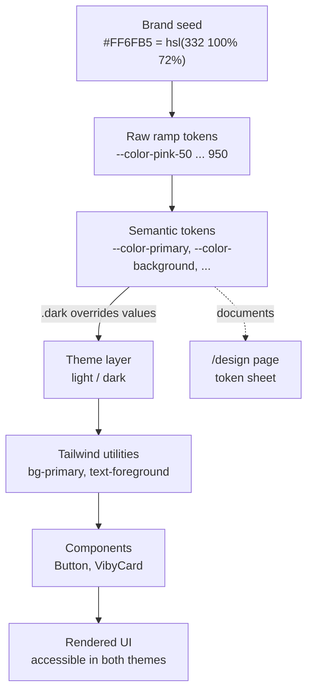

# Chapter 11 — Color, Theming & the Viby Design System

> Color isn't decoration — it's the fastest message your app sends before a single word is read.

## What you'll learn

- The working color theory you actually need: hue/saturation/lightness, contrast, and 60-30-10.
- How to turn a brand color (#FF6FB5) into a **token-based palette** that scales across light and dark.
- How to define those tokens natively in **Tailwind CSS v4 `@theme`** — no `tailwind.config.js`.
- Building Viby's signature **gradients, glow, and glass** surfaces, accessibly.
- Shipping a **design-token sheet**: a single living page that documents every token in the app.

## Prerequisites

- Chapter 4 (Tailwind v4 setup, the `@theme` block, `globals.css`).
- Chapter 7 (shadcn-style UI primitives and the `cn()` helper).
- Chapter 9 (Framer Motion basics — `motion` components and gestures).
- Comfort with Next.js 16 Server vs. Client Components (Chapter 6).

---

## Theory

### Color is a system, not a swatch

Beginners pick colors one at a time: "this pink looks nice here." Professionals define a **system** once and let every screen draw from it. Think of it like a kitchen. An amateur grabs whatever spice is closest; a chef builds a *mise en place* — everything measured, labeled, in reach. Our mise en place is a set of **design tokens**: named values (`--color-primary`, `--radius-lg`) that the whole codebase references instead of raw hex.

The payoff: change `--color-primary` in one place and every button, badge, and focus ring updates. Tokens are the difference between "we have a pink" and "we have a design system."

### HSL: the only color model that thinks like a designer

Hex (`#FF6FB5`) is how computers store color; **HSL** is how humans reason about it:

- **Hue** (0–360°): the color's identity. Viby's bubblegum pink sits around **332°**.
- **Saturation** (0–100%): how vivid vs. gray.
- **Lightness** (0–100%): how close to white or black.

HSL makes palettes *derivable*. Keep the hue, walk the lightness up and down, and you get a tonal scale (50 → 950) that feels like one family because it *is* one family. That's exactly how Tailwind's built-in scales work, and how we'll build Viby's.

`#FF6FB5` ≈ `hsl(332, 100%, 72%)`. From that single seed we generate the whole ramp.

### Contrast is non-negotiable

A pretty color that nobody can read is a bug. **WCAG** sets minimum contrast ratios: **4.5:1** for normal text, **3:1** for large text and UI components (borders, icons, focus states). Bubblegum pink on white is only ~2:1 — gorgeous for *fills*, illegal for *body text*. So the rule for Viby: pink is a **surface and accent** color; readable text rides on near-black ink (`--color-foreground`) or pure white on pink fills. We'll bake an accessible "on-primary" token in so nobody has to guess.

### 60-30-10: the proportion that makes brands feel calm

A balanced UI is roughly **60% dominant** (white/neutral background), **30% secondary** (cards, muted surfaces), **10% accent** (the pink — buttons, links, highlights). The mistake new designers make is flooding the screen with brand color; restraint is what makes the 10% *pop*. Viby looks premium precisely because pink is a spark, not a wall.

### Light and dark from one source of truth

We never hand-author two palettes. We define **semantic tokens** (`--color-background`, `--color-foreground`, `--color-primary`) and swap their *values* under a `.dark` class. Components only ever speak in semantics — `bg-background`, `text-foreground` — so they're theme-agnostic by construction.

---

## In practice

### 1. The token sheet, defined in CSS

Tailwind v4 has no JS config. Tokens live in `globals.css` inside `@theme`, and every token there automatically becomes a utility class (`--color-primary` → `bg-primary`, `text-primary`, `border-primary`).

```css
/* app/globals.css */
@import "tailwindcss";

/* 1) Raw brand ramp — the immutable source of truth.
   One hue (332°), walked across lightness. */
@theme {
  --color-pink-50:  hsl(330 100% 97%);
  --color-pink-100: hsl(331 100% 93%);
  --color-pink-200: hsl(332 100% 88%);
  --color-pink-300: hsl(332 100% 82%);
  --color-pink-400: hsl(332 100% 77%);
  --color-pink-500: hsl(332 100% 72%); /* #FF6FB5 — the brand */
  --color-pink-600: hsl(332 78%  60%);
  --color-pink-700: hsl(332 65%  48%);
  --color-pink-800: hsl(332 60%  38%);
  --color-pink-900: hsl(332 55%  28%);
  --color-pink-950: hsl(332 60%  16%);

  --color-ink-50:  hsl(320 16% 97%);
  --color-ink-500: hsl(320 8%  46%);
  --color-ink-900: hsl(322 24% 12%);

  /* 2) Semantic tokens — what components actually reference.
     These point AT the ramp, so a rebrand is a one-line change. */
  --color-background: white;
  --color-foreground: hsl(322 24% 12%);
  --color-primary: var(--color-pink-500);
  --color-primary-foreground: white;   /* text/icons ON pink — passes contrast */
  --color-muted: hsl(330 40% 97%);
  --color-muted-foreground: hsl(320 8% 46%);
  --color-card: white;
  --color-border: hsl(330 30% 91%);
  --color-ring: var(--color-pink-500);

  /* 3) Shape + motion tokens belong in the system too. */
  --radius-lg: 1rem;
  --radius-xl: 1.5rem;
  --shadow-glow: 0 0 0 1px hsl(332 100% 72% / 0.25),
                 0 8px 30px -8px hsl(332 100% 72% / 0.45);
}
```

### 2. Dark mode: same names, new values

We override the semantic layer only — the raw ramp never changes. Use a `@custom-variant` so `dark:` utilities work with a class toggle.

```css
/* still in globals.css */
@custom-variant dark (&:where(.dark, .dark *));

.dark {
  --color-background: hsl(322 24% 8%);
  --color-foreground: hsl(330 40% 96%);
  --color-primary: var(--color-pink-400); /* lift lightness so it glows on dark */
  --color-primary-foreground: hsl(322 30% 10%);
  --color-muted: hsl(322 20% 14%);
  --color-muted-foreground: hsl(320 12% 65%);
  --color-card: hsl(322 22% 11%);
  --color-border: hsl(322 18% 20%);
}
```

Because `--color-primary` is referenced by the `bg-primary` utility, the *same component* renders pink-500 in light mode and pink-400 in dark — zero component changes.

### 3. A token-driven Button (shadcn-style)

```tsx
// components/ui/button.tsx
import { cva, type VariantProps } from "class-variance-authority";
import { cn } from "@/lib/utils";

const button = cva(
  "inline-flex items-center justify-center rounded-lg font-medium " +
    "transition-colors focus-visible:outline-none focus-visible:ring-2 " +
    "focus-visible:ring-ring focus-visible:ring-offset-2 disabled:opacity-50",
  {
    variants: {
      variant: {
        primary:
          "bg-primary text-primary-foreground hover:bg-pink-600 shadow-glow",
        ghost: "text-foreground hover:bg-muted",
        outline: "border border-border text-foreground hover:bg-muted",
      },
      size: { sm: "h-9 px-3 text-sm", md: "h-11 px-5", lg: "h-13 px-7 text-lg" },
    },
    defaultVariants: { variant: "primary", size: "md" },
  },
);

export function Button({
  className,
  variant,
  size,
  ...props
}: React.ComponentProps<"button"> & VariantProps<typeof button>) {
  return <button className={cn(button({ variant, size }), className)} {...props} />;
}
```

Notice: no hex anywhere. The button speaks only tokens, so it's automatically correct in both themes.

### 4. Gradients, glow & glass — the Viby signature

```tsx
// components/viby-card.tsx  (Server Component — no interactivity needed)
export function VibyCard({ children }: { children: React.ReactNode }) {
  return (
    <div
      className={[
        "rounded-xl p-6",
        // Glass: translucent surface + blur + hairline border
        "bg-card/70 backdrop-blur-xl border border-border/60",
        // Glow: our shadow token
        "shadow-glow",
      ].join(" ")}
    >
      {children}
    </div>
  );
}
```

```css
/* A reusable brand gradient, defined as a token-backed utility */
@layer utilities {
  .bg-viby-gradient {
    background-image: linear-gradient(
      135deg,
      var(--color-pink-400) 0%,
      var(--color-pink-600) 100%
    );
  }
  .text-viby-gradient {
    background: linear-gradient(135deg, var(--color-pink-500), var(--color-pink-700));
    -webkit-background-clip: text;
    background-clip: text;
    color: transparent;
  }
}
```

```tsx
// A hero headline using the gradient text utility
<h1 className="text-4xl font-bold text-viby-gradient">
  Find your people.
</h1>
```

### 5. A theme toggle that respects the system

The toggle flips a class on `<html>` and persists choice. Reading from `localStorage` and matching system preference means we need a Client Component, but we keep it tiny.

```tsx
// components/theme-toggle.tsx
"use client";
import { useEffect, useState } from "react";
import { motion } from "framer-motion";
import { Button } from "@/components/ui/button";

export function ThemeToggle() {
  const [dark, setDark] = useState(false);

  useEffect(() => {
    const stored = localStorage.getItem("viby-theme");
    const prefersDark = window.matchMedia("(prefers-color-scheme: dark)").matches;
    const isDark = stored ? stored === "dark" : prefersDark;
    setDark(isDark);
    document.documentElement.classList.toggle("dark", isDark);
  }, []);

  function toggle() {
    const next = !dark;
    setDark(next);
    document.documentElement.classList.toggle("dark", next);
    localStorage.setItem("viby-theme", next ? "dark" : "light");
  }

  return (
    <Button variant="ghost" size="sm" onClick={toggle} aria-label="Toggle theme">
      <motion.span key={dark ? "moon" : "sun"} initial={{ rotate: -90, opacity: 0 }}
        animate={{ rotate: 0, opacity: 1 }} transition={{ duration: 0.2 }}>
        {dark ? "🌙" : "☀️"}
      </motion.span>
    </Button>
  );
}
```

To avoid a flash of the wrong theme, set the class **before** React hydrates with a tiny inline script in the root layout's `<head>`:

```tsx
// app/layout.tsx (excerpt)
<script
  dangerouslySetInnerHTML={{
    __html: `(function(){try{var s=localStorage.getItem('viby-theme');
      var d=s?s==='dark':matchMedia('(prefers-color-scheme:dark)').matches;
      document.documentElement.classList.toggle('dark',d);}catch(e){}})();`,
  }}
/>
```

---

## Architecture / diagram

The flow from a single brand hue to a rendered, themeable pixel:



The arrows only ever flow downward: components never reach past the semantic layer to raw hex. That one rule keeps the whole system maintainable.

---

## Best practices & pitfalls

- **Do** reference semantic tokens (`bg-primary`) in components, never raw ramp steps or hex. Raw steps are for *defining* the system, not consuming it.
- **Do** keep one hue family per brand color and derive the ramp by lightness — it guarantees harmony.
- **Don't** put brand pink behind body text. Reserve it for fills, accents, and large display text; check 4.5:1 with a contrast checker.
- **Don't** create a separate dark palette by hand. Override semantic values under `.dark` only.
- **Do** ship a no-flash inline script; a dark-mode flash on load reads as "amateur."
- **Don't** overuse glow/glass. Glass needs a busy/colored backdrop to read; over a flat white it just looks blurry. Follow 60-30-10.
- **Do** include radius, shadow, and spacing in your tokens — a design system is more than color.
- **Don't** animate `box-shadow` directly in hot paths; prefer transitioning a pseudo-element's opacity for glow on hover to stay at 60fps.

---

## Exercises

1. **Derive a step.** Compute `--color-pink-450` between 400 and 500 in HSL and add it to the ramp. Verify the utility `bg-pink-450` works on a `<div>`.
2. **Audit contrast.** Use a checker to test `text-primary` on `bg-background` in both themes. If it fails, adjust which ramp step `--color-primary` references in `.dark` and re-test.
3. **A semantic `success` token.** Add `--color-success` / `--color-success-foreground` (a mint green ~150°), wire a `success` Button variant, and confirm it themes correctly.
4. **Glow on hover, performantly.** Refactor `VibyCard` so the glow appears only on hover by transitioning a pseudo-element's opacity rather than the `box-shadow` property.
5. **System-preference live sync.** Extend `ThemeToggle` so that when the user has *not* made an explicit choice, the app follows OS theme changes in real time via a `matchMedia` `change` listener.

---

## Mini-project — The Viby Design Token Sheet

Build `/design`, a living page that renders every token so the whole team (and your future self) can see the system at a glance.

```tsx
// app/design/page.tsx  — Server Component, zero client JS
const RAMP = [50, 100, 200, 300, 400, 500, 600, 700, 800, 900, 950];
const SEMANTIC = [
  "background", "foreground", "primary", "primary-foreground",
  "muted", "muted-foreground", "card", "border",
] as const;

export default function DesignSystemPage() {
  return (
    <main className="min-h-screen bg-background text-foreground p-8 space-y-12">
      <header>
        <h1 className="text-4xl font-bold text-viby-gradient">Viby Design Tokens</h1>
        <p className="text-muted-foreground">One source of truth for color, shape & glow.</p>
      </header>

      <section>
        <h2 className="text-2xl font-semibold mb-4">Pink ramp</h2>
        <div className="grid grid-cols-11 gap-2">
          {RAMP.map((step) => (
            <div key={step} className="text-center">
              <div className="h-16 rounded-lg border border-border"
                   style={{ background: `var(--color-pink-${step})` }} />
              <span className="text-xs text-muted-foreground">{step}</span>
            </div>
          ))}
        </div>
      </section>

      <section>
        <h2 className="text-2xl font-semibold mb-4">Semantic tokens</h2>
        <div className="grid grid-cols-2 sm:grid-cols-4 gap-4">
          {SEMANTIC.map((name) => (
            <div key={name} className="rounded-lg border border-border overflow-hidden">
              <div className="h-16" style={{ background: `var(--color-${name})` }} />
              <code className="block p-2 text-xs">--color-{name}</code>
            </div>
          ))}
        </div>
      </section>

      <section>
        <h2 className="text-2xl font-semibold mb-4">Surfaces</h2>
        <div className="grid sm:grid-cols-3 gap-4">
          <div className="rounded-xl p-6 bg-viby-gradient text-white">Gradient</div>
          <div className="rounded-xl p-6 shadow-glow bg-card">Glow</div>
          <div className="rounded-xl p-6 bg-card/70 backdrop-blur-xl border border-border/60">
            Glass
          </div>
        </div>
      </section>
    </main>
  );
}
```

Add a `ThemeToggle` to the page header and watch every swatch re-theme live. This page is your contract: if a new component doesn't match what's here, the component is wrong — not the system.

---

## Key takeaways

- Design with a **system of tokens**, not one-off hex values; change once, update everywhere.
- Reason in **HSL** and derive ramps by walking lightness across a single hue.
- Split tokens into **raw ramp** → **semantic** → **theme overrides**; components consume semantics only.
- Tailwind v4 puts the whole token sheet in **CSS `@theme`** — every token becomes a utility for free.
- Respect **contrast** and **60-30-10**: pink is a spark, not a flood.
- A **token sheet page** keeps the system honest and onboards teammates instantly.

**Up next — Chapter 12: Typography & Spacing — A Type Scale That Breathes**, where we give Viby a voice to match its color.
