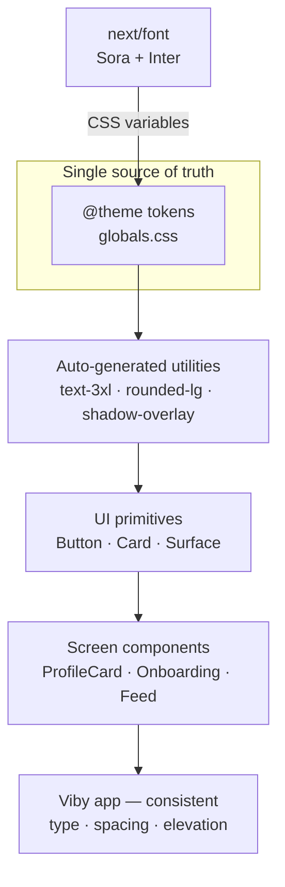

# Chapter 12 — Typography, Spacing & Layout Systems

> Great design isn't decoration you add at the end — it's a system of decisions you make once, then reuse a thousand times.

You've shipped working screens. Now we make them *feel* like a real product. The difference between "a student project" and "a startup app" is rarely the features — it's the rhythm: consistent type, breathing room, and a hierarchy that guides the eye without a single instruction. This chapter turns Viby's look into a **system**.

## What you'll learn

- How to build a **type scale** and pair a display font with a body font that actually works
- **Spacing rhythm** — why a 4px-based scale beats eyeballed margins
- A **radius and elevation system** for cards, sheets, and buttons
- The mechanics of **visual hierarchy**: size, weight, color, and space working together
- How to encode all of it as **Tailwind v4 `@theme` tokens** and apply them across real Viby screens

## Prerequisites

- Chapter 3 (project setup) and Chapter 4 (Tailwind v4 + the `@theme` block in `globals.css`)
- Chapter 8 (shadcn-style UI primitives — `Button`, `Card`)
- Comfort with Server Components vs. `"use client"` (Chapter 6)

---

## Theory

### Why a *system* and not just "good taste"

Imagine furnishing a house where every door is a different height and every wall a slightly different white. Nothing is *wrong*, but the whole thing feels off. UI is the same. When one card uses `padding: 14px`, the next uses `16px`, and a third uses `1rem`, your brain registers the inconsistency as "amateur" even if it can't name why.

A design system replaces a thousand ad-hoc choices with a small set of **tokens** — named, reusable values. You decide the spacing scale *once*. After that, you're never asking "16 or 18?"; you're picking from a menu. That's what makes design fast *and* consistent.

### Type scales — the musical analogy

A type scale is like a musical scale: a fixed set of notes that sound good together. Instead of random sizes (13px, 15px, 22px, 31px), you generate sizes from a base by multiplying by a **ratio**.

- Base: `16px` (1rem) — your body text.
- Ratio: a common choice is the **Major Third (1.25)** or **Perfect Fourth (1.333)**. Bigger ratio = more dramatic contrast between headings and body.

With a 1.25 ratio from a 16px base: 16 → 20 → 25 → 31 → 39 → 49. Each step is "one note up." Viby is a punchy, mobile-first social app, so we want strong contrast: a big confident display size for moments like the onboarding hero, and a calm, readable body.

**Pairing fonts.** The reliable formula is *one expressive display face + one neutral, highly-readable body face*. Contrast is the goal — if both fonts are geometric sans-serifs, they fight. For Viby we'll pair **Sora** (a rounded, friendly geometric sans for display — on-brand Gen-Z energy) with **Inter** (the workhorse UI body font, superb at small sizes).

### Rhythm and spacing — the 4px grid

Vertical and horizontal rhythm come from a single base unit. The industry standard is a **4px base** (sometimes 8px). Every gap, padding, and margin is a multiple: 4, 8, 12, 16, 24, 32, 48, 64. Why? Multiples of 4 align cleanly on screens, and constraining yourself to the scale eliminates the "is this 15 or 16?" dithering. Tailwind already bakes this in (`p-4` = 16px, `gap-2` = 8px), so we lean on it rather than fighting it.

Think of spacing like the silence in music. The notes (your content) matter, but the rests (your whitespace) are what make it *legible*. Cramped UIs read as stressful; generous spacing reads as premium.

### Radius and elevation

**Radius** sets personality. Sharp corners (0–2px) feel corporate and serious; soft corners (12–24px) feel friendly and modern. Viby is warm and social, so we go generously rounded.

**Elevation** is how you communicate stacking — what floats above what. In flat design, elevation isn't drop-shadow soup; it's a small, deliberate ramp of shadows (rest → raised → overlay → modal). Each level should feel like a real step up off the page. Like the floors of a building: the lobby, then a few defined storeys — not forty indistinguishable ones.

### Visual hierarchy — the four levers

You guide attention with four tools, used together:

1. **Size** — bigger = more important.
2. **Weight** — bolder = louder.
3. **Color/contrast** — high contrast pulls the eye; muted recedes.
4. **Space** — isolation creates emphasis (a lone CTA surrounded by whitespace screams "click me").

The mistake beginners make is shouting with all four at once on everything. Hierarchy is *relative*: something is only "loud" because other things are quiet.

---

## In practice

### 1. Load the fonts (Next.js 16, `next/font`)

In the App Router, `next/font` self-hosts Google Fonts at build time (zero layout shift, no network request) and exposes them as CSS variables.

```tsx
// app/layout.tsx
import type { Metadata } from "next";
import { Sora, Inter } from "next/font/google";
import "./globals.css";

const sora = Sora({
  subsets: ["latin"],
  variable: "--font-display",
  display: "swap",
  weight: ["600", "700", "800"],
});

const inter = Inter({
  subsets: ["latin"],
  variable: "--font-body",
  display: "swap",
});

export const metadata: Metadata = {
  title: "Viby — find your people",
  description: "Social discovery through shared hobbies and lifestyle.",
};

export default function RootLayout({
  children,
}: {
  children: React.ReactNode;
}) {
  return (
    <html lang="en" className={`${sora.variable} ${inter.variable}`}>
      <body className="bg-background text-foreground antialiased">
        {children}
      </body>
    </html>
  );
}
```

### 2. Encode the system as Tailwind v4 `@theme` tokens

In Tailwind v4 there is **no `tailwind.config.js`** — design tokens live in CSS inside an `@theme` block. The font variables we just created get wired in here, alongside our type scale, radius, and shadow ramp.

```css
/* app/globals.css */
@import "tailwindcss";

@theme {
  /* Brand */
  --color-primary: #ff6fb5;
  --color-primary-foreground: #ffffff;
  --color-background: #ffffff;
  --color-foreground: #18121c;
  --color-muted: #f4f1f4;
  --color-muted-foreground: #6b6470;

  /* Fonts — consume the next/font variables */
  --font-display: var(--font-display), ui-sans-serif, system-ui, sans-serif;
  --font-body: var(--font-body), ui-sans-serif, system-ui, sans-serif;

  /* Type scale — base 16px, ~1.25 ratio (Major Third) */
  --text-xs: 0.75rem;     /* 12 */
  --text-sm: 0.875rem;    /* 14 */
  --text-base: 1rem;      /* 16 */
  --text-lg: 1.25rem;     /* 20 */
  --text-xl: 1.563rem;    /* 25 */
  --text-2xl: 1.953rem;   /* 31 */
  --text-3xl: 2.441rem;   /* 39 */
  --text-4xl: 3.052rem;   /* 49 */

  /* Line-height pairs to each step (set via utilities below) */
  --leading-tight: 1.1;
  --leading-snug: 1.3;
  --leading-relaxed: 1.6;

  /* Radius system — friendly, generous */
  --radius-sm: 0.5rem;    /* 8  - inputs, chips */
  --radius-md: 0.875rem;  /* 14 - buttons */
  --radius-lg: 1.25rem;   /* 20 - cards */
  --radius-xl: 1.75rem;   /* 28 - sheets, modals */
  --radius-full: 9999px;  /* avatars, pills */

  /* Elevation ramp — soft, brand-tinted */
  --shadow-raised: 0 1px 2px rgba(24, 18, 28, 0.06),
                   0 2px 8px rgba(24, 18, 28, 0.05);
  --shadow-overlay: 0 8px 24px rgba(24, 18, 28, 0.10);
  --shadow-modal: 0 24px 64px rgba(24, 18, 28, 0.18);
  --shadow-glow: 0 8px 28px rgba(255, 111, 181, 0.35);
}

/* Two semantic type roles built on the scale */
@layer components {
  .text-display {
    font-family: var(--font-display);
    font-weight: 800;
    line-height: var(--leading-tight);
    letter-spacing: -0.02em;
  }
  .text-body {
    font-family: var(--font-body);
    line-height: var(--leading-relaxed);
  }
}
```

Because we named tokens like `--color-primary`, `--radius-lg`, and `--shadow-overlay`, Tailwind v4 auto-generates utilities: `bg-primary`, `rounded-lg`, `shadow-overlay`, `text-3xl`, and so on. No config file, no plugin — the CSS *is* the source of truth.

### 3. A profile card that uses the whole system

Here's a Viby discovery card — the thing you swipe through to find people who share your hobbies. Notice every value is a token: type from the scale, `rounded-lg`, `shadow-overlay`, spacing on the 4px grid.

```tsx
// components/discovery/profile-card.tsx
import Image from "next/image";

type Person = {
  name: string;
  age: number;
  tagline: string;
  hobbies: string[];
  avatarUrl: string;
};

export function ProfileCard({ person }: { person: Person }) {
  return (
    <article className="overflow-hidden rounded-lg bg-background shadow-overlay">
      <div className="relative aspect-[4/5] w-full">
        <Image
          src={person.avatarUrl}
          alt={person.name}
          fill
          className="object-cover"
          sizes="(max-width: 480px) 100vw, 380px"
        />
        {/* gradient scrim so text stays readable over any photo */}
        <div className="absolute inset-x-0 bottom-0 h-2/5 bg-gradient-to-t from-foreground/70 to-transparent" />
        <div className="absolute inset-x-0 bottom-0 p-5 text-primary-foreground">
          <h2 className="text-display text-2xl">
            {person.name}{" "}
            <span className="font-normal opacity-80">{person.age}</span>
          </h2>
          <p className="text-body mt-1 text-sm opacity-90">{person.tagline}</p>
        </div>
      </div>

      <div className="flex flex-wrap gap-2 p-4">
        {person.hobbies.map((h) => (
          <span
            key={h}
            className="rounded-full bg-muted px-3 py-1 text-sm text-muted-foreground"
          >
            {h}
          </span>
        ))}
      </div>
    </article>
  );
}
```

Read it top to bottom: the **name** is the loudest thing (display font, `text-2xl`, full white), the **age** recedes (normal weight, reduced opacity), the **tagline** is quieter still (body font, `text-sm`), and hobby chips are calm muted pills. Four levers, one clear path for the eye — and not a single hand-tuned pixel.

### 4. A reusable elevation primitive

Wrapping elevation in a tiny component keeps the ramp consistent and gives you one place to tune it. Server Component by default — no client JS needed.

```tsx
// components/ui/surface.tsx
import { cn } from "@/lib/utils";

const elevation = {
  flat: "",
  raised: "shadow-raised",
  overlay: "shadow-overlay",
  modal: "shadow-modal",
} as const;

export function Surface({
  level = "raised",
  className,
  ...props
}: React.ComponentProps<"div"> & { level?: keyof typeof elevation }) {
  return (
    <div
      className={cn("rounded-lg bg-background", elevation[level], className)}
      {...props}
    />
  );
}
```

### 5. Animate elevation on interaction (Framer Motion)

A card that lifts on hover *feels* tactile. Keep the motion subtle — premium, not bouncy-house. This needs the client.

```tsx
// components/discovery/interactive-card.tsx
"use client";

import { motion } from "framer-motion";

export function InteractiveCard({ children }: { children: React.ReactNode }) {
  return (
    <motion.div
      whileHover={{ y: -4 }}
      whileTap={{ scale: 0.98 }}
      transition={{ type: "spring", stiffness: 320, damping: 26 }}
      className="rounded-lg bg-background shadow-raised hover:shadow-overlay"
    >
      {children}
    </motion.div>
  );
}
```

The Tailwind `hover:shadow-overlay` and Framer's `y: -4` work together: the card both *rises* (transform) and *casts a bigger shadow* (the elevation ramp). That's elevation done right.

---

## Architecture / diagram

How the system flows from a few token definitions out to every screen:



And the hierarchy levers, ranked by how strongly each pulls the eye on a Viby card:

```text
LOUDEST  ┌────────────────────────────┐
  ▲      │  Name   (display, text-2xl) │  ← size + weight + contrast
  │      ├────────────────────────────┤
  │      │  Age    (normal, 80% opac)  │  ← same size, lower contrast
  │      ├────────────────────────────┤
  │      │  Tagline (body, text-sm)    │  ← smaller, quieter
  ▼      ├────────────────────────────┤
QUIETEST │  Hobby chips (muted pills)  │  ← grouped, low contrast, spaced
         └────────────────────────────┘
```

---

## Best practices & pitfalls

- **Do** pick a base size + ratio and generate the whole scale. **Don't** add one-off sizes "just this once" — that's how scales rot.
- **Do** pair *one* display font with *one* body font. **Don't** ship three+ font families; it reads as chaos and bloats your font payload.
- **Do** use `font-display: swap` and self-host via `next/font` to kill layout shift (CLS). **Don't** `<link>` to Google Fonts in `<head>` — it's slower and shifts the page.
- **Do** snap every gap/padding to the 4px grid (Tailwind's defaults). **Don't** write arbitrary values like `p-[13px]` unless you have a documented reason.
- **Do** keep a *small* elevation ramp (3–4 levels). **Don't** stack heavy shadows on everything — flat-with-purpose beats shadow soup.
- **Do** tighten `line-height` on big headings (1.1) and loosen it on body (1.5–1.6). **Don't** use one line-height for all sizes; large tight, small loose.
- **Do** check contrast: body text should hit WCAG AA (4.5:1). Bubblegum pink `#FF6FB5` on white is **not** AA for small text — use it for fills/accents, and use `--color-foreground` for reading text.
- **Don't** use color *alone* to convey state (a green vs. red dot is invisible to many users) — pair it with an icon or label.

---

## Exercises

1. **Re-scale.** Regenerate the type scale using a Perfect Fourth ratio (1.333) instead of 1.25. Update the `@theme` tokens and observe how the onboarding hero gets more dramatic. Which ratio suits Viby better, and why?
2. **Spacing audit.** Open any screen you built earlier and find three places using off-grid values (e.g. `mt-[18px]`). Snap them to the nearest scale step and note whether the layout looks more cohesive.
3. **Add a level.** Extend the elevation ramp with a `--shadow-sheet` value for a bottom sheet that sits between `overlay` and `modal`. Add it to the `Surface` primitive's `elevation` map.
4. **Hierarchy challenge.** Take the `ProfileCard` and make the **tagline** the loudest element instead of the name — using only the four levers. Then argue (in a comment) which version serves a *discovery* app better.
5. **Dark mode token swap (stretch).** Add a `@media (prefers-color-scheme: dark)` block that overrides `--color-background`, `--color-foreground`, and the shadow ramp. Confirm every component adapts without touching a single component file.

---

## Mini-project — the Viby Design Tokens reference screen

Build a `/styleguide` route (a Server Component page) that renders your living design system, so the whole team designs from the same source.

**Goal:** one page that displays:

- The full **type scale** — each step rendered at size with its name and px value.
- The **spacing scale** — labeled bars showing 4 → 64.
- The **radius set** — swatches from `sm` to `full`.
- The **elevation ramp** — four `Surface` cards, one per level.

```tsx
// app/styleguide/page.tsx
import { Surface } from "@/components/ui/surface";

const typeSteps = [
  ["text-4xl", "49px", "Find your people"],
  ["text-3xl", "39px", "Section heading"],
  ["text-2xl", "31px", "Card title"],
  ["text-xl", "25px", "Subhead"],
  ["text-lg", "20px", "Lead paragraph"],
  ["text-base", "16px", "Body — the workhorse"],
  ["text-sm", "14px", "Captions & chips"],
] as const;

const space = [1, 2, 3, 4, 6, 8, 12, 16] as const; // ×4px

export default function StyleguidePage() {
  return (
    <main className="mx-auto max-w-2xl space-y-12 p-6">
      <h1 className="text-display text-4xl text-primary">Viby Design System</h1>

      <section className="space-y-3">
        <h2 className="text-display text-xl">Type scale</h2>
        {typeSteps.map(([cls, px, sample]) => (
          <div key={cls} className="flex items-baseline gap-4">
            <code className="w-44 shrink-0 text-sm text-muted-foreground">
              {cls} · {px}
            </code>
            <span className={`text-display ${cls}`}>{sample}</span>
          </div>
        ))}
      </section>

      <section className="space-y-3">
        <h2 className="text-display text-xl">Spacing (×4px)</h2>
        {space.map((s) => (
          <div key={s} className="flex items-center gap-4">
            <code className="w-16 text-sm text-muted-foreground">{s * 4}px</code>
            <div className="h-3 rounded-sm bg-primary" style={{ width: s * 4 }} />
          </div>
        ))}
      </section>

      <section className="space-y-3">
        <h2 className="text-display text-xl">Radius</h2>
        <div className="flex flex-wrap gap-4">
          {["sm", "md", "lg", "xl", "full"].map((r) => (
            <div
              key={r}
              className={`grid h-20 w-20 place-items-center bg-muted text-sm text-muted-foreground rounded-${r}`}
            >
              {r}
            </div>
          ))}
        </div>
      </section>

      <section className="space-y-3">
        <h2 className="text-display text-xl">Elevation</h2>
        <div className="grid grid-cols-2 gap-6">
          {(["raised", "overlay", "modal"] as const).map((level) => (
            <Surface key={level} level={level} className="grid h-24 place-items-center">
              <span className="text-sm text-muted-foreground">{level}</span>
            </Surface>
          ))}
        </div>
      </section>
    </main>
  );
}
```

Ship this once and you'll reference it for the rest of the book. When a teammate asks "what's our card radius?" you point at `/styleguide` instead of arguing in Slack. (One caveat for the radius swatches: because `rounded-${r}` is built dynamically, add those class names to a safelist comment or list them statically if your build tree-shakes unused utilities.)

---

## Key takeaways

- A design system swaps a thousand ad-hoc choices for a **small set of named tokens** — fast *and* consistent.
- Generate your **type scale** from a base size and a ratio; pair **one display + one body** font for contrast.
- Snap all spacing to a **4px grid**; whitespace is a feature, not wasted space.
- Keep a **small radius set and a 3–4 step elevation ramp** — restraint reads as premium.
- Drive hierarchy with **size, weight, contrast, and space** — relatively, never all at once.
- In this stack the system lives in **Tailwind v4 `@theme` tokens** (no config file), fed by **`next/font`** variables, and is the single source of truth for every screen.

**Up next — Chapter 13: Color, Theming & Dark Mode**, where we turn that bubblegum pink into a full, accessible palette and make Viby beautiful in the dark.
