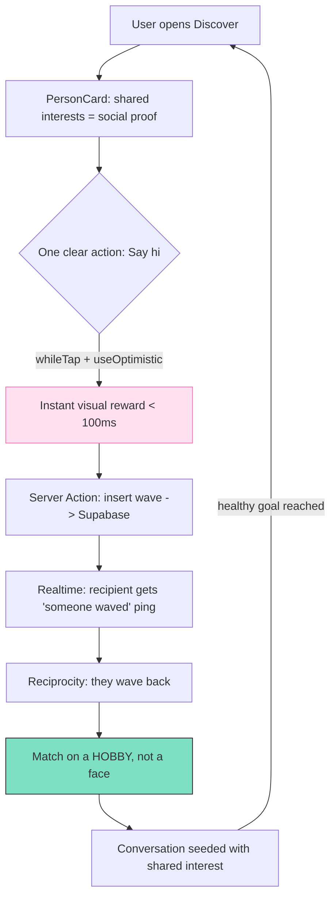

# Chapter 13 — Design Psychology, Gen-Z & Social App UX

> Great social apps don't *show* you content — they make you *feel* something in under 400ms, and then make you want to come back tomorrow.

## What you'll learn

- **Emotional design**: why the first 5 seconds decide whether a user stays, and how to engineer warmth into pixels.
- **Cognitive load**: how to make Viby feel effortless by giving the brain less to do.
- **Social & feedback loops**: the mechanics behind likes, streaks, and "someone viewed your profile" — and how to use them ethically.
- **Onboarding psychology**: progressive disclosure, the goal-gradient effect, and the dreaded empty state.
- **Premium feel**: micro-interactions, motion, and the details that separate a $0 app from a startup-grade one.
- **Dark patterns to avoid**: the manipulative tricks that work short-term and burn trust long-term.
- **Designing an identity system that is NOT a dating clone**: how copy, taxonomy, and affordances steer Viby toward *friendship and discovery*.

## Prerequisites

- Chapter 6 (Tailwind CSS v4 with `@theme` tokens) — we'll lean on our design tokens here.
- Chapter 8 (shadcn-style UI primitives) — `Button`, `Card`, `Avatar`.
- Chapter 10 (Framer Motion) — `motion`, `AnimatePresence`, gestures.
- Chapter 11 (Zustand demo state) and Chapter 12 (Supabase Realtime) — for the live feedback loop in the mini-project.

---

## Theory

### Emotional design: people decode feeling before function

Don Norman splits design into three levels: **visceral** (gut reaction to look/feel), **behavioral** (how good it is to *use*), and **reflective** (the story you tell yourself after — "I'm the kind of person who uses this"). Most beginners obsess over behavioral and ignore the other two. For a social app, that's fatal: the visceral layer fires in ~50ms, before a single word is read.

Think of your UI like meeting a person. Before they speak, you've judged their posture, their warmth, whether they're *like you*. Viby's bubblegum pink (`#FF6FB5`) on generous white space is a deliberate visceral signal: playful, soft, non-threatening — the opposite of a corporate blue LinkedIn or a sultry red dating app.

### Cognitive load: the brain is lazy on purpose

Working memory holds only a handful of items at once. Every choice, every unlabeled icon, every "wait, what does this do?" spends a slice of that budget. **Cognitive load** comes in three flavors:

- **Intrinsic** — inherent difficulty of the task (joining a hobby group).
- **Extraneous** — difficulty *you* added with bad UI (a cluttered screen). This is the one we ruthlessly cut.
- **Germane** — effort that builds the user's mental model (a good onboarding tour).

Analogy: a well-designed screen is a clean kitchen. Everything you need for *this* step is on the counter; everything else is in a drawer. **Hick's Law** says decision time grows with the number of options — so we show one primary action per screen, not five.

### Social & feedback loops: the dopamine machine, used kindly

A feedback loop is *action → reward → motivation to repeat*. Social apps run on three engines:

1. **Reciprocity** — you waved, they waved back. Humans are wired to return gestures.
2. **Social proof** — "12 people share your love of bouldering" lowers the fear of joining.
3. **Variable reward** — you don't know *who* will react, so you check. This is the most powerful and the most dangerous lever; we'll use it with restraint.

The ethical line: a loop is healthy when it helps the user reach *their* goal (find friends), and toxic when it exists only to maximize *our* session time.

### Onboarding psychology: earn the right to ask

New users have zero investment and infinite exits. Two principles save us:

- **Progressive disclosure** — reveal complexity only as needed. Don't ask for 14 interests up front; ask for 3, celebrate, then offer more.
- **Goal-gradient effect** — motivation increases as a goal feels closer. A progress bar that starts at 20% (not 0%) makes people finish.

### Premium feel: the invisible 10%

Premium isn't a gradient — it's *responsiveness*. Buttons that depress, lists that stagger in, optimistic UI that reacts *before* the server replies. The brain reads sub-100ms feedback as "this thing is alive."

### NOT a dating clone: identity through constraint

A dating app and a friendship app can look identical in a Figma file — the difference lives in **affordances and language**. Swipe-to-judge-faces says "rate this body." A grid of *shared interests* says "find your people." We design Viby so the unit of attraction is a **shared hobby**, never a face. We'll codify this below.

---

## In practice

### 1. Encoding emotion as design tokens (Tailwind v4 `@theme`)

Emotion should be *systematized*, not vibes. We define warmth in CSS tokens once (Chapter 6) and reuse everywhere.

```css
/* app/globals.css */
@import "tailwindcss";

@theme {
  /* Brand — visceral warmth */
  --color-viby: #ff6fb5;
  --color-viby-soft: #ffe1f0;
  --color-viby-ink: #2a1622;

  /* Friendship-coded accents (NOT romance reds) */
  --color-spark: #ffd166;   /* shared-interest highlight */
  --color-calm: #7ee0c2;    /* "you're matched on a hobby" */

  /* Premium motion */
  --ease-spring: cubic-bezier(0.34, 1.56, 0.64, 1);
  --radius-bubble: 1.25rem;
}
```

### 2. Low cognitive load: one primary action per screen

A profile card that surfaces *shared interests* (social proof) and exactly **one** clear next step (Hick's Law).

```tsx
// components/discover/PersonCard.tsx  (Server Component by default)
import { Card } from "@/components/ui/card";
import { Avatar } from "@/components/ui/avatar";
import { WaveButton } from "./WaveButton";

type Person = {
  id: string;
  name: string;
  avatarUrl: string;
  sharedInterests: string[]; // the unit of attraction — hobbies, not looks
};

export function PersonCard({ person }: { person: Person }) {
  return (
    <Card className="rounded-[--radius-bubble] p-5 bg-white">
      <div className="flex items-center gap-3">
        <Avatar src={person.avatarUrl} alt={person.name} className="size-14" />
        <div>
          <h3 className="font-semibold text-viby-ink">{person.name}</h3>
          {/* Social proof, not a hot-or-not score */}
          <p className="text-sm text-viby-ink/70">
            {person.sharedInterests.length} shared interests
          </p>
        </div>
      </div>

      <ul className="mt-3 flex flex-wrap gap-2">
        {person.sharedInterests.slice(0, 3).map((tag) => (
          <li
            key={tag}
            className="rounded-full bg-viby-soft px-3 py-1 text-xs font-medium text-viby"
          >
            {tag}
          </li>
        ))}
      </ul>

      {/* Exactly ONE primary action */}
      <WaveButton personId={person.id} className="mt-4 w-full" />
    </Card>
  );
}
```

### 3. The feedback loop: optimistic "Wave" with a Server Action

A wave is reciprocity-coded (friendly), not a swipe (judgmental). We make it feel *instant* with React 19's `useOptimistic`, then persist via a Server Action.

```ts
// app/discover/actions.ts
"use server";

import { createServerClient } from "@supabase/ssr";
import { cookies } from "next/headers";
import { revalidatePath } from "next/cache";

export async function sendWave(personId: string) {
  const cookieStore = await cookies(); // async in Next.js 16

  const supabase = createServerClient(
    process.env.NEXT_PUBLIC_SUPABASE_URL!,
    process.env.NEXT_PUBLIC_SUPABASE_ANON_KEY!,
    {
      cookies: {
        getAll: () => cookieStore.getAll(),
        setAll: (toSet) =>
          toSet.forEach(({ name, value, options }) =>
            cookieStore.set(name, value, options),
          ),
      },
    },
  );

  const {
    data: { user },
  } = await supabase.auth.getUser();
  if (!user) throw new Error("Not authenticated");

  const { error } = await supabase
    .from("waves")
    .insert({ from_user: user.id, to_user: personId });

  if (error) throw error;
  revalidatePath("/discover");
}
```

```tsx
// components/discover/WaveButton.tsx
"use client";

import { useOptimistic, useTransition } from "react";
import { motion } from "framer-motion";
import { Button } from "@/components/ui/button";
import { sendWave } from "@/app/discover/actions";

export function WaveButton({
  personId,
  className,
}: {
  personId: string;
  className?: string;
}) {
  const [waved, setWaved] = useOptimistic(false);
  const [isPending, startTransition] = useTransition();

  return (
    <motion.div whileTap={{ scale: 0.96 }} className={className}>
      <Button
        disabled={waved || isPending}
        className="w-full bg-viby text-white transition-[transform,background-color]"
        onClick={() =>
          startTransition(async () => {
            setWaved(true); // feels instant — premium responsiveness
            await sendWave(personId);
          })
        }
      >
        {waved ? "Wave sent 👋" : "Say hi"}
      </Button>
    </motion.div>
  );
}
```

### 4. Onboarding: progressive disclosure + goal-gradient

Ask for **3** interests, show a head-start progress bar, celebrate on completion.

```tsx
// components/onboarding/InterestPicker.tsx
"use client";

import { useState } from "react";
import { motion, AnimatePresence } from "framer-motion";

const INTERESTS = ["Bouldering", "Lo-fi", "Film photography", "Ramen", "Indie games", "Plants"];
const GOAL = 3;

export function InterestPicker() {
  const [picked, setPicked] = useState<string[]>([]);
  // Goal-gradient: start the bar at 20%, never empty
  const progress = 20 + (picked.length / GOAL) * 80;
  const done = picked.length >= GOAL;

  function toggle(tag: string) {
    setPicked((p) =>
      p.includes(tag) ? p.filter((t) => t !== tag) : [...p, tag],
    );
  }

  return (
    <div className="space-y-5">
      <div className="h-2 w-full overflow-hidden rounded-full bg-viby-soft">
        <motion.div
          className="h-full bg-viby"
          animate={{ width: `${Math.min(progress, 100)}%` }}
          transition={{ type: "spring", stiffness: 180, damping: 22 }}
        />
      </div>

      <p className="text-sm text-viby-ink/70">Pick {GOAL} things you love</p>

      <div className="flex flex-wrap gap-2">
        {INTERESTS.map((tag) => {
          const active = picked.includes(tag);
          return (
            <motion.button
              key={tag}
              whileTap={{ scale: 0.94 }}
              onClick={() => toggle(tag)}
              className={`rounded-full px-4 py-2 text-sm font-medium transition-colors ${
                active ? "bg-viby text-white" : "bg-viby-soft text-viby"
              }`}
            >
              {tag}
            </motion.button>
          );
        })}
      </div>

      <AnimatePresence>
        {done && (
          <motion.p
            initial={{ opacity: 0, y: 8 }}
            animate={{ opacity: 1, y: 0 }}
            exit={{ opacity: 0 }}
            className="font-semibold text-viby"
          >
            Nice — we found 24 people who love these too ✨
          </motion.p>
        )}
      </AnimatePresence>
    </div>
  );
}
```

Note the celebration line: it's **social proof delivered at the moment of investment** — the strongest time to reduce drop-off.

---

## Architecture / diagram

The healthy feedback loop, and where each psychological lever attaches:



The loop closes on a **goal the user actually wants** (a real conversation), not on raw session time. That single design decision is what keeps Viby out of dark-pattern territory.

---

## Best practices & pitfalls

**Do**

- Give every action sub-100ms feedback (optimistic UI, `whileTap`). Perceived speed *is* premium.
- Use motion with intent: `--ease-spring` for playful, short durations (150–300ms). Animation should clarify, never delay.
- Anchor matches to **shared interests**, never appearance scores.
- Respect `prefers-reduced-motion` — wrap large animations so accessibility users aren't punished.
- Write copy in a warm, second-person voice ("find your people"), not transactional ("browse users").

**Don't**

- ❌ **Confirmshaming** ("No thanks, I hate making friends") — manipulative and off-brand.
- ❌ **Forced continuity / roach motel** — easy to subscribe, impossible to leave. Make "delete account" findable.
- ❌ **Infinite variable-reward feeds** with no natural stopping point. Add "you're all caught up" states.
- ❌ **Fake urgency / vanity counters** ("5 people are looking at you NOW!") that aren't true.
- ❌ Swipe-on-faces, hot-or-not scoring, or proximity-first matching — these silently turn a friendship app into a dating clone.
- ❌ Dumping 10 onboarding fields on screen one. Disclose progressively.

---

## Exercises

1. **Warm empty state (easy).** The Discover feed has no people yet. Design and build an empty state with an illustration placeholder, one encouraging line of copy, and a single CTA ("Add interests"). No dead ends.
2. **Reduced-motion guard (medium).** Refactor `InterestPicker` so all Framer Motion animations are disabled when the user has `prefers-reduced-motion: reduce`. Hint: Framer Motion's `useReducedMotion()` hook.
3. **Dark-pattern audit (medium).** Take any onboarding flow from an app on your phone. List 3 dark patterns it uses and rewrite each as an ethical alternative in Viby's voice.
4. **Streak, ethically (hard).** Add a "kept in touch" streak that rewards *replying within 48h* — but design it so missing a day produces gentle encouragement, never guilt or loss-aversion pressure. Justify your copy choices in comments.
5. **Taxonomy redesign (hard).** Replace any one screen's "users" framing with "interests" framing. Show before/after and explain how the affordance shift moves Viby further from a dating clone.

---

## Mini-project: the "Someone waved at you" live ping

Build a realtime feedback loop that closes the reciprocity cycle. When another user sends a wave (via the Server Action above), the recipient sees a warm, dismissible toast — no fake urgency, just genuine social signal.

```tsx
// components/discover/WaveListener.tsx
"use client";

import { useEffect, useState } from "react";
import { createBrowserClient } from "@supabase/ssr";
import { motion, AnimatePresence } from "framer-motion";

export function WaveListener({ userId }: { userId: string }) {
  const [from, setFrom] = useState<string | null>(null);

  useEffect(() => {
    const supabase = createBrowserClient(
      process.env.NEXT_PUBLIC_SUPABASE_URL!,
      process.env.NEXT_PUBLIC_SUPABASE_ANON_KEY!,
    );

    const channel = supabase
      .channel("waves-inbox")
      .on(
        "postgres_changes",
        {
          event: "INSERT",
          schema: "public",
          table: "waves",
          filter: `to_user=eq.${userId}`,
        },
        (payload) => setFrom((payload.new as { from_user: string }).from_user),
      )
      .subscribe();

    return () => {
      supabase.removeChannel(channel);
    };
  }, [userId]);

  return (
    <AnimatePresence>
      {from && (
        <motion.div
          initial={{ opacity: 0, y: 24, scale: 0.95 }}
          animate={{ opacity: 1, y: 0, scale: 1 }}
          exit={{ opacity: 0, y: 24 }}
          transition={{ type: "spring", stiffness: 220, damping: 20 }}
          className="fixed bottom-6 left-1/2 -translate-x-1/2 rounded-[--radius-bubble]
                     bg-white px-5 py-3 shadow-lg ring-1 ring-viby-soft"
        >
          <p className="text-sm font-medium text-viby-ink">
            Someone waved at you 👋{" "}
            <button
              onClick={() => setFrom(null)}
              className="ml-2 font-semibold text-viby"
            >
              Wave back
            </button>
          </p>
        </motion.div>
      )}
    </AnimatePresence>
  );
}
```

Mount it once in your authenticated layout:

```tsx
// app/(app)/layout.tsx  (Server Component)
import { createServerClient } from "@supabase/ssr";
import { cookies } from "next/headers";
import { WaveListener } from "@/components/discover/WaveListener";

export default async function AppLayout({
  children,
}: {
  children: React.ReactNode;
}) {
  const cookieStore = await cookies();
  const supabase = createServerClient(
    process.env.NEXT_PUBLIC_SUPABASE_URL!,
    process.env.NEXT_PUBLIC_SUPABASE_ANON_KEY!,
    {
      cookies: {
        getAll: () => cookieStore.getAll(),
        setAll: () => {}, // read-only in a layout
      },
    },
  );

  const {
    data: { user },
  } = await supabase.auth.getUser();

  return (
    <>
      {children}
      {user && <WaveListener userId={user.id} />}
    </>
  );
}
```

**Why this is ethical by design:** the toast appears *only* on a genuine event, it's instantly dismissible, and the CTA points back to a real human goal (reciprocate, start talking) — not "open the app again." That's the whole philosophy of this chapter compiled into one component.

> Route-protection note: this layout reads auth but doesn't *enforce* it. In Next.js 16 we handle redirect logic in `proxy.ts` (Chapter 9), not a `middleware.ts` file.

---

## Key takeaways

- Users feel before they think — engineer the **visceral** layer (color, space, motion) deliberately.
- Cut **extraneous cognitive load**: one primary action per screen, social proof over raw choice.
- Build **feedback loops around the user's goal** (real connection), not around your session-time metric.
- Onboard with **progressive disclosure** and a **goal-gradient** head start; celebrate investment with social proof.
- Premium = **responsiveness**: optimistic UI and intentful, sub-300ms motion.
- Avoid dark patterns — they win the week and lose the user.
- Keep Viby *not a dating clone* through **affordances and language**: the unit of attraction is a shared hobby, never a face.

**Up next — Chapter 14: Component Architecture & Design Systems at Scale**, where we turn these psychological principles into a reusable, tokenized component library that stays consistent as Viby grows.
