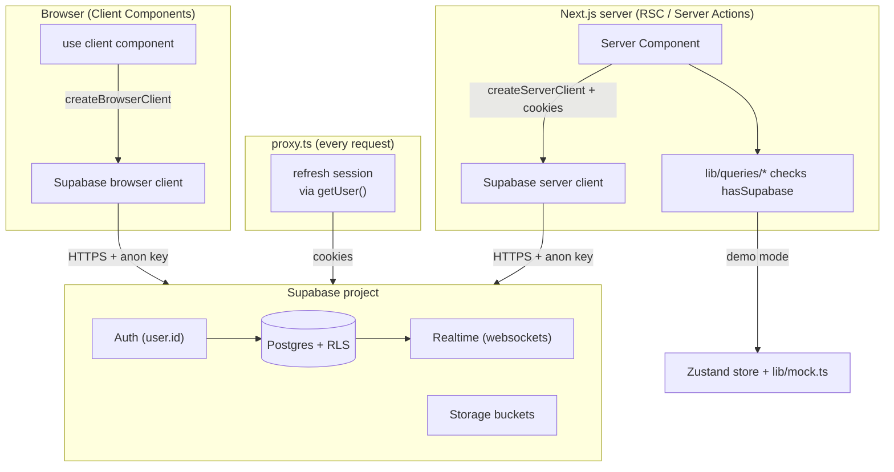

# Chapter 15 — Supabase Architecture & Setup

> Up to now Viby has been a beautiful app pretending to have a backend. In this chapter we give it a real one — without breaking the demo for a single second.

## What you'll learn

- What **Supabase** actually is: managed Postgres + Auth + Storage + Realtime + Edge, and where each piece fits Viby.
- How to **create a Supabase project**, find your URL and keys, and wire them into env vars safely.
- How to use the **SQL editor** and run our `schema.sql` to stand up every table and Row Level Security policy at once.
- The crucial difference between the **browser client and the server client** with `@supabase/ssr`, and why we need both.
- The **connected-vs-demo mode flag** pattern that lets Viby run with zero backend *or* a full one — no code changes in your components.

## Prerequisites

- Chapter 6 (Next.js App Router) and Chapter 8 (Server vs Client Components) — we lean hard on the server/client boundary here.
- Chapter 5 (TypeScript for React) — clients and rows are typed.
- Chapter 11 (Color & theming) only insofar as you have a running Viby app you can `npm run dev`.
- A free Supabase account (we'll create one together) and the Viby repo with `@supabase/ssr` already in `package.json`.

---

## Theory

For the first fourteen chapters, Viby's data lived in a **Zustand store seeded from `lib/mock.ts`** — fake profiles, fake matches, fake messages, all in memory. That was deliberate: it let you build every screen, animation, and interaction without first becoming a database administrator. But an in-memory store forgets everything on refresh, can't be shared between two phones, and has no concept of "you." To ship a real social-discovery app, we need a backend that **persists data, knows who's logged in, stores photos, and pushes live updates**.

You could assemble that yourself: a Postgres server, an auth service, an object store like S3, a websocket layer, plus the glue between them. That's weeks of plumbing before you write a single feature. **Supabase** is that whole stack, managed for you, around a real Postgres database.

Think of Supabase as a **fully-furnished apartment versus an empty lot**. The empty lot (raw cloud infrastructure) is yours to build on, but you're pouring the foundation and running the pipes. The furnished apartment gives you a working kitchen, plumbing, and locks on the door — you move in and start living. The key word is *managed*: someone else handles backups, scaling, and security patches. The other key word is **Postgres** — underneath the convenience, you have a real, standard SQL database you can take anywhere. No lock-in to a proprietary data model.

### The five pieces

Supabase bundles five services around your database:

- **Postgres** — the database itself. Tables, relationships, indexes, SQL. This is the source of truth for every Viby profile, swipe, match, and message.
- **Auth** — sign-up, login, sessions, OAuth providers, magic links. Critically, it issues a `user.id` (a UUID) that your tables reference. We covered the *concept* of identity earlier; here it becomes real.
- **Storage** — an object store for files (think avatars and post images). It's S3-style buckets with the same auth rules as your database.
- **Realtime** — a websocket layer that streams database changes to subscribed clients. When someone sends a Viby message, every device in that conversation hears about it instantly.
- **Edge Functions** — serverless functions for logic that shouldn't live in the client (webhooks, payments, AI calls). We won't need them this chapter, but they're there.

The thing that ties Storage, Realtime, and your queries together — and the thing beginners most often skip — is **Row Level Security (RLS)**. RLS lets you write authorization *as SQL policies on the table itself*. "A user can read any profile but only update their own." "Only members of a conversation can read its messages." Once a policy is on, the database enforces it for **every** client, even a leaked anon key. Your security doesn't live in your app code where a bug can bypass it; it lives in the database where it can't.

### Why two clients?

Here's the part that confuses everyone coming from older tutorials. Next.js 16 runs your code in **two very different environments**: on the server (Server Components, Server Actions, route handlers, the `proxy.ts` request layer) and in the browser (Client Components). Supabase needs to know *who* the request is for so RLS can do its job — and "who you are" is stored in a cookie.

- On the **server**, there's no `window`, no `localStorage`. The session lives in the request's **cookies**, which Next exposes through `next/headers`. The server client reads and writes those cookies.
- In the **browser**, there's no access to Next's cookie store; the client manages the session through the document's cookies directly.

So `@supabase/ssr` gives us two factory functions — `createBrowserClient` and `createServerClient` — and our job is to wrap each in a tiny helper. Use the wrong one in the wrong place and auth silently breaks: you'll be logged in on the client and anonymous on the server, or vice versa. Match the client to the environment and the session flows seamlessly across both.

---

## In practice

### 1. Create the project

1. Go to [supabase.com](https://supabase.com), sign in, and click **New project**.
2. Pick an organization, name it `viby`, and set a strong **database password** (save it — it's the Postgres superuser password).
3. Choose a region close to your users.
4. Wait ~2 minutes while it provisions.

Then open **Project Settings → API**. You need two values:

- **Project URL** — `https://<your-ref>.supabase.co`
- **anon (public) key** — a JWT, safe to expose to the browser *because RLS protects your data*.

There's also a **service_role key**. It **bypasses RLS** — treat it like a root password. Never put it in a `NEXT_PUBLIC_` variable, never ship it to the browser. We won't use it this chapter.

### 2. Set environment variables

Create `.env.local` in the Viby root (it's already in `.gitignore` — never commit secrets):

```bash
# .env.local
NEXT_PUBLIC_SUPABASE_URL=https://your-ref.supabase.co
NEXT_PUBLIC_SUPABASE_ANON_KEY=eyJhbGciOiJIUzI1NiIsInR5cCI6...
```

The `NEXT_PUBLIC_` prefix is a Next.js convention: it inlines the value into the browser bundle. That's exactly what we want for these two — they're meant to be public. Anything *without* the prefix stays server-only. Restart `npm run dev` after editing env files; they're read at boot, not hot-reloaded.

### 3. Run the schema in the SQL editor

In the dashboard, open the **SQL Editor** (left sidebar). This is a browser-based query console wired straight to your Postgres database — the same place you'll later debug queries and inspect data.

Open `supabase/schema.sql` from the Viby repo, paste the whole thing in, and click **Run**. One click stands up every table, enum, index, RLS policy, the Realtime publication, and a trigger that auto-creates a profile on signup. Here's the shape of it:

```sql
-- supabase/schema.sql (excerpt)
create table if not exists profiles (
  id            uuid primary key references auth.users on delete cascade,
  username      text unique not null,
  display_name  text not null,
  bio           text,
  avatar_url    text,
  interests     text[] default '{}',   -- denormalized for fast discovery scoring
  city          text,
  onboarded     boolean default false,
  created_at    timestamptz default now()
);

-- Turn RLS ON, then say exactly who can do what:
alter table profiles enable row level security;
create policy "profiles readable" on profiles
  for select to authenticated using (true);
create policy "edit own profile" on profiles
  for update to authenticated using (auth.uid() = id);
```

Two details worth internalizing. First, `id` references `auth.users` — every profile is *owned* by an auth user, and `on delete cascade` means deleting the account cleans up the profile. Second, `auth.uid()` is a Postgres function Supabase provides that returns the current request's user ID; it's how a policy knows "this row is yours."

The schema also auto-creates a profile whenever someone signs up, so your app never has to remember to do it:

```sql
create or replace function public.handle_new_user()
returns trigger language plpgsql security definer set search_path = public as $$
begin
  insert into public.profiles (id, username, display_name)
  values (new.id, split_part(new.email, '@', 1),
          coalesce(new.raw_user_meta_data->>'name', 'New member'));
  return new;
end $$;

create trigger on_auth_user_created
  after insert on auth.users
  for each row execute function public.handle_new_user();
```

After running it, open the **Table Editor** — you should see `profiles`, `swipes`, `matches`, `posts`, `messages`, `communities`, `events`, and friends. The lot is now furnished.

### 4. The two clients

The browser client (`lib/supabase/client.ts`) is tiny — it reads the public env vars and lets `@supabase/ssr` manage the session via document cookies:

```ts
// lib/supabase/client.ts  — used inside "use client" components
import { createBrowserClient } from "@supabase/ssr";

export function createClient() {
  return createBrowserClient(
    process.env.NEXT_PUBLIC_SUPABASE_URL ?? "",
    process.env.NEXT_PUBLIC_SUPABASE_ANON_KEY ?? "",
  );
}
```

The server client (`lib/supabase/server.ts`) is the one to study. In Next.js 16, `cookies()` is **async**, so the factory is `async` and we `await` it. We hand Supabase `getAll`/`setAll` cookie handlers so it can read the session and refresh tokens:

```ts
// lib/supabase/server.ts  — used in Server Components, Server Actions, route handlers
import { createServerClient } from "@supabase/ssr";
import { cookies } from "next/headers";

export async function createClient() {
  const cookieStore = await cookies();
  return createServerClient(
    process.env.NEXT_PUBLIC_SUPABASE_URL ?? "",
    process.env.NEXT_PUBLIC_SUPABASE_ANON_KEY ?? "",
    {
      cookies: {
        getAll: () => cookieStore.getAll(),
        setAll: (toSet) => {
          try {
            toSet.forEach(({ name, value, options }) =>
              cookieStore.set(name, value, options),
            );
          } catch {
            // Called from a Server Component (read-only cookies) —
            // safe to ignore because proxy.ts refreshes the session.
          }
        },
      },
    },
  );
}
```

That `try/catch` matters: a Server Component **can't** write cookies (the response headers are already streaming). So who keeps the session fresh? Our `proxy.ts` — Next 16's replacement for `middleware.ts`. It runs on every request, touches `getUser()` to refresh the token, and writes the cookie back on the *response*:

```ts
// proxy.ts  (Next 16 renamed middleware → proxy)
import { createServerClient } from "@supabase/ssr";
import { NextResponse, type NextRequest } from "next/server";

export async function proxy(request: NextRequest) {
  const url = process.env.NEXT_PUBLIC_SUPABASE_URL;
  const key = process.env.NEXT_PUBLIC_SUPABASE_ANON_KEY;
  if (!url || !key) return NextResponse.next(); // demo mode: do nothing

  let response = NextResponse.next({ request });
  const supabase = createServerClient(url, key, {
    cookies: {
      getAll: () => request.cookies.getAll(),
      setAll: (cookiesToSet) => {
        cookiesToSet.forEach(({ name, value }) => request.cookies.set(name, value));
        response = NextResponse.next({ request });
        cookiesToSet.forEach(({ name, value, options }) =>
          response.cookies.set(name, value, options),
        );
      },
    },
  });

  await supabase.auth.getUser(); // refresh if needed
  return response;
}

export const config = {
  matcher: ["/((?!_next/static|_next/image|favicon.ico|.*\\.(?:svg|png|jpg|jpeg|gif|webp)$).*)"],
};
```

### 5. The connected-vs-demo flag

Here's the pattern that keeps the whole book honest. We never want a missing env var to crash Viby — beginners should be able to clone, `npm run dev`, and click everything. So we have **one source of truth**:

```ts
// lib/supabase/config.ts
export const hasSupabase =
  !!process.env.NEXT_PUBLIC_SUPABASE_URL &&
  !!process.env.NEXT_PUBLIC_SUPABASE_ANON_KEY;
```

Every data function branches on it. If `hasSupabase` is false, fall back to the mock store; otherwise hit Postgres. Because both branches return the **same typed shape**, your components never know or care which mode they're in:

```ts
// lib/queries/profiles.ts  (excerpt, simplified)
import { createClient } from "@/lib/supabase/server";
import { hasSupabase } from "@/lib/supabase/config";
import { mockProfiles } from "@/lib/mock";
import type { Profile } from "@/lib/types";

export async function getProfileById(id: string): Promise<Profile | null> {
  if (!hasSupabase) {
    return mockProfiles.find((p) => p.id === id) ?? null;
  }
  const supabase = await createClient();
  const { data } = await supabase
    .from("profiles")
    .select("id, username, display_name, bio, avatar_url, interests, city")
    .eq("id", id)
    .maybeSingle();
  return data ? mapProfileRow(data) : null; // map DB row → app Profile
}
```

The `mapProfileRow` helper converts snake_case DB columns into the camelCase `Profile` type your UI already expects, so swapping from demo to connected mode is invisible above this layer. That's the payoff: the same Viby, two backends.

---

## Architecture / diagram



The anon key is the *same* on both clients; RLS — driven by `auth.uid()` from the session cookie — is what decides what each request may actually see.

---

## Best practices & pitfalls

- **Do** keep the `service_role` key server-only and out of the repo. If it leaks, rotate it immediately — it ignores RLS entirely.
- **Do** turn on RLS for every table that holds user data *and* write policies. RLS with no policies = nobody can read anything; RLS off = everybody can read everything. Both are common first-day mistakes.
- **Do** use the server client for anything that runs on the server (RSC, Server Actions, `proxy.ts`) and the browser client only inside `"use client"`. Mixing them breaks the session silently.
- **Don't** instantiate a single shared client at module top-level for the server — create one per request inside `await createClient()` so cookies are scoped correctly.
- **Don't** forget the `try/catch` in the server client's `setAll`; without `proxy.ts` refreshing sessions, logins will expire and feel "randomly logged out."
- **Don't** assume env vars hot-reload — restart the dev server after editing `.env.local`.
- **Do** keep `hasSupabase` as the *only* place you check for configuration, so demo mode never rots.

---

## Exercises

1. **Smoke test.** Create the project, set `.env.local`, restart dev, and add a temporary Server Component page that calls `await createClient()` then `supabase.from("profiles").select("*")`. Log the result. You should get an empty array (not an error) — proof RLS and the connection both work.

2. **Read your own row.** In the SQL editor, manually insert one row into `profiles` with a real `auth.users` id (create a test user under **Authentication → Users** first). Confirm your page now returns it.

3. **Break and fix RLS.** Temporarily `drop policy "profiles readable" on profiles;` and reload the page. Watch the row disappear (RLS denies by default). Re-create the policy and confirm it returns. Internalize *deny-by-default*.

4. **Flag flip.** Comment out the env vars, restart, and confirm Viby still runs entirely on mock data with no crash. Then restore them. The `hasSupabase` branch is doing its job.

5. **(Stretch)** Add a `getCommunities()` query in `lib/queries/communities.ts` following the `profiles.ts` pattern: mock branch when `!hasSupabase`, real `select` otherwise, mapping rows to your app type.

---

## Mini-project: "Backend health" badge

Build a small server-rendered badge that proves, at a glance, which mode Viby is in.

1. Create `components/backend-badge.tsx` as a **Server Component**.
2. Import `hasSupabase`. If false, render a pink `Demo mode` pill.
3. If true, `await createClient()`, run `const { error } = await supabase.from("profiles").select("id").limit(1);` and render `Connected` (green) when there's no error, or `Config error` (red) when there is.
4. Drop `<BackendBadge />` into your root layout's footer.

```tsx
// components/backend-badge.tsx
import { hasSupabase } from "@/lib/supabase/config";
import { createClient } from "@/lib/supabase/server";

export default async function BackendBadge() {
  if (!hasSupabase) {
    return <span className="rounded-full bg-[--color-brand]/10 px-3 py-1 text-xs text-[--color-brand]">Demo mode</span>;
  }
  const supabase = await createClient();
  const { error } = await supabase.from("profiles").select("id").limit(1);
  const ok = !error;
  return (
    <span className={`rounded-full px-3 py-1 text-xs ${ok ? "bg-green-100 text-green-700" : "bg-red-100 text-red-700"}`}>
      {ok ? "Connected" : "Config error"}
    </span>
  );
}
```

You now have a one-glance answer to "is the backend wired up?" — invaluable as we start migrating screens off mock data.

---

## Key takeaways

- Supabase is **managed Postgres** with Auth, Storage, Realtime, and Edge bolted on — and a real SQL database underneath, so no lock-in.
- **RLS is your authorization layer**: it lives in the database, enforces deny-by-default, and protects you even though the anon key is public.
- Next.js 16 needs **two clients** — `createServerClient` (cookies via `next/headers`, async) for the server, `createBrowserClient` for `"use client"` — and `proxy.ts` keeps the session fresh.
- One `schema.sql` run in the **SQL editor** stands up the entire Viby data model in a single click.
- The **`hasSupabase` flag** lets Viby run demo-only or fully connected with identical component code — that's the pattern we'll lean on for the rest of Section 4.

**Up next — Chapter 16: Authentication with Supabase Auth**, where we turn `auth.uid()` from an abstraction into a real signed-in human, and finally give Viby members their own identity.
