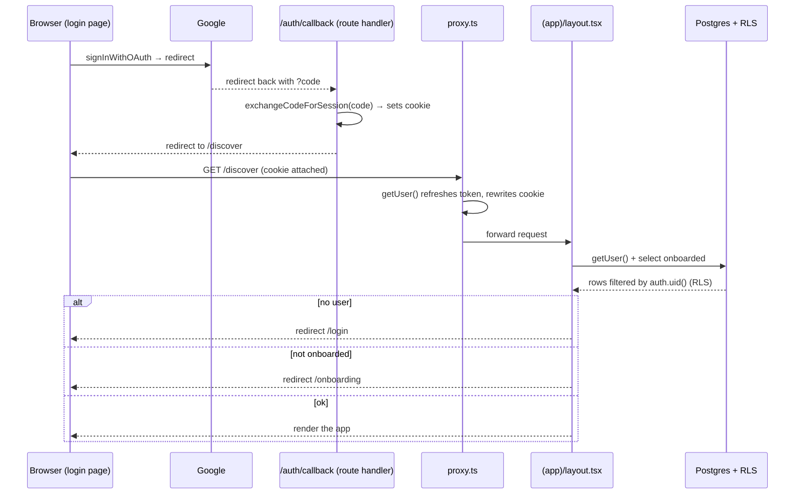

# Chapter 16 — Authentication, Sessions & Row-Level Security

> Auth isn't a login screen — it's a chain of trust that runs from the user's browser all the way down to a single `WHERE` clause in your database.

## What you'll learn

- How **Google OAuth** and **email OTP** (passwordless one-time codes) actually work, and how to wire both into Viby with `@supabase/ssr`.
- What the **auth callback route** is for, and why OAuth needs a server-side handshake.
- How **session refresh** works across requests using Next.js 16's `proxy.ts` — and why your app silently logs people out without it.
- How to **protect routes** with the `(app)` route-group layout, and how to gate un-onboarded users.
- How **Row-Level Security (RLS)** turns Postgres itself into your authorization layer, so a leaked API key can't dump your users' messages.

## Prerequisites

- Chapter 6 (Next.js App Router) and Chapter 7 (routing, layouts, route groups) — you should know what `layout.tsx` and a `(group)` folder do.
- Chapter 8 (Server vs Client Components) — we lean hard on the server/client boundary and Server Actions.
- Chapter 15 (Supabase setup) — you should have a Supabase project and the `lib/supabase/*` clients in place.
- A Viby checkout with `NEXT_PUBLIC_SUPABASE_URL` and `NEXT_PUBLIC_SUPABASE_ANON_KEY` set (see `.env.example`). Without them, Viby runs in **demo mode** on Zustand — every snippet below guards on `hasSupabase`.

---

## Theory

### The "why" before the "how"

Authentication answers **"who are you?"** Authorization answers **"what are you allowed to touch?"** Beginners conflate them, and that's exactly how data leaks happen: they verify the login, then trust the client to ask only for its own rows. The client is never trustworthy. Anyone can open DevTools, grab your anon key (it's public — it ships to the browser), and hit your database directly.

So Viby splits the job in two:

1. **Sessions** prove identity. A signed token (JWT) lives in an HTTP-only cookie. Every request carries it; the server verifies it.
2. **Row-Level Security** enforces permission *inside Postgres*. Even with a valid token, the database refuses to return rows you don't own — no application code required.

Think of a members-only club. The **session cookie** is your wristband: the bouncer checks it once at the door (and the wristband is hard to forge). **RLS** is the rule that every locker only opens for the person whose name is on it — enforced by the lockers themselves, not by trusting members to be polite. Even if someone sneaks past the door, the lockers stay shut.

### Two ways in: OAuth vs. OTP

Viby offers two front doors, and they have fundamentally different shapes:

- **Google OAuth** is a *redirect dance*. We never see the user's Google password. We bounce them to Google, Google authenticates them, and Google bounces them back to us carrying a short-lived `code`. We exchange that `code` for a session on the **server**. That exchange is why we need a dedicated callback route — the code is single-use and must be redeemed server-side so the session cookie gets set on our domain.

- **Email OTP** (one-time passcode) is *passwordless*. The user types their email, Supabase emails a 6-digit code, the user types it back, and we verify it. No passwords to leak, no password reset flow to build. This is the friendliest possible auth for a Gen-Z social app — and it's why Viby leads with "No passwords ever."

### Why sessions need *refreshing*

A session token is deliberately short-lived (Supabase access tokens expire in ~1 hour). That limits the blast radius if a token leaks. But you don't want users re-logging-in every hour, so there's also a long-lived **refresh token**. Someone has to trade the expiring access token for a fresh one — quietly, on every request — or your Server Components will start seeing `null` users halfway through a session.

In the browser, the Supabase client does this automatically. But Server Components **can't set cookies** after rendering starts. So we need a piece of code that runs *before* the request reaches your pages, refreshes the token if it's stale, and writes the new cookie back. In Next.js 16 that's `proxy.ts` (the file formerly known as `middleware.ts`).

---

## In practice

### 1. The two Supabase clients

Everything starts with the right client for the right environment. Viby keeps a tiny `hasSupabase` flag so the app degrades gracefully to demo mode.

```ts
// lib/supabase/config.ts
export const hasSupabase =
  !!process.env.NEXT_PUBLIC_SUPABASE_URL &&
  !!process.env.NEXT_PUBLIC_SUPABASE_ANON_KEY;
```

```ts
// lib/supabase/client.ts  — runs in the browser
import { createBrowserClient } from "@supabase/ssr";

export function createClient() {
  return createBrowserClient(
    process.env.NEXT_PUBLIC_SUPABASE_URL ?? "",
    process.env.NEXT_PUBLIC_SUPABASE_ANON_KEY ?? "",
  );
}
```

```ts
// lib/supabase/server.ts  — runs in RSC / route handlers / server actions
import { createServerClient } from "@supabase/ssr";
import { cookies } from "next/headers";

export async function createClient() {
  const cookieStore = await cookies(); // Next 16: cookies() is async — await it
  return createServerClient(
    process.env.NEXT_PUBLIC_SUPABASE_URL ?? "",
    process.env.NEXT_PUBLIC_SUPABASE_ANON_KEY ?? "",
    {
      cookies: {
        getAll: () => cookieStore.getAll(),
        setAll: (toSet) => {
          try {
            toSet.forEach(({ name, value, options }) =>
              cookieStore.set(name, value, options),
            );
          } catch {
            // Called from a Server Component, where cookies are read-only.
            // Safe to ignore — proxy.ts refreshes the session instead.
          }
        },
      },
    },
  );
}
```

The `getAll` / `setAll` pair is the modern `@supabase/ssr` contract. **Do not** use the old single-cookie `get`/`set`/`remove` handlers — they're removed in current versions and cause subtle session-loss bugs.

### 2. The login screen — OAuth and OTP

The login page is a Client Component because it owns interactive state (which step, the email, the six code digits). Here are the three real handlers from `app/login/page.tsx`, trimmed to the auth essentials:

```tsx
"use client";
import { createClient } from "@/lib/supabase/client";
import { hasSupabase } from "@/lib/supabase/config";

// Google OAuth — redirect dance. Note redirectTo points at our callback route.
async function signInGoogle() {
  if (!hasSupabase) return finish(); // demo fallback
  const { error } = await createClient().auth.signInWithOAuth({
    provider: "google",
    options: { redirectTo: `${window.location.origin}/auth/callback` },
  });
  if (error) setError(error.message);
}

// Email OTP — step 1: send the code.
async function sendCode() {
  if (!hasSupabase) return setStep("otp");
  const { error } = await createClient().auth.signInWithOtp({
    email,
    options: {
      shouldCreateUser: true, // create the account on first login
      emailRedirectTo: `${window.location.origin}/auth/callback`,
    },
  });
  if (error) setError(error.message);
  else setStep("otp");
}

// Email OTP — step 2: verify the 6-digit code.
async function verify(token: string) {
  if (!hasSupabase) return finish();
  const { error } = await createClient().auth.verifyOtp({
    email,
    token,
    type: "email",
  });
  if (error) return setError(error.message);
  router.push("/discover");
}
```

Two things to notice. OAuth **redirects the whole browser** away to Google, so `signInWithOAuth` never resolves to a logged-in user here — the user comes back through the callback route. OTP, by contrast, completes *in place*: `verifyOtp` sets the session cookie and we navigate to `/discover` ourselves.

### 3. The auth callback route

When Google (or a clicked magic-link) sends the user back, they land here with a `?code=...`. We exchange it for a session — server-side — then redirect into the app.

```ts
// app/auth/callback/route.ts
import { NextResponse } from "next/server";
import { createClient } from "@/lib/supabase/server";
import { hasSupabase } from "@/lib/supabase/config";

export async function GET(request: Request) {
  const { searchParams, origin } = new URL(request.url);
  const code = searchParams.get("code");
  const next = searchParams.get("next") ?? "/discover";

  if (code && hasSupabase) {
    const supabase = await createClient();
    await supabase.auth.exchangeCodeForSession(code); // sets the cookie
  }

  return NextResponse.redirect(`${origin}${next}`);
}
```

Because this is a Route Handler (not a Server Component), it's allowed to *write* cookies — so `exchangeCodeForSession` can persist the session. We deliberately don't decide onboarding here; the `(app)` layout owns that, so there's exactly one source of truth.

### 4. Session refresh with `proxy.ts`

This is the unsung hero. It runs before every matching request, refreshes the token if it's about to expire, and writes the fresh cookie onto the response.

```ts
// proxy.ts  (project root — Next 16's replacement for middleware.ts)
import { createServerClient } from "@supabase/ssr";
import { NextResponse, type NextRequest } from "next/server";

export async function proxy(request: NextRequest) {
  const url = process.env.NEXT_PUBLIC_SUPABASE_URL;
  const key = process.env.NEXT_PUBLIC_SUPABASE_ANON_KEY;
  if (!url || !key) return NextResponse.next(); // demo mode: no-op

  let response = NextResponse.next({ request });

  const supabase = createServerClient(url, key, {
    cookies: {
      getAll: () => request.cookies.getAll(),
      setAll: (cookiesToSet) => {
        cookiesToSet.forEach(({ name, value }) =>
          request.cookies.set(name, value),
        );
        response = NextResponse.next({ request });
        cookiesToSet.forEach(({ name, value, options }) =>
          response.cookies.set(name, value, options),
        );
      },
    },
  });

  // Touching getUser() validates the token and refreshes it if needed.
  await supabase.auth.getUser();
  return response;
}

export const config = {
  matcher: [
    // Everything except static assets and images.
    "/((?!_next/static|_next/image|favicon.ico|.*\\.(?:svg|png|jpg|jpeg|gif|webp)$).*)",
  ],
};
```

The pattern looks fiddly but it's load-bearing: you must write refreshed cookies onto **both** the incoming `request` (so the rest of this request sees them) **and** the outgoing `response` (so the browser stores them). The `let response` reassignment inside `setAll` is exactly that. Calling `getUser()` is the trigger that performs the refresh — never call `getSession()` here for auth decisions (more on that in pitfalls).

### 5. Protecting routes with the `(app)` layout

Viby's authenticated screens all live under the `(app)` route group, so a single async layout guards every one of them. It also enforces the **onboarding redirect**: a signed-in user who hasn't finished their profile gets bounced to `/onboarding`.

```tsx
// app/(app)/layout.tsx
import { redirect } from "next/navigation";
import { DeviceFrame } from "@/components/shell/DeviceFrame";
import { TabBar } from "@/components/shell/TabBar";
import { hasSupabase } from "@/lib/supabase/config";
import { createClient } from "@/lib/supabase/server";

export default async function AppLayout({
  children,
}: {
  children: React.ReactNode;
}) {
  if (hasSupabase) {
    const supabase = await createClient();
    const {
      data: { user },
    } = await supabase.auth.getUser();
    if (!user) redirect("/login"); // gate 1: must be signed in

    const { data: profile } = await supabase
      .from("profiles")
      .select("onboarded")
      .eq("id", user.id)
      .maybeSingle();
    if (!profile?.onboarded) redirect("/onboarding"); // gate 2: must be onboarded
  }

  return (
    <DeviceFrame>
      <main className="no-scrollbar relative flex-1 overflow-y-auto overflow-x-hidden">
        {children}
      </main>
      <TabBar />
    </DeviceFrame>
  );
}
```

Two layers of defense here: `proxy.ts` keeps the session fresh, but this layout makes the *authorization decision*. `proxy.ts` alone is not enough protection — it can't reliably redirect for every page, and security checks belong as close to the data as possible.

### 6. Finishing onboarding with a Server Action

When the user completes onboarding, a Server Action writes their profile and flips `onboarded`. The `"use server"` directive marks the whole module as server-only — it never ships to the browser.

```ts
// app/actions/auth.ts
"use server";
import { redirect } from "next/navigation";
import { createClient } from "@/lib/supabase/server";
import { hasSupabase } from "@/lib/supabase/config";

export async function saveOnboarding(input: OnboardingInput) {
  if (!hasSupabase) return { ok: true as const };

  const supabase = await createClient();
  const {
    data: { user },
  } = await supabase.auth.getUser();
  if (!user) return { ok: false as const, error: "Not signed in" };

  const { error } = await supabase.from("profiles").upsert({
    id: user.id, // RLS requires this to equal auth.uid()
    username: (user.email?.split("@")[0] ?? `viby_${user.id.slice(0, 6)}`).toLowerCase(),
    display_name: input.displayName,
    bio: input.bio,
    interests: input.interests,
    vibe_tags: input.vibeTags,
    city: input.city,
    photos: input.photos,
    onboarded: true,
  });

  return error ? { ok: false as const, error: error.message } : { ok: true as const };
}

export async function signOut() {
  if (hasSupabase) {
    const supabase = await createClient();
    await supabase.auth.signOut();
  }
  redirect("/");
}
```

Notice the action re-derives `user` server-side rather than trusting any id sent from the client. That id then has to match `auth.uid()` for RLS to allow the write — belt and suspenders.

### 7. Row-Level Security — Postgres is the last line of defense

Here's the part that separates a toy from a shippable product. Enabling RLS on a table means **deny by default**: no row is readable or writable until a policy explicitly allows it. From Viby's `supabase/schema.sql`:

```sql
-- Lock the tables down first.
alter table profiles enable row level security;
alter table swipes   enable row level security;
alter table messages enable row level security;

-- Profiles: any logged-in user can READ any profile (discovery needs this)…
create policy "profiles readable" on profiles
  for select to authenticated using (true);

-- …but you may only UPDATE / INSERT your own row.
create policy "edit own profile" on profiles
  for update to authenticated using (auth.uid() = id);
create policy "insert own profile" on profiles
  for insert to authenticated with check (auth.uid() = id);

-- Swipes are private to the swiper — read AND write.
create policy "own swipes" on swipes for all to authenticated
  using (auth.uid() = swiper_id) with check (auth.uid() = swiper_id);

-- Messages: only members of the conversation can read it…
create policy "conv messages readable" on messages for select to authenticated using (
  exists (
    select 1 from conversation_members m
    where m.conversation_id = messages.conversation_id
      and m.profile_id = auth.uid()
  )
);
-- …and you can only send as yourself.
create policy "send as self" on messages for insert to authenticated
  with check (auth.uid() = sender_id);
```

`auth.uid()` is the magic: Supabase reads the JWT from the request and exposes the user's id to every policy. `using (...)` controls which rows are **visible** (reads, and the pre-image of updates/deletes); `with check (...)` controls which rows you're **allowed to write**. A `for all` policy with both clauses covers select/insert/update/delete in one shot.

The chat policy is the showpiece: even though `messages` is readable, the subquery means you only ever see messages from conversations *you're a member of*. That rule lives in the database. No leaked anon key, no buggy query, no malicious client can route around it.

Finally, Viby auto-creates a profile row the moment a user signs up, via a trigger:

```sql
create or replace function public.handle_new_user()
returns trigger language plpgsql security definer set search_path = public as $$
begin
  insert into public.profiles (id, username, display_name)
  values (
    new.id,
    split_part(new.email, '@', 1),
    coalesce(new.raw_user_meta_data->>'name', 'New member')
  );
  return new;
end $$;

create trigger on_auth_user_created
  after insert on auth.users
  for each row execute function public.handle_new_user();
```

`security definer` lets the trigger insert into `profiles` even though the brand-new user can't yet — it runs with the function owner's rights. The `set search_path = public` guard is mandatory here to prevent a known privilege-escalation attack.

---

## Architecture / diagram



---

## Best practices & pitfalls

- **DO** use `supabase.auth.getUser()` for any auth decision on the server. It re-validates the JWT against Supabase. **DON'T** use `getSession()` for security — it trusts the cookie's contents without verification and can be spoofed.
- **DO** keep `proxy.ts` thin and let it call `getUser()`. **DON'T** put your authorization logic *only* in `proxy.ts` — always also guard in the layout/page closest to the data.
- **DO** enable RLS on every table that holds user data and treat the anon key as fully public. **DON'T** ever ship the `service_role` key to the browser — it bypasses RLS entirely.
- **DON'T** forget `with check` on insert/update policies. A `using`-only policy lets a user *change a row's owner to someone else* on update. Always pair them.
- **DO** point both `redirectTo` (OAuth) and `emailRedirectTo` (OTP) at `/auth/callback`, and register that exact URL in Supabase → Auth → URL Configuration. Mismatched redirect URLs are the #1 cause of "it works locally but not on Vercel."
- **DO** return the same generic message for "wrong code" and "unknown email" — don't let attackers enumerate which emails have accounts.
- **DON'T** read or write cookies from a Server Component and expect it to persist — it can't. That's the entire reason `proxy.ts` exists.

---

## Exercises

1. **Sign-out button.** Wire the `signOut` Server Action into a button in `TopBar`. Confirm that after sign-out, visiting `/discover` redirects you to `/login`.
2. **A `next` param.** Make the login flow remember where the user was headed: pass `?next=/communities` through `signInWithOtp`'s `emailRedirectTo`, read it in the callback, and land them there instead of `/discover`.
3. **Resend cooldown.** Add a 30-second cooldown to the OTP "Send code" button so users can't spam Supabase's rate limit. Show a live countdown with Framer Motion.
4. **RLS for comments.** The `comments` table has RLS enabled but no policies yet — so it's currently locked shut. Write `select` (readable to all authenticated), `insert` (`auth.uid() = author_id`), and `delete` (own comments only) policies, mirroring the `posts` policies.
5. **Prove RLS works.** In the Supabase SQL editor, run a `select * from swipes` as a specific user (use `set local role` / a test JWT). Confirm you only see that user's swipes, then try to insert a swipe with someone else's `swiper_id` and watch it get rejected.

---

## Mini-project: a "Who can see this?" debug panel

Build a small `/settings/security` page (inside `(app)`) that makes RLS *visible* to the learner.

- A Server Component reads the current `user` via `createClient()` and shows their id and email.
- Below it, render three live queries and their results: `profiles` (count returned), `swipes` (count — should equal *only this user's* swipes), and `messages` (count — only conversations they belong to).
- Add a deliberately "naughty" Server Action that tries to `update` someone *else's* profile (`.eq("id", SOME_OTHER_ID)`) and display the result. It should silently affect **0 rows** — proof that RLS, not your code, stopped it.
- Style it with the bubblegum-pink card aesthetic and animate each result row in with a Framer Motion `stagger`.

The payoff: a learner sees, in their own UI, that the database refused to leak or mutate data even when the app *asked it to*. That's the moment RLS stops being abstract.

---

## Key takeaways

- Authentication (who you are) and authorization (what you can touch) are **separate jobs** — Viby solves them with sessions and RLS respectively.
- **OAuth** needs a server-side callback route to exchange a `code` for a session; **email OTP** is passwordless and completes in place via `verifyOtp`.
- `proxy.ts` is Next 16's middleware: it refreshes the Supabase session on every request so Server Components always see a valid user.
- The `(app)` layout is your single, server-side authorization checkpoint — and your onboarding gate.
- Always verify identity with `getUser()`, never trust `getSession()` for security, and never ship the `service_role` key.
- **RLS is the real guarantee.** With `using` + `with check` policies and `auth.uid()`, Postgres itself refuses to leak or mutate rows you don't own — even if your app code is buggy or your anon key is public.

**Up next — Chapter 17: Building Viby's Data Layer with Supabase Queries & Server Actions**, where we turn these locked-down tables into typed, RLS-safe reads and writes that power Discover, the feed, and chat.
