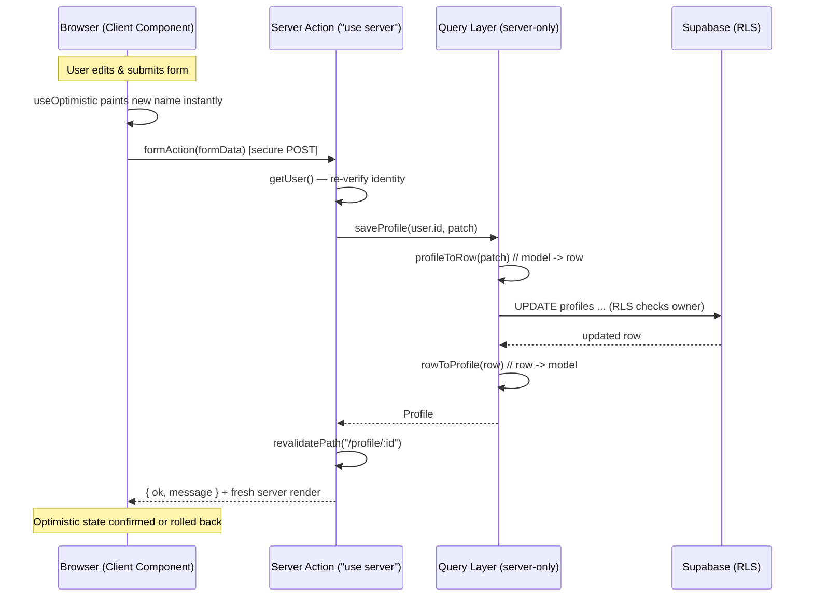

# Chapter 17 — CRUD with Server Components & Server Actions

> Your data layer is the spine of Viby. In this chapter you'll give it real muscle — reading on the server, mutating with Server Actions, and snapping the UI to instant with optimistic updates.

## What you'll learn

- How to **read data** directly in Server Components — no `useEffect`, no client fetch, no loading spinner gymnastics.
- How to **mutate data** safely with `"use server"` Server Actions, and refresh the screen with `revalidatePath`.
- How to make edits feel instant with **optimistic UI** (`useOptimistic` + `useActionState`).
- How to build a **typed query layer** that isolates Supabase from your components, with **row → model mappers** so your app never touches a raw DB row.
- The Viby patterns `getProfileById` and `saveProfile`, end to end.

## Prerequisites

- **Chapter 9** — TypeScript types & interfaces (we lean hard on typed models).
- **Chapter 14** — Supabase setup with `@supabase/ssr` (the `createServerClient` / `createBrowserClient` helpers).
- **Chapter 15** — Auth & sessions (we read the logged-in user inside actions).
- **Chapter 16** — Database schema & RLS for the `profiles` table.

---

## Theory

For the whole frontend half of this book, data lived in the browser. A component mounted, fired a `fetch`, flipped a `loading` flag, and eventually rendered. That's the **client-fetch** model, and it has three taxes: a waterfall (HTML arrives, *then* JS, *then* data), a spinner the user stares at, and your database credentials nervously close to the browser.

The App Router flips this. **Server Components render on the server**, where your code is already millimeters from the database. So a component can just... ask for data and `await` it. No state, no effect, no spinner. Think of it like the difference between **mailing a request form and waiting for a reply** (client fetch) versus **walking into the back office where the filing cabinet lives** (server component). One of these is dramatically faster, and the keys to the cabinet never leave the building.

That handles *reading*. But a social app is all about *writing* — editing your profile, posting a vibe, joining a circle. For that, React and Next.js give us **Server Actions**: functions you mark with the `"use server"` directive. They run **only on the server**, but you can call them straight from a `<form>` or a button as if they were local. Under the hood Next.js wires up a secure POST endpoint for you. The analogy: a Server Action is a **trusted back-office clerk you can summon from the front desk**. The customer (browser) never walks into the back; they hand the clerk a slip, the clerk does the privileged work, and comes back with a result.

After a mutation, the server's cached render of a page is stale. `revalidatePath("/profile")` tells Next.js: *"throw away the cached version of this route and re-render it with fresh data."* The next request — or the current one, since Next.js streams the fresh tree back — sees the new data automatically.

Finally, **optimistic UI**. Even a fast round-trip is ~200ms, and on mobile that's a perceptible lag. Optimistic UI means we **assume success and update the screen immediately**, then reconcile when the server answers. If the server rejects, React rolls the optimistic state back. It's tipping the waiter before the meal arrives — almost always right, and gracefully reversible when it isn't.

One more principle that separates hobby code from startup-grade code: **never let components talk to Supabase directly.** Put a **query layer** between them. Components ask for a `Profile`; the query layer knows about tables, columns, snake_case, and joins, and hands back a clean typed **model**. The translator between a raw DB row and a model is a **mapper**. This single boundary is what lets you refactor your schema later without touching a single component.

---

## In practice

### 1. The typed model and the mapper

Database rows are `snake_case` and shaped by storage concerns. Our app wants `camelCase` domain models. Keep them in separate files so the seam is obvious.

```typescript
// lib/types/profile.ts

// The domain model — what the rest of Viby sees.
export interface Profile {
  id: string;
  username: string;
  displayName: string;
  bio: string;
  avatarUrl: string | null;
  hobbies: string[];
  city: string | null;
  createdAt: string;
}

// Exactly the row shape returned by Supabase (snake_case, nullable).
export interface ProfileRow {
  id: string;
  username: string;
  display_name: string;
  bio: string | null;
  avatar_url: string | null;
  hobbies: string[] | null;
  city: string | null;
  created_at: string;
}
```

```typescript
// lib/mappers/profile.ts
import type { Profile, ProfileRow } from "@/lib/types/profile";

// row -> model: the ONE place snake_case and nulls get normalized.
export function rowToProfile(row: ProfileRow): Profile {
  return {
    id: row.id,
    username: row.username,
    displayName: row.display_name,
    bio: row.bio ?? "",
    avatarUrl: row.avatar_url,
    hobbies: row.hobbies ?? [],
    city: row.city,
    createdAt: row.created_at,
  };
}

// model (partial) -> row: used when writing.
export function profileToRow(
  input: Pick<Profile, "displayName" | "bio" | "hobbies" | "city">
): Partial<ProfileRow> {
  return {
    display_name: input.displayName,
    bio: input.bio,
    hobbies: input.hobbies,
    city: input.city,
  };
}
```

### 2. The query layer

This module is the only thing in Viby that imports the Supabase client for `profiles`. It returns models, never rows. (The `createClient` helper is the `createServerClient` wrapper you built in Chapter 14.)

```typescript
// lib/queries/profiles.ts
import "server-only"; // hard guarantee: this never ships to the browser
import { createClient } from "@/lib/supabase/server";
import { rowToProfile, profileToRow } from "@/lib/mappers/profile";
import type { Profile, ProfileRow } from "@/lib/types/profile";

export async function getProfileById(id: string): Promise<Profile | null> {
  const supabase = await createClient();
  const { data, error } = await supabase
    .from("profiles")
    .select("id, username, display_name, bio, avatar_url, hobbies, city, created_at")
    .eq("id", id)
    .maybeSingle();

  if (error) throw new Error(`getProfileById failed: ${error.message}`);
  return data ? rowToProfile(data as ProfileRow) : null;
}

export async function saveProfile(
  id: string,
  patch: Pick<Profile, "displayName" | "bio" | "hobbies" | "city">
): Promise<Profile> {
  const supabase = await createClient();
  const { data, error } = await supabase
    .from("profiles")
    .update(profileToRow(patch))
    .eq("id", id)
    .select("id, username, display_name, bio, avatar_url, hobbies, city, created_at")
    .single();

  if (error) throw new Error(`saveProfile failed: ${error.message}`);
  return rowToProfile(data as ProfileRow);
}
```

> Note: `import "server-only"` makes the build **fail loudly** if a Client Component ever imports this file by accident. Cheap insurance.

### 3. Reading in a Server Component

No `"use client"`, no hooks. In Next.js 16, dynamic route `params` is a Promise — `await` it.

```tsx
// app/profile/[id]/page.tsx
import { notFound } from "next/navigation";
import { getProfileById } from "@/lib/queries/profiles";

export default async function ProfilePage({
  params,
}: {
  params: Promise<{ id: string }>;
}) {
  const { id } = await params;
  const profile = await getProfileById(id);

  if (!profile) notFound();

  return (
    <main className="mx-auto max-w-md p-6">
      <h1 className="text-2xl font-bold text-brand">{profile.displayName}</h1>
      <p className="text-sm text-neutral-500">@{profile.username}</p>
      <p className="mt-4 text-neutral-800">{profile.bio}</p>
      <ul className="mt-4 flex flex-wrap gap-2">
        {profile.hobbies.map((h) => (
          <li key={h} className="rounded-full bg-brand/10 px-3 py-1 text-sm text-brand">
            {h}
          </li>
        ))}
      </ul>
    </main>
  );
}
```

The brand color comes from your Tailwind v4 theme tokens (Chapter 7), defined in CSS — no `tailwind.config.js`:

```css
/* app/globals.css */
@import "tailwindcss";

@theme {
  --color-brand: #ff6fb5;
}
```

### 4. The Server Action

A `"use server"` file. We re-check auth inside the action — **never trust the client** to tell us who it is — and revalidate after writing.

```typescript
// app/profile/[id]/actions.ts
"use server";

import { revalidatePath } from "next/cache";
import { createClient } from "@/lib/supabase/server";
import { saveProfile } from "@/lib/queries/profiles";

export type SaveState = { ok: boolean; message: string };

export async function saveProfileAction(
  _prev: SaveState,
  formData: FormData
): Promise<SaveState> {
  const supabase = await createClient();
  const {
    data: { user },
  } = await supabase.auth.getUser();

  if (!user) return { ok: false, message: "You must be signed in." };

  const displayName = String(formData.get("displayName") ?? "").trim();
  const bio = String(formData.get("bio") ?? "").trim();
  const city = String(formData.get("city") ?? "").trim() || null;
  const hobbies = String(formData.get("hobbies") ?? "")
    .split(",")
    .map((h) => h.trim())
    .filter(Boolean);

  if (displayName.length < 2) {
    return { ok: false, message: "Display name needs at least 2 characters." };
  }

  // RLS still enforces that user.id can only update its own row.
  await saveProfile(user.id, { displayName, bio, hobbies, city });

  revalidatePath(`/profile/${user.id}`);
  return { ok: true, message: "Profile saved." };
}
```

### 5. The form + optimistic UI (Client Component)

`useActionState` wires the form to the action and exposes pending state. `useOptimistic` paints the new value instantly.

```tsx
// app/profile/[id]/edit-form.tsx
"use client";

import { useActionState, useOptimistic } from "react";
import { motion, AnimatePresence } from "framer-motion";
import { saveProfileAction, type SaveState } from "./actions";
import type { Profile } from "@/lib/types/profile";

const initial: SaveState = { ok: false, message: "" };

export function EditProfileForm({ profile }: { profile: Profile }) {
  const [state, formAction, isPending] = useActionState(saveProfileAction, initial);

  // Optimistic display name: updates the heading the instant the user submits.
  const [optimisticName, setOptimisticName] = useOptimistic(profile.displayName);

  return (
    <form
      action={formAction}
      onSubmit={(e) => {
        const fd = new FormData(e.currentTarget);
        setOptimisticName(String(fd.get("displayName") ?? ""));
      }}
      className="space-y-4"
    >
      <h2 className="text-xl font-bold text-brand">{optimisticName}</h2>

      <input
        name="displayName"
        defaultValue={profile.displayName}
        className="w-full rounded-xl border px-4 py-2"
        placeholder="Display name"
      />
      <textarea
        name="bio"
        defaultValue={profile.bio}
        className="w-full rounded-xl border px-4 py-2"
        placeholder="Your vibe in one line"
      />
      <input
        name="city"
        defaultValue={profile.city ?? ""}
        className="w-full rounded-xl border px-4 py-2"
        placeholder="City"
      />
      <input
        name="hobbies"
        defaultValue={profile.hobbies.join(", ")}
        className="w-full rounded-xl border px-4 py-2"
        placeholder="climbing, vinyl, matcha"
      />

      <motion.button
        type="submit"
        disabled={isPending}
        whileTap={{ scale: 0.96 }}
        className="w-full rounded-xl bg-brand py-3 font-semibold text-white disabled:opacity-60"
      >
        {isPending ? "Saving…" : "Save profile"}
      </motion.button>

      <AnimatePresence>
        {state.message && (
          <motion.p
            initial={{ opacity: 0, y: 4 }}
            animate={{ opacity: 1, y: 0 }}
            exit={{ opacity: 0 }}
            className={state.ok ? "text-green-600" : "text-red-600"}
          >
            {state.message}
          </motion.p>
        )}
      </AnimatePresence>
    </form>
  );
}
```

Because the form `action` is a Server Action, this works **even before JavaScript loads** — progressive enhancement for free. The optimistic name and pending state are the enhancement on top.

---

## Architecture / diagram



The dependency rule, in one line:

```
Server Component / Server Action  ->  Query Layer  ->  Mapper  ->  Supabase
        (knows models only)         (knows tables)   (translates)   (raw rows)
```

---

## Best practices & pitfalls

- **Do** re-authenticate inside every Server Action with `supabase.auth.getUser()`. The form fields are attacker-controlled; the session cookie is your source of truth.
- **Do** keep RLS as your last line of defense even with checks in the action. Defense in depth — never rely on app code alone.
- **Don't** return raw DB rows from the query layer. Always map to a model so components stay decoupled from your schema.
- **Don't** put secrets or the service-role key anywhere a Client Component can import. Use `import "server-only"` on query modules to enforce it.
- **Do** call `revalidatePath` (or `revalidateTag`) after a mutation, or your users will see stale cached data.
- **Don't** `revalidatePath` on a hot path you don't need to refresh — over-revalidating throws away good cache and hurts performance.
- **Do** validate and coerce `FormData` inside the action (it's all strings/`File`s). Consider Zod for anything non-trivial.
- **Don't** swallow errors silently. Return a typed `{ ok, message }` state so the UI can react.
- **Pitfall:** forgetting that `params` and `searchParams` are Promises in Next.js 16 — `await` them (or `use()` them in a Client Component).
- **Pitfall:** mutating optimistic state outside a transition. `useOptimistic` updates must happen during the action dispatch (as in the `onSubmit` above), not in a random click handler.

---

## Exercises

1. **Read-only warm-up.** Add `getProfileByUsername(username)` to the query layer and a `app/u/[username]/page.tsx` Server Component that renders it, calling `notFound()` when missing.
2. **Validate harder.** Extend `saveProfileAction` to reject a `bio` longer than 160 characters and a `hobbies` list longer than 8 items, returning a clear `message` for each.
3. **Optimistic hobbies.** Add a "remove" button next to each hobby chip that optimistically drops the chip while a Server Action persists the change. Roll back visually if the action returns `ok: false`.
4. **Tag-based revalidation.** Refactor reads to use `revalidateTag("profile:" + id)` instead of `revalidatePath`, and tag the fetch accordingly. Explain in a comment when tags beat paths.
5. **Stretch.** Add an avatar upload: a Server Action that puts a file in Supabase Storage, writes `avatar_url`, and revalidates. Map the public URL in `rowToProfile`.

---

## Mini-project: "Edit My Vibe" profile editor

Ship a complete, production-shaped profile editor for the logged-in user.

**Goal:** `/profile/me/edit` lets the signed-in user update their display name, bio, city, and hobbies, with instant optimistic feedback and a graceful error state.

**Steps:**

1. Create `app/profile/me/edit/page.tsx` (Server Component). Read the user with `supabase.auth.getUser()`, then `getProfileById(user.id)`. Redirect to `/login` if there's no user.
2. Pass the loaded `Profile` into the `<EditProfileForm />` Client Component from this chapter.
3. Wire `saveProfileAction` exactly as shown, revalidating `/profile/${user.id}`.
4. Add inline validation messages and the optimistic display-name heading.
5. After a successful save, redirect to the public profile with `redirect(\`/profile/${user.id}\`)` inside the action (note: `redirect` throws, so put it after the DB write).

**Definition of done:** disabling JavaScript still lets you save (progressive enhancement); with JS on, the heading updates instantly and a green confirmation animates in. No component imports Supabase directly — everything flows through the query layer.

---

## Key takeaways

- **Server Components read data directly** — `await` your query, no client fetch, no spinner, credentials stay server-side.
- **Server Actions (`"use server"`) are your safe write path** — callable from forms, always re-verify auth, backed by RLS.
- **`revalidatePath` / `revalidateTag`** refresh the cache so users never see stale data after a mutation.
- **A typed query layer + mappers** (`getProfileById` / `saveProfile`, `rowToProfile` / `profileToRow`) keep components ignorant of your schema — the seam that makes refactors painless.
- **Optimistic UI** with `useOptimistic` + `useActionState` makes Viby feel instant while staying correct.

**Up next — Chapter 18: Realtime with Supabase**, where Viby comes alive: live presence, instant message delivery, and reactive feeds powered by Supabase Realtime channels.
