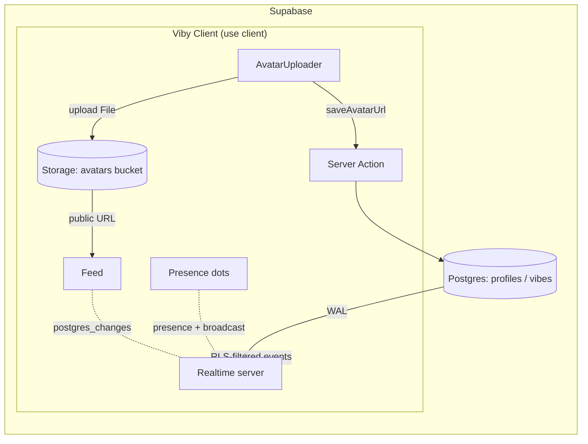

# Chapter 18 — Storage & Realtime Systems

> Until now Viby has been a place you *read*. In this chapter it starts to *breathe* — profile photos upload, and presence dots glow green the instant a friend opens the app.

## What you'll learn

- How **Supabase Storage** works: buckets, object paths, and why per-user upload paths are non-negotiable.
- Building a reusable, typed **upload helper** for Viby avatars — including overwrite, public URLs, and old-file cleanup.
- How **Supabase Realtime** delivers three different things over one WebSocket: `postgres_changes`, **Broadcast**, and **Presence**.
- Subscribing to live database changes so a new "vibe" appears in the feed without a refresh.
- Building **online** and **typing** indicators with Presence and Broadcast.
- The security model that ties it all together: Storage RLS policies and Realtime authorization.

## Prerequisites

- Chapter 14 (Supabase setup) and Chapter 15 (`@supabase/ssr` browser & server clients) — we reuse those clients verbatim.
- Chapter 16 (Row Level Security) — Storage policies are *just RLS on a hidden table*, so this will feel familiar.
- Chapter 17 (Server Actions & data fetching) — we trigger uploads from client components but persist URLs through actions.
- A `profiles` table and a `vibes` table (id, author_id, body, created_at) from earlier chapters.

---

## Theory

### Storage: a filing cabinet bolted onto your database

Supabase Storage is an S3-compatible object store with one superpower: **it speaks the same RLS language as your Postgres tables.** Think of it as a filing cabinet standing next to your database. The cabinet is divided into **buckets** (drawers). Inside a drawer, every file lives at a **path** — a string like `8f3.../avatar.png` that behaves like a folder tree even though storage is flat.

Two kinds of drawers:

- **Public buckets** — anyone with the URL can read the file. Perfect for avatars and cover photos on a discovery app, where the whole point is to be seen.
- **Private buckets** — reads require a short-lived **signed URL** you mint on the server. Use these for anything sensitive (ID verification, draft media).

The single most important rule: **scope every upload path by user id.** If everyone dumps files into a shared namespace, user A can overwrite user B's avatar, and your RLS policies have nothing to grab onto. By making the *first path segment* the uploader's `auth.uid()`, you get a clean folder-per-user structure that an RLS policy can check with one expression. The analogy: everyone gets their own labelled drawer, and the lock only opens for the name on the label.

### Realtime: one socket, three jobs

Supabase Realtime is a single WebSocket connection multiplexed into **channels**. On a channel you can use three features, and beginners constantly confuse them:

| Feature | Question it answers | Backed by | Survives reconnect? |
|---|---|---|---|
| `postgres_changes` | "What changed in the database?" | Postgres WAL (write-ahead log) | Yes — replays |
| **Broadcast** | "What did another client just *say*?" | Ephemeral message bus | No — fire & forget |
| **Presence** | "Who is here right now?" | In-memory state, synced | Diffs on join/leave |

Analogy: a channel is a **group chat room**. `postgres_changes` is a bot that announces "the shared doc was edited." Broadcast is people typing messages that vanish if you weren't looking. Presence is the little "5 people online" list at the top that updates as people walk in and out.

Why three tools instead of one? Because durability has a cost. A new vibe is *data* — it must be persisted and reliably delivered, so it rides `postgres_changes`. A "typing…" indicator is *noise* — it should be cheap and disappear, so it rides Broadcast. "Who's online" is *state* — Presence keeps a synced snapshot and tells you the delta when it changes. Using the right one keeps your database write-free for things that shouldn't touch disk.

One gotcha: `postgres_changes` only fires for tables where **Realtime is enabled** (you add the table to the `supabase_realtime` publication), and the events you receive are still filtered by **RLS** — a user only hears about rows they're allowed to read.

---

## In practice

### 1. Create the bucket and policies

Run this once in the Supabase SQL editor (or a migration). We make `avatars` public for reads but lock writes to the owning user.

```sql
-- Public bucket: reads are open, writes are guarded by policy
insert into storage.buckets (id, name, public)
values ('avatars', 'avatars', true)
on conflict (id) do nothing;

-- A user may upload/update/delete ONLY inside a folder named after their uid.
-- storage.foldername(name) returns the path segments as an array.
create policy "Avatar uploads are owner-scoped"
on storage.objects for insert to authenticated
with check (
  bucket_id = 'avatars'
  and (storage.foldername(name))[1] = (select auth.uid())::text
);

create policy "Avatar updates are owner-scoped"
on storage.objects for update to authenticated
using (
  bucket_id = 'avatars'
  and (storage.foldername(name))[1] = (select auth.uid())::text
);

create policy "Avatar deletes are owner-scoped"
on storage.objects for delete to authenticated
using (
  bucket_id = 'avatars'
  and (storage.foldername(name))[1] = (select auth.uid())::text
);
```

Reads need no policy because the bucket is public. Notice the path contract baked into `(storage.foldername(name))[1]`: the **first segment must equal the user's id.** Our helper will honor exactly that.

### 2. The upload helper

A typed helper that uploads an avatar, cleans up the old one, and returns a public URL. It runs in the browser using the SSR browser client from Chapter 15.

```ts
// lib/storage/avatars.ts
import { createBrowserClient } from "@supabase/ssr";

const supabase = createBrowserClient(
  process.env.NEXT_PUBLIC_SUPABASE_URL!,
  process.env.NEXT_PUBLIC_SUPABASE_ANON_KEY!,
);

const BUCKET = "avatars";
const MAX_BYTES = 2 * 1024 * 1024; // 2 MB
const ALLOWED = ["image/jpeg", "image/png", "image/webp"] as const;

export type UploadResult = { url: string; path: string };

export async function uploadAvatar(
  userId: string,
  file: File,
): Promise<UploadResult> {
  if (file.size > MAX_BYTES) throw new Error("Image must be under 2 MB.");
  if (!ALLOWED.includes(file.type as (typeof ALLOWED)[number])) {
    throw new Error("Use a JPEG, PNG, or WebP image.");
  }

  // Stable extension; cache-busting handled below so we can keep one path.
  const ext = file.name.split(".").pop()?.toLowerCase() ?? "png";
  const path = `${userId}/avatar.${ext}`; // <-- first segment = userId (RLS!)

  // Remove any previous avatar with a different extension so we don't orphan files.
  const { data: existing } = await supabase.storage.from(BUCKET).list(userId);
  const stale = (existing ?? [])
    .filter((f) => f.name.startsWith("avatar.") && f.name !== `avatar.${ext}`)
    .map((f) => `${userId}/${f.name}`);
  if (stale.length) await supabase.storage.from(BUCKET).remove(stale);

  const { error } = await supabase.storage
    .from(BUCKET)
    .upload(path, file, { upsert: true, contentType: file.type });
  if (error) throw new Error(error.message);

  const { data } = supabase.storage.from(BUCKET).getPublicUrl(path);
  // Append a version token so browsers/CDN refetch the new image at the same path.
  return { url: `${data.publicUrl}?v=${Date.now()}`, path };
}
```

Two real-world touches: `upsert: true` lets a user replace their photo at a stable path, and the `?v=` query string defeats CDN/browser caching so the new face shows up immediately.

### 3. Persisting the URL through a Server Action

The upload happens client-side (the file never needs to round-trip through your server), but the resulting URL belongs in the database. Save it with a Server Action.

```ts
// app/profile/actions.ts
"use server";

import { revalidatePath } from "next/cache";
import { createServerClient } from "@supabase/ssr";
import { cookies } from "next/headers";

export async function saveAvatarUrl(url: string) {
  const cookieStore = await cookies(); // async in Next.js 16
  const supabase = createServerClient(
    process.env.NEXT_PUBLIC_SUPABASE_URL!,
    process.env.NEXT_PUBLIC_SUPABASE_ANON_KEY!,
    {
      cookies: {
        getAll: () => cookieStore.getAll(),
        setAll: (all) =>
          all.forEach(({ name, value, options }) =>
            cookieStore.set(name, value, options),
          ),
      },
    },
  );

  const { data: { user } } = await supabase.auth.getUser();
  if (!user) throw new Error("Not signed in.");

  const { error } = await supabase
    .from("profiles")
    .update({ avatar_url: url })
    .eq("id", user.id);
  if (error) throw new Error(error.message);

  revalidatePath("/profile");
}
```

### 4. The client uploader component

```tsx
// app/profile/avatar-uploader.tsx
"use client";

import { useState } from "react";
import { motion, AnimatePresence } from "framer-motion";
import { uploadAvatar } from "@/lib/storage/avatars";
import { saveAvatarUrl } from "./actions";

export function AvatarUploader({ userId, initialUrl }: { userId: string; initialUrl: string }) {
  const [url, setUrl] = useState(initialUrl);
  const [busy, setBusy] = useState(false);
  const [error, setError] = useState<string | null>(null);

  async function onPick(e: React.ChangeEvent<HTMLInputElement>) {
    const file = e.target.files?.[0];
    if (!file) return;
    setBusy(true);
    setError(null);
    try {
      const { url: newUrl } = await uploadAvatar(userId, file);
      await saveAvatarUrl(newUrl);
      setUrl(newUrl);
    } catch (err) {
      setError(err instanceof Error ? err.message : "Upload failed.");
    } finally {
      setBusy(false);
    }
  }

  return (
    <label className="group relative inline-block cursor-pointer">
      <AnimatePresence mode="wait">
        <motion.img
          key={url}
          src={url}
          alt="Your avatar"
          initial={{ opacity: 0, scale: 0.9 }}
          animate={{ opacity: 1, scale: 1 }}
          exit={{ opacity: 0 }}
          className="size-24 rounded-full object-cover ring-4 ring-[--color-brand]"
        />
      </AnimatePresence>
      <input type="file" accept="image/*" hidden onChange={onPick} disabled={busy} />
      {busy && <span className="absolute inset-0 grid place-items-center rounded-full bg-black/40 text-xs text-white">Uploading…</span>}
      {error && <p className="mt-2 text-xs text-red-500">{error}</p>}
    </label>
  );
}
```

The `--color-brand` token comes from your Tailwind v4 `@theme` block (`@theme { --color-brand: #FF6FB5; }`) — no `tailwind.config.js` in sight.

### 5. Realtime: live vibes in the feed

First enable Realtime for the table (run once):

```sql
alter publication supabase_realtime add table public.vibes;
```

Now a hook that subscribes to inserts and prepends them. RLS still applies, so users only receive vibes they're allowed to see.

```tsx
// lib/realtime/use-live-vibes.ts
"use client";

import { useEffect } from "react";
import { createBrowserClient } from "@supabase/ssr";

type Vibe = { id: string; author_id: string; body: string; created_at: string };

const supabase = createBrowserClient(
  process.env.NEXT_PUBLIC_SUPABASE_URL!,
  process.env.NEXT_PUBLIC_SUPABASE_ANON_KEY!,
);

export function useLiveVibes(onInsert: (v: Vibe) => void) {
  useEffect(() => {
    const channel = supabase
      .channel("vibes-feed")
      .on(
        "postgres_changes",
        { event: "INSERT", schema: "public", table: "vibes" },
        (payload) => onInsert(payload.new as Vibe),
      )
      .subscribe();

    return () => {
      supabase.removeChannel(channel); // always tear down
    };
  }, [onInsert]);
}
```

### 6. Realtime: presence + typing

Presence answers "who's online," Broadcast carries the "typing…" pings. Both live on one channel.

```tsx
// lib/realtime/use-presence.ts
"use client";

import { useEffect, useState } from "react";
import { createBrowserClient } from "@supabase/ssr";

const supabase = createBrowserClient(
  process.env.NEXT_PUBLIC_SUPABASE_URL!,
  process.env.NEXT_PUBLIC_SUPABASE_ANON_KEY!,
);

export function useRoomPresence(roomId: string, me: { id: string; name: string }) {
  const [online, setOnline] = useState<string[]>([]);
  const [typing, setTyping] = useState<string | null>(null);

  useEffect(() => {
    const channel = supabase.channel(`room:${roomId}`, {
      config: { presence: { key: me.id } },
    });

    channel
      .on("presence", { event: "sync" }, () => {
        const state = channel.presenceState<{ name: string }>();
        setOnline(Object.values(state).map((p) => p[0].name));
      })
      .on("broadcast", { event: "typing" }, ({ payload }) => {
        setTyping(payload.name);
        setTimeout(() => setTyping(null), 1500);
      })
      .subscribe(async (status) => {
        if (status === "SUBSCRIBED") {
          await channel.track({ name: me.name }); // announce myself
        }
      });

    return () => {
      supabase.removeChannel(channel);
    };
  }, [roomId, me.id, me.name]);

  function notifyTyping() {
    supabase.channel(`room:${roomId}`).send({
      type: "broadcast",
      event: "typing",
      payload: { name: me.name },
    });
  }

  return { online, typing, notifyTyping };
}
```

`channel.track()` registers you in Presence; the `sync` event fires whenever anyone joins or leaves. Typing pings go out as fire-and-forget Broadcast — no database writes, no history, exactly what an ephemeral hint should be.

---

## Architecture / diagram



The file goes straight to Storage; only the resulting *string* travels through your server. Database writes flow to Postgres, whose write-ahead log feeds Realtime, which fans RLS-filtered events back to every subscribed client.

---

## Best practices & pitfalls

- **DO** make the first path segment the user id. It's the hook every Storage RLS policy relies on.
- **DO** validate file type and size *client-side for UX* and rely on bucket/RLS limits *server-side for security*. Never trust the client alone.
- **DON'T** forget `supabase.removeChannel()` in your cleanup. Leaked channels pile up across navigations and exhaust the connection.
- **DON'T** use `postgres_changes` for typing indicators — you'd hammer the database with throwaway writes. Use Broadcast.
- **DO** add the table to the `supabase_realtime` publication, or your `postgres_changes` subscription will silently receive nothing.
- **DON'T** assume Realtime bypasses RLS. It doesn't — if a user can't `select` a row, they won't get its change events. Test with a real signed-in client, not the service role.
- **DO** cache-bust public URLs (`?v=`) when you reuse a stable path, or users will keep seeing their old photo.
- **DON'T** store the service-role key in any `NEXT_PUBLIC_` variable. Uploads here use the anon key plus RLS — that's the point.
- **DO** clean up orphaned files on replace; storage costs and clutter are real at scale.

---

## Exercises

1. **Cover photos.** Add a `covers` bucket and extend the helper with `uploadCover(userId, file)` reusing the per-user path pattern. Wire matching insert/update/delete policies.
2. **Drag-and-drop.** Enhance `AvatarUploader` with a Framer Motion drop zone using `onDragOver`/`onDrop`, animating a pink dashed border (`whileHover`/`animate`) when a file hovers.
3. **Live like counts.** Subscribe to `UPDATE` events on a `vibes` row's `like_count` and animate the number with a Framer Motion `key`-swap counter.
4. **Debounced typing.** The current `notifyTyping` could fire on every keystroke. Debounce it to at most one broadcast per 800 ms.
5. **Signed URLs (harder).** Create a *private* `verification` bucket and write a Server Action that returns a 60-second signed URL via `createSignedUrl`.

---

## Mini-project: the live "Who's vibing now" rail

Build a sidebar rail on the Viby home feed that shows live presence and live vibes together.

**Requirements**
1. A `PresenceRail` client component that joins channel `room:home`, tracks the current user, and renders up to 8 online avatars with a green pulsing dot (Framer Motion `animate` loop on opacity/scale).
2. Use `useLiveVibes` so that when *anyone* posts, the new vibe slides into the top of the feed via `AnimatePresence` + `layout`.
3. The composer at the top calls `notifyTyping` (debounced from Exercise 4); other users see "Maya is vibing…" appear and fade.
4. Posting a vibe writes through a Server Action; the live insert — not a manual `setState` — is what adds it to the feed, proving the realtime loop end to end.

**Acceptance:** open two browser windows signed in as different users. Posting in one appears instantly in the other, both presence rails show two avatars, and typing in one shows the hint in the other. No page refresh, anywhere.

---

## Key takeaways

- Supabase **Storage** is RLS-governed object storage; **per-user path prefixes** are what make policies enforceable.
- Public buckets serve open read URLs; private buckets need **signed URLs** minted server-side.
- Your upload helper should validate, upsert at a stable path, **clean up stale files**, and cache-bust the URL.
- Realtime multiplexes three tools on one channel: **`postgres_changes`** for durable data, **Broadcast** for ephemeral signals, **Presence** for who's-here state.
- `postgres_changes` requires the table in the `supabase_realtime` publication and **still respects RLS**.
- Always **remove channels** on cleanup to avoid leaks.

**Up next — Chapter 19: Edge Functions & Webhooks**, where Viby starts reacting to the outside world: image moderation on upload, and Stripe events arriving over the wire.
