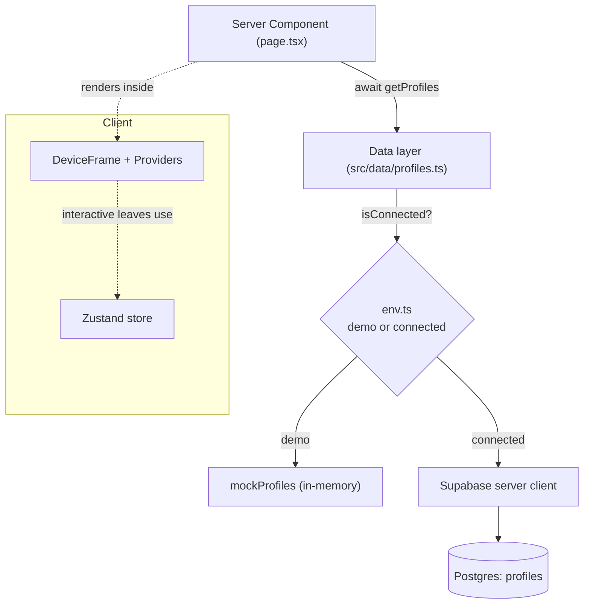

# Chapter 19 — Project Setup & Foundation

> Every great app starts as an empty folder and a clear decision about where things go. Today we make those decisions for Viby — once — so the next forty chapters feel like flow instead of friction.

## What you'll learn

- How to scaffold a **Next.js 16** project with the App Router, TypeScript, and Tailwind CSS v4
- The exact **stack install** for Viby (shadcn-style primitives, Framer Motion, Zustand, Supabase via `@supabase/ssr`)
- A **folder structure** that scales from demo to production without a single rename
- How to define **brand design tokens** in `globals.css` using Tailwind v4's `@theme` — no `tailwind.config.js`
- Building the **`DeviceFrame`**, the **`Providers`** tree, and the **Zustand store**
- The **demo / connected-mode seam**: one switch that runs Viby fully in-memory *or* against real Supabase

## Prerequisites

- **Chapters 1–8** — JavaScript, TypeScript fundamentals, and the React 19 mental model (Server vs. Client Components).
- **Chapters 9–14** — Next.js App Router routing, Server Actions, and data fetching.
- **Chapters 15–18** — Tailwind v4, component composition, and an intro to Supabase Auth.
- Node.js **20.9+** and a package manager (we use `pnpm`, but `npm`/`yarn` work).

---

## Theory

### Why a foundation chapter at all?

Think of Viby like a house. You *could* start nailing up drywall immediately — but if the foundation isn't poured level and the plumbing rough-in is missing, every later step fights you. Our "foundation" is three things working together:

1. **Structure** — where files live, so you never hunt.
2. **Tokens** — the brand's colors, radii, and motion expressed *once*, so the whole app stays visually consistent automatically.
3. **A seam** — a clean line between *fake data* and *real backend* so you can build and demo the UI today and flip on Supabase tomorrow without rewriting components.

That third one is the secret weapon of professional teams. The "**demo / connected seam**" means your UI never imports Supabase directly. Instead it talks to a small **data layer**, and that layer decides — based on one environment flag — whether to return in-memory mock data or hit the real database. The UI can't tell the difference. This is the same pattern behind feature flags, Storybook mocks, and offline-first apps.

### Server-first, client-when-needed

Next.js 16 renders **Server Components by default**. They run on the server, never ship their JS to the browser, and can `await` data directly. You opt a component into the browser with the `"use client"` directive — and you only do that when you need state, effects, event handlers, or browser APIs. Viby's rule of thumb: *pages and layouts stay Server Components; anything interactive (a button with a Zustand store, a Framer Motion gesture) is a Client Component leaf.*

### Tokens as a single source of truth

In Tailwind v4 there is no `tailwind.config.js`. You declare your design system **in CSS** with the `@theme` block. Define `--color-viby` once and Tailwind generates `bg-viby`, `text-viby`, `border-viby`, and friends for you. Change the hex in one place and the entire app re-skins. That's the analogy of a *style guide that the compiler actually enforces*.

### Why a `DeviceFrame`?

Viby is **mobile-first**. On a laptop, a full-width mobile app looks lost in an ocean of whitespace. The `DeviceFrame` is a presentational shell — a phone-shaped container — so that on desktop you preview Viby exactly as it appears on a phone, and on an actual phone the frame melts away to full-screen. It's a teaching device *and* a real product decision used by many social apps' marketing previews.

---

## In practice

### 1. Scaffold the project

```bash
pnpm create next-app@latest viby --typescript --eslint --app --tailwind --src-dir --use-pnpm
cd viby
```

Choices: **App Router**, **TypeScript**, **Tailwind**, and a **`src/` directory** (keeps config files at the root uncluttered). This gives you Next.js 16, React 19, and Tailwind v4 out of the box.

### 2. Install the Viby stack

```bash
# State + animation
pnpm add zustand framer-motion

# Supabase (SSR-aware client)
pnpm add @supabase/supabase-js @supabase/ssr

# UI utilities used by shadcn-style primitives
pnpm add class-variance-authority clsx tailwind-merge lucide-react
```

### 3. Folder structure

```text
viby/
├─ src/
│  ├─ app/                      # App Router: routes, layouts, pages
│  │  ├─ layout.tsx             # Root layout — fonts, Providers, DeviceFrame
│  │  ├─ page.tsx               # Landing / discover feed
│  │  └─ globals.css            # Tailwind import + @theme tokens
│  ├─ components/
│  │  ├─ ui/                    # shadcn-style primitives (Button, Card…)
│  │  ├─ device-frame.tsx       # the phone shell
│  │  └─ providers.tsx          # client-side context providers
│  ├─ lib/
│  │  ├─ utils.ts               # cn() helper
│  │  ├─ env.ts                 # mode detection (demo vs connected)
│  │  └─ supabase/
│  │     ├─ client.ts           # createBrowserClient
│  │     └─ server.ts           # createServerClient
│  ├─ data/                     # THE SEAM — UI imports from here, never Supabase
│  │  ├─ profiles.ts            # getProfiles() — demo or connected
│  │  └─ mock/profiles.ts       # in-memory seed data
│  ├─ store/
│  │  └─ use-viby-store.ts      # Zustand global store
│  └─ types/
│     └─ index.ts               # shared TypeScript types
├─ proxy.ts                     # middleware-style logic (Next.js 16)
└─ .env.local
```

> **Note on `proxy.ts`:** In Next.js 16, request-intercepting logic that older tutorials put in `middleware.ts` now lives in **`proxy.ts`** at the project root. We'll wire Supabase session refresh there in Chapter 22.

### 4. Design tokens in `globals.css`

```css
@import "tailwindcss";

@theme {
  /* Brand */
  --color-viby: #ff6fb5;          /* bubblegum pink */
  --color-viby-ink: #1b1320;      /* near-black text */
  --color-viby-muted: #8b8194;    /* secondary text */
  --color-viby-bg: #ffffff;
  --color-viby-surface: #fff5fa;  /* soft pink wash */

  /* Radii — rounded, friendly, Gen-Z */
  --radius-viby: 1.25rem;

  /* Fonts (wired in layout.tsx) */
  --font-sans: var(--font-geist-sans), ui-sans-serif, system-ui, sans-serif;

  /* Motion */
  --ease-viby: cubic-bezier(0.22, 1, 0.36, 1);
}

:root {
  color-scheme: light;
}

body {
  background: var(--color-viby-bg);
  color: var(--color-viby-ink);
  -webkit-font-smoothing: antialiased;
}
```

Now `bg-viby`, `text-viby-muted`, `rounded-viby`, and `ease-[--ease-viby]` all exist as utilities — zero config file.

### 5. The `cn()` helper

```ts
// src/lib/utils.ts
import { clsx, type ClassValue } from "clsx";
import { twMerge } from "tailwind-merge";

export function cn(...inputs: ClassValue[]) {
  return twMerge(clsx(inputs));
}
```

### 6. The mode flag (the heart of the seam)

```ts
// src/lib/env.ts
// Connected mode turns on ONLY when real Supabase env vars are present.
export const isConnected =
  !!process.env.NEXT_PUBLIC_SUPABASE_URL &&
  !!process.env.NEXT_PUBLIC_SUPABASE_ANON_KEY;

export const mode = isConnected ? "connected" : "demo";
```

```bash
# .env.local  — leave BLANK for demo mode; fill in for connected mode
NEXT_PUBLIC_SUPABASE_URL=
NEXT_PUBLIC_SUPABASE_ANON_KEY=
```

### 7. Supabase clients (`@supabase/ssr`)

```ts
// src/lib/supabase/client.ts
import { createBrowserClient } from "@supabase/ssr";

export function createClient() {
  return createBrowserClient(
    process.env.NEXT_PUBLIC_SUPABASE_URL!,
    process.env.NEXT_PUBLIC_SUPABASE_ANON_KEY!,
  );
}
```

```ts
// src/lib/supabase/server.ts
import { createServerClient } from "@supabase/ssr";
import { cookies } from "next/headers";

export async function createClient() {
  const cookieStore = await cookies(); // async in Next.js 16

  return createServerClient(
    process.env.NEXT_PUBLIC_SUPABASE_URL!,
    process.env.NEXT_PUBLIC_SUPABASE_ANON_KEY!,
    {
      cookies: {
        getAll() {
          return cookieStore.getAll();
        },
        setAll(cookiesToSet) {
          try {
            cookiesToSet.forEach(({ name, value, options }) =>
              cookieStore.set(name, value, options),
            );
          } catch {
            // Called from a Server Component — safe to ignore;
            // proxy.ts refreshes the session instead.
          }
        },
      },
    },
  );
}
```

### 8. The data layer — where the seam lives

```ts
// src/types/index.ts
export type Profile = {
  id: string;
  name: string;
  age: number;
  city: string;
  bio: string;
  hobbies: string[];
  avatarUrl: string;
};
```

```ts
// src/data/mock/profiles.ts
import type { Profile } from "@/types";

export const mockProfiles: Profile[] = [
  {
    id: "p1",
    name: "Maya",
    age: 24,
    city: "Austin",
    bio: "Bouldering, vinyl crates, and aggressively good coffee.",
    hobbies: ["climbing", "vinyl", "coffee"],
    avatarUrl: "/avatars/maya.jpg",
  },
  {
    id: "p2",
    name: "Devon",
    age: 27,
    city: "Austin",
    bio: "Run-club captain. I will drag you to a 6am 5k.",
    hobbies: ["running", "board games", "tacos"],
    avatarUrl: "/avatars/devon.jpg",
  },
];
```

```ts
// src/data/profiles.ts  — the UI imports THIS, never Supabase
import { isConnected } from "@/lib/env";
import { mockProfiles } from "@/data/mock/profiles";
import type { Profile } from "@/types";

export async function getProfiles(): Promise<Profile[]> {
  if (!isConnected) {
    // Demo mode: instant, in-memory, no network.
    return mockProfiles;
  }

  // Connected mode: real Supabase read.
  const { createClient } = await import("@/lib/supabase/server");
  const supabase = await createClient();
  const { data, error } = await supabase
    .from("profiles")
    .select("id, name, age, city, bio, hobbies, avatar_url");

  if (error) throw error;

  return (data ?? []).map((row) => ({
    id: row.id,
    name: row.name,
    age: row.age,
    city: row.city,
    bio: row.bio,
    hobbies: row.hobbies ?? [],
    avatarUrl: row.avatar_url,
  }));
}
```

The component that renders the feed only ever sees `getProfiles()`. It has no idea whether the data is fake or real — and that's the whole point.

### 9. The Zustand store

```ts
// src/store/use-viby-store.ts
"use client";

import { create } from "zustand";

type VibyState = {
  likedIds: string[];
  toggleLike: (id: string) => void;
  isLiked: (id: string) => boolean;
};

export const useVibyStore = create<VibyState>((set, get) => ({
  likedIds: [],
  toggleLike: (id) =>
    set((state) => ({
      likedIds: state.likedIds.includes(id)
        ? state.likedIds.filter((x) => x !== id)
        : [...state.likedIds, id],
    })),
  isLiked: (id) => get().likedIds.includes(id),
}));
```

### 10. Providers (client boundary)

```tsx
// src/components/providers.tsx
"use client";

import { type ReactNode } from "react";

export function Providers({ children }: { children: ReactNode }) {
  // Today: a thin wrapper. Later: theme, toast, Supabase realtime context.
  return <>{children}</>;
}
```

### 11. The `DeviceFrame`

```tsx
// src/components/device-frame.tsx
import { type ReactNode } from "react";
import { cn } from "@/lib/utils";

export function DeviceFrame({ children }: { children: ReactNode }) {
  return (
    <div className="flex min-h-dvh items-center justify-center bg-viby-surface p-0 sm:p-6">
      <div
        className={cn(
          "relative w-full overflow-hidden bg-viby-bg shadow-2xl",
          // Full-screen on phones; framed phone shape on larger screens.
          "min-h-dvh sm:min-h-0 sm:h-[844px] sm:max-w-[390px] sm:rounded-[2.5rem]",
          "sm:ring-8 sm:ring-viby-ink/90",
        )}
      >
        {children}
      </div>
    </div>
  );
}
```

### 12. Wire it all in the root layout

```tsx
// src/app/layout.tsx
import type { Metadata } from "next";
import { Geist } from "next/font/google";
import { Providers } from "@/components/providers";
import { DeviceFrame } from "@/components/device-frame";
import "./globals.css";

const geist = Geist({ subsets: ["latin"], variable: "--font-geist-sans" });

export const metadata: Metadata = {
  title: "Viby — find your people",
  description: "Make friends through shared hobbies and lifestyle.",
};

export default function RootLayout({
  children,
}: {
  children: React.ReactNode;
}) {
  return (
    <html lang="en" className={geist.variable}>
      <body className="font-sans">
        <Providers>
          <DeviceFrame>{children}</DeviceFrame>
        </Providers>
      </body>
    </html>
  );
}
```

A quick Server Component page that consumes the seam:

```tsx
// src/app/page.tsx  (Server Component — note the await)
import { getProfiles } from "@/data/profiles";
import { mode } from "@/lib/env";

export default async function DiscoverPage() {
  const profiles = await getProfiles();

  return (
    <main className="p-5">
      <header className="mb-4 flex items-baseline justify-between">
        <h1 className="text-2xl font-bold text-viby">Viby</h1>
        <span className="text-xs text-viby-muted">{mode} mode</span>
      </header>

      <ul className="space-y-3">
        {profiles.map((p) => (
          <li key={p.id} className="rounded-viby bg-viby-surface p-4">
            <p className="font-semibold">
              {p.name}, {p.age}
            </p>
            <p className="text-sm text-viby-muted">{p.bio}</p>
          </li>
        ))}
      </ul>
    </main>
  );
}
```

Run it:

```bash
pnpm dev
```

With `.env.local` blank you'll see `demo mode` and Maya + Devon. Fill in real keys and the *same page* serves live data.

---

## Architecture / diagram



The UI sits on the **left** and never reaches past the data layer. The **flag** in the middle is the only thing that decides demo vs. real — flip it and nothing else changes.

---

## Best practices & pitfalls

- **Do** keep all backend access behind `src/data/*`. **Don't** import a Supabase client inside a component — that hard-wires you to the backend and breaks demo mode.
- **Do** define tokens once in `@theme`. **Don't** sprinkle raw hex like `#ff6fb5` in components — use `bg-viby`.
- **Do** keep `"use client"` on leaves (the store, animated buttons). **Don't** mark `layout.tsx` or `page.tsx` as client — you lose `async` data fetching and ship needless JS.
- **Do** `await cookies()` and `await params` in Next.js 16 — they're async now. Forgetting `await` is the #1 upgrade bug.
- **Do** use `proxy.ts` (not `middleware.ts`) for request interception in Next.js 16.
- **Don't** commit `.env.local`. Confirm it's in `.gitignore` (Next.js adds it by default).
- **Don't** put secrets behind the `NEXT_PUBLIC_` prefix unless they're truly public — that prefix exposes them to the browser. The anon key is safe; a service-role key never is.

---

## Exercises

1. **Token tweak (easy).** Add a `--color-viby-accent` token (try a mint `#5ce0c2`) and use it for the "mode" badge text.
2. **Second entity (easy–medium).** Create a `Hobby` type, a `mock/hobbies.ts`, and a `getHobbies()` in the data layer following the exact seam pattern.
3. **Store growth (medium).** Add a `passedIds` array and a `pass(id)` action to the Zustand store, ensuring a profile can't be both liked and passed.
4. **Frame polish (medium).** Add a notch/status-bar strip to the top of `DeviceFrame` that only appears on `sm:` and up.
5. **Seam proof (challenge).** Without changing `page.tsx`, make `getProfiles()` log `"[demo]"` or `"[connected]"` to the server console — proving the UI is decoupled from the source.

---

## Mini-project — The Discover skeleton

Build a working **Discover feed skeleton** end to end:

1. Scaffold and install the stack (steps 1–2).
2. Drop in the tokens, `cn()`, `env.ts`, the data layer, the store, `DeviceFrame`, `Providers`, and the layout.
3. Make `page.tsx` render the profiles from `getProfiles()` inside the `DeviceFrame`.
4. Add a small **Client Component** `LikeButton` that calls `useVibyStore().toggleLike(p.id)` and shows a filled heart when liked (use `lucide-react`'s `Heart`). This is your first taste of the Server-renders / Client-interacts split.
5. Confirm the app runs in **demo mode** with no Supabase keys, shows `demo mode`, and lets you like Maya and Devon.

Success looks like: a phone-framed pink feed, two profiles, a heart that toggles — all running with zero backend.

---

## Key takeaways

- Next.js 16 is **server-first**; reach for `"use client"` only on interactive leaves.
- Tailwind v4 puts your design system in **`@theme` tokens** — no config file, one source of truth.
- The **data layer (`src/data/*`)** is a seam: the UI never imports Supabase, so demo and connected modes share identical components.
- A single env-derived flag (`isConnected`) decides the mode — making Viby buildable, demoable, and testable today.
- `DeviceFrame` + `Providers` + the **Zustand store** give you a mobile-shaped shell and clean client-state from day one.

**Up next — Chapter 20: Design System & UI Primitives**, where we turn these tokens into a full set of shadcn-style components (Button, Card, Avatar, Badge) with Framer Motion polish.
