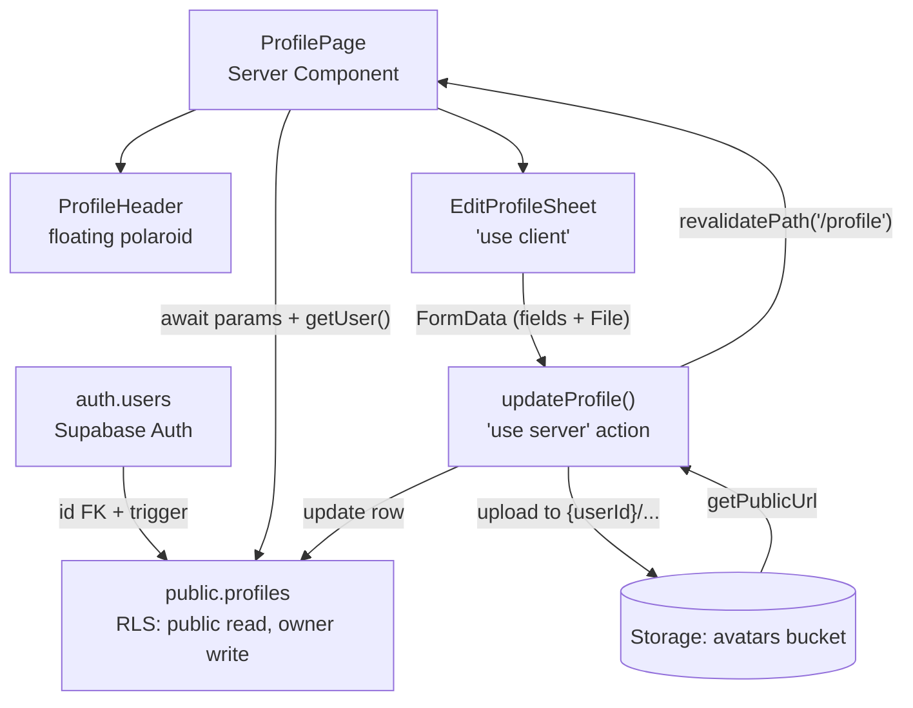

# Chapter 21 — Profiles & the Identity System

> Your profile is the first thing another human sees on Viby — make it feel less like a database row and more like a person you'd want to grab coffee with.

In this chapter we leave behind the plumbing and build the part of Viby people will actually *fall in love with*: the identity layer. We'll craft the signature non-circular avatar tile, a cinematic profile header with a floating polaroid, a buttery `EditProfileSheet`, real photo uploads to Supabase Storage, and persistence that survives refreshes and devices.

## What you'll learn

- How to model a `profiles` table that mirrors Supabase Auth users via a foreign key + RLS
- Building the signature **squircle identity tile** (our non-circular avatar) as a reusable component
- A cinematic header with a **floating polaroid** using Framer Motion layout + gesture animation
- An accessible, mobile-first **EditProfileSheet** with optimistic updates
- Uploading photos to **Supabase Storage** with signed-path conventions and image validation
- Persisting profile edits via **Server Actions** with `revalidatePath`

## Prerequisites

- Chapter 7 — Tailwind v4 `@theme` tokens (we lean on our brand tokens here)
- Chapter 12 — Supabase Auth with `@supabase/ssr` (we reuse the server/browser clients)
- Chapter 15 — Server Actions and the `"use server"` directive
- Chapter 18 — Zustand for ephemeral UI state (the sheet's open/close + draft state)

---

## Theory

### A profile is a *projection* of an auth user, not the user itself

When someone signs up, Supabase Auth creates a row in the protected `auth.users` table. You don't own that table and shouldn't write app data into it. Instead we create our **own** `public.profiles` table whose primary key *is* the auth user's `id`. Think of `auth.users` as a passport (identity, immutable, government-issued) and `profiles` as the personality you show the world — your display name, bio, hobbies, the polaroid you picked. One passport, one public persona, linked by id.

This separation matters because:

1. **Security boundaries** — Row Level Security (RLS) on `profiles` lets anyone *read* a profile (discovery is the whole point of Viby) but only the owner can *write* it.
2. **Schema freedom** — you evolve `profiles` freely without touching auth.
3. **Realtime + joins** — every post, like, and message can join to `profiles` cheaply.

### Identity is *visual*, not just data

Most apps default to a circular avatar. Circles are safe and forgettable. Viby's brand is a confident bubblegum-pink Gen-Z aesthetic, so our signature shape is a **squircle** — a superellipse rendered via CSS — wrapped in a soft pink ring. It's instantly recognizable and screenshots beautifully. The lesson: *identity components are brand surface area*. Treat the avatar like a logo.

### The "floating polaroid" metaphor

The profile header is the cinematic moment. We layer a wide gradient cover, then a single **polaroid-style photo** that floats slightly above the surface with a subtle tilt and a spring on hover/drag. It reads as a physical object dropped onto a digital page — tangible, playful, premium. Framer Motion's spring physics is what sells the "weight."

### Optimistic by default

When a user saves their bio, they shouldn't stare at a spinner. We update the UI immediately (optimistic), fire the Server Action, and only roll back if the server rejects. The mental model: *trust the user's intent, verify in the background.*

---

## In practice

### 1. The database: a `profiles` table mirroring auth users

Run this in the Supabase SQL editor (or as a migration):

```sql
create table public.profiles (
  id          uuid primary key references auth.users (id) on delete cascade,
  username    text unique not null,
  display_name text not null default '',
  bio         text default '',
  hobbies     text[] default '{}',
  avatar_url  text,
  polaroid_url text,
  updated_at  timestamptz default now()
);

alter table public.profiles enable row level security;

-- Anyone can read profiles (discovery is public).
create policy "Profiles are viewable by everyone"
  on public.profiles for select
  using (true);

-- Only the owner can insert their own row.
create policy "Users can insert their own profile"
  on public.profiles for insert
  with check (auth.uid() = id);

-- Only the owner can update their own row.
create policy "Users can update their own profile"
  on public.profiles for update
  using (auth.uid() = id);
```

Auto-create a profile the moment a user signs up, using a trigger so you never have an authenticated user without a profile:

```sql
create function public.handle_new_user()
returns trigger language plpgsql security definer set search_path = '' as $$
begin
  insert into public.profiles (id, username, display_name)
  values (new.id, 'user_' || substr(new.id::text, 1, 8), '');
  return new;
end;
$$;

create trigger on_auth_user_created
  after insert on auth.users
  for each row execute function public.handle_new_user();
```

Create a Storage bucket for photos (Dashboard → Storage → New bucket → `avatars`, public read). Add a policy so users only write to their own folder:

```sql
create policy "Users manage own avatar folder"
  on storage.objects for all
  using ( bucket_id = 'avatars' and (storage.foldername(name))[1] = auth.uid()::text )
  with check ( bucket_id = 'avatars' and (storage.foldername(name))[1] = auth.uid()::text );
```

### 2. Typed Supabase clients (recap from Ch. 12)

```ts
// lib/supabase/server.ts
import { createServerClient } from "@supabase/ssr";
import { cookies } from "next/headers";

export async function createClient() {
  const cookieStore = await cookies();
  return createServerClient(
    process.env.NEXT_PUBLIC_SUPABASE_URL!,
    process.env.NEXT_PUBLIC_SUPABASE_ANON_KEY!,
    {
      cookies: {
        getAll: () => cookieStore.getAll(),
        setAll: (toSet) =>
          toSet.forEach(({ name, value, options }) =>
            cookieStore.set(name, value, options)
          ),
      },
    }
  );
}
```

```ts
// lib/supabase/client.ts
import { createBrowserClient } from "@supabase/ssr";

export const createClient = () =>
  createBrowserClient(
    process.env.NEXT_PUBLIC_SUPABASE_URL!,
    process.env.NEXT_PUBLIC_SUPABASE_ANON_KEY!
  );
```

### 3. The signature identity tile (squircle avatar)

A reusable Server Component — no client JS needed for the static case.

```tsx
// components/identity-tile.tsx
import Image from "next/image";
import { cn } from "@/lib/utils";

type Props = {
  src?: string | null;
  name: string;
  size?: number; // px
  className?: string;
};

export function IdentityTile({ src, name, size = 72, className }: Props) {
  const initials = name.trim().slice(0, 2).toUpperCase() || "VB";
  return (
    <div
      className={cn(
        "relative grid place-items-center overflow-hidden",
        "rounded-tile bg-brand/10 ring-2 ring-brand/60 shadow-tile",
        className
      )}
      style={{ width: size, height: size }}
    >
      {src ? (
        <Image src={src} alt={name} fill sizes={`${size}px`} className="object-cover" />
      ) : (
        <span className="font-semibold text-brand" style={{ fontSize: size * 0.32 }}>
          {initials}
        </span>
      )}
    </div>
  );
}
```

The squircle and brand tokens live in your global stylesheet (Tailwind v4 — **no `tailwind.config.js`**):

```css
/* app/globals.css */
@import "tailwindcss";

@theme {
  --color-brand: #ff6fb5;
  --radius-tile: 28% / 38%; /* superellipse-ish squircle */
  --shadow-tile: 0 8px 24px -8px rgba(255, 111, 181, 0.45);
}
```

> The `28% / 38%` border-radius gives that distinctive non-circular squircle — softer than a rounded rect, edgier than a circle. That asymmetry *is* the brand.

### 4. The cinematic header with a floating polaroid

```tsx
// components/profile-header.tsx
"use client";

import { motion } from "framer-motion";
import Image from "next/image";
import { IdentityTile } from "./identity-tile";

type Props = {
  displayName: string;
  username: string;
  bio: string;
  avatarUrl?: string | null;
  polaroidUrl?: string | null;
};

export function ProfileHeader({ displayName, username, bio, avatarUrl, polaroidUrl }: Props) {
  return (
    <header className="relative">
      {/* Cinematic gradient cover */}
      <div className="h-40 w-full bg-gradient-to-br from-brand via-pink-400 to-fuchsia-300 sm:h-56" />

      {/* Floating polaroid */}
      {polaroidUrl && (
        <motion.div
          drag
          dragConstraints={{ left: -12, right: 12, top: -8, bottom: 8 }}
          dragElastic={0.25}
          initial={{ rotate: -4, y: 24, opacity: 0 }}
          animate={{ rotate: -4, y: 0, opacity: 1 }}
          whileHover={{ rotate: 0, scale: 1.04 }}
          transition={{ type: "spring", stiffness: 220, damping: 18 }}
          className="absolute right-5 top-20 w-28 cursor-grab rounded-sm bg-white p-2 pb-6 shadow-xl active:cursor-grabbing sm:w-36"
        >
          <Image
            src={polaroidUrl}
            alt={`${displayName}'s polaroid`}
            width={160}
            height={160}
            className="aspect-square w-full object-cover"
          />
        </motion.div>
      )}

      {/* Identity row overlapping the cover */}
      <div className="-mt-10 flex items-end gap-4 px-5">
        <IdentityTile src={avatarUrl} name={displayName} size={88} className="shadow-lg" />
        <div className="pb-2">
          <h1 className="text-xl font-bold leading-tight">{displayName || "New Viber"}</h1>
          <p className="text-sm text-zinc-500">@{username}</p>
        </div>
      </div>

      <p className="mt-3 px-5 text-sm leading-relaxed text-zinc-700">{bio}</p>
    </header>
  );
}
```

### 5. The Server Action: persist + upload

```ts
// app/profile/actions.ts
"use server";

import { revalidatePath } from "next/cache";
import { createClient } from "@/lib/supabase/server";

const MAX_BYTES = 5 * 1024 * 1024; // 5 MB
const ALLOWED = ["image/jpeg", "image/png", "image/webp"];

export async function updateProfile(formData: FormData) {
  const supabase = await createClient();
  const {
    data: { user },
  } = await supabase.auth.getUser();
  if (!user) return { ok: false, error: "Not authenticated" };

  const patch: Record<string, unknown> = {
    display_name: String(formData.get("display_name") ?? "").slice(0, 80),
    bio: String(formData.get("bio") ?? "").slice(0, 280),
    updated_at: new Date().toISOString(),
  };

  // Optional photo upload (avatar). Folder is keyed by user id for RLS.
  const file = formData.get("avatar") as File | null;
  if (file && file.size > 0) {
    if (!ALLOWED.includes(file.type)) return { ok: false, error: "Unsupported file type" };
    if (file.size > MAX_BYTES) return { ok: false, error: "Image too large (max 5 MB)" };

    const ext = file.type.split("/")[1];
    const path = `${user.id}/avatar-${Date.now()}.${ext}`;
    const { error: upErr } = await supabase.storage
      .from("avatars")
      .upload(path, file, { upsert: true, contentType: file.type });
    if (upErr) return { ok: false, error: upErr.message };

    const { data: pub } = supabase.storage.from("avatars").getPublicUrl(path);
    patch.avatar_url = pub.publicUrl;
  }

  const { error } = await supabase.from("profiles").update(patch).eq("id", user.id);
  if (error) return { ok: false, error: error.message };

  revalidatePath("/profile");
  return { ok: true };
}
```

### 6. The EditProfileSheet (client, optimistic)

We use Zustand only for sheet open/close (ephemeral UI), and `useActionState` + `useOptimistic` for the form lifecycle.

```tsx
// components/edit-profile-sheet.tsx
"use client";

import { useActionState, useOptimistic, useRef, useState } from "react";
import { AnimatePresence, motion } from "framer-motion";
import { updateProfile } from "@/app/profile/actions";

type Profile = { display_name: string; bio: string; avatar_url?: string | null };

export function EditProfileSheet({ profile }: { profile: Profile }) {
  const [open, setOpen] = useState(false);
  const [preview, setPreview] = useState<string | null>(profile.avatar_url ?? null);
  const fileRef = useRef<HTMLInputElement>(null);

  const [optimistic, setOptimistic] = useOptimistic(profile);

  const [state, formAction, pending] = useActionState(
    async (_prev: unknown, formData: FormData) => {
      setOptimistic({
        display_name: String(formData.get("display_name") ?? ""),
        bio: String(formData.get("bio") ?? ""),
        avatar_url: optimistic.avatar_url,
      });
      const res = await updateProfile(formData);
      if (res.ok) setOpen(false);
      return res;
    },
    null
  );

  return (
    <>
      <button
        onClick={() => setOpen(true)}
        className="rounded-full bg-brand px-5 py-2 text-sm font-semibold text-white shadow-tile"
      >
        Edit profile
      </button>

      <AnimatePresence>
        {open && (
          <>
            <motion.div
              className="fixed inset-0 z-40 bg-black/40"
              initial={{ opacity: 0 }}
              animate={{ opacity: 1 }}
              exit={{ opacity: 0 }}
              onClick={() => setOpen(false)}
            />
            <motion.div
              role="dialog"
              aria-modal="true"
              aria-label="Edit profile"
              className="fixed inset-x-0 bottom-0 z-50 rounded-t-3xl bg-white p-6"
              initial={{ y: "100%" }}
              animate={{ y: 0 }}
              exit={{ y: "100%" }}
              transition={{ type: "spring", stiffness: 300, damping: 32 }}
            >
              <div className="mx-auto mb-4 h-1.5 w-12 rounded-full bg-zinc-200" />
              <form action={formAction} className="space-y-4">
                <label className="block">
                  <span className="text-sm font-medium">Display name</span>
                  <input
                    name="display_name"
                    defaultValue={optimistic.display_name}
                    maxLength={80}
                    className="mt-1 w-full rounded-xl border border-zinc-200 px-3 py-2"
                  />
                </label>

                <label className="block">
                  <span className="text-sm font-medium">Bio</span>
                  <textarea
                    name="bio"
                    defaultValue={optimistic.bio}
                    maxLength={280}
                    rows={3}
                    className="mt-1 w-full rounded-xl border border-zinc-200 px-3 py-2"
                  />
                </label>

                <input
                  ref={fileRef}
                  type="file"
                  name="avatar"
                  accept="image/jpeg,image/png,image/webp"
                  className="text-sm"
                  onChange={(e) => {
                    const f = e.target.files?.[0];
                    if (f) setPreview(URL.createObjectURL(f));
                  }}
                />
                {preview && (
                  
                )}

                {state && !state.ok && (
                  <p className="text-sm text-red-600">{state.error}</p>
                )}

                <button
                  type="submit"
                  disabled={pending}
                  className="w-full rounded-full bg-brand py-3 font-semibold text-white disabled:opacity-60"
                >
                  {pending ? "Saving…" : "Save changes"}
                </button>
              </form>
            </motion.div>
          </>
        )}
      </AnimatePresence>
    </>
  );
}
```

### 7. The profile page (Server Component, async params)

```tsx
// app/profile/[username]/page.tsx
import { notFound } from "next/navigation";
import { createClient } from "@/lib/supabase/server";
import { ProfileHeader } from "@/components/profile-header";
import { EditProfileSheet } from "@/components/edit-profile-sheet";

export default async function ProfilePage({
  params,
}: {
  params: Promise<{ username: string }>;
}) {
  const { username } = await params; // Next.js 16: params is async
  const supabase = await createClient();

  const { data: profile } = await supabase
    .from("profiles")
    .select("*")
    .eq("username", username)
    .single();

  if (!profile) notFound();

  const {
    data: { user },
  } = await supabase.auth.getUser();
  const isOwner = user?.id === profile.id;

  return (
    <main className="mx-auto max-w-xl pb-24">
      <ProfileHeader
        displayName={profile.display_name}
        username={profile.username}
        bio={profile.bio}
        avatarUrl={profile.avatar_url}
        polaroidUrl={profile.polaroid_url}
      />
      {isOwner && (
        <div className="mt-6 px-5">
          <EditProfileSheet profile={profile} />
        </div>
      )}
    </main>
  );
}
```

---

## Architecture / diagram



The flow: a request hits the Server Component, which reads the profile and decides ownership. The client sheet collects edits, hands a `FormData` (text + the `File`) to the Server Action, which validates, uploads to a user-scoped Storage folder, updates the row, and revalidates the cached page.

---

## Best practices & pitfalls

- **Do** key Storage paths by `auth.uid()` (`${user.id}/...`) so your one RLS policy covers every file. **Don't** put files at the bucket root — you lose per-user isolation.
- **Do** validate `file.type` and `file.size` *on the server*. Client `accept` attributes are a UX hint, not security.
- **Do** call `supabase.auth.getUser()` (which re-validates with the auth server) in Server Actions — never trust `getSession()` for authorization decisions.
- **Don't** access `params` synchronously in Next.js 16 — it's a Promise. `await` it (or `use()` it in a Client Component).
- **Don't** forget cache invalidation: without `revalidatePath`, the saved profile won't reflect until a hard reload.
- **Do** add cache-busting to avatar URLs (timestamped filename, as we do) so updated photos don't serve from a stale CDN cache.
- **Don't** reach for `middleware.ts`. In our stack, middleware-style logic lives in **`proxy.ts`** — use it for session refresh, not profile writes.
- **Do** debounce/limit huge uploads client-side too, but treat the server limit as the real gate.
- **Don't** store the polaroid and avatar in the same field — they play different roles (identity vs. expression).

---

## Exercises

1. **Username editing** — add a `username` field to the sheet with a uniqueness check. Surface the Postgres unique-violation error (`23505`) as a friendly "That handle's taken."
2. **Hobby chips** — render `profile.hobbies` as pink squircle chips under the bio, and add a multi-add input in the sheet that writes the `text[]` array.
3. **Drag-to-reorder polaroids** — extend to multiple polaroids using Framer Motion's `Reorder` group, persisting the new order.
4. **Skeleton loading** — add a `loading.tsx` for the profile route with a shimmering squircle placeholder.
5. **Crop before upload** — integrate a square-crop step (e.g. a canvas crop) so every avatar is a clean square before it reaches Storage.

---

## Mini-project: "Your Viby Identity Card"

Build a self-contained `/me` route that:

1. Redirects unauthenticated users to `/login` (use the session check in `proxy.ts` from Ch. 12).
2. Fetches the current user's profile and renders the `ProfileHeader` with `isOwner` always true.
3. Shows the `EditProfileSheet` with **live optimistic preview** — typing in the display name updates the header instantly via shared state (lift state up or use a Zustand store).
4. On save, uploads a new avatar to Storage, persists via the Server Action, and shows a pink toast "Identity updated."
5. Bonus: render a tiny "share card" — the identity tile + name + first hobby chip — that you could later turn into an OG image.

Ship it mobile-first. When you can edit your name, drop a new photo, and watch the header animate in under a second, you've built the heart of a real social app.

---

## Key takeaways

- A `profiles` table mirrors `auth.users` by id, with RLS for **public read / owner write**, auto-created via a trigger.
- The **squircle identity tile** is brand surface area — a reusable component, not an afterthought.
- The **floating polaroid** uses Framer Motion springs and drag to feel like a physical object.
- **Server Actions** handle validation, user-scoped **Storage** uploads, persistence, and `revalidatePath` in one place.
- `useOptimistic` + `useActionState` give instant, trustworthy UX without manual spinners.
- Authorize with `getUser()`, validate uploads server-side, and key files by user id.

**Up next — Chapter 22: The Discovery Feed**, where these profiles come alive in a swipeable, realtime grid of people you'll actually want to meet.
