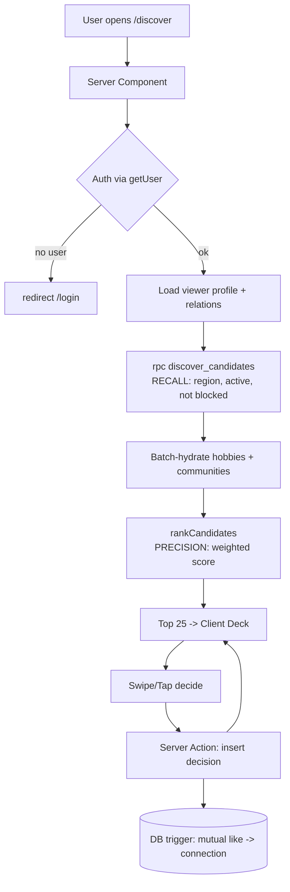

# Chapter 22 — Discover & the Matching Algorithm

> The screen where Viby stops being a profile form and starts feeling like magic: "how did it know I'd vibe with these people?"

Every social-discovery app lives or dies by one screen — the one that hands a stranger to you and quietly says *trust me, you two will get along*. In this chapter we build Viby's **Discover** experience end to end: the browse → open → explore → decide flow, the query that fetches good candidates, and the **compatibility score** that ranks them. No black magic — just an honest, explainable function you could defend in a code review.

## What you'll learn

- The mental model behind a *discovery* feed (not a dating swipe clone) and why ranking beats raw recency.
- How to fetch a sane **candidate pool** from Supabase without scanning your whole user table.
- A weighted **compatibility scoring** function over hobbies, vibe, lifestyle, proximity, and community overlap — with real TypeScript.
- Wiring it into a Next.js 16 Server Component, then layering a client card stack with Framer Motion gestures.
- The pitfalls that turn a "smart" feed into a slow, creepy, or boring one.

## Prerequisites

- Chapter 9–10: the Supabase data model (`profiles`, `hobbies`, `profile_hobbies`, `communities`) and `@supabase/ssr` clients.
- Chapter 12: Server Components, Server Actions, and the `proxy.ts` auth gate.
- Chapter 17: the `geography` / lat-lng columns and the Haversine helper you wrote for "people near me."
- Chapter 19: Zustand demo state and the shadcn-style `Card`, `Button`, `Avatar` primitives.

## Theory

A discovery feed answers a deceptively simple question: *of everyone on Viby, who should this user see first?* Recency ("newest profiles") is the lazy answer and it rots fast — your most active users see the same faces, newcomers drown, and nothing feels personal.

The professional answer is **ranking**: score every reasonable candidate against the viewer, sort descending, show the top slice. Think of it like a great party host. The host doesn't introduce you to all 200 guests alphabetically. They scan the room, remember you love bouldering and lo-fi and you're new in Lisbon, and walk you toward the three people most likely to become your people. That scan-and-introduce instinct is exactly what our scoring function encodes.

We split the work into two stages, and the split matters:

1. **Candidate fetching (recall).** Cheaply narrow thousands of users down to a few hundred *plausible* matches using coarse filters the database is good at — same city-ish region, active recently, not already connected or blocked. This is a SQL job.
2. **Scoring & ranking (precision).** Take that small pool into application code and compute a rich, weighted compatibility score. This is a TypeScript job.

Why not do it all in SQL? Because the interesting signal — overlapping hobbies, vibe affinity, lifestyle fit — is multi-dimensional and easier to reason about, test, and tune in code. And why not score *everyone* in code? Because pulling 50,000 rows to rank 12 cards is how you get a 4-second feed and an angry DBA. Recall is cheap and wide; precision is expensive and narrow. Keep them separate.

The score itself is a **weighted sum of normalized sub-scores**. Each dimension produces a number in `[0, 1]`, we multiply by a weight, and sum. Normalization is the part beginners skip and regret: if hobby overlap can be 0–8 and distance can be 0–500, the raw numbers aren't comparable and distance silently dominates everything. Squash each signal to `[0, 1]` *first*, weight *second*.

Our five dimensions for Viby:

| Dimension | Signal | Weight |
|---|---|---|
| Hobbies | Shared tagged hobbies (Jaccard overlap) | 0.35 |
| Vibe | Cosine similarity of personality/vibe vector | 0.20 |
| Lifestyle | Match on schedule, social energy, going-out style | 0.15 |
| Proximity | Closer = better, with a soft falloff | 0.20 |
| Community | Shared communities/groups joined | 0.10 |

Hobbies lead because Viby's whole premise is *shared interests build real friendships*. Weights are product decisions, not laws of physics — keep them in one config object so a product manager can tune them without touching logic.

## In practice

### 1. The candidate query (recall)

We fetch only plausible people: roughly the same region, active in the last 30 days, and not the viewer, not blocked, not already connected. Do the heavy exclusion in the database.

```sql
-- supabase/migrations/0042_discover_candidates.sql
-- A SQL function keeps the recall logic in one place and lets PostgREST call it via rpc().
create or replace function public.discover_candidates(
  viewer uuid,
  region_code text,
  max_results int default 200
)
returns setof public.profiles
language sql
stable
as $$
  select p.*
  from public.profiles p
  where p.id <> viewer
    and p.region_code = region_code
    and p.last_active_at > now() - interval '30 days'
    and p.discoverable = true
    and not exists (
      select 1 from public.connections c
      where (c.a_id = viewer and c.b_id = p.id)
         or (c.b_id = viewer and c.a_id = p.id)
    )
    and not exists (
      select 1 from public.blocks b
      where (b.blocker_id = viewer and b.blocked_id = p.id)
         or (b.blocker_id = p.id and b.blocked_id = viewer)
    )
  order by p.last_active_at desc
  limit max_results;
$$;
```

> Region is a coarse bucket (e.g. metro area), not exact distance — distance is a *scoring* signal, not a *filter*. A great match 12 km away should still surface.

### 2. The scoring function

Pure, synchronous, framework-free. That makes it trivially unit-testable — no mocks, no database, just data in, number out.

```typescript
// lib/discover/scoring.ts
export interface VibyProfile {
  id: string;
  hobbyIds: string[];        // e.g. ["bouldering", "lofi", "ramen"]
  vibe: number[];            // fixed-length vector, each value 0..1 (from onboarding quiz)
  lifestyle: {
    schedule: "early-bird" | "night-owl" | "flexible";
    socialEnergy: "introvert" | "ambivert" | "extrovert";
    goingOut: "homebody" | "balanced" | "always-out";
  };
  lat: number;
  lng: number;
  communityIds: string[];
}

// Product-tunable weights. Must sum to 1 for an interpretable 0..1 final score.
export const WEIGHTS = {
  hobbies: 0.35,
  vibe: 0.2,
  lifestyle: 0.15,
  proximity: 0.2,
  community: 0.1,
} as const;

/** Jaccard index: |A ∩ B| / |A ∪ B| — naturally normalized to [0,1]. */
function jaccard(a: string[], b: string[]): number {
  if (a.length === 0 && b.length === 0) return 0;
  const setB = new Set(b);
  const intersection = a.filter((x) => setB.has(x)).length;
  const union = new Set([...a, ...b]).size;
  return union === 0 ? 0 : intersection / union;
}

/** Cosine similarity of two equal-length vectors, clamped to [0,1]. */
function cosine(a: number[], b: number[]): number {
  if (a.length !== b.length || a.length === 0) return 0;
  let dot = 0;
  let magA = 0;
  let magB = 0;
  for (let i = 0; i < a.length; i++) {
    dot += a[i] * b[i];
    magA += a[i] * a[i];
    magB += b[i] * b[i];
  }
  if (magA === 0 || magB === 0) return 0;
  return Math.max(0, Math.min(1, dot / (Math.sqrt(magA) * Math.sqrt(magB))));
}

/** Fraction of categorical lifestyle fields that match. */
function lifestyleScore(a: VibyProfile["lifestyle"], b: VibyProfile["lifestyle"]): number {
  const keys = ["schedule", "socialEnergy", "goingOut"] as const;
  const matches = keys.filter((k) => a[k] === b[k]).length;
  return matches / keys.length;
}

/** Haversine distance in km (Chapter 17). */
function distanceKm(a: VibyProfile, b: VibyProfile): number {
  const R = 6371;
  const dLat = ((b.lat - a.lat) * Math.PI) / 180;
  const dLng = ((b.lng - a.lng) * Math.PI) / 180;
  const lat1 = (a.lat * Math.PI) / 180;
  const lat2 = (b.lat * Math.PI) / 180;
  const h =
    Math.sin(dLat / 2) ** 2 +
    Math.cos(lat1) * Math.cos(lat2) * Math.sin(dLng / 2) ** 2;
  return 2 * R * Math.asin(Math.sqrt(h));
}

/** Soft proximity score: 1 when co-located, decaying to ~0 by ~50km. */
function proximityScore(a: VibyProfile, b: VibyProfile): number {
  const km = distanceKm(a, b);
  // Exponential falloff feels natural: nearby matters a lot, far barely moves.
  return Math.exp(-km / 15); // 0km→1, 15km→0.37, 50km→0.04
}

export interface ScoredCandidate {
  profile: VibyProfile;
  score: number;
  breakdown: Record<keyof typeof WEIGHTS, number>;
}

export function scoreCandidate(viewer: VibyProfile, candidate: VibyProfile): ScoredCandidate {
  const breakdown = {
    hobbies: jaccard(viewer.hobbyIds, candidate.hobbyIds),
    vibe: cosine(viewer.vibe, candidate.vibe),
    lifestyle: lifestyleScore(viewer.lifestyle, candidate.lifestyle),
    proximity: proximityScore(viewer, candidate),
    community: jaccard(viewer.communityIds, candidate.communityIds),
  };

  const score = (Object.keys(WEIGHTS) as (keyof typeof WEIGHTS)[]).reduce(
    (sum, key) => sum + breakdown[key] * WEIGHTS[key],
    0,
  );

  return { profile: candidate, score, breakdown };
}

export function rankCandidates(viewer: VibyProfile, pool: VibyProfile[]): ScoredCandidate[] {
  return pool
    .map((c) => scoreCandidate(viewer, c))
    .sort((a, b) => b.score - a.score);
}
```

A quick sanity test — this is the kind of test that catches a weight typo before users do:

```typescript
// lib/discover/scoring.test.ts
import { describe, it, expect } from "vitest";
import { scoreCandidate, type VibyProfile } from "./scoring";

const base: VibyProfile = {
  id: "viewer", hobbyIds: ["bouldering", "lofi"], vibe: [0.8, 0.2, 0.5],
  lifestyle: { schedule: "night-owl", socialEnergy: "ambivert", goingOut: "balanced" },
  lat: 38.72, lng: -9.14, communityIds: ["lisbon-climbers"],
};

describe("scoreCandidate", () => {
  it("returns 0..1 and ranks a twin above a stranger", () => {
    const twin = { ...base, id: "twin" };
    const stranger: VibyProfile = {
      id: "stranger", hobbyIds: ["golf"], vibe: [0, 1, 0],
      lifestyle: { schedule: "early-bird", socialEnergy: "introvert", goingOut: "homebody" },
      lat: 40.4, lng: -3.7, communityIds: [],
    };
    const t = scoreCandidate(base, twin).score;
    const s = scoreCandidate(base, stranger).score;
    expect(t).toBeGreaterThan(s);
    expect(t).toBeLessThanOrEqual(1);
    expect(s).toBeGreaterThanOrEqual(0);
  });
});
```

### 3. The Discover page (Server Component)

Fetch on the server, rank on the server, ship a ready-made list to the client. The viewer never waits on the browser to do math.

```tsx
// app/(app)/discover/page.tsx
import { createServerClient } from "@supabase/ssr";
import { cookies } from "next/headers";
import { redirect } from "next/navigation";
import { rankCandidates, type VibyProfile } from "@/lib/discover/scoring";
import { DiscoverDeck } from "./discover-deck";

function toVibyProfile(row: any): VibyProfile {
  return {
    id: row.id,
    hobbyIds: row.profile_hobbies?.map((h: any) => h.hobby_id) ?? [],
    vibe: row.vibe_vector ?? [],
    lifestyle: row.lifestyle,
    lat: row.lat,
    lng: row.lng,
    communityIds: row.community_members?.map((c: any) => c.community_id) ?? [],
  };
}

export default async function DiscoverPage() {
  const cookieStore = await cookies();
  const supabase = createServerClient(
    process.env.NEXT_PUBLIC_SUPABASE_URL!,
    process.env.NEXT_PUBLIC_SUPABASE_ANON_KEY!,
    {
      cookies: {
        getAll: () => cookieStore.getAll(),
        setAll: (toSet) =>
          toSet.forEach(({ name, value, options }) =>
            cookieStore.set(name, value, options),
          ),
      },
    },
  );

  const { data: { user } } = await supabase.auth.getUser();
  if (!user) redirect("/login");

  // Viewer profile (with the relations we score on).
  const { data: viewerRow } = await supabase
    .from("profiles")
    .select("*, profile_hobbies(hobby_id), community_members(community_id)")
    .eq("id", user.id)
    .single();

  if (!viewerRow) redirect("/onboarding");
  const viewer = toVibyProfile(viewerRow);

  // Candidate pool via the SQL recall function.
  const { data: candidateRows } = await supabase.rpc("discover_candidates", {
    viewer: user.id,
    region_code: viewerRow.region_code,
    max_results: 200,
  });

  // Hydrate relations for the pool in one batched query (avoid N+1).
  const ids = (candidateRows ?? []).map((r: any) => r.id);
  const { data: enriched } = await supabase
    .from("profiles")
    .select("*, profile_hobbies(hobby_id), community_members(community_id)")
    .in("id", ids);

  const pool = (enriched ?? []).map(toVibyProfile);
  const ranked = rankCandidates(viewer, pool).slice(0, 25);

  return (
    <main className="mx-auto min-h-dvh max-w-md px-4 py-6">
      <h1 className="mb-4 text-2xl font-bold text-fg">Discover</h1>
      <DiscoverDeck
        cards={ranked.map((r) => ({
          id: r.profile.id,
          score: r.score,
          breakdown: r.breakdown,
        }))}
      />
    </main>
  );
}
```

Tailwind v4 tokens (no `tailwind.config.js`) — the brand pink lives in CSS:

```css
/* app/globals.css */
@import "tailwindcss";

@theme {
  --color-brand: #ff6fb5;
  --color-brand-fg: #ffffff;
  --color-fg: #1a1320;
  --color-muted: #8b8195;
  --radius-card: 1.5rem;
}
```

### 4. The card deck (Client Component)

`"use client"` only here, where we need gestures and local state. A swipe right is a Server Action call to record a "like"; the card animates out either way.

```tsx
// app/(app)/discover/discover-deck.tsx
"use client";

import { useState } from "react";
import { motion, AnimatePresence, type PanInfo } from "framer-motion";
import { decideOnCandidate } from "./actions";

type Card = { id: string; score: number; breakdown: Record<string, number> };

export function DiscoverDeck({ cards }: { cards: Card[] }) {
  const [stack, setStack] = useState(cards);
  const top = stack[0];

  async function decide(id: string, liked: boolean) {
    setStack((s) => s.slice(1)); // optimistic: pop immediately
    await decideOnCandidate(id, liked);
  }

  function onDragEnd(_: unknown, info: PanInfo, id: string) {
    if (info.offset.x > 120) decide(id, true);
    else if (info.offset.x < -120) decide(id, false);
  }

  if (!top) {
    return <p className="mt-20 text-center text-muted">You're all caught up. Check back soon.</p>;
  }

  return (
    <div className="relative h-[28rem]">
      <AnimatePresence>
        <motion.div
          key={top.id}
          drag="x"
          dragConstraints={{ left: 0, right: 0 }}
          onDragEnd={(e, info) => onDragEnd(e, info, top.id)}
          initial={{ scale: 0.95, opacity: 0 }}
          animate={{ scale: 1, opacity: 1 }}
          exit={{ x: 0, opacity: 0, transition: { duration: 0.2 } }}
          whileTap={{ scale: 0.98 }}
          className="absolute inset-0 flex flex-col justify-end rounded-[var(--radius-card)] bg-brand p-6 text-brand-fg shadow-xl"
        >
          <span className="text-sm/relaxed opacity-90">
            {Math.round(top.score * 100)}% vibe match
          </span>
          <div className="mt-2 flex gap-3">
            <button
              onClick={() => decide(top.id, false)}
              className="rounded-full bg-white/20 px-5 py-2 font-semibold"
            >
              Skip
            </button>
            <button
              onClick={() => decide(top.id, true)}
              className="rounded-full bg-white px-5 py-2 font-semibold text-brand"
            >
              Connect
            </button>
          </div>
        </motion.div>
      </AnimatePresence>
    </div>
  );
}
```

```tsx
// app/(app)/discover/actions.ts
"use server";

import { revalidatePath } from "next/cache";
import { createServerActionClient } from "@/lib/supabase/server";

export async function decideOnCandidate(candidateId: string, liked: boolean) {
  const supabase = await createServerActionClient();
  const { data: { user } } = await supabase.auth.getUser();
  if (!user) return;

  await supabase.from("decisions").insert({
    actor_id: user.id,
    target_id: candidateId,
    liked,
  });
  // A DB trigger creates a connection when both sides liked — covered in Ch. 23.
  revalidatePath("/discover");
}
```

## Architecture / diagram



The clean seam: the database does cheap wide **recall**, application code does rich narrow **precision**, the client does only presentation and intent capture.

## Best practices & pitfalls

- **Do normalize every sub-score to `[0,1]` before weighting.** Mixing raw distance (0–500) with hobby counts (0–8) lets one signal silently bully the rest.
- **Do keep weights in one config object.** Tuning the feed should be a one-line diff, not an archaeology dig through branching logic.
- **Do filter blocked/connected users in SQL, not in the score.** A score of 0 still *renders* the person; exclusion must be a hard filter upstream.
- **Don't score your entire user table.** Recall first. Scoring 50k profiles to show 25 cards is a self-inflicted performance bug.
- **Don't make the score a black box.** Keep the `breakdown` — it powers "85% match because you both love bouldering," debugging, and trust.
- **Don't over-weight proximity.** This is discovery, not "who's literally closest." A soft exponential falloff beats a hard radius filter.
- **Avoid feedback loops.** If you only show the top-ranked people forever, newcomers never surface. Inject a little exploration (see exercises).
- **Respect privacy.** Never ship a viewer's raw lat/lng to the client; compute distance server-side and send only the score.

## Exercises

1. **Tie-breaker.** When two candidates score within 0.01, break the tie by `last_active_at` (more recently active wins). Add it to `rankCandidates` without changing the score.
2. **Explain the match.** Write `topReason(breakdown)` that returns a human string like `"You both love bouldering"` for the highest-weighted contributing dimension, and render it on the card.
3. **Exploration slot.** After ranking, replace card #5 with a random candidate from the *lower half* of the pool, so newcomers get a chance. Keep the rest ranked.
4. **Cold start.** A brand-new user has no `vibe` vector and few hobbies. Make `scoreCandidate` gracefully fall back so they still get reasonable matches (hint: redistribute weight from missing dimensions).
5. **Weight tuning.** Add a `WEIGHTS_VARIANT_B` and a Zustand toggle so you can A/B two weight sets in the demo build, logging which gets more "Connect" taps.

## Mini-project

**Build the "Why we matched" expander.** On each Discover card, add a tappable chevron that opens a Framer Motion `AnimatePresence` panel showing the five sub-scores as labeled progress bars (hobbies, vibe, lifestyle, proximity, community), each filled to `breakdown[dim] * 100`%, colored with `--color-brand`. Sort the bars descending so the strongest reason is on top. This forces you to thread the full `breakdown` from the server to the client and turns your scoring math into a trust-building feature users can actually see. Bonus: animate the bar fill on expand with `initial={{ width: 0 }}`.

## Key takeaways

- Discovery is **ranking**, not recency — score plausible candidates and show the best.
- Split the work: **cheap wide recall in SQL**, **rich narrow precision in TypeScript**.
- A compatibility score is a **weighted sum of normalized sub-scores** — normalize first, weight second.
- Keep the scoring function **pure and testable**, and keep the **breakdown** for trust and debugging.
- Server Components do the fetching and math; the client handles only gestures and intent.

**Up next — Chapter 23: Connections & Realtime Chat.** Two people both tapped "Connect." Now we make the match real with a Postgres trigger and open a live conversation over Supabase Realtime.
