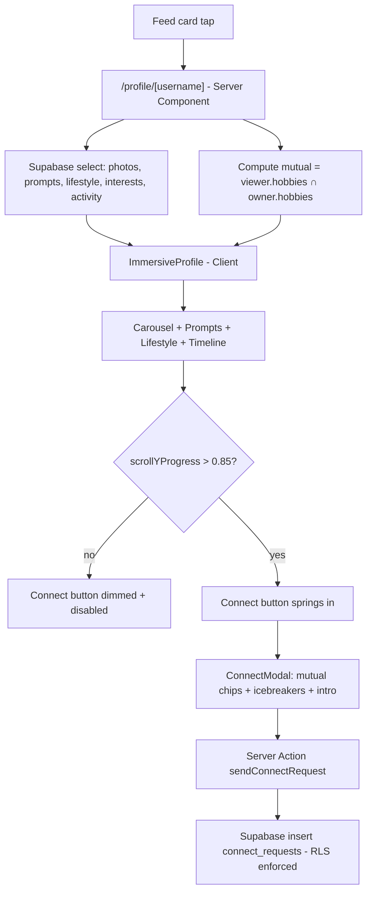

# Chapter 23 — Immersive Profiles & the Connect Flow

> A great profile doesn't *list* a person — it lets you *meet* them before you ever say hello.

In the last few chapters you built Viby's discovery feed: cards swipe by, people surface based on shared hobbies. But a feed card is a teaser. When a learner taps "View profile," they cross a threshold — from *browsing* to *deciding*. This chapter is about that threshold: the immersive, scrollable profile that earns a connection, and the Connect modal that turns a quiet impression into a real first message.

## What you'll learn

- How to build a **scrollable immersive profile**: a swipeable photo carousel, prompt cards, a lifestyle grid, and an activity timeline.
- The **decision-after-scrolling** pattern — why Viby withholds the Connect action until someone has actually *experienced* the profile, and how to implement it without feeling gimmicky.
- How to derive and display **mutual interests** between the viewer and the profile owner.
- Building the **Connect modal** with auto-generated **icebreakers** and a personalized **intro message**, persisted through a Supabase **Server Action**.
- Composing Framer Motion gestures, `AnimatePresence`, and scroll-driven UI without jank.

## Prerequisites

- **Chapter 9** (Tailwind v4 `@theme` tokens) — we lean on Viby's pink design tokens.
- **Chapter 14** (Server Components, async `params`, Server Actions).
- **Chapter 17** (Supabase via `@supabase/ssr`, `getAll`/`setAll` cookie handlers).
- **Chapter 21** (Framer Motion gestures and `AnimatePresence`).
- **Chapter 22** (the discovery feed — the profile is what a card links *into*).

## Theory

A discovery feed answers *"who is out there?"* A profile answers *"do I want to know this person?"* Those are different jobs, and they need different shapes.

Think of the feed card as a **movie poster** and the profile as the **trailer**. A poster is glanceable and identical in size to every other poster. A trailer unfolds over time, controls its own pacing, and is designed to make you *feel* something before the credits. Viby's immersive profile is the trailer: full-bleed photos you swipe through, prompts that reveal personality ("My Sunday in three words..."), a lifestyle grid, and a timeline of recent activity. The viewer scrolls, and with each section they learn a little more.

This pacing is the whole point of **decision-after-scrolling**. On a dating clone you can hot-or-not from a thumbnail — but Viby is about *finding your people*, and snap judgments produce shallow connections and regret. So we deliberately keep the primary action — **Connect** — out of reach until the viewer has scrolled through enough of the profile to have actually met the person. It's a gentle friction: not a paywall, not a nag, just an interaction design that says *slow down, this is a human*. Concretely, the floating Connect button stays dimmed and disabled until the viewer reaches (or nears) the bottom of the scroll, then springs in.

Two analogies make the mechanics click:

- **The carousel is a flipbook.** We don't load ten `` tags stacked vertically; we render one active image and translate the strip horizontally on swipe. The browser only paints what's on screen.
- **Mutual interests are a Venn diagram.** The viewer has a set of hobby IDs; the profile owner has another. The intersection is gold — it's literally *why* these two should talk, and it powers the icebreakers.

The **Connect modal** is where intent becomes action. We don't drop the user onto a blank message box (intimidating, high-abandon). Instead we surface the mutual-interest Venn result, offer **icebreakers** generated from those shared hobbies ("You both love bouldering — what's your go-to gym?"), and let one tap pre-fill the intro message. The user can edit, then send. Lower friction, warmer first messages, better connections.

## In practice

### 1. The route and data (Server Component)

Profiles live at `/profile/[username]`. In Next.js 16 the `params` prop is async, so we `await` it.

```tsx
// app/profile/[username]/page.tsx
import { notFound } from "next/navigation";
import { createClient } from "@/lib/supabase/server";
import { getCurrentUserId } from "@/lib/auth";
import { ImmersiveProfile } from "@/components/profile/immersive-profile";

export default async function ProfilePage({
  params,
}: {
  params: Promise<{ username: string }>;
}) {
  const { username } = await params;
  const supabase = await createClient();

  const { data: profile } = await supabase
    .from("profiles")
    .select(
      `id, username, display_name, age, city, bio,
       photos:profile_photos(url, position),
       prompts:profile_prompts(question, answer),
       lifestyle:profile_lifestyle(key, value),
       interests:profile_interests(hobby:hobbies(id, label, emoji)),
       activity:profile_activity(kind, label, created_at)`
    )
    .eq("username", username)
    .single();

  if (!profile) notFound();

  // The Venn intersection: which of the viewer's hobbies this person shares.
  const viewerId = await getCurrentUserId();
  const { data: mine } = await supabase
    .from("profile_interests")
    .select("hobby_id")
    .eq("profile_id", viewerId);

  const myHobbyIds = new Set((mine ?? []).map((r) => r.hobby_id));
  const mutual = profile.interests
    .map((i) => i.hobby)
    .filter((h) => myHobbyIds.has(h.id));

  return <ImmersiveProfile profile={profile} mutual={mutual} />;
}
```

The Supabase client uses the `@supabase/ssr` server helper you wired up in Chapter 17:

```ts
// lib/supabase/server.ts
import { createServerClient } from "@supabase/ssr";
import { cookies } from "next/headers";

export async function createClient() {
  const cookieStore = await cookies();
  return createServerClient(
    process.env.NEXT_PUBLIC_SUPABASE_URL!,
    process.env.NEXT_PUBLIC_SUPABASE_ANON_KEY!,
    {
      cookies: {
        getAll: () => cookieStore.getAll(),
        setAll: (toSet) =>
          toSet.forEach(({ name, value, options }) =>
            cookieStore.set(name, value, options)
          ),
      },
    }
  );
}
```

### 2. The photo carousel (Client Component)

The carousel is interactive, so it's a Client Component. We render the whole strip but translate it horizontally; swipe distance and velocity decide whether we advance.

```tsx
"use client";

import { useState } from "react";
import { motion, AnimatePresence } from "framer-motion";

export function PhotoCarousel({ photos }: { photos: { url: string }[] }) {
  const [index, setIndex] = useState(0);
  const count = photos.length;

  const paginate = (dir: number) =>
    setIndex((i) => Math.min(Math.max(i + dir, 0), count - 1));

  return (
    <div className="relative h-[70vh] w-full overflow-hidden rounded-b-3xl bg-black">
      <AnimatePresence initial={false}>
        <motion.img
          key={index}
          src={photos[index].url}
          alt=""
          className="absolute inset-0 h-full w-full object-cover"
          initial={{ opacity: 0 }}
          animate={{ opacity: 1 }}
          exit={{ opacity: 0 }}
          transition={{ duration: 0.25 }}
          drag="x"
          dragConstraints={{ left: 0, right: 0 }}
          dragElastic={0.2}
          onDragEnd={(_, info) => {
            if (info.offset.x < -80 || info.velocity.x < -500) paginate(1);
            else if (info.offset.x > 80 || info.velocity.x > 500) paginate(-1);
          }}
        />
      </AnimatePresence>

      {/* Story-style progress segments */}
      <div className="absolute left-3 right-3 top-3 flex gap-1">
        {photos.map((_, i) => (
          <div
            key={i}
            className={`h-1 flex-1 rounded-full ${
              i <= index ? "bg-white" : "bg-white/30"
            }`}
          />
        ))}
      </div>
    </div>
  );
}
```

The `@theme` tokens (defined once in `app/globals.css`) give us Viby's brand pink everywhere:

```css
/* app/globals.css */
@import "tailwindcss";

@theme {
  --color-viby: #ff6fb5;
  --color-viby-soft: #ffe1ef;
  --radius-card: 1.5rem;
}
```

### 3. Decision-after-scrolling: the gated Connect button

We track scroll progress and only enable Connect once the viewer reaches the end. This is the heart of the chapter — friction with a purpose.

```tsx
"use client";

import { useState } from "react";
import { motion, useScroll, useMotionValueEvent } from "framer-motion";
import { PhotoCarousel } from "./photo-carousel";
import { ConnectModal } from "./connect-modal";

type Hobby = { id: string; label: string; emoji: string };

export function ImmersiveProfile({
  profile,
  mutual,
}: {
  profile: any;
  mutual: Hobby[];
}) {
  const { scrollYProgress } = useScroll();
  const [reachedEnd, setReachedEnd] = useState(false);
  const [open, setOpen] = useState(false);

  useMotionValueEvent(scrollYProgress, "change", (p) => {
    if (p > 0.85) setReachedEnd(true); // unlock near the bottom
  });

  return (
    <div className="mx-auto max-w-md pb-28">
      <PhotoCarousel photos={profile.photos} />

      <header className="px-5 pt-4">
        <h1 className="text-2xl font-bold">
          {profile.display_name}, {profile.age}
        </h1>
        <p className="text-sm text-neutral-500">{profile.city}</p>
        <p className="mt-3 leading-relaxed">{profile.bio}</p>
      </header>

      {/* Prompts */}
      <section className="mt-6 space-y-3 px-5">
        {profile.prompts.map((p: any) => (
          <div key={p.question} className="rounded-card bg-viby-soft p-4">
            <p className="text-xs font-semibold uppercase text-viby">
              {p.question}
            </p>
            <p className="mt-1 text-lg font-medium">{p.answer}</p>
          </div>
        ))}
      </section>

      {/* Lifestyle grid */}
      <section className="mt-6 grid grid-cols-2 gap-3 px-5">
        {profile.lifestyle.map((l: any) => (
          <div key={l.key} className="rounded-card border p-3">
            <p className="text-xs text-neutral-500">{l.key}</p>
            <p className="font-medium">{l.value}</p>
          </div>
        ))}
      </section>

      {/* Activity timeline */}
      <section className="mt-6 px-5">
        <h2 className="mb-3 font-semibold">Recently on Viby</h2>
        <ol className="relative border-l border-viby-soft pl-4">
          {profile.activity.map((a: any) => (
            <li key={a.created_at} className="mb-4">
              <span className="absolute -left-[5px] mt-1.5 h-2 w-2 rounded-full bg-viby" />
              <p className="text-sm">{a.label}</p>
            </li>
          ))}
        </ol>
      </section>

      {/* Floating gated Connect button */}
      <div className="fixed inset-x-0 bottom-4 mx-auto max-w-md px-5">
        <motion.button
          disabled={!reachedEnd}
          onClick={() => setOpen(true)}
          animate={{
            opacity: reachedEnd ? 1 : 0.4,
            scale: reachedEnd ? 1 : 0.98,
          }}
          whileTap={reachedEnd ? { scale: 0.96 } : undefined}
          className="w-full rounded-full bg-viby py-4 font-semibold text-white shadow-lg disabled:cursor-not-allowed"
        >
          {reachedEnd ? `Connect with ${profile.display_name}` : "Keep scrolling to connect"}
        </motion.button>
      </div>

      <ConnectModal
        open={open}
        onClose={() => setOpen(false)}
        profile={profile}
        mutual={mutual}
      />
    </div>
  );
}
```

### 4. The Connect modal: mutual interests, icebreakers, intro message

We generate icebreakers from the mutual hobbies, let a tap pre-fill the message, then submit through a Server Action.

```tsx
"use client";

import { useState } from "react";
import { motion, AnimatePresence } from "framer-motion";
import { sendConnectRequest } from "@/app/actions/connect";

type Hobby = { id: string; label: string; emoji: string };

function icebreakersFor(name: string, mutual: Hobby[]) {
  return mutual.slice(0, 3).map(
    (h) => `You both love ${h.label.toLowerCase()} ${h.emoji} — what got ${name} into it?`
  );
}

export function ConnectModal({
  open,
  onClose,
  profile,
  mutual,
}: {
  open: boolean;
  onClose: () => void;
  profile: any;
  mutual: Hobby[];
}) {
  const [message, setMessage] = useState("");
  const [pending, setPending] = useState(false);
  const icebreakers = icebreakersFor(profile.display_name, mutual);

  async function handleSend() {
    setPending(true);
    await sendConnectRequest({ targetId: profile.id, message });
    setPending(false);
    onClose();
  }

  return (
    <AnimatePresence>
      {open && (
        <motion.div
          className="fixed inset-0 z-50 flex items-end bg-black/40"
          initial={{ opacity: 0 }}
          animate={{ opacity: 1 }}
          exit={{ opacity: 0 }}
          onClick={onClose}
        >
          <motion.div
            className="w-full rounded-t-3xl bg-white p-5"
            initial={{ y: "100%" }}
            animate={{ y: 0 }}
            exit={{ y: "100%" }}
            transition={{ type: "spring", damping: 30, stiffness: 300 }}
            onClick={(e) => e.stopPropagation()}
          >
            <h2 className="text-lg font-bold">
              Connect with {profile.display_name}
            </h2>

            {mutual.length > 0 ? (
              <div className="mt-3 flex flex-wrap gap-2">
                {mutual.map((h) => (
                  <span
                    key={h.id}
                    className="rounded-full bg-viby-soft px-3 py-1 text-sm text-viby"
                  >
                    {h.emoji} {h.label}
                  </span>
                ))}
              </div>
            ) : (
              <p className="mt-3 text-sm text-neutral-500">
                No shared hobbies yet — say hi and find out what clicks.
              </p>
            )}

            <p className="mt-4 text-xs font-semibold uppercase text-neutral-400">
              Icebreakers
            </p>
            <div className="mt-2 space-y-2">
              {icebreakers.map((ib) => (
                <button
                  key={ib}
                  onClick={() => setMessage(ib)}
                  className="w-full rounded-card border border-viby-soft p-3 text-left text-sm"
                >
                  {ib}
                </button>
              ))}
            </div>

            <textarea
              value={message}
              onChange={(e) => setMessage(e.target.value)}
              placeholder="Write your intro message..."
              rows={3}
              className="mt-4 w-full rounded-card border p-3 text-sm outline-none focus:border-viby"
            />

            <button
              onClick={handleSend}
              disabled={pending || message.trim().length === 0}
              className="mt-3 w-full rounded-full bg-viby py-3 font-semibold text-white disabled:opacity-50"
            >
              {pending ? "Sending..." : "Send connect request"}
            </button>
          </motion.div>
        </motion.div>
      )}
    </AnimatePresence>
  );
}
```

### 5. The Server Action

```ts
// app/actions/connect.ts
"use server";

import { revalidatePath } from "next/cache";
import { createClient } from "@/lib/supabase/server";

export async function sendConnectRequest({
  targetId,
  message,
}: {
  targetId: string;
  message: string;
}) {
  const supabase = await createClient();
  const {
    data: { user },
  } = await supabase.auth.getUser();
  if (!user) throw new Error("Not authenticated");

  const clean = message.trim();
  if (clean.length === 0 || clean.length > 1000) {
    throw new Error("Message must be 1–1000 characters.");
  }

  const { error } = await supabase.from("connect_requests").insert({
    from_id: user.id,
    to_id: targetId,
    intro_message: clean,
    status: "pending",
  });

  if (error) throw new Error(error.message);
  revalidatePath("/connections");
}
```

Row-Level Security (Chapter 17) does the real enforcement on the server; never trust the client to set `from_id`. The Server Action derives it from the authenticated session.

## Architecture / diagram



## Best practices & pitfalls

- **Do** keep data fetching in the Server Component and pass plain props down. Don't fetch the profile inside a `"use client"` component — you lose streaming and leak query logic to the browser.
- **Do** derive `from_id` server-side from `auth.getUser()`. **Don't** accept a `fromId` from the client; it's the classic impersonation hole.
- **Do** treat decision-after-scrolling as *encouragement*, not a wall. Unlock near the bottom (`> 0.85`), not at an exact pixel, and provide an accessible fallback — disabled buttons should still be reachable and explained by their label.
- **Don't** stack every photo as a tall column of `` — it tanks LCP. Render the active image (or use `next/image` with `priority` on the first) and lazy-load the rest.
- **Do** stop click propagation on the modal sheet (`e.stopPropagation()`) so tapping inside doesn't dismiss it, while the backdrop tap still closes.
- **Don't** forget `key={index}` on the `AnimatePresence` child — without a changing key, the enter/exit animation won't fire.
- **Do** validate message length in the Server Action *and* rely on RLS. Client-side `disabled` is UX; the server is security.
- **Don't** auto-send an icebreaker. Pre-fill, then let the human edit — a verbatim template message reads as spam.

## Exercises

1. **Read progress bar.** Add a thin pink progress bar fixed to the top that fills with `scrollYProgress` using `motion.div` and `scaleX`. (Hint: `style={{ scaleX: scrollYProgress }}` with `transformOrigin: "left"`.)
2. **Tap-to-advance carousel.** Add left/right tap zones over the photo so users can advance without dragging — match the story-style segments to the active index.
3. **Smarter icebreakers.** When the viewer and owner share a *lifestyle* value (e.g. both "Early bird"), generate an extra icebreaker referencing it, ranked above the hobby ones.
4. **Optimistic Connect.** Use `useOptimistic` to flip the button to "Request sent ✓" instantly while the Server Action runs, rolling back on error.
5. **Empty-state polish (harder).** If `mutual.length === 0`, fetch the owner's *most popular* hobby and craft a discovery icebreaker ("You haven't tried pottery yet — they're obsessed. Curious?").

## Mini-project

**Build the "Profile Preview" self-view.** Add a `/profile/me` route that renders the *same* `ImmersiveProfile` component with the logged-in user's data, but with two differences: (1) the gated Connect button is replaced by an "Edit profile" button that's always enabled, and (2) a banner at the top reads "This is how others see you." Reuse the carousel, prompts, lifestyle grid, and timeline untouched. This proves your profile is a genuinely reusable component and gives users the confidence-building preview every great social app ships. Bonus: add a `motion` shimmer on the banner so it feels alive.

## Key takeaways

- Profiles are **trailers, not posters** — they unfold over time to make the viewer *feel* the person.
- **Decision-after-scrolling** is intentional, gentle friction that produces deeper connections; gate the action near the bottom, never wall it off.
- Fetch in **Server Components**, animate in **Client Components**, and persist through **Server Actions** with server-derived identity + RLS.
- **Mutual interests** (a set intersection) are the engine behind both the Venn chips and the icebreakers.
- Pre-fill icebreakers, but always let the human edit — warmth beats automation.

**Up next:** Chapter 24 — *Realtime Chat & Presence*, where an accepted connect request opens a live conversation powered by Supabase Realtime, typing indicators, and read receipts.
