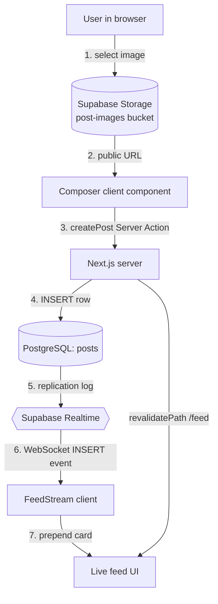

# Chapter 24 — The Activity Feed

> Every great social app has a heartbeat. In this chapter, you build Viby's.

So far, Viby has been about *who*: profiles, matching, the people you might click with. Now we build the *what they're doing* — a persistent, scrollable Activity Feed where members post a photo from their morning trail run, tag it `#hiking`, drop a location, and watch reactions roll in live. Think Strava's "I did a thing" energy crossed with Instagram's visual scroll, minus the vanity-metric pressure. This is the feature that turns a directory of strangers into a living community.

## What you'll learn

- How to model a feed post in PostgreSQL with activity tags, geolocation, and timestamps
- Building a **composer** with client-side image upload to Supabase Storage
- Rendering an infinite-ish feed with Server Components, then hydrating interactivity
- **Reactions and comments** wired through Server Actions
- **Activity-type filtering** that keeps URL state shareable
- **Realtime inserts** so new posts appear without a refresh
- Row Level Security (RLS) so the feed is safe by default

## Prerequisites

- Chapter 9 (Supabase Auth and `@supabase/ssr` clients)
- Chapter 12 (PostgreSQL schema design and RLS basics)
- Chapter 15 (Supabase Storage and signed/public URLs)
- Chapter 18 (Server Actions and revalidation)
- Chapter 21 (Zustand for ephemeral client state)
- Chapter 22 (Framer Motion: `motion`, `AnimatePresence`, gestures)

---

## Theory

A feed looks simple — a list of cards — but it's secretly three hard problems stacked together: **storage**, **freshness**, and **interaction**.

**Storage.** A post is structured metadata (caption, tag, location, author, time) *plus* a heavy binary blob (the image). The golden rule: databases store **pointers**, not pixels. We push the image to Supabase Storage (object storage, served over a CDN) and save only its URL in PostgreSQL. Think of the database as a library card catalog and Storage as the shelves — the catalog card is tiny and fast to search; the book itself lives elsewhere.

**Freshness.** Traditional web apps are *pull* — you refresh, the server hands you the latest. A feed feels alive only when it's *push*: the server taps you on the shoulder and says "hey, Maya just posted." Supabase Realtime gives us this for free by streaming PostgreSQL's replication log (the same write-ahead log the database uses internally) over a WebSocket. When a row hits the `posts` table, every subscribed client hears about it in milliseconds. The analogy: instead of you walking to the mailbox every minute, the mail carrier rings your doorbell.

**Interaction.** Reactions and comments are *writes triggered by reading*. The instinct of a beginner is to fetch everything through client-side `useEffect`. The professional instinct in Next.js 16 is the opposite: **read on the server, write through Server Actions, and only reach for the client when you need interactivity or realtime**. Server Components fetch the initial feed (fast, SEO-friendly, no loading spinner), Server Actions mutate data with progressive enhancement, and a thin `"use client"` layer handles optimistic reactions and the live socket.

One more concept: **optimistic UI**. When you tap a heart, waiting 300ms for a round-trip feels broken. So we update the UI *immediately* (assume success), fire the mutation in the background, and only roll back if it fails. React 19's `useOptimistic` hook is built exactly for this.

---

## In practice

### 1. The schema

Run this in the Supabase SQL editor. We model an `activity_type` enum so the tag set is constrained (no typo'd `#hikingg`), and we denormalize a `reaction_count` only if we measure a need — for now we count on read.

```sql
-- Constrained set of activity tags
create type activity_type as enum (
  'running', 'hiking', 'cycling', 'climbing',
  'yoga', 'gaming', 'cooking', 'music', 'art', 'other'
);

create table posts (
  id          uuid primary key default gen_random_uuid(),
  author_id   uuid not null references auth.users (id) on delete cascade,
  caption     text check (char_length(caption) <= 500),
  image_url   text,
  activity    activity_type not null default 'other',
  location    text,                          -- human label, e.g. "Griffith Park"
  created_at  timestamptz not null default now()
);

create table reactions (
  post_id     uuid not null references posts (id) on delete cascade,
  user_id     uuid not null references auth.users (id) on delete cascade,
  created_at  timestamptz not null default now(),
  primary key (post_id, user_id)            -- one reaction per user per post
);

create table comments (
  id          uuid primary key default gen_random_uuid(),
  post_id     uuid not null references posts (id) on delete cascade,
  author_id   uuid not null references auth.users (id) on delete cascade,
  body        text not null check (char_length(body) between 1 and 300),
  created_at  timestamptz not null default now()
);

-- Feed queries always sort by recency
create index posts_created_at_idx on posts (created_at desc);
create index comments_post_idx    on comments (post_id, created_at);
```

Now lock it down with **RLS**. The feed is public-read for signed-in members, but you can only write as yourself:

```sql
alter table posts     enable row level security;
alter table reactions enable row level security;
alter table comments  enable row level security;

create policy "feed is readable by authenticated users"
  on posts for select to authenticated using (true);

create policy "users insert their own posts"
  on posts for insert to authenticated
  with check (auth.uid() = author_id);

create policy "users delete their own posts"
  on posts for delete to authenticated
  using (auth.uid() = author_id);

create policy "reactions readable"
  on reactions for select to authenticated using (true);
create policy "users manage their own reactions"
  on reactions for all to authenticated
  using (auth.uid() = user_id) with check (auth.uid() = user_id);

create policy "comments readable"
  on comments for select to authenticated using (true);
create policy "users write their own comments"
  on comments for insert to authenticated
  with check (auth.uid() = author_id);
```

Then create a **public** storage bucket called `post-images` in the dashboard (Storage → New bucket → Public), and enable Realtime for the `posts` table (Database → Replication → toggle `posts`).

### 2. The feed (Server Component)

The page is a Server Component. It reads cookies, builds a server Supabase client, and fetches the first page. The `activity` filter comes from the URL search params so it's shareable and survives refresh. In Next.js 16, `searchParams` is async — you `await` it.

```tsx
// app/feed/page.tsx
import { createClient } from "@/lib/supabase/server";
import { Composer } from "@/components/feed/composer";
import { FilterBar } from "@/components/feed/filter-bar";
import { FeedStream } from "@/components/feed/feed-stream";

export default async function FeedPage({
  searchParams,
}: {
  searchParams: Promise<{ activity?: string }>;
}) {
  const { activity } = await searchParams;
  const supabase = await createClient();

  let query = supabase
    .from("posts")
    .select(
      `id, caption, image_url, activity, location, created_at, author_id,
       author:profiles!author_id (username, avatar_url),
       reactions (user_id),
       comments (id)`,
    )
    .order("created_at", { ascending: false })
    .limit(20);

  if (activity) query = query.eq("activity", activity);

  const { data: posts } = await query;

  return (
    <main className="mx-auto max-w-xl px-4 pb-24">
      <Composer />
      <FilterBar active={activity ?? null} />
      <FeedStream initialPosts={posts ?? []} activity={activity ?? null} />
    </main>
  );
}
```

Our server client from Chapter 9, for reference — note the `getAll`/`setAll` cookie handlers required by `@supabase/ssr`:

```ts
// lib/supabase/server.ts
import { createServerClient } from "@supabase/ssr";
import { cookies } from "next/headers";

export async function createClient() {
  const cookieStore = await cookies();
  return createServerClient(
    process.env.NEXT_PUBLIC_SUPABASE_URL!,
    process.env.NEXT_PUBLIC_SUPABASE_ANON_KEY!,
    {
      cookies: {
        getAll: () => cookieStore.getAll(),
        setAll: (toSet) => {
          try {
            toSet.forEach(({ name, value, options }) =>
              cookieStore.set(name, value, options),
            );
          } catch {
            // Called from a Server Component — safe to ignore; proxy.ts refreshes the session.
          }
        },
      },
    },
  );
}
```

### 3. The composer (Server Action + client upload)

We upload the image straight from the browser to Storage (keeps heavy bytes off your server function), then call a Server Action with the resulting URL. The Action runs on the server, so RLS and `auth.uid()` are authoritative.

```ts
// app/feed/actions.ts
"use server";

import { createClient } from "@/lib/supabase/server";
import { revalidatePath } from "next/cache";
import { redirect } from "next/navigation";

export async function createPost(formData: FormData) {
  const supabase = await createClient();
  const {
    data: { user },
  } = await supabase.auth.getUser();
  if (!user) redirect("/login");

  const caption = String(formData.get("caption") ?? "").slice(0, 500);
  const activity = String(formData.get("activity") ?? "other");
  const location = String(formData.get("location") ?? "") || null;
  const imageUrl = String(formData.get("imageUrl") ?? "") || null;

  const { error } = await supabase.from("posts").insert({
    author_id: user.id,
    caption,
    activity,
    location,
    image_url: imageUrl,
  });
  if (error) return { error: error.message };

  revalidatePath("/feed");
  return { ok: true };
}
```

The composer itself is a client component because it handles file selection and upload progress. Notice we use `useTransition` to keep the UI responsive while the Action runs:

```tsx
// components/feed/composer.tsx
"use client";

import { useRef, useState, useTransition } from "react";
import { createBrowserClient } from "@supabase/ssr";
import { motion, AnimatePresence } from "framer-motion";
import { createPost } from "@/app/feed/actions";

const ACTIVITIES = ["running", "hiking", "cycling", "yoga", "gaming", "art"];

export function Composer() {
  const [preview, setPreview] = useState<string | null>(null);
  const [uploading, setUploading] = useState(false);
  const [activity, setActivity] = useState("running");
  const fileRef = useRef<HTMLInputElement>(null);
  const [pending, startTransition] = useTransition();

  const supabase = createBrowserClient(
    process.env.NEXT_PUBLIC_SUPABASE_URL!,
    process.env.NEXT_PUBLIC_SUPABASE_ANON_KEY!,
  );

  async function uploadImage(file: File): Promise<string> {
    setUploading(true);
    const ext = file.name.split(".").pop();
    const path = `${crypto.randomUUID()}.${ext}`;
    const { error } = await supabase.storage
      .from("post-images")
      .upload(path, file, { cacheControl: "3600", upsert: false });
    setUploading(false);
    if (error) throw error;
    const { data } = supabase.storage.from("post-images").getPublicUrl(path);
    return data.publicUrl;
  }

  async function onSubmit(formData: FormData) {
    const file = fileRef.current?.files?.[0];
    if (file) formData.set("imageUrl", await uploadImage(file));
    formData.set("activity", activity);
    startTransition(async () => {
      await createPost(formData);
      setPreview(null);
      if (fileRef.current) fileRef.current.value = "";
    });
  }

  return (
    <form
      action={onSubmit}
      className="mb-6 rounded-2xl border border-pink-100 bg-white p-4 shadow-sm"
    >
      <textarea
        name="caption"
        placeholder="What are you up to?"
        maxLength={500}
        className="w-full resize-none rounded-xl border-0 text-base outline-none placeholder:text-gray-400"
        rows={2}
      />

      <AnimatePresence>
        {preview && (
          <motion.img
            src={preview}
            alt="preview"
            initial={{ opacity: 0, scale: 0.96 }}
            animate={{ opacity: 1, scale: 1 }}
            exit={{ opacity: 0 }}
            className="my-3 max-h-72 w-full rounded-xl object-cover"
          />
        )}
      </AnimatePresence>

      <div className="mt-2 flex items-center gap-2 overflow-x-auto pb-1">
        {ACTIVITIES.map((a) => (
          <button
            key={a}
            type="button"
            onClick={() => setActivity(a)}
            className={`shrink-0 rounded-full px-3 py-1 text-sm transition ${
              activity === a
                ? "bg-[var(--color-brand)] text-white"
                : "bg-pink-50 text-pink-600"
            }`}
          >
            #{a}
          </button>
        ))}
      </div>

      <input
        name="location"
        placeholder="Add a location"
        className="mt-2 w-full rounded-lg bg-gray-50 px-3 py-2 text-sm outline-none"
      />

      <div className="mt-3 flex items-center justify-between">
        <label className="cursor-pointer text-sm font-medium text-pink-600">
          + Photo
          <input
            ref={fileRef}
            type="file"
            accept="image/*"
            hidden
            onChange={(e) => {
              const f = e.target.files?.[0];
              if (f) setPreview(URL.createObjectURL(f));
            }}
          />
        </label>
        <button
          disabled={pending || uploading}
          className="rounded-full bg-[var(--color-brand)] px-5 py-2 text-sm font-semibold text-white disabled:opacity-50"
        >
          {uploading ? "Uploading…" : pending ? "Posting…" : "Post"}
        </button>
      </div>
    </form>
  );
}
```

Our Tailwind v4 brand token, defined once in CSS — no `tailwind.config.js`:

```css
/* app/globals.css */
@import "tailwindcss";

@theme {
  --color-brand: #ff6fb5;
  --color-brand-soft: #ffe3f1;
}
```

### 4. Reactions, comments, and realtime

The feed stream is a client component so it can own the live socket and optimistic state. It seeds from `initialPosts` (already fetched on the server — no spinner), then listens for inserts.

```tsx
// components/feed/feed-stream.tsx
"use client";

import { useEffect, useState } from "react";
import { createBrowserClient } from "@supabase/ssr";
import { motion, AnimatePresence } from "framer-motion";
import { PostCard, type Post } from "./post-card";

export function FeedStream({
  initialPosts,
  activity,
}: {
  initialPosts: Post[];
  activity: string | null;
}) {
  const [posts, setPosts] = useState<Post[]>(initialPosts);

  useEffect(() => setPosts(initialPosts), [initialPosts]);

  useEffect(() => {
    const supabase = createBrowserClient(
      process.env.NEXT_PUBLIC_SUPABASE_URL!,
      process.env.NEXT_PUBLIC_SUPABASE_ANON_KEY!,
    );

    const channel = supabase
      .channel("feed-inserts")
      .on(
        "postgres_changes",
        { event: "INSERT", schema: "public", table: "posts" },
        (payload) => {
          const row = payload.new as Post;
          // Respect the active filter
          if (activity && row.activity !== activity) return;
          setPosts((prev) =>
            prev.some((p) => p.id === row.id) ? prev : [row, ...prev],
          );
        },
      )
      .subscribe();

    return () => {
      supabase.removeChannel(channel);
    };
  }, [activity]);

  return (
    <ul className="space-y-4">
      <AnimatePresence initial={false}>
        {posts.map((post) => (
          <motion.li
            key={post.id}
            layout
            initial={{ opacity: 0, y: -12 }}
            animate={{ opacity: 1, y: 0 }}
            exit={{ opacity: 0 }}
          >
            <PostCard post={post} />
          </motion.li>
        ))}
      </AnimatePresence>
    </ul>
  );
}
```

The reaction is the showcase for optimistic UI. We use React 19's `useOptimistic` so the heart fills instantly:

```tsx
// components/feed/like-button.tsx
"use client";

import { useOptimistic, useTransition } from "react";
import { motion } from "framer-motion";
import { toggleReaction } from "@/app/feed/actions";

export function LikeButton({
  postId,
  count,
  reacted,
}: {
  postId: string;
  count: number;
  reacted: boolean;
}) {
  const [, startTransition] = useTransition();
  const [optimistic, setOptimistic] = useOptimistic(
    { count, reacted },
    (_state, next: boolean) => ({
      reacted: next,
      count: count + (next ? 1 : 0) - (reacted ? 1 : 0),
    }),
  );

  return (
    <button
      onClick={() =>
        startTransition(async () => {
          setOptimistic(!optimistic.reacted);
          await toggleReaction(postId, !optimistic.reacted);
        })
      }
      className="flex items-center gap-1 text-sm"
    >
      <motion.span
        key={String(optimistic.reacted)}
        initial={{ scale: 0.6 }}
        animate={{ scale: 1 }}
        className={optimistic.reacted ? "text-[var(--color-brand)]" : "text-gray-400"}
      >
        {optimistic.reacted ? "♥" : "♡"}
      </motion.span>
      <span className="tabular-nums">{optimistic.count}</span>
    </button>
  );
}
```

The matching Server Actions:

```ts
// app/feed/actions.ts  (append)
export async function toggleReaction(postId: string, on: boolean) {
  const supabase = await createClient();
  const {
    data: { user },
  } = await supabase.auth.getUser();
  if (!user) return;

  if (on) {
    await supabase
      .from("reactions")
      .upsert({ post_id: postId, user_id: user.id });
  } else {
    await supabase
      .from("reactions")
      .delete()
      .match({ post_id: postId, user_id: user.id });
  }
}

export async function addComment(postId: string, body: string) {
  const supabase = await createClient();
  const {
    data: { user },
  } = await supabase.auth.getUser();
  if (!user || !body.trim()) return;

  await supabase
    .from("comments")
    .insert({ post_id: postId, author_id: user.id, body: body.trim() });
  revalidatePath("/feed");
}
```

The `FilterBar` is just links that set the search param — no client JS needed, and the state lives in the URL:

```tsx
// components/feed/filter-bar.tsx
import Link from "next/link";

const TAGS = ["running", "hiking", "cycling", "yoga", "gaming", "art"];

export function FilterBar({ active }: { active: string | null }) {
  return (
    <nav className="mb-4 flex gap-2 overflow-x-auto pb-1">
      <Link
        href="/feed"
        className={`shrink-0 rounded-full px-3 py-1 text-sm ${
          !active ? "bg-[var(--color-brand)] text-white" : "bg-gray-100"
        }`}
      >
        All
      </Link>
      {TAGS.map((t) => (
        <Link
          key={t}
          href={`/feed?activity=${t}`}
          className={`shrink-0 rounded-full px-3 py-1 text-sm ${
            active === t ? "bg-[var(--color-brand)] text-white" : "bg-gray-100"
          }`}
        >
          #{t}
        </Link>
      ))}
    </nav>
  );
}
```

---

## Architecture / diagram



The two paths to the screen: the **author** sees their post via `revalidatePath`, while **everyone else** sees it pushed through Realtime. Same data, two delivery mechanisms.

---

## Best practices & pitfalls

- **Do** upload images from the client straight to Storage. **Don't** pipe binary through a Server Action — you'll hit body-size limits and waste serverless compute.
- **Do** rely on RLS as your real authorization boundary. **Don't** trust `author_id` sent from the client; always derive identity from `auth.getUser()` server-side.
- **Do** seed the client feed from Server-Component data. **Don't** fetch the first page in a `useEffect` — that gives users a blank flash and tanks perceived performance.
- **Do** clean up your Realtime channel in the `useEffect` return. **Don't** leave channels open on unmount — you'll leak subscriptions and double-render new posts.
- **Pitfall:** Realtime `INSERT` payloads contain only the raw row — no joined `author` or counts. Either fetch the full row by id when an event arrives, or render gracefully with the data you have and let the next refresh fill gaps.
- **Pitfall:** forgetting to toggle Realtime replication on the table in the dashboard — the socket connects but never fires. Check the Replication tab first when "nothing happens."
- **Do** constrain tags with an enum and caption length with a `check`. Validate at the database edge, not just in React.
- **Do** add `loading: "lazy"` and proper `sizes` to feed images, or use `next/image`, so a long scroll doesn't download every photo at once.

---

## Exercises

1. **Comment composer.** Build a `CommentSheet` client component that lists a post's comments and posts new ones via `addComment`, with optimistic insert.
2. **Relative timestamps.** Render `created_at` as "3m ago" / "2h ago" using `Intl.RelativeTimeFormat`, updating on an interval — without causing hydration mismatches.
3. **Hydrate realtime rows.** When a Realtime `INSERT` arrives, fetch the full joined row (author, counts) by id before prepending, so live posts look identical to server-rendered ones.
4. **Infinite scroll.** Add cursor pagination keyed on `created_at`, loading 20 more posts when an `IntersectionObserver` sentinel enters view.
5. **Delete with undo.** Let authors delete their own post with a 5-second "Undo" toast (Framer Motion `AnimatePresence`) before the Server Action actually runs.

---

## Mini-project — "Trail Drop"

Build a focused, shareable feed page for a single activity: `/feed/hiking`.

Requirements:
- A dedicated route (`app/feed/[activity]/page.tsx`) that reads the dynamic `params` (remember: `await params` in Next.js 16) and filters server-side.
- The composer pre-selects that activity and is locked to it.
- Realtime is scoped so only matching posts stream in (use the `filter` option on the channel: `filter: 'activity=eq.hiking'`).
- A header showing the live member count reacting today, animated with a Framer Motion count-up.
- Empty state: a friendly "Be the first to drop a trail 🥾" card with a motion entrance.

Ship it, open two browser windows side by side, post from one, and watch it land in the other. That moment — the post appearing without a refresh — is the whole magic of realtime, and now you own it.

---

## Key takeaways

- A feed = **structured metadata in Postgres + binary in Storage**; the DB holds pointers, never pixels.
- **Read on the server** (Server Components), **write through Server Actions**, reach for `"use client"` only for interactivity and realtime.
- **RLS is your real auth** — identity comes from `auth.getUser()`, never the client payload.
- **`useOptimistic`** makes reactions feel instant; roll back only on failure.
- **Supabase Realtime** streams the Postgres replication log over WebSocket — remember to enable replication and clean up channels.
- Keep filter state in the **URL** so feeds are shareable and refresh-safe.

**Up next — Chapter 25: Direct Messages**, where we turn one-to-many broadcasting into private, one-to-one realtime chat with read receipts and presence.
