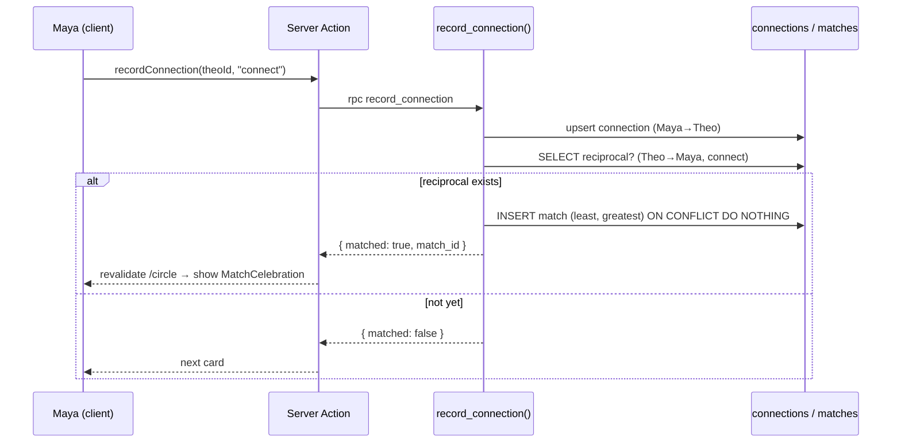

# Chapter 25 — The Connections System

> The moment two people both tap "Connect" is where Viby stops being an app and starts being a place people belong.

So far, Viby can *show* people to each other. In this chapter we build the beating heart of social discovery: the swipe, the mutual match, and the Circle of humans a user actually gets to talk to. This is the feature that turns browsing into belonging.

## What you'll learn

- How a **swipe / connect / skip** model works under the hood, and why we persist intent rather than UI state
- Designing a `connections` table and a **mutual-match** rule in PostgreSQL (with a clean, race-safe way to create a `match` on a reciprocal connect)
- Writing **Server Actions** to record connect/skip decisions safely
- Building the **Circle screen** — the grid of confirmed matches — as a Server Component
- **Surfacing connections inside chat**, so a new match instantly becomes a conversation
- Using **Framer Motion gestures** for a tactile swipe deck without a heavyweight library

## Prerequisites

- Chapter 9 — Supabase Auth and the `@supabase/ssr` client helpers
- Chapter 12 — Row Level Security (RLS) and policies
- Chapter 18 — Server Actions and `revalidatePath`
- Chapter 21 — The discovery feed (`profiles`, recommendation ordering)
- Chapter 23 — Realtime chat and the `messages` table

If you can read and write a row with RLS enabled, you're ready.

## Theory

A connection is **directional intent**. When Maya taps "Connect" on Theo, she is saying: *"I'd like to be in Theo's Circle."* That is a one-way arrow — `Maya → Theo`. It is meaningless to Theo until he reciprocates.

A **match** is the *symmetric* relationship that exists only when both arrows point at each other: `Maya → Theo` **and** `Theo → Maya`. Think of it like a handshake. One hand extended is an offer; the connection only "completes" when the other hand reaches back. Until then, nobody gets notified and no chat opens. This respects consent and keeps the experience pressure-free — a core promise of Viby being a discovery app, *not* a dating clone.

This gives us a clean mental model:

- **Connect** = insert a directional `connect` row.
- **Skip** = insert a directional `skip` row (we remember it so we never show that person again).
- **Match** = the derived fact that two reciprocal `connect` rows exist.

Why persist *skips*? Two reasons. First, the feed must not resurface someone you've already passed on — that feels broken and a little insulting. Second, "intent data" is gold for recommendations later (Chapter 27). We store the decision, not the swipe animation. The UI is disposable; the data is forever.

The subtle part is **when and how a match is born**. Maya connects with Theo while Theo has already connected with Maya — at that instant a match should appear in *both* Circles, atomically, exactly once. Do it naively with "read, check, write" and two simultaneous requests can both think they're first and create duplicate matches. We'll solve this the boring, bulletproof way: let the *database* decide, with a unique constraint and an `ON CONFLICT` upsert.

## In practice

### 1. The schema

We use one table for directional decisions and one for the symmetric match. The match table stores a **canonical ordered pair** (`user_a < user_b`) so a pair can only ever produce one match row.

```sql
-- supabase/migrations/0025_connections.sql

create type connection_kind as enum ('connect', 'skip');

create table public.connections (
  id          uuid primary key default gen_random_uuid(),
  actor_id    uuid not null references auth.users (id) on delete cascade,
  target_id   uuid not null references auth.users (id) on delete cascade,
  kind        connection_kind not null,
  created_at  timestamptz not null default now(),
  -- one decision per (actor -> target); re-deciding updates the row
  unique (actor_id, target_id),
  check (actor_id <> target_id)
);

create table public.matches (
  id          uuid primary key default gen_random_uuid(),
  user_a      uuid not null references auth.users (id) on delete cascade,
  user_b      uuid not null references auth.users (id) on delete cascade,
  created_at  timestamptz not null default now(),
  -- canonical order guarantees one row per pair
  check (user_a < user_b),
  unique (user_a, user_b)
);

create index on public.connections (actor_id, kind);
create index on public.matches (user_a);
create index on public.matches (user_b);
```

### 2. The match-on-mutual-connect function

We push the "is this mutual?" logic into a single `SECURITY DEFINER` function so it runs atomically. The `ON CONFLICT DO NOTHING` makes it idempotent: even if two reciprocal connects land in the same millisecond, exactly one match row survives.

```sql
-- still in 0025_connections.sql

create or replace function public.record_connection(p_target uuid, p_kind connection_kind)
returns table (matched boolean, match_id uuid)
language plpgsql
security definer
set search_path = public
as $$
declare
  v_actor uuid := auth.uid();
  v_a uuid;
  v_b uuid;
  v_match_id uuid;
  v_reciprocal boolean := false;
begin
  if v_actor is null then
    raise exception 'not authenticated';
  end if;
  if v_actor = p_target then
    raise exception 'cannot connect with yourself';
  end if;

  -- 1. persist this decision (idempotent: re-deciding overwrites)
  insert into public.connections (actor_id, target_id, kind)
  values (v_actor, p_target, p_kind)
  on conflict (actor_id, target_id)
  do update set kind = excluded.kind, created_at = now();

  -- skips never create matches
  if p_kind = 'skip' then
    return query select false, null::uuid;
    return;
  end if;

  -- 2. did the target already connect with us?
  select exists (
    select 1 from public.connections
    where actor_id = p_target and target_id = v_actor and kind = 'connect'
  ) into v_reciprocal;

  if not v_reciprocal then
    return query select false, null::uuid;
    return;
  end if;

  -- 3. mutual! create the canonical match row, idempotently
  v_a := least(v_actor, p_target);
  v_b := greatest(v_actor, p_target);

  insert into public.matches (user_a, user_b)
  values (v_a, v_b)
  on conflict (user_a, user_b) do nothing
  returning id into v_match_id;

  if v_match_id is null then
    select id into v_match_id from public.matches
    where user_a = v_a and user_b = v_b;
  end if;

  return query select true, v_match_id;
end;
$$;
```

### 3. Row Level Security

Users may only read their own decisions and the matches they're part of. Writes go exclusively through the function above, so we keep direct insert policies tight.

```sql
alter table public.connections enable row level security;
alter table public.matches enable row level security;

create policy "read own connections"
  on public.connections for select
  using (auth.uid() = actor_id);

create policy "read own matches"
  on public.matches for select
  using (auth.uid() = user_a or auth.uid() = user_b);
```

> Note: because `record_connection` is `SECURITY DEFINER`, it bypasses RLS for its inserts — exactly what we want, since the user is acting on their own behalf and we validate `auth.uid()` inside.

### 4. The Server Action

Thin wrapper that calls the RPC, revalidates the feed and Circle, and tells the client whether a match just happened.

```ts
// app/(app)/discover/actions.ts
"use server";

import { revalidatePath } from "next/cache";
import { createServerClient } from "@/lib/supabase/server";

export type ConnectResult =
  | { ok: true; matched: boolean; matchId: string | null }
  | { ok: false; error: string };

export async function recordConnection(
  targetId: string,
  kind: "connect" | "skip",
): Promise<ConnectResult> {
  const supabase = await createServerClient();

  const { data, error } = await supabase
    .rpc("record_connection", { p_target: targetId, p_kind: kind })
    .single();

  if (error) return { ok: false, error: error.message };

  revalidatePath("/discover");
  if (kind === "connect" && data?.matched) revalidatePath("/circle");

  return { ok: true, matched: data?.matched ?? false, matchId: data?.match_id ?? null };
}
```

Here's the `createServerClient` helper from Chapter 9, for reference — note the `getAll`/`setAll` cookie handlers required by `@supabase/ssr`:

```ts
// lib/supabase/server.ts
import { cookies } from "next/headers";
import { createServerClient as createClient } from "@supabase/ssr";

export async function createServerClient() {
  const cookieStore = await cookies();
  return createClient(
    process.env.NEXT_PUBLIC_SUPABASE_URL!,
    process.env.NEXT_PUBLIC_SUPABASE_ANON_KEY!,
    {
      cookies: {
        getAll: () => cookieStore.getAll(),
        setAll: (toSet) => {
          try {
            toSet.forEach(({ name, value, options }) =>
              cookieStore.set(name, value, options),
            );
          } catch {
            // called from a Server Component — safe to ignore; proxy.ts refreshes the session
          }
        },
      },
    },
  );
}
```

### 5. The swipe deck (client gesture)

A focused `"use client"` component handles the drag gesture and optimistic removal. We keep the data fetching on the server and hand the deck a plain array.

```tsx
// app/(app)/discover/SwipeDeck.tsx
"use client";

import { useState, useTransition } from "react";
import { motion, AnimatePresence, type PanInfo } from "framer-motion";
import { recordConnection } from "./actions";
import { MatchCelebration } from "./MatchCelebration";

type Candidate = { id: string; displayName: string; avatarUrl: string; bio: string; vibes: string[] };

export function SwipeDeck({ initial }: { initial: Candidate[] }) {
  const [deck, setDeck] = useState(initial);
  const [matched, setMatched] = useState<Candidate | null>(null);
  const [, startTransition] = useTransition();

  function decide(card: Candidate, kind: "connect" | "skip") {
    setDeck((d) => d.filter((c) => c.id !== card.id)); // optimistic
    startTransition(async () => {
      const res = await recordConnection(card.id, kind);
      if (res.ok && res.matched) setMatched(card);
    });
  }

  const onDragEnd = (card: Candidate) => (_: unknown, info: PanInfo) => {
    if (info.offset.x > 120) decide(card, "connect");
    else if (info.offset.x < -120) decide(card, "skip");
  };

  return (
    <div className="relative mx-auto h-[520px] w-full max-w-sm">
      <AnimatePresence>
        {deck.slice(-3).map((card, i, arr) => {
          const top = i === arr.length - 1;
          return (
            <motion.div
              key={card.id}
              drag={top ? "x" : false}
              dragSnapToOrigin
              onDragEnd={top ? onDragEnd(card) : undefined}
              initial={{ scale: 0.95, y: 12 }}
              animate={{ scale: 1 - (arr.length - 1 - i) * 0.04, y: (arr.length - 1 - i) * -10 }}
              exit={{ x: 0, opacity: 0, scale: 0.8, transition: { duration: 0.2 } }}
              whileDrag={{ rotate: 0 }}
              className="absolute inset-0 rounded-3xl border border-pink-100 bg-white shadow-xl overflow-hidden"
            >
              
              <div className="p-5">
                <h3 className="text-xl font-bold text-gray-900">{card.displayName}</h3>
                <p className="mt-1 text-sm text-gray-500">{card.bio}</p>
                <div className="mt-3 flex flex-wrap gap-2">
                  {card.vibes.map((v) => (
                    <span key={v} className="rounded-full bg-pink-50 px-3 py-1 text-xs font-medium text-[--color-brand]">
                      {v}
                    </span>
                  ))}
                </div>
              </div>
              {top && (
                <div className="absolute inset-x-0 bottom-0 flex justify-center gap-6 p-4">
                  <button onClick={() => decide(card, "skip")} aria-label="Skip"
                    className="grid h-14 w-14 place-items-center rounded-full bg-gray-100 text-2xl">✕</button>
                  <button onClick={() => decide(card, "connect")} aria-label="Connect"
                    className="grid h-14 w-14 place-items-center rounded-full bg-[--color-brand] text-2xl text-white">♥</button>
                </div>
              )}
            </motion.div>
          );
        })}
      </AnimatePresence>

      {deck.length === 0 && (
        <p className="grid h-full place-items-center text-center text-gray-400">
          That's everyone for now — check back soon!
        </p>
      )}

      <AnimatePresence>
        {matched && <MatchCelebration person={matched} onClose={() => setMatched(null)} />}
      </AnimatePresence>
    </div>
  );
}
```

The brand color comes from our Tailwind v4 theme tokens — no config file:

```css
/* app/globals.css */
@import "tailwindcss";

@theme {
  --color-brand: #ff6fb5;
  --color-brand-soft: #fff0f7;
}
```

### 6. The Circle screen (Server Component)

The Circle is the user's confirmed matches. Because it's a Server Component, we fetch with the user's session and RLS does the filtering for free.

```tsx
// app/(app)/circle/page.tsx
import Link from "next/link";
import { createServerClient } from "@/lib/supabase/server";

export default async function CirclePage() {
  const supabase = await createServerClient();
  const { data: { user } } = await supabase.auth.getUser();

  const { data: matches } = await supabase
    .from("matches")
    .select(`
      id, created_at,
      a:profiles!matches_user_a_fkey ( id, display_name, avatar_url ),
      b:profiles!matches_user_b_fkey ( id, display_name, avatar_url )
    `)
    .order("created_at", { ascending: false });

  const people = (matches ?? []).map((m) => (m.a.id === user!.id ? m.b : m.a));

  return (
    <main className="mx-auto max-w-2xl p-4">
      <h1 className="text-2xl font-bold text-gray-900">Your Circle</h1>
      <p className="mt-1 text-sm text-gray-500">{people.length} people you both said yes to.</p>

      <ul className="mt-6 grid grid-cols-2 gap-4 sm:grid-cols-3">
        {people.map((p) => (
          <li key={p.id}>
            <Link href={`/chat/${p.id}`} className="block rounded-2xl border border-pink-100 p-3 transition hover:shadow-md">
              
              <span className="mt-2 block text-center text-sm font-semibold text-gray-800">{p.display_name}</span>
            </Link>
          </li>
        ))}
      </ul>

      {people.length === 0 && (
        <p className="mt-16 text-center text-gray-400">No matches yet. Head to Discover and find your people!</p>
      )}
    </main>
  );
}
```

> The `profiles!matches_user_a_fkey` syntax disambiguates the two foreign keys both pointing at `auth.users`/`profiles`. Without it, PostgREST can't tell which join you mean.

### 7. Surfacing connections in chat

A match should *open a door*. We don't pre-create empty conversations — instead, the chat list is **derived from matches**. Tapping a Circle member routes to `/chat/[peerId]`, and the messages query (Chapter 23) loads on demand. The chat list page reuses the same match query:

```tsx
// app/(app)/chat/page.tsx (excerpt)
const people = (matches ?? []).map((m) => (m.a.id === user!.id ? m.b : m.a));
// render each as a chat row → Link href={`/chat/${person.id}`}
```

This keeps a single source of truth: **you can only chat with someone in your Circle.** Enforce it at the data layer too — your `messages` RLS policy should check that a `matches` row exists for the sender/recipient pair before allowing an insert.

### 8. The match celebration

```tsx
// app/(app)/discover/MatchCelebration.tsx
"use client";
import Link from "next/link";
import { motion } from "framer-motion";

export function MatchCelebration({
  person, onClose,
}: { person: { id: string; displayName: string; avatarUrl: string }; onClose: () => void }) {
  return (
    <motion.div
      initial={{ opacity: 0 }} animate={{ opacity: 1 }} exit={{ opacity: 0 }}
      className="fixed inset-0 z-50 grid place-items-center bg-[--color-brand]/90 p-6 text-white"
      onClick={onClose}
    >
      <motion.div
        initial={{ scale: 0.6, y: 30 }} animate={{ scale: 1, y: 0 }}
        transition={{ type: "spring", stiffness: 260, damping: 18 }}
        className="text-center"
      >
        <p className="text-sm font-semibold uppercase tracking-widest">It's a match</p>
        <h2 className="mt-2 text-4xl font-black">You & {person.displayName}</h2>
        
        <Link href={`/chat/${person.id}`}
          className="mt-8 inline-block rounded-full bg-white px-8 py-3 font-bold text-[--color-brand]">
          Say hi 👋
        </Link>
      </motion.div>
    </motion.div>
  );
}
```

## Architecture / diagram



```
connections (directional intent)        matches (symmetric, canonical)
+----------+-----------+--------+        +--------+--------+
| actor_id | target_id | kind   |        | user_a | user_b |
+----------+-----------+--------+        +--------+--------+
| Maya     | Theo      | connect|  --->  | Maya   | Theo   |  (user_a < user_b)
| Theo     | Maya      | connect|  ---^  +--------+--------+
| Maya     | Ravi      | skip   |        (created only on mutual connect)
+----------+-----------+--------+
```

## Best practices & pitfalls

- **DO let the database enforce uniqueness.** The `matches` unique constraint + `ON CONFLICT DO NOTHING` is what makes simultaneous reciprocal connects safe. Never "SELECT then INSERT" in app code for this.
- **DO store the canonical pair** (`least`/`greatest`) so a pair maps to exactly one match row regardless of who connected first.
- **DON'T trust the client for `actor_id`.** Always derive it from `auth.uid()` inside the `SECURITY DEFINER` function — never accept it as a parameter.
- **DO make the action idempotent.** Re-tapping connect (double-click, retry) must not create duplicate intent or duplicate matches. The `unique (actor_id, target_id)` upsert handles this.
- **DON'T pre-create chat rooms** for every match — derive conversations from matches and lazy-load messages. Empty rooms are clutter and storage you'll regret.
- **DO gate `messages` inserts with RLS** that requires an existing match. A connection feature isn't done until people *can't* message strangers.
- **PITFALL: optimistic UI desync.** If the Server Action fails, reconcile — re-add the card or toast an error. Don't leave the deck silently out of sync with the DB.
- **PITFALL: forgetting `set search_path` in `SECURITY DEFINER` functions** — it's a real privilege-escalation vector. Always pin it.
- **DON'T resurface skipped users.** Your discover query must `LEFT JOIN`/`NOT IN` against `connections` for the current actor.

## Exercises

1. **Filter the feed.** Update the Discover server query so candidates exclude anyone the current user has already connected with *or* skipped, and exclude existing matches. (Hint: `not in (select target_id from connections where actor_id = auth.uid())`.)
2. **Undo a skip.** Add a "Bring back" button that deletes the most recent `skip` row for the user and revalidates `/discover`. Keep it RLS-safe.
3. **Match count badge.** Add a live badge to the Circle nav item showing the number of matches created in the last 24 hours. Try it first with a server query, then upgrade to Supabase Realtime on the `matches` table.
4. **Pending connections (intermediate).** Build a "Liked you" screen that shows people who connected with the current user but whom the user hasn't decided on yet — without leaking it before mutual consent. Think carefully about which RLS policy makes this safe.
5. **Race-condition test (advanced).** Write a SQL or pgTAP test that fires two reciprocal `record_connection` calls concurrently and asserts exactly one `matches` row exists afterward.

## Mini-project

**Ship the full connect → match → chat loop.**

1. Run the `0025_connections.sql` migration (tables, function, RLS).
2. Wire `app/(app)/discover/page.tsx` (Server Component) to fetch candidates excluding prior decisions, and render `<SwipeDeck initial={candidates} />`.
3. Implement the `recordConnection` Server Action and confirm both button taps and drag gestures persist rows.
4. Build the Circle screen and verify two test accounts that mutually connect both see each other (and that `MatchCelebration` fires for the second connector).
5. From a Circle card, navigate into `/chat/[peerId]` and send the first message — then add the `messages` RLS policy that *requires* a match, and prove a non-matched user gets rejected.

Success criteria: a brand-new pair can go from two swipes to a live conversation, with zero duplicate matches even under rapid double-taps.

## Key takeaways

- A **connection is directional intent**; a **match is the symmetric handshake** derived from two reciprocal connects.
- Persist **both connects and skips** — the UI animation is throwaway, the decision data is permanent and powers recommendations later.
- Make match creation **atomic and idempotent** with a canonical ordered pair, a unique constraint, and `ON CONFLICT DO NOTHING` — never read-then-write in app code.
- Keep writes inside a validated `SECURITY DEFINER` RPC and reads behind tight **RLS**; derive the Circle and chat list from `matches` as a single source of truth.
- Optimistic UI + Server Actions gives a snappy swipe deck, but always **reconcile on failure**.

**Up next — Chapter 26: Realtime Presence & Notifications**, where we light up "online now" dots, typing indicators, and push a "You have a new match!" notification the instant that handshake completes.
