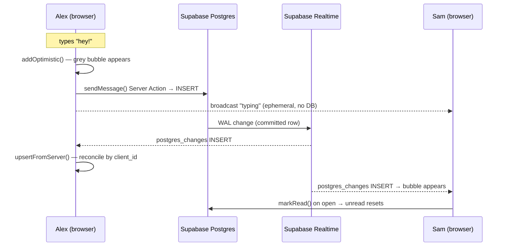

# Chapter 26 — Realtime Chat

> The moment two strangers who love the same obscure board game start typing to each other — *that's* Viby working. Let's build the room where it happens.

## What you'll learn

- How to model `conversations` and `messages` so 1-on-1 chat scales cleanly
- Sending messages with **optimistic UI** so the bubble appears the instant you hit send
- Subscribing to **Supabase Realtime** so new messages stream in live
- **Typing indicators** and **online presence** using Realtime broadcast & presence channels
- **Unread counters** that survive refreshes and stay accurate
- A polished **conversation list** that re-sorts itself as messages arrive

## Prerequisites

- Chapter 9 (Supabase Auth + `@supabase/ssr` clients)
- Chapter 12 (Postgres schema design + Row Level Security)
- Chapter 18 (Zustand for client state)
- Chapter 22 (Server Actions and the `proxy.ts` auth gate)
- Comfort with `motion` / `AnimatePresence` from Chapter 20

---

## Theory

Chat *feels* simple — text goes in a box, appears on a screen. Under the hood it's the hardest UI in the whole app, because three different forces fight each other:

1. **Persistence** — messages must survive a refresh, so they live in Postgres.
2. **Liveness** — the other person's message must appear *now*, not after a poll.
3. **Perceived speed** — *your own* message must appear before the server even confirms it.

Think of it like a **restaurant kitchen with a pass**. When you order (send a message), the waiter writes it on a ticket and *immediately* tells you "got it" — that's **optimistic UI**, the bubble shows up grey before the kitchen confirms. The ticket goes to the kitchen (Postgres `insert`). When *any* dish is plated, a bell rings on the pass and every waiter hears it — that's **Realtime**, a broadcast everyone subscribed to the channel receives. You don't keep walking back to ask "is it ready yet?" (that's polling, and it's wasteful) — you *subscribe to the bell*.

Three Realtime primitives matter here, and they're easy to confuse:

- **Postgres Changes** — Supabase tails the database's write-ahead log and pushes `INSERT`/`UPDATE`/`DELETE` events. This is the source of truth: it fires *after* a row is committed. Use it for messages, because messages are durable.
- **Broadcast** — a lightweight, ephemeral message bus. Nothing is stored. Perfect for "Alex is typing…", which nobody needs to remember.
- **Presence** — a synchronized roster of who's currently on a channel, with automatic join/leave events. Perfect for the green "online" dot.

The rule of thumb: **if losing it on refresh is fine, use Broadcast/Presence; if it must persist, write to Postgres and listen to Postgres Changes.** Typing and online status are gloriously disposable. Messages and unread counts are not.

One more concept: the **optimistic reconciliation problem**. You insert a fake message locally with a temporary id, then the *real* row arrives via Realtime with a real id. If you're not careful you'll show it twice. We solve this with a stable `client_id` so the optimistic row and the database row are the same row.

---

## In practice

### 1. The schema

Two tables, plus a `read_state` table for unread counts. Run this in the Supabase SQL editor (this builds on the migrations pattern from Chapter 12).

```sql
-- A conversation is a 1-on-1 thread between two users.
create table conversations (
  id uuid primary key default gen_random_uuid(),
  user_a uuid not null references auth.users (id) on delete cascade,
  user_b uuid not null references auth.users (id) on delete cascade,
  last_message text,
  last_message_at timestamptz not null default now(),
  created_at timestamptz not null default now(),
  -- order the pair so (a,b) and (b,a) can't both exist
  constraint ordered_pair check (user_a < user_b),
  constraint unique_pair unique (user_a, user_b)
);

create table messages (
  id uuid primary key default gen_random_uuid(),
  conversation_id uuid not null references conversations (id) on delete cascade,
  sender_id uuid not null references auth.users (id) on delete cascade,
  body text not null check (char_length(body) between 1 and 4000),
  client_id text not null,           -- stable id from the client for dedupe
  created_at timestamptz not null default now()
);

-- Per-user, per-conversation read cursor.
create table read_state (
  conversation_id uuid not null references conversations (id) on delete cascade,
  user_id uuid not null references auth.users (id) on delete cascade,
  last_read_at timestamptz not null default now(),
  primary key (conversation_id, user_id)
);

create index messages_conversation_idx on messages (conversation_id, created_at desc);

-- Realtime needs the table in the publication.
alter publication supabase_realtime add table messages;
```

Now lock it down with RLS so users only touch their own conversations:

```sql
alter table conversations enable row level security;
alter table messages enable row level security;
alter table read_state enable row level security;

create policy "see own conversations" on conversations for select
  using (auth.uid() in (user_a, user_b));

create policy "read messages in own conversations" on messages for select
  using (exists (
    select 1 from conversations c
    where c.id = conversation_id and auth.uid() in (c.user_a, c.user_b)
  ));

create policy "send as self in own conversations" on messages for insert
  with check (
    sender_id = auth.uid() and exists (
      select 1 from conversations c
      where c.id = conversation_id and auth.uid() in (c.user_a, c.user_b)
    )
  );

create policy "manage own read state" on read_state for all
  using (user_id = auth.uid()) with check (user_id = auth.uid());
```

> Why `user_a < user_b`? It guarantees one canonical row per pair. Without it, Alex→Sam and Sam→Alex become two separate threads — a classic duplicate-conversation bug.

### 2. Server Action: send a message

We send through a Server Action so the write happens with the user's authenticated server client and the conversation's `last_message` updates atomically.

```ts
// app/chat/actions.ts
"use server";

import { createServerClient } from "@/lib/supabase/server";
import { revalidatePath } from "next/cache";

export async function sendMessage(
  conversationId: string,
  body: string,
  clientId: string
) {
  const supabase = await createServerClient();
  const { data: { user } } = await supabase.auth.getUser();
  if (!user) return { error: "Not authenticated" };

  const text = body.trim();
  if (!text) return { error: "Empty message" };

  const { error } = await supabase.from("messages").insert({
    conversation_id: conversationId,
    sender_id: user.id,
    body: text,
    client_id: clientId,
  });
  if (error) return { error: error.message };

  // Bump the conversation so the list re-sorts.
  await supabase
    .from("conversations")
    .update({ last_message: text, last_message_at: new Date().toISOString() })
    .eq("id", conversationId);

  revalidatePath("/chat");
  return { ok: true };
}
```

### 3. The optimistic message store (Zustand)

```ts
// stores/useChatStore.ts
import { create } from "zustand";

export type ChatMessage = {
  id: string;            // db id, or temp id while pending
  client_id: string;     // stable dedupe key
  body: string;
  sender_id: string;
  created_at: string;
  pending?: boolean;
};

type ChatState = {
  messages: ChatMessage[];
  setInitial: (m: ChatMessage[]) => void;
  addOptimistic: (m: ChatMessage) => void;
  upsertFromServer: (m: ChatMessage) => void;
};

export const useChatStore = create<ChatState>((set) => ({
  messages: [],
  setInitial: (m) => set({ messages: m }),
  addOptimistic: (m) => set((s) => ({ messages: [...s.messages, m] })),
  upsertFromServer: (incoming) =>
    set((s) => {
      // Reconcile by client_id: replace the optimistic row if present.
      const idx = s.messages.findIndex((x) => x.client_id === incoming.client_id);
      if (idx === -1) return { messages: [...s.messages, incoming] };
      const next = [...s.messages];
      next[idx] = incoming;
      return { messages: next };
    }),
}));
```

The `upsertFromServer` reconciliation is the whole trick: the optimistic row and the realtime row share a `client_id`, so the server version *replaces* the grey pending bubble instead of stacking on top of it.

### 4. The chat thread: realtime + optimistic send

```tsx
// app/chat/[id]/Thread.tsx
"use client";

import { use, useEffect, useRef, useState, useTransition } from "react";
import { motion, AnimatePresence } from "framer-motion";
import { createBrowserClient } from "@/lib/supabase/client";
import { useChatStore, type ChatMessage } from "@/stores/useChatStore";
import { sendMessage } from "../actions";

export function Thread({
  conversationId,
  meId,
  initial,
}: {
  conversationId: string;
  meId: string;
  initial: ChatMessage[];
}) {
  const supabase = createBrowserClient();
  const { messages, setInitial, addOptimistic, upsertFromServer } = useChatStore();
  const [text, setText] = useState("");
  const [, startTransition] = useTransition();
  const bottomRef = useRef<HTMLDivElement>(null);

  useEffect(() => setInitial(initial), [initial, setInitial]);

  // Subscribe to new messages for this conversation.
  useEffect(() => {
    const channel = supabase
      .channel(`messages:${conversationId}`)
      .on(
        "postgres_changes",
        {
          event: "INSERT",
          schema: "public",
          table: "messages",
          filter: `conversation_id=eq.${conversationId}`,
        },
        (payload) => upsertFromServer(payload.new as ChatMessage)
      )
      .subscribe();

    return () => {
      supabase.removeChannel(channel);
    };
  }, [conversationId, supabase, upsertFromServer]);

  useEffect(() => {
    bottomRef.current?.scrollIntoView({ behavior: "smooth" });
  }, [messages.length]);

  function handleSend() {
    const body = text.trim();
    if (!body) return;
    const clientId = crypto.randomUUID();

    // 1. Show it instantly.
    addOptimistic({
      id: `temp-${clientId}`,
      client_id: clientId,
      body,
      sender_id: meId,
      created_at: new Date().toISOString(),
      pending: true,
    });
    setText("");

    // 2. Persist. Realtime will deliver the canonical row and reconcile.
    startTransition(async () => {
      const res = await sendMessage(conversationId, body, clientId);
      if (res?.error) {
        // mark the bubble as failed (left as an exercise)
        console.error(res.error);
      }
    });
  }

  return (
    <div className="flex h-full flex-col">
      <div className="flex-1 space-y-2 overflow-y-auto p-4">
        <AnimatePresence initial={false}>
          {messages.map((m) => {
            const mine = m.sender_id === meId;
            return (
              <motion.div
                key={m.client_id}
                initial={{ opacity: 0, y: 8, scale: 0.97 }}
                animate={{ opacity: m.pending ? 0.6 : 1, y: 0, scale: 1 }}
                className={`flex ${mine ? "justify-end" : "justify-start"}`}
              >
                <span
                  className={`max-w-[75%] rounded-2xl px-4 py-2 text-sm ${
                    mine
                      ? "bg-brand text-white"
                      : "bg-gray-100 text-gray-900"
                  }`}
                >
                  {m.body}
                </span>
              </motion.div>
            );
          })}
        </AnimatePresence>
        <div ref={bottomRef} />
      </div>

      <div className="flex gap-2 border-t p-3">
        <input
          value={text}
          onChange={(e) => setText(e.target.value)}
          onKeyDown={(e) => e.key === "Enter" && handleSend()}
          placeholder="Say hi…"
          className="flex-1 rounded-full border px-4 py-2 text-sm outline-none focus:border-brand"
        />
        <button
          onClick={handleSend}
          className="rounded-full bg-brand px-5 py-2 text-sm font-semibold text-white"
        >
          Send
        </button>
      </div>
    </div>
  );
}
```

The `bg-brand` token comes from our Tailwind v4 `@theme` block (Chapter 6):

```css
/* app/globals.css */
@theme {
  --color-brand: #ff6fb5;
}
```

### 5. Typing indicators (Broadcast) + presence (Presence)

Both ride on a single channel. Typing is ephemeral broadcast; online status is presence.

```tsx
// hooks/usePresenceAndTyping.ts
"use client";

import { useEffect, useRef, useState } from "react";
import { createBrowserClient } from "@/lib/supabase/client";

export function usePresenceAndTyping(conversationId: string, meId: string) {
  const supabase = createBrowserClient();
  const [peerTyping, setPeerTyping] = useState(false);
  const [peerOnline, setPeerOnline] = useState(false);
  const channelRef = useRef<ReturnType<typeof supabase.channel>>(null);
  const stopTimer = useRef<ReturnType<typeof setTimeout>>(null);

  useEffect(() => {
    const channel = supabase.channel(`room:${conversationId}`, {
      config: { presence: { key: meId } },
    });
    channelRef.current = channel;

    channel
      .on("broadcast", { event: "typing" }, ({ payload }) => {
        if (payload.userId === meId) return;
        setPeerTyping(true);
        clearTimeout(stopTimer.current!);
        stopTimer.current = setTimeout(() => setPeerTyping(false), 2500);
      })
      .on("presence", { event: "sync" }, () => {
        const state = channel.presenceState();
        // anyone present who isn't me => peer online
        setPeerOnline(Object.keys(state).some((k) => k !== meId));
      })
      .subscribe(async (status) => {
        if (status === "SUBSCRIBED") {
          await channel.track({ online_at: new Date().toISOString() });
        }
      });

    return () => {
      supabase.removeChannel(channel);
    };
  }, [conversationId, meId, supabase]);

  // Call this on each keystroke; it's a fire-and-forget broadcast.
  function emitTyping() {
    channelRef.current?.send({
      type: "broadcast",
      event: "typing",
      payload: { userId: meId },
    });
  }

  return { peerTyping, peerOnline, emitTyping };
}
```

Wire `emitTyping()` into the input's `onChange`, and render `peerTyping` as an animated three-dot bubble. The 2.5s timer auto-clears the indicator if keystrokes stop — broadcast has no "stopped typing" event, so we infer it.

### 6. Unread counters

Unread = messages newer than my `last_read_at` that I didn't send. We compute it server-side for accuracy, and reset it when the thread opens.

```ts
// app/chat/actions.ts (append)
export async function markRead(conversationId: string) {
  const supabase = await createServerClient();
  const { data: { user } } = await supabase.auth.getUser();
  if (!user) return;
  await supabase.from("read_state").upsert({
    conversation_id: conversationId,
    user_id: user.id,
    last_read_at: new Date().toISOString(),
  });
}
```

```ts
// lib/chat/unread.ts — used by the conversation list (Server Component)
import { createServerClient } from "@/lib/supabase/server";

export async function getUnreadCount(conversationId: string, meId: string) {
  const supabase = await createServerClient();
  const { data: rs } = await supabase
    .from("read_state")
    .select("last_read_at")
    .eq("conversation_id", conversationId)
    .eq("user_id", meId)
    .maybeSingle();

  const since = rs?.last_read_at ?? "1970-01-01";
  const { count } = await supabase
    .from("messages")
    .select("*", { count: "exact", head: true })
    .eq("conversation_id", conversationId)
    .neq("sender_id", meId)
    .gt("created_at", since);

  return count ?? 0;
}
```

Call `markRead(conversationId)` from the `Thread` once it mounts (in a `useEffect` via a transition). The badge in the list then reflects only genuinely-unseen messages.

---

## Architecture / diagram



```
 Channels per conversation
 ────────────────────────────────────────────
  messages:<id>   ── postgres_changes ──> durable message stream
  room:<id>       ── broadcast(typing) ──> ephemeral "typing…"
  room:<id>       ── presence ──────────> who's online right now
```

---

## Best practices & pitfalls

- **Do** dedupe by `client_id`, not by array index or db `id`. The optimistic row has no db id yet.
- **Do** scope channels per conversation (`messages:<id>`) and always `removeChannel` in cleanup — leaked subscriptions silently multiply and you'll process the same insert five times.
- **Don't** trust the `filter` on `postgres_changes` for security. RLS is what actually stops a user reading another thread; the filter is a performance convenience.
- **Don't** store typing state in Postgres. A row write per keystroke will hammer your database and your bill. Broadcast is free-flowing and ephemeral for a reason.
- **Do** compute unread counts on the server. A purely client-side counter drifts the moment a tab was closed when a message arrived.
- **Don't** forget `alter publication supabase_realtime add table messages;` — the single most common "why isn't realtime firing?" cause.
- **Do** debounce or throttle `emitTyping()` if you broadcast on every keystroke at scale; once per ~300ms is plenty.
- **Do** handle the failed-send case — flip `pending` to a `failed` flag and offer a retry, rather than leaving a ghost bubble.

---

## Exercises

1. **Failed-send retry.** Add a `status: "sending" | "sent" | "failed"` to `ChatMessage`. When `sendMessage` returns an error, mark the bubble failed and render a tap-to-retry icon.
2. **Typing dots component.** Build a `<TypingBubble />` with three dots that bounce using Framer Motion's `animate` and staggered `transition.delay`. Show it only when `peerTyping` is true, wrapped in `AnimatePresence`.
3. **Read receipts.** Using the peer's `read_state.last_read_at`, render a subtle "Seen" under the last message you sent if its `created_at` is older than their read cursor.
4. **Live unread badge.** Make the conversation-list badge update without a refresh by subscribing to `messages` inserts at the list level and incrementing the count for non-active threads.
5. **Pagination.** The thread loads only the latest 50 messages. Add "load older" that fetches the previous page by `created_at` cursor and prepends without breaking scroll position.

---

## Mini-project — "Viby DMs" end to end

Build a working two-pane chat at `/chat`:

- **Left pane:** a `ConversationList` Server Component that fetches the user's conversations ordered by `last_message_at desc`, renders each with the peer's avatar, the `last_message` preview, a relative timestamp, and an unread badge from `getUnreadCount`. The bubblegum-pink badge only shows when count > 0.
- **Right pane:** the `Thread` from this chapter, with optimistic send, realtime delivery, a presence dot in the header ("Online" in pink when `peerOnline`), and a typing bubble.
- On open, call `markRead`. On send, watch the optimistic bubble reconcile.

Acceptance test: open two browsers (one incognito) signed in as two users who matched in an earlier chapter. Type in one — the dots appear in the other within a beat, the message lands live, the unread badge clears on open, and your own bubble never duplicates. Ship it to Vercel and DM a classmate.

---

## Key takeaways

- **Persist messages in Postgres; stream them with `postgres_changes`.** That's your durable backbone.
- **Optimistic UI + `client_id` reconciliation** gives instant-feeling sends with zero duplicates.
- **Broadcast for typing, Presence for online** — ephemeral signals never touch the database.
- **Unread counts belong on the server**, derived from a per-user read cursor.
- **RLS is the real security boundary;** realtime filters are only for efficiency.

**Up next — Chapter 27: Push Notifications & Background Sync**, so the conversation pulls people back in even when Viby is closed.
