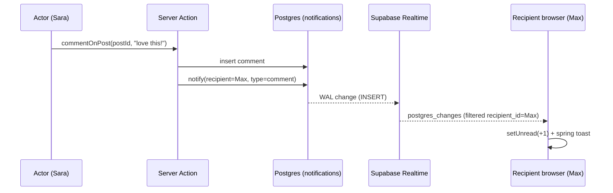

# Chapter 27 — Groups & Notifications

> A social app stops being a feed and starts being a *community* the moment people can gather in rooms and feel the tap on the shoulder when something happens.

So far Viby connects people one-to-one. In this chapter we give them places to belong — **Groups** (hobby communities people create and join) — and the nervous system that keeps everyone in the loop: a **realtime notifications** system that fires on new connections, messages, comments, reactions, and group invites, surfacing them as live toasts.

## What you'll learn

- How to model many-to-many membership (`groups`, `group_members`) and a group feed in PostgreSQL with Row Level Security.
- How to build create/join flows with **Server Actions** and optimistic UI.
- The architecture of a **notifications** table and why notifications are *materialized rows*, not computed on the fly.
- How to subscribe to Supabase **Realtime** changes from a Client Component and pop **Framer Motion** toasts.
- How to keep an unread badge accurate without hammering the database.

## Prerequisites

- Chapter 9–11: Supabase Auth, the `@supabase/ssr` client helpers, and RLS basics.
- Chapter 18: Server Actions and `revalidatePath`.
- Chapter 22: the connections/friendship model (`connections` table).
- Chapter 24: Realtime fundamentals (you built the live chat there — we reuse the same `postgres_changes` subscription pattern).
- Chapter 26: the Zustand store and our toast primitive.

---

## Theory

### Groups are a join table wearing a costume

A "community" feels like a big, fuzzy concept, but underneath it's the most classic relational pattern there is: **many-to-many**. A user can be in many groups; a group has many users. You never store an array of member IDs on the group row (that path leads to race conditions and unqueryable data). Instead you put a thin **join table** between them — `group_members` — where each row says "user X is in group Y, with role R."

Think of it like a coat-check: the group is the cloakroom, each `group_members` row is a numbered ticket. The ticket carries a little metadata (your role: `member`, `admin`, `owner`) and lets either side look the other up instantly.

The **group feed** is then just posts scoped to a `group_id` — the same posts table you've used, with one extra foreign key.

### Notifications are *events you saved*, not events you compute

Here's the single most important idea in this chapter, and the one beginners get wrong: **a notification is a stored row, not a query.**

It's tempting to think "the user's notifications are: all unread messages + all new comments on their posts + …" and compute that with a giant join on every page load. Don't. That's slow, it's impossible to mark individual items read, and it can't represent "Sara reacted then un-reacted."

Instead, treat a notification as a **fact that happened at a point in time** — like a stamped letter dropped in a mailbox. When an event occurs (someone comments, reacts, sends an invite), you *write a row* into a `notifications` table addressed to the recipient. That row is immutable history. The mailbox (the bell icon) just lists rows and tracks which envelopes have been opened (`read_at`).

This "write on event" model is called a **materialized** or **fan-out-on-write** notification system. It costs a tiny write when the event happens and makes every read cheap.

### Realtime is a phone line you leave off the hook

Polling ("any new notifications yet? …yet? …yet?") is the rude way. Supabase Realtime lets the client **subscribe** to inserts on the `notifications` table filtered to *its own* rows. Postgres streams the new row down a WebSocket the instant it's committed. Your React component receives it and shows a toast. No polling, no refresh — the tap on the shoulder.

---

## In practice

### 1. The schema

```sql
-- Groups (communities)
create table public.groups (
  id          uuid primary key default gen_random_uuid(),
  slug        text unique not null,
  name        text not null,
  description text,
  cover_url   text,
  created_by  uuid not null references auth.users (id) on delete cascade,
  created_at  timestamptz not null default now()
);

create table public.group_members (
  group_id  uuid not null references public.groups (id) on delete cascade,
  user_id   uuid not null references auth.users (id) on delete cascade,
  role      text not null default 'member' check (role in ('member','admin','owner')),
  joined_at timestamptz not null default now(),
  primary key (group_id, user_id)
);

-- Group feed: posts already exist; add an optional group scope
alter table public.posts
  add column group_id uuid references public.groups (id) on delete cascade;

-- Notifications: one row per event, addressed to a recipient
create table public.notifications (
  id           uuid primary key default gen_random_uuid(),
  recipient_id uuid not null references auth.users (id) on delete cascade,
  actor_id     uuid references auth.users (id) on delete set null,
  type         text not null
                 check (type in ('connection','message','comment','reaction','group_invite')),
  entity_id    uuid,            -- the post/message/group this is about
  metadata     jsonb not null default '{}',
  read_at      timestamptz,
  created_at   timestamptz not null default now()
);

create index notifications_recipient_idx
  on public.notifications (recipient_id, created_at desc);
```

A few deliberate choices: `actor_id` is **nullable with `on delete set null`** so a deleted account doesn't erase your history (the notification just becomes "someone"). `entity_id` + `type` together tell the UI where to deep-link. `read_at IS NULL` is our definition of *unread* — cleaner than a boolean because it records *when* it was read.

### 2. Row Level Security

```sql
alter table public.groups          enable row level security;
alter table public.group_members   enable row level security;
alter table public.notifications   enable row level security;

-- Anyone signed in can discover groups; only members see member lists
create policy "groups are public to read"
  on public.groups for select using (true);

create policy "members read their memberships"
  on public.group_members for select
  using (
    exists (
      select 1 from public.group_members gm
      where gm.group_id = group_members.group_id
        and gm.user_id = auth.uid()
    )
  );

create policy "users join groups as themselves"
  on public.group_members for insert
  with check (user_id = auth.uid());

-- Notifications: you can ONLY ever read your own
create policy "read own notifications"
  on public.notifications for select
  using (recipient_id = auth.uid());

create policy "update own notifications"
  on public.notifications for update
  using (recipient_id = auth.uid());
```

Notice there's **no client-side INSERT policy on `notifications`**. Notifications are written by *Server Actions* using the server client (or, even better, a Postgres trigger / service role) so a malicious client can't forge a notification addressed to someone else.

### 3. A reusable "notify" helper (Server)

```ts
// lib/notifications.ts
import "server-only";
import { createServerSupabase } from "@/lib/supabase/server";

type NotifyInput = {
  recipientId: string;
  actorId: string;
  type: "connection" | "message" | "comment" | "reaction" | "group_invite";
  entityId?: string;
  metadata?: Record<string, unknown>;
};

export async function notify(input: NotifyInput) {
  // Never notify yourself about your own action.
  if (input.recipientId === input.actorId) return;

  const supabase = await createServerSupabase();
  const { error } = await supabase.from("notifications").insert({
    recipient_id: input.recipientId,
    actor_id: input.actorId,
    type: input.type,
    entity_id: input.entityId ?? null,
    metadata: input.metadata ?? {},
  });
  if (error) console.error("[notify] failed:", error.message);
}
```

> Recall from Chapter 11 that `createServerSupabase` wraps `createServerClient` from `@supabase/ssr` with the `getAll`/`setAll` cookie handlers. We `await` it because Next.js 16 `cookies()` is async.

### 4. Server Actions: join a group, comment, and fan out

```ts
// app/groups/[slug]/actions.ts
"use server";

import { revalidatePath } from "next/cache";
import { createServerSupabase } from "@/lib/supabase/server";
import { notify } from "@/lib/notifications";

export async function joinGroup(groupId: string) {
  const supabase = await createServerSupabase();
  const { data: { user } } = await supabase.auth.getUser();
  if (!user) throw new Error("Not authenticated");

  const { error } = await supabase
    .from("group_members")
    .insert({ group_id: groupId, user_id: user.id });
  if (error && error.code !== "23505") throw error; // ignore "already a member"

  revalidatePath(`/groups`);
}

export async function commentOnPost(postId: string, body: string) {
  const supabase = await createServerSupabase();
  const { data: { user } } = await supabase.auth.getUser();
  if (!user) throw new Error("Not authenticated");

  const { data: post } = await supabase
    .from("posts")
    .select("id, author_id, group_id")
    .eq("id", postId)
    .single();
  if (!post) throw new Error("Post not found");

  await supabase.from("comments").insert({
    post_id: postId,
    author_id: user.id,
    body,
  });

  // Fan out: tell the post's author someone commented.
  await notify({
    recipientId: post.author_id,
    actorId: user.id,
    type: "comment",
    entityId: postId,
    metadata: { groupId: post.group_id },
  });

  revalidatePath(`/posts/${postId}`);
}
```

### 5. The Join button — optimistic with `useTransition`

```tsx
// components/groups/join-button.tsx
"use client";

import { useState, useTransition } from "react";
import { motion } from "framer-motion";
import { joinGroup } from "@/app/groups/[slug]/actions";

export function JoinButton({ groupId, joined }: { groupId: string; joined: boolean }) {
  const [isMember, setIsMember] = useState(joined);
  const [isPending, startTransition] = useTransition();

  function handleJoin() {
    setIsMember(true); // optimistic
    startTransition(async () => {
      try {
        await joinGroup(groupId);
      } catch {
        setIsMember(false); // roll back on failure
      }
    });
  }

  return (
    <motion.button
      whileTap={{ scale: 0.94 }}
      onClick={handleJoin}
      disabled={isMember || isPending}
      className="rounded-full px-5 py-2 text-sm font-semibold text-white
                 bg-[var(--color-brand)] disabled:opacity-60 transition"
    >
      {isMember ? "Joined" : "Join group"}
    </motion.button>
  );
}
```

Our brand pink lives in a Tailwind v4 theme token (defined once in `app/globals.css`):

```css
@import "tailwindcss";

@theme {
  --color-brand: #FF6FB5;
  --color-brand-ink: #B11D6E;
}
```

### 6. The Notification Bell — subscribe + toast

This is the payoff. A Client Component opens a Realtime subscription scoped to the current user and renders a live unread badge. New rows trigger a Framer Motion toast.

```tsx
// components/notifications/notification-bell.tsx
"use client";

import { useEffect, useState } from "react";
import { motion, AnimatePresence } from "framer-motion";
import { createBrowserSupabase } from "@/lib/supabase/client";

type Notification = {
  id: string;
  type: string;
  actor_id: string | null;
  metadata: Record<string, unknown>;
  read_at: string | null;
};

const COPY: Record<string, string> = {
  connection: "wants to connect with you",
  message: "sent you a message",
  comment: "commented on your post",
  reaction: "reacted to your post",
  group_invite: "invited you to a group",
};

export function NotificationBell({
  userId,
  initialUnread,
}: {
  userId: string;
  initialUnread: number;
}) {
  const [unread, setUnread] = useState(initialUnread);
  const [toast, setToast] = useState<Notification | null>(null);

  useEffect(() => {
    const supabase = createBrowserSupabase();

    const channel = supabase
      .channel(`notifications:${userId}`)
      .on(
        "postgres_changes",
        {
          event: "INSERT",
          schema: "public",
          table: "notifications",
          filter: `recipient_id=eq.${userId}`,
        },
        (payload) => {
          const n = payload.new as Notification;
          setUnread((c) => c + 1);
          setToast(n);
          setTimeout(() => setToast(null), 4000);
        }
      )
      .subscribe();

    return () => {
      supabase.removeChannel(channel);
    };
  }, [userId]);

  return (
    <>
      <button className="relative" aria-label={`Notifications, ${unread} unread`}>
        <BellIcon />
        {unread > 0 && (
          <span
            className="absolute -top-1 -right-1 min-w-5 h-5 px-1 grid place-items-center
                       rounded-full bg-[var(--color-brand)] text-white text-xs font-bold"
          >
            {unread > 9 ? "9+" : unread}
          </span>
        )}
      </button>

      <AnimatePresence>
        {toast && (
          <motion.div
            initial={{ opacity: 0, y: 24, scale: 0.96 }}
            animate={{ opacity: 1, y: 0, scale: 1 }}
            exit={{ opacity: 0, y: 12, scale: 0.98 }}
            transition={{ type: "spring", stiffness: 380, damping: 28 }}
            className="fixed bottom-6 right-6 z-50 max-w-xs rounded-2xl bg-white
                       shadow-lg ring-1 ring-black/5 px-4 py-3 text-sm"
          >
            <span className="font-semibold text-[var(--color-brand-ink)]">Someone </span>
            {COPY[toast.type] ?? "did something"}
          </motion.div>
        )}
      </AnimatePresence>
    </>
  );
}

function BellIcon() {
  return (
    <svg width="22" height="22" viewBox="0 0 24 24" fill="none" stroke="currentColor"
      strokeWidth="2" strokeLinecap="round" strokeLinejoin="round">
      <path d="M6 8a6 6 0 0 1 12 0c0 7 3 9 3 9H3s3-2 3-9" />
      <path d="M10.3 21a1.94 1.94 0 0 0 3.4 0" />
    </svg>
  );
}
```

The bell receives its `initialUnread` count from the Server Component that renders the layout, so the badge is correct on first paint and Realtime keeps it live afterward:

```tsx
// app/(app)/layout.tsx  (excerpt — Server Component)
import { createServerSupabase } from "@/lib/supabase/server";
import { NotificationBell } from "@/components/notifications/notification-bell";

export default async function AppLayout({ children }: { children: React.ReactNode }) {
  const supabase = await createServerSupabase();
  const { data: { user } } = await supabase.auth.getUser();

  const { count } = await supabase
    .from("notifications")
    .select("id", { count: "exact", head: true })
    .is("read_at", null);

  return (
    <div>
      <header className="flex items-center justify-end p-4">
        {user && <NotificationBell userId={user.id} initialUnread={count ?? 0} />}
      </header>
      {children}
    </div>
  );
}
```

> One setup step: in the Supabase dashboard, enable Realtime for the `notifications` table (Database → Replication → add the table to the `supabase_realtime` publication). RLS still applies to Realtime, so a user only ever receives *their own* rows even though everyone subscribes to the same table.

### 7. Marking read

```ts
// app/(app)/notifications/actions.ts
"use server";
import { createServerSupabase } from "@/lib/supabase/server";
import { revalidatePath } from "next/cache";

export async function markAllRead() {
  const supabase = await createServerSupabase();
  const { data: { user } } = await supabase.auth.getUser();
  if (!user) return;

  await supabase
    .from("notifications")
    .update({ read_at: new Date().toISOString() })
    .is("read_at", null); // RLS already scopes this to the current user

  revalidatePath("/notifications");
}
```

---

## Architecture / diagram



```
groups ──< group_members >── auth.users
  │                              │
  └──< posts (group_id) >──┐     │
                           │     │
        comments/reactions ┘     │
                                 │
        notifications >──────────┘   (recipient_id, actor_id)
        ^ one immutable row per event, addressed to recipient
```

---

## Best practices & pitfalls

- **Do** write notifications server-side only. Never give clients INSERT rights — they'd forge notifications for other users.
- **Do** guard against self-notification (`recipientId === actorId`). Nobody wants "You commented on your own post."
- **Don't** compute notifications with a giant join at read time. Materialize one row per event.
- **Do** rely on RLS for Realtime security — the `filter` in `.on()` is a convenience, not a security boundary. The policy is what actually protects rows.
- **Don't** forget to `removeChannel` in the `useEffect` cleanup, or you'll leak WebSocket subscriptions and double-fire toasts in React Strict Mode.
- **Do** collapse noisy events (e.g., 12 reactions → "Sara and 11 others reacted") by updating `metadata` on an existing unread row instead of inserting 12 rows. Add this once you feel the volume.
- **Don't** store member IDs as an array column on `groups`. Use the join table — it's queryable, RLS-able, and race-free.
- **Do** index `notifications(recipient_id, created_at desc)` — the bell query sorts on exactly this.
- **Don't** trust `count` from a stale client; seed from the server on load, then let Realtime adjust deltas.

---

## Exercises

1. **Member avatars.** On the group page, render a stacked avatar row of the first 5 members plus a "+N" bubble. Query `group_members` joined to profiles, ordered by `joined_at`.
2. **Leave a group.** Add a `leaveGroup` Server Action and toggle the `JoinButton` between Join/Leave with optimistic state and a roll-back on error.
3. **Deep links.** Make each notification clickable: build a `hrefFor(notification)` helper that routes `comment`/`reaction` to `/posts/{entity_id}`, `group_invite` to `/groups/{slug}`, and `connection` to the actor's profile.
4. **Group invites.** Add an `inviteToGroup(groupId, userId)` action that inserts a `group_invite` notification, and accept/decline buttons in the toast that call back into Server Actions.
5. **Reaction collapsing (hard).** Before inserting a `reaction` notification, check for an existing *unread* reaction notification on the same `entity_id`; if found, bump a `count` in its `metadata` and update `created_at` instead of inserting a new row.

---

## Mini-project — "Viby Circles"

Build a complete community page at `/groups/[slug]`:

1. **Server Component** loads the group by `slug`, its member count, and the latest 20 posts where `group_id = group.id` (newest first).
2. A **header** with the cover image, name, description, member count, and the optimistic `JoinButton`.
3. A **group feed** of posts; each post has a comment box wired to `commentOnPost`. Posting a comment fans out a `comment` notification to the post's author.
4. The shared **NotificationBell** in the layout: open two browser profiles, comment as one user, and watch the spring toast and badge increment live for the other — with **zero page refresh**.
5. Bonus: add an "Invite a friend" button that writes a `group_invite` notification, and confirm it toasts on the recipient's screen in realtime.

Ship it, then DM the link to a friend — that loop (join → post → get notified) is the heartbeat of every social product you'll ever build.

---

## Key takeaways

- Communities are a **many-to-many** relationship: `groups` + a `group_members` join table, never an array column.
- A notification is a **stored, immutable row addressed to a recipient** — fan-out-on-write, not computed-on-read.
- `read_at IS NULL` is a cleaner "unread" definition than a boolean, because it records *when*.
- **Server Actions** (or triggers) write notifications; clients never get INSERT rights.
- **Supabase Realtime** + RLS streams each user only their own new rows; Framer Motion turns them into delightful toasts.
- Seed counts from the server for a correct first paint, then let Realtime apply live deltas.

**Up next — Chapter 28: Search & Discovery**, where we make Viby findable: full-text search on people and groups, trending hobbies, and a "people you might vibe with" recommendation feed.
