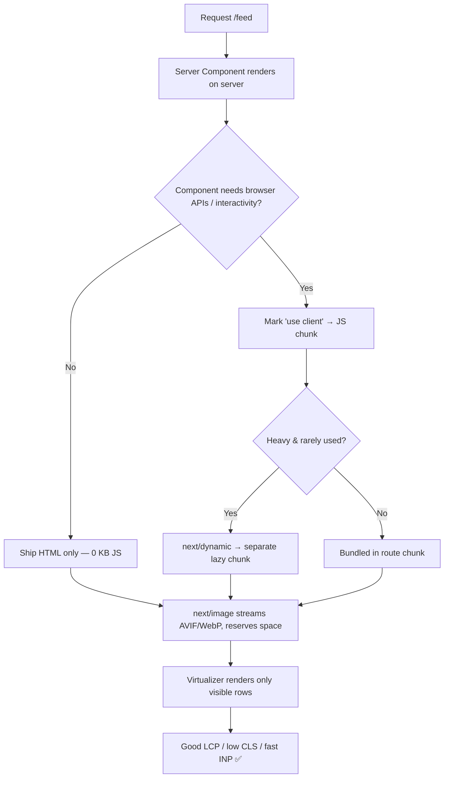

# Chapter 28 — Performance & Optimization

> A fast app feels like magic; a slow one feels broken — even when every feature works perfectly.

By now your Viby app *does* a lot: profiles, hobby feeds, realtime chat, image uploads. This chapter is where you make it *feel* premium. Performance isn't a final polish step — it's a product feature your users feel in their thumbs.

## What you'll learn

- What **Core Web Vitals** (LCP, INP, CLS) actually measure and why Google ranks you on them
- Shipping **optimized images** with `next/image` and Supabase Storage
- **Code-splitting & lazy loading** heavy client components with `next/dynamic`
- **Memoization** and how to stop React from re-rendering the whole feed
- **Analyzing your bundle** to find the 200KB library you forgot about
- **Virtualizing** Viby's infinite hobby feed so 5,000 cards don't crater the page
- Keeping **Framer Motion** animations buttery at 60fps

## Prerequisites

- Chapter 11 (Server vs. Client Components) — we lean hard on the Server Component default
- Chapter 17 (Supabase Storage & uploads) — we optimize the avatars you stored there
- Chapter 22 (Framer Motion) — we revisit those animations through a performance lens
- Chapter 25 (the infinite feed) — the list we're about to virtualize

---

## Theory

### Why "fast" is not one thing

Performance is really three separate questions a user asks subconsciously:

1. **Did it show up?** (loading)
2. **Did it respond when I tapped?** (interactivity)
3. **Did it stop jumping around?** (visual stability)

Google formalized these as **Core Web Vitals**:

- **LCP — Largest Contentful Paint**: when the biggest thing in the viewport (usually a hero image or heading) finishes rendering. Target: **under 2.5s**. *Analogy: how long until the restaurant actually puts food on your table.*
- **INP — Interaction to Next Paint**: how quickly the UI visibly reacts to taps/clicks across the whole session. Target: **under 200ms**. (INP replaced the old FID metric in 2024.) *Analogy: how fast the waiter looks up when you wave.*
- **CLS — Cumulative Layout Shift**: how much content jumps around as things load. Target: **under 0.1**. *Analogy: the table not wobbling every time a dish arrives.*

These aren't vanity numbers. They affect SEO ranking, and they correlate directly with bounce rate. A Gen-Z user on a mid-range Android over spotty 4G is unforgiving.

### Where time actually goes

The two biggest performance sins in a React app are almost always:

- **Shipping too much JavaScript** — every KB must be downloaded, parsed, and executed on a phone CPU far slower than your MacBook.
- **Re-rendering too often** — React re-running components that didn't need to change.

The good news: Next.js 16's App Router defaults fight both for you. **Server Components ship zero JS to the browser.** A component is server-rendered unless you opt out with `"use client"`. So the cheapest optimization is simply *not* reaching for `"use client"` out of habit.

### The mental model for re-renders

React re-renders a component when its state changes, its props change, or its parent re-renders. That last one surprises people: a parent re-rendering re-renders *all* its children by default, even children whose props are identical. Memoization (`React.memo`, `useMemo`, `useCallback`) is how you tell React "skip this — nothing it depends on changed."

But memoization isn't free, and premature memoization is clutter. **Measure first.** React 19's compiler (when enabled) auto-memoizes a lot of this, but understanding the manual tools makes you a better engineer.

---

## In practice

### 1. Images: the single biggest LCP win

Viby is image-heavy — avatars, hobby cover photos, profile galleries. Unoptimized images are the #1 cause of bad LCP. Always use `next/image`: it serves modern formats (AVIF/WebP), generates responsive `srcset`s, lazy-loads off-screen images, and *reserves space* so nothing shifts (helping CLS).

First, allow your Supabase Storage domain in `next.config.ts`:

```ts
// next.config.ts
import type { NextConfig } from "next";

const nextConfig: NextConfig = {
  images: {
    remotePatterns: [
      {
        protocol: "https",
        hostname: "YOUR_PROJECT.supabase.co",
        pathname: "/storage/v1/object/public/**",
      },
    ],
  },
};

export default nextConfig;
```

Now a hobby card. Note `priority` on above-the-fold images (skips lazy-loading so LCP fires sooner), explicit `sizes` so the browser downloads the right resolution, and `fill` with a sized parent to prevent layout shift:

```tsx
// components/feed/HobbyCard.tsx  (Server Component — no "use client")
import Image from "next/image";

type Hobby = { id: string; title: string; coverUrl: string };

export function HobbyCard({ hobby, priority = false }: { hobby: Hobby; priority?: boolean }) {
  return (
    <article className="overflow-hidden rounded-2xl bg-white shadow-sm">
      <div className="relative aspect-[4/3] w-full">
        <Image
          src={hobby.coverUrl}
          alt={hobby.title}
          fill
          priority={priority}
          sizes="(max-width: 640px) 100vw, (max-width: 1024px) 50vw, 33vw"
          className="object-cover"
        />
      </div>
      <h3 className="p-4 font-semibold text-zinc-900">{hobby.title}</h3>
    </article>
  );
}
```

Mark only the *first* few cards `priority`; lazy-load the rest (the default).

### 2. Code-splitting heavy client components

Viby's emoji picker for chat is ~150KB and most users never open it. Don't make everyone pay for it on first load. Split it with `next/dynamic`, and skip SSR for browser-only widgets:

```tsx
// components/chat/MessageComposer.tsx
"use client";

import { useState } from "react";
import dynamic from "next/dynamic";

// Loaded only when needed; never server-rendered.
const EmojiPicker = dynamic(() => import("./EmojiPicker"), {
  ssr: false,
  loading: () => <div className="h-72 w-72 animate-pulse rounded-xl bg-pink-50" />,
});

export function MessageComposer() {
  const [showEmoji, setShowEmoji] = useState(false);

  return (
    <div className="relative">
      <button
        onClick={() => setShowEmoji((v) => !v)}
        className="rounded-full px-3 py-2 text-[#FF6FB5]"
        aria-label="Add emoji"
      >
        😊
      </button>
      {showEmoji && <EmojiPicker />}
    </div>
  );
}
```

The emoji bundle is now a separate chunk fetched on first click — not in your initial page load.

### 3. Memoization: stop the feed from re-rendering

Suppose Viby's feed has a like counter in a parent. Every time the count changes, the parent re-renders — and so does every `HobbyCard`, even though their data didn't change. Wrap the card in `React.memo`, and stabilize the callback with `useCallback`:

```tsx
// components/feed/LikeableCard.tsx
"use client";

import { memo, useCallback, useState } from "react";

type Props = { id: string; title: string; onLike: (id: string) => void };

// Re-renders only when its own props change by reference.
export const LikeableCard = memo(function LikeableCard({ id, title, onLike }: Props) {
  console.log("render", id); // watch this stop firing for unchanged cards
  return (
    <button onClick={() => onLike(id)} className="rounded-2xl bg-white p-4 shadow-sm">
      {title} 💖
    </button>
  );
});

export function Feed({ hobbies }: { hobbies: { id: string; title: string }[] }) {
  const [likes, setLikes] = useState(0);

  // Stable reference across renders → memo'd children don't re-render.
  const handleLike = useCallback((id: string) => {
    setLikes((n) => n + 1);
    console.log("liked", id);
  }, []);

  return (
    <>
      <p className="mb-3 text-sm text-zinc-500">{likes} likes</p>
      {hobbies.map((h) => (
        <LikeableCard key={h.id} id={h.id} title={h.title} onLike={handleLike} />
      ))}
    </>
  );
}
```

Without `useCallback`, `handleLike` would be a *new* function every render, breaking `memo`. Use `useMemo` similarly for expensive computed values (e.g., filtering/sorting a big hobby list) — not for cheap ones.

### 4. List virtualization for the infinite feed

When Viby's feed grows to thousands of cards, the browser chokes on DOM nodes — even memoized ones, because they all exist. **Virtualization** renders only the rows currently in (and near) the viewport. We'll use `@tanstack/react-virtual`:

```bash
npm install @tanstack/react-virtual
```

```tsx
// components/feed/VirtualFeed.tsx
"use client";

import { useRef } from "react";
import { useVirtualizer } from "@tanstack/react-virtual";
import { HobbyCard } from "./HobbyCard";

type Hobby = { id: string; title: string; coverUrl: string };

export function VirtualFeed({ hobbies }: { hobbies: Hobby[] }) {
  const parentRef = useRef<HTMLDivElement>(null);

  const virtualizer = useVirtualizer({
    count: hobbies.length,
    getScrollElement: () => parentRef.current,
    estimateSize: () => 320, // estimated card height in px
    overscan: 5, // render a few extra above/below for smooth scroll
  });

  return (
    <div ref={parentRef} className="h-[100dvh] overflow-auto">
      <div style={{ height: virtualizer.getTotalSize(), position: "relative" }}>
        {virtualizer.getVirtualItems().map((item) => (
          <div
            key={hobbies[item.index].id}
            style={{
              position: "absolute",
              top: 0,
              left: 0,
              width: "100%",
              transform: `translateY(${item.start}px)`,
            }}
          >
            <HobbyCard hobby={hobbies[item.index]} priority={item.index < 3} />
          </div>
        ))}
      </div>
    </div>
  );
}
```

5,000 hobbies, ~12 DOM cards at a time. The scrollbar still feels full because the spacer div has the *total* height.

### 5. Analyzing your bundle

You can't optimize what you can't see. Add the analyzer:

```bash
npm install --save-dev @next/bundle-analyzer
```

```ts
// next.config.ts
import type { NextConfig } from "next";
import withBundleAnalyzer from "@next/bundle-analyzer";

const nextConfig: NextConfig = {
  images: { /* ...as above... */ },
};

const analyzer = withBundleAnalyzer({ enabled: process.env.ANALYZE === "true" });
export default analyzer(nextConfig);
```

```bash
# package.json script: "analyze": "ANALYZE=true next build"
ANALYZE=true npm run build
```

A treemap opens in your browser. Look for surprises — a date library, an icon set imported whole, a `"use client"` component that dragged a server-only dependency into the client. Fix by importing narrowly (`import { format } from "date-fns/format"`) or moving logic server-side.

### 6. Animation performance

Framer Motion is fast *if* you animate the right properties. Animating `transform` (`x`, `y`, `scale`, `rotate`) and `opacity` is GPU-accelerated and never triggers layout. Animating `width`, `height`, `top`, or `margin` forces layout recalculation on every frame and causes jank.

```tsx
// components/feed/CardReveal.tsx
"use client";

import { motion } from "framer-motion";

export function CardReveal({ children }: { children: React.ReactNode }) {
  return (
    <motion.div
      initial={{ opacity: 0, y: 16 }}   // ✅ transform + opacity = 60fps
      animate={{ opacity: 1, y: 0 }}
      transition={{ duration: 0.3, ease: "easeOut" }}
      // Respect users who get motion sick:
      style={{ willChange: "transform, opacity" }}
    >
      {children}
    </motion.div>
  );
}
```

Avoid animating `height: 0 → auto`; animate `scaleY` or use a fixed/measured height instead. And honor `prefers-reduced-motion` — Framer Motion's `MotionConfig` with `reducedMotion="user"` does this app-wide.

---

## Architecture / diagram

How a request becomes a fast, stable paint:



The throughline: **default to the server, opt into the client deliberately, and only ship what the user can actually see.**

---

## Best practices & pitfalls

- **Do** keep components as Server Components until you genuinely need state, effects, or browser APIs. `"use client"` is a cost, not a default.
- **Do** set `priority` on the one or two largest above-the-fold images — and *only* those.
- **Do** always provide `sizes` with `fill` images, or you'll download desktop-sized images to phones.
- **Don't** memoize everything reflexively. `memo` on a component whose props change every render just adds an extra comparison.
- **Don't** put `useCallback`/`useMemo` around trivial values — the bookkeeping can cost more than the work.
- **Don't** animate layout-affecting properties (`width`, `top`, `margin`). Use `transform`.
- **Do** virtualize any list that can exceed a few hundred items. Pagination + virtualization compound nicely.
- **Don't** import whole libraries (`import _ from "lodash"`). Import the function (`import debounce from "lodash/debounce"`).
- **Do** measure with the Network tab throttled to "Slow 4G" and CPU 4x slowdown — that's your real user.
- **Pitfall:** `ssr: false` in `next/dynamic` only works inside Client Components. Calling it from a Server Component throws.

---

## Exercises

1. **Audit one route.** Run `ANALYZE=true npm run build` on the `/feed` route. Screenshot the treemap and name the three largest chunks. Replace one whole-library import with a narrow one and re-measure the delta.
2. **Kill a layout shift.** Find an image in Viby rendered with a plain `` and no dimensions. Convert it to `next/image` with `fill` + aspect-ratio parent. Confirm CLS drops in Lighthouse.
3. **Lazy-load a modal.** Pick a rarely-used component (settings panel, report dialog) and convert it to `next/dynamic` with `ssr: false` and a skeleton `loading` state.
4. **Catch a rogue re-render.** Add a `console.log` to a feed card. Trigger a parent state change and watch every card log. Fix it with `memo` + `useCallback` so only relevant cards re-render.
5. **Virtualize & profile.** Render 2,000 mock hobbies without virtualization, record the React Profiler commit time, then add `VirtualFeed` and compare.

---

## Mini-project: The Buttery Feed

Build a production-grade `/discover` page that ties the whole chapter together.

**Requirements:**

1. A **Server Component** page that fetches the first page of hobbies from Supabase (`createServerClient` with `getAll`/`setAll` cookie handlers from Chapter 14).
2. Cards rendered with **`next/image`**, correct `sizes`, and `priority` on the first three.
3. The list passed into a **`VirtualFeed`** client component using `@tanstack/react-virtual`.
4. Each card wrapped in a **`memo`'d** `CardReveal` using Framer Motion (`opacity` + `y` only).
5. A lazy-loaded **filter sheet** (`next/dynamic`, `ssr: false`) that opens on tap.
6. Wrap the app in `<MotionConfig reducedMotion="user">` to respect accessibility.

**Definition of done:** Lighthouse mobile run scores **LCP < 2.5s, CLS < 0.1, INP < 200ms** on a throttled profile, and the bundle analyzer shows the filter sheet in its *own* chunk — not the initial load.

Starter for the page shell:

```tsx
// app/discover/page.tsx  (Server Component)
import { createServerClient } from "@supabase/ssr";
import { cookies } from "next/headers";
import { VirtualFeed } from "@/components/feed/VirtualFeed";

export default async function DiscoverPage() {
  const cookieStore = await cookies();
  const supabase = createServerClient(
    process.env.NEXT_PUBLIC_SUPABASE_URL!,
    process.env.NEXT_PUBLIC_SUPABASE_ANON_KEY!,
    {
      cookies: {
        getAll: () => cookieStore.getAll(),
        setAll: (toSet) => toSet.forEach(({ name, value, options }) =>
          cookieStore.set(name, value, options)),
      },
    },
  );

  const { data: hobbies } = await supabase
    .from("hobbies")
    .select("id, title, coverUrl:cover_url")
    .limit(200);

  return (
    <main className="mx-auto max-w-3xl">
      <h1 className="px-4 py-6 text-2xl font-bold text-[#FF6FB5]">Discover your people</h1>
      <VirtualFeed hobbies={hobbies ?? []} />
    </main>
  );
}
```

---

## Key takeaways

- **Core Web Vitals** — LCP (loading), INP (interactivity), CLS (stability) — are the metrics that define "fast" and affect your ranking.
- **Server Components ship zero JS.** The cheapest optimization is not opting into `"use client"`.
- **`next/image`** with `priority`, `sizes`, and reserved space is your biggest single LCP + CLS win.
- **`next/dynamic`** keeps rarely-used heavy code out of the initial bundle.
- **`memo` + `useCallback`/`useMemo`** stop needless re-renders — but measure before reaching for them.
- **Virtualize** long lists; **analyze** your bundle; **animate only `transform` and `opacity`.**

**Up next — Chapter 29: Testing & Quality Assurance**, where we make sure all this speed never ships a regression: unit tests, component tests, and end-to-end flows for Viby.
