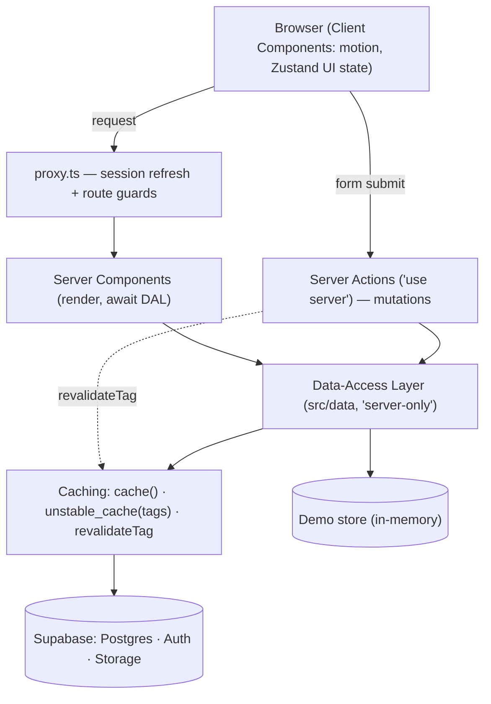

# Chapter 29 — Caching, Server Components & Scalable Architecture

> The difference between an app that feels instant and one that feels broken is almost never the database — it's *where* you decided to do the work.

By now Viby works. People sign up, build hobby profiles, discover their people, and chat in realtime. But "works on my laptop with three users" and "works on Vercel with three thousand" are different sports. This chapter is where you stop being someone who *makes features* and start being someone who *makes systems*.

## What you'll learn

- The four caching layers in Next.js 16 and how `revalidate`, tags, and `dynamic` actually behave
- Streaming UI with `<Suspense>` so slow data never blocks a fast page
- A decision framework for **where logic lives**: client, Server Component, Server Action, or data layer
- A scalable **feature-first folder architecture** that survives 50+ screens
- A clean **data-access layer (DAL)** that centralizes every query and auth check
- How the **demo (Zustand) vs. connected (Supabase)** seam holds up as the app grows

## Prerequisites

- Chapter 7 (Server vs. Client Components) and Chapter 11 (Server Actions & forms)
- Chapter 18 (Supabase Auth with `@supabase/ssr`) and Chapter 21 (Realtime chat)
- Chapter 24 (the demo/connected pattern with Zustand) — we extend that seam here

---

## Theory

### Caching is just "remembering so you don't redo work"

Imagine a barista who memorizes your regular order. The first time, they ask everything. After that, you say "the usual" and coffee appears. Caching is that — but you have to decide *how long* "the usual" stays valid before they re-ask. Too short and you're slow; too long and you serve a stale order.

Next.js 16 gives you **four places** to remember things:

1. **Request Memoization** — within a *single* render pass, identical `fetch()` calls (or React `cache()`-wrapped functions) run once. Free, automatic, lasts one request. This is why you can call your "get current user" helper in five components without five queries.
2. **Data Cache** — persists fetched data *across* requests and deployments until you invalidate it. This is the big one for performance.
3. **Full Route Cache** — caches the rendered HTML/RSC payload of static routes at build time.
4. **Router Cache** — a client-side, in-memory cache of visited routes for snappy back/forward navigation.

The mental shift in the App Router: **rendering is dynamic by default unless you opt into caching.** In Next.js 16, `fetch` is **not** cached unless you say so, and reading dynamic inputs (cookies, headers, `searchParams`) makes a route dynamic. You choose static behavior deliberately.

### Static, dynamic, and revalidation

Three knobs control a route segment:

- **Static** — rendered once, reused. Perfect for a marketing page or a public hobby directory.
- **Dynamic** — rendered per request. Required when output depends on the logged-in user.
- **Revalidate (ISR)** — static, but refreshed on a timer or on demand. "Cache this, but re-bake it every 60 seconds" or "re-bake it the moment someone edits their profile."

On-demand revalidation uses **tags**. You tag cached data, then call `revalidateTag('hobbies')` from a Server Action after a mutation. The barista forgets only *that* order, not the whole menu.

### Streaming and Suspense: don't let the slow guest hold the door

Picture a dinner party. Some dishes are ready instantly; the soufflé takes ten minutes. You don't make every guest stand outside until the soufflé is done — you seat them, serve bread, and bring the soufflé when it's ready.

`<Suspense>` is that. You send the fast shell (header, nav, profile card) immediately, show a skeleton where the slow part will go, and **stream** the slow component in when its data resolves. The user sees a meaningful page in ~100ms instead of staring at a white screen for a slow query.

### Where does logic go?

This is the question that separates juniors from seniors. The rule of thumb:

| Concern | Lives in |
| --- | --- |
| Reading data for first paint | Server Component (calls the DAL) |
| Mutations (create/update/delete) | Server Action (`"use server"`) |
| Interactivity, animation, local UI state | Client Component (`"use client"`) |
| Database queries + auth checks | **Data-access layer** (one place) |
| Cross-cutting routing rules (auth redirects) | `proxy.ts` |

Push data fetching **down** to the leaf that needs it (so Suspense can isolate it) and push secrets/queries **into** the DAL (so nothing leaks to the client and auth is never forgotten).

---

## In practice

### The data-access layer (one front door for your data)

Everything that touches Supabase goes through `src/data/`. No component imports the Supabase client directly. This is your security boundary and your caching boundary.

```ts
// src/data/supabase/server.ts
import { createServerClient } from "@supabase/ssr";
import { cookies } from "next/headers";

export async function createClient() {
  const cookieStore = await cookies();

  return createServerClient(
    process.env.NEXT_PUBLIC_SUPABASE_URL!,
    process.env.NEXT_PUBLIC_SUPABASE_ANON_KEY!,
    {
      cookies: {
        getAll() {
          return cookieStore.getAll();
        },
        setAll(cookiesToSet) {
          try {
            cookiesToSet.forEach(({ name, value, options }) =>
              cookieStore.set(name, value, options),
            );
          } catch {
            // Called from a Server Component render — safe to ignore;
            // proxy.ts refreshes the session cookie instead.
          }
        },
      },
    },
  );
}
```

```ts
// src/data/profiles.ts
import "server-only";
import { cache } from "react";
import { createClient } from "@/data/supabase/server";

// React cache(): dedupes within a single request (Request Memoization).
export const getCurrentUser = cache(async () => {
  const supabase = await createClient();
  const {
    data: { user },
  } = await supabase.auth.getUser();
  return user;
});

export async function getProfileByHandle(handle: string) {
  const supabase = await createClient();
  const { data, error } = await supabase
    .from("profiles")
    .select("id, handle, display_name, bio, avatar_url, hobbies(name, emoji)")
    .eq("handle", handle)
    .single();

  if (error) throw new Error("Profile not found");
  return data;
}
```

The `import "server-only"` line is a tripwire: if anyone ever imports this into a Client Component, the build fails loudly instead of shipping your service logic to the browser.

### Discover feed: static directory, fresh on demand

Viby's public Discover page lists hobby communities. It rarely changes, so cache it — but refresh instantly when an admin adds a hobby.

```ts
// src/data/hobbies.ts
import "server-only";
import { unstable_cache } from "next/cache";
import { createClient } from "@/data/supabase/server";

export const getHobbyCommunities = unstable_cache(
  async () => {
    const supabase = await createClient();
    const { data } = await supabase
      .from("hobbies")
      .select("id, name, emoji, member_count")
      .order("member_count", { ascending: false });
    return data ?? [];
  },
  ["hobby-communities"], // cache key parts
  { tags: ["hobbies"], revalidate: 3600 }, // refresh hourly OR on demand
);
```

```tsx
// src/app/discover/page.tsx  (Server Component — no "use client")
import { getHobbyCommunities } from "@/data/hobbies";
import { HobbyCard } from "@/features/discover/components/hobby-card";

export default async function DiscoverPage() {
  const communities = await getHobbyCommunities();

  return (
    <main className="mx-auto max-w-2xl px-4 py-8">
      <h1 className="text-2xl font-bold text-brand">Find your people</h1>
      <div className="mt-6 grid grid-cols-2 gap-3">
        {communities.map((c) => (
          <HobbyCard key={c.id} community={c} />
        ))}
      </div>
    </main>
  );
}
```

When an admin creates a hobby, the Server Action busts only the hobby cache:

```ts
// src/features/discover/actions.ts
"use server";

import { revalidateTag } from "next/cache";
import { createHobby } from "@/data/hobbies";
import { getCurrentUser } from "@/data/profiles";

export async function addHobbyAction(formData: FormData) {
  const user = await getCurrentUser();
  if (!user) throw new Error("Unauthorized");

  await createHobby({
    name: String(formData.get("name")),
    emoji: String(formData.get("emoji")),
  });

  revalidateTag("hobbies"); // every reader of "hobbies" re-bakes
}
```

### Streaming a slow profile section

A profile page should paint instantly. The "people you might vibe with" matcher is slow (it scores shared hobbies), so we stream it.

```tsx
// src/app/u/[handle]/page.tsx
import { Suspense } from "react";
import { getProfileByHandle } from "@/data/profiles";
import { ProfileHeader } from "@/features/profile/components/profile-header";
import { VibeMatches } from "@/features/profile/components/vibe-matches";
import { MatchesSkeleton } from "@/features/profile/components/matches-skeleton";

// Next.js 16: params is async — await it.
export default async function ProfilePage({
  params,
}: {
  params: Promise<{ handle: string }>;
}) {
  const { handle } = await params;
  const profile = await getProfileByHandle(handle); // fast, blocks paint

  return (
    <main className="mx-auto max-w-2xl px-4 py-8">
      <ProfileHeader profile={profile} />

      {/* Fast shell renders now; matches stream in when ready */}
      <Suspense fallback={<MatchesSkeleton />}>
        <VibeMatches profileId={profile.id} />
      </Suspense>
    </main>
  );
}
```

```tsx
// src/features/profile/components/vibe-matches.tsx  (async Server Component)
import { getVibeMatches } from "@/data/matches";
import { MatchRow } from "./match-row";

export async function VibeMatches({ profileId }: { profileId: string }) {
  const matches = await getVibeMatches(profileId); // the slow query

  return (
    <section className="mt-8">
      <h2 className="text-lg font-semibold">People you might vibe with</h2>
      <ul className="mt-3 space-y-2">
        {matches.map((m) => (
          <MatchRow key={m.id} match={m} />
        ))}
      </ul>
    </section>
  );
}
```

The skeleton is a Client Component only if it animates; otherwise keep it on the server:

```tsx
// src/features/profile/components/matches-skeleton.tsx
"use client";
import { motion } from "framer-motion";

export function MatchesSkeleton() {
  return (
    <div className="mt-8 space-y-2">
      {[0, 1, 2].map((i) => (
        <motion.div
          key={i}
          className="h-14 rounded-xl bg-pink-100"
          animate={{ opacity: [0.5, 1, 0.5] }}
          transition={{ duration: 1.2, repeat: Infinity, delay: i * 0.15 }}
        />
      ))}
    </div>
  );
}
```

### Cross-cutting auth in `proxy.ts`

Middleware-style logic lives in `proxy.ts` (not `middleware.ts`). It refreshes the Supabase session cookie and guards private routes.

```ts
// proxy.ts
import { type NextRequest, NextResponse } from "next/server";
import { createServerClient } from "@supabase/ssr";

export async function proxy(request: NextRequest) {
  let response = NextResponse.next({ request });

  const supabase = createServerClient(
    process.env.NEXT_PUBLIC_SUPABASE_URL!,
    process.env.NEXT_PUBLIC_SUPABASE_ANON_KEY!,
    {
      cookies: {
        getAll() {
          return request.cookies.getAll();
        },
        setAll(cookiesToSet) {
          cookiesToSet.forEach(({ name, value, options }) =>
            response.cookies.set(name, value, options),
          );
        },
      },
    },
  );

  const {
    data: { user },
  } = await supabase.auth.getUser();

  const isPrivate = request.nextUrl.pathname.startsWith("/app");
  if (!user && isPrivate) {
    return NextResponse.redirect(new URL("/login", request.url));
  }

  return response;
}

export const config = {
  matcher: ["/((?!_next/static|_next/image|favicon.ico).*)"],
};
```

### The demo/connected seam at scale

From Chapter 24, Viby runs in **demo mode** (Zustand, in-memory) or **connected mode** (Supabase). At scale you don't `if (demo)` inside components — you choose the implementation at the DAL boundary:

```ts
// src/data/matches.ts
import "server-only";
import { isDemo } from "@/lib/runtime";
import { demoMatches } from "@/data/demo/matches";
import { fetchVibeMatches } from "@/data/supabase/matches";

export async function getVibeMatches(profileId: string) {
  return isDemo() ? demoMatches(profileId) : fetchVibeMatches(profileId);
}
```

Components stay identical in both modes; only the data source swaps. One seam, enforced in one folder.

---

## Architecture / diagram



**Feature-first folder layout** — group by domain, not by file type, so a feature is self-contained and deletable:

```text
src/
  app/                      # routes only (thin: compose features)
    discover/page.tsx
    u/[handle]/page.tsx
  features/                 # one folder per domain
    discover/
      components/
      actions.ts
      schema.ts
    profile/
      components/
      actions.ts
    chat/
  data/                     # the ONLY place that talks to data
    supabase/               # client factories + raw queries
    demo/                   # in-memory equivalents
    profiles.ts hobbies.ts matches.ts
  components/ui/            # shadcn-style primitives (Button, Card)
  lib/                      # pure helpers (runtime flags, formatters)
  stores/                   # Zustand stores (client UI state)
```

---

## Best practices & pitfalls

- **Do** keep all queries + auth checks in `src/data/`. **Don't** call `createClient()` inside page components.
- **Do** add `import "server-only"` to every DAL module. It turns an accidental client leak into a build error.
- **Do** wrap per-request reads (like `getCurrentUser`) in React `cache()`. **Don't** assume `fetch` is cached — in Next.js 16 it isn't unless configured.
- **Do** use **tags + `revalidateTag`** for surgical invalidation after mutations. **Don't** reach for `revalidatePath("/")` as a sledgehammer — it nukes far more than you mean to.
- **Do** stream slow, independent sections with `<Suspense>`. **Don't** wrap your *whole* page in one Suspense boundary — you lose the fast shell.
- **Don't** cache anything user-specific with a shared key. Either scope the cache key to the user or keep the route dynamic.
- **Do** `await params` and `await cookies()` — they're async in Next.js 16. **Don't** add `"use client"` just to silence an error; understand which boundary you actually need.
- **Don't** scatter `if (demo)` through the UI. Resolve it once at the DAL.

---

## Exercises

1. **Tag a cache.** Convert Viby's events list to `unstable_cache` with the tag `"events"`, then add a `createEventAction` that calls `revalidateTag("events")`. Confirm the list updates without a full reload.
2. **Stream a second section.** Add a `<Suspense>`-wrapped "Recent activity" feed to the profile page with its own skeleton. Verify the header paints before the feed.
3. **Find the leak.** Import a `src/data/` module into a Client Component and watch the build fail. Explain in a comment *why* `server-only` caught it.
4. **Scope a cache key.** Cache a user's saved-hobbies list correctly so two different users never see each other's data. (Hint: include the user id in the key array.)
5. **Refactor a seam.** Take one component still doing `if (isDemo())` inline and move that branch into its DAL function.

## Mini-project — "Trending Communities" with on-demand revalidation

Build a `/discover/trending` page that ranks hobby communities by weekly join count.

1. In `src/data/hobbies.ts`, add `getTrendingCommunities()` wrapped in `unstable_cache` with key `["trending"]`, tag `"hobbies"`, and `revalidate: 600`.
2. Build `src/app/discover/trending/page.tsx` as a Server Component that maps results into animated `HobbyCard`s.
3. Wrap the list in `<Suspense>` with a `TrendingSkeleton` (Framer Motion pulse).
4. Add a "Join community" Server Action that inserts a membership row **and** calls `revalidateTag("hobbies")`, so trending re-ranks within the same session.
5. Wire it for both modes: a `demoTrending()` branch and a Supabase branch, selected in the DAL — zero `if (demo)` in the page.

Ship it to Vercel and watch the page serve from cache, then re-bake the instant you tap "Join."

## Key takeaways

- Next.js 16 renders **dynamically by default**; caching is an intentional opt-in across four layers (request, data, route, router).
- Use **tags + `revalidateTag`** for precise, on-demand cache busting after mutations.
- **Stream** slow, independent sections with `<Suspense>` so the fast shell never waits.
- Logic has a home: reads in **Server Components**, mutations in **Server Actions**, queries + auth in the **DAL**, routing rules in **proxy.ts**.
- A **feature-first** structure plus a single data-access boundary keeps Viby scalable — and keeps the demo/connected seam to exactly one place.

**Up next — Chapter 30: Observability & Performance — measuring Core Web Vitals, tracing slow queries, and proving Viby is fast under real load.**
