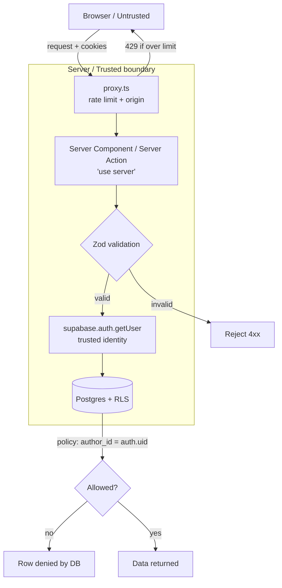

# Chapter 30 — Security, RLS & Rate Limiting

> The moment Viby has one real user, it has one real attacker — and the only code you can trust runs on a machine you control.

## What you'll learn

- Why **the client is never a security boundary**, and where the real boundary lives
- How **Row-Level Security (RLS)** turns Postgres itself into your authorization layer
- Validating input with **Zod** in Server Actions, and trusting *nothing* from the request
- Handling **secrets** correctly (and the difference between `NEXT_PUBLIC_` and server-only env)
- The mechanics of **XSS** and **CSRF**, and why the App Router defends you by default
- Adding **rate limiting** to protect signups, messages, and uploads

## Prerequisites

- Supabase Auth and `@supabase/ssr` clients (Chapter 12)
- Server Actions and the `"use server"` directive (Chapter 15)
- `proxy.ts` for edge/middleware-style logic (Chapter 18)
- The Viby `profiles`, `posts`, and `messages` tables (Chapters 10–14)

---

## Theory

### The client is enemy territory

Here's the mental model that prevents 90% of security bugs: **everything that runs in the browser can be edited, replayed, and lied to.** The JavaScript you ship, the `disabled` attribute on a button, the `if (user.isAdmin)` check in a React component — all of it is *suggestion*, not enforcement. A determined user opens DevTools, edits your Zustand store, replays your `fetch` with a different `user_id`, and your "hidden" admin action fires.

Think of it like a nightclub. The styling on the door — the velvet rope, the sign saying "members only" — is the client. It sets expectations. But the **bouncer** is the server, and the **guest list** is the database. If the bouncer waves anyone through because the rope *looked* closed, the rope was decoration. Security lives at the door you control, every single time, for every single request.

So the rule: **validate and authorize on the server, ideally as close to the data as possible.** The closer the check sits to the data, the harder it is to bypass.

### RLS: authorization that lives *in* the data

Most apps put authorization in application code: "before returning posts, filter by the logged-in user." That works until you have three API routes, two Server Actions, and a cron job — and one of them forgets the filter. Now any user can read anyone's private messages.

**Row-Level Security** moves the rule into Postgres. You write a *policy* — a SQL predicate — that the database evaluates on **every** query touching that table, no matter which client, route, or action issued it. Forget to filter in your code? The database filters for you. It's the difference between asking every employee to remember the safe combination versus installing a lock that physically can't open for the wrong key.

With Supabase, the magic is that the user's JWT flows into Postgres, and `auth.uid()` returns the authenticated user's id *inside the policy*. The policy becomes: "you may only see rows where `user_id = auth.uid()`." Even if your Server Action has a bug, the database refuses.

> **Critical:** RLS only protects you when queries run with the **anon** or **authenticated** role (the keys exposed to users). The **service role** key *bypasses RLS entirely*. Treat it like the master key to the building — server-only, never in the browser, used sparingly.

### Validation, secrets, XSS, CSRF — the supporting cast

- **Input validation:** even authenticated users send garbage — a 50,000-character bio, a `role: "admin"` field you never asked for. Parse incoming data against a strict schema and reject everything else.
- **Secrets:** API keys belong in server-only environment variables. Anything prefixed `NEXT_PUBLIC_` is **baked into the browser bundle** — public forever.
- **XSS** (cross-site scripting): an attacker gets their script to run in *another user's* browser, usually by smuggling `<script>` into content you later render as raw HTML. React escapes by default; you only get burned via `dangerouslySetInnerHTML`.
- **CSRF** (cross-site request forgery): a malicious site silently submits a request *as* the logged-in victim, riding their cookies. The App Router's Server Actions are POST-only with Origin checks, which neutralizes the classic attack.
- **Rate limiting:** without it, one script can attempt 10,000 logins or flood your DMs in a minute. Limits cap the blast radius of abuse and runaway bots.

---

## In practice

### 1. Turn on RLS for every user-facing table

In the Supabase SQL editor, enable RLS and write explicit policies for the Viby `posts` table. **Enabling RLS with no policy denies all access** — that's the safe default.

```sql
-- Enable RLS (default-deny once on)
alter table public.posts enable row level security;

-- Anyone authenticated can read PUBLIC posts; you always see your own.
create policy "read public or own posts"
on public.posts for select
to authenticated
using (
  visibility = 'public' or author_id = (select auth.uid())
);

-- You may only INSERT a post authored by yourself.
create policy "insert own posts"
on public.posts for insert
to authenticated
with check ( author_id = (select auth.uid()) );

-- You may only UPDATE / DELETE your own posts.
create policy "modify own posts"
on public.posts for update
to authenticated
using ( author_id = (select auth.uid()) )
with check ( author_id = (select auth.uid()) );

create policy "delete own posts"
on public.posts for delete
to authenticated
using ( author_id = (select auth.uid()) );
```

Two things worth burning into memory:

- `using` filters which existing rows the operation can *see/touch*; `with check` validates the row's *new* values. Inserts need `with check`; deletes need `using`; updates need both.
- Wrapping `auth.uid()` in `(select auth.uid())` lets Postgres evaluate it once per query instead of per row — a real performance win on large tables.

### 2. Read data with the SSR client — RLS does the rest

Because RLS enforces ownership, your Server Component query stays refreshingly dumb. No manual `.eq('author_id', user.id)` needed for security — though you may still add filters for *correctness*.

```typescript
// app/feed/page.tsx — Server Component (no "use client")
import { createServerClient } from "@supabase/ssr";
import { cookies } from "next/headers";

async function getSupabase() {
  const cookieStore = await cookies(); // Next.js 16: async
  return createServerClient(
    process.env.NEXT_PUBLIC_SUPABASE_URL!,
    process.env.NEXT_PUBLIC_SUPABASE_ANON_KEY!, // anon key → RLS applies
    {
      cookies: {
        getAll: () => cookieStore.getAll(),
        setAll: (toSet) =>
          toSet.forEach(({ name, value, options }) =>
            cookieStore.set(name, value, options)
          ),
      },
    }
  );
}

export default async function FeedPage() {
  const supabase = await getSupabase();
  // RLS guarantees we only get public posts + our own private ones.
  const { data: posts } = await supabase
    .from("posts")
    .select("id, body, visibility, author_id")
    .order("created_at", { ascending: false });

  return (
    <ul className="space-y-3">
      {posts?.map((p) => (
        <li key={p.id} className="rounded-2xl bg-white p-4 shadow-sm">
          {p.body}
        </li>
      ))}
    </ul>
  );
}
```

### 3. Validate in a Server Action — never trust the payload

A Server Action runs on the server, but the *arguments still come from the client*. Parse them. Here we validate a new Viby post with Zod, then let RLS confirm ownership at write time.

```typescript
// app/feed/actions.ts
"use server";

import { z } from "zod";
import { revalidatePath } from "next/cache";
import { createServerClient } from "@supabase/ssr";
import { cookies } from "next/headers";

const PostInput = z.object({
  body: z.string().trim().min(1, "Say something!").max(500),
  visibility: z.enum(["public", "friends", "private"]),
});

export async function createPost(formData: FormData) {
  // 1. Validate shape + bounds. Reject anything extra/oversized.
  const parsed = PostInput.safeParse({
    body: formData.get("body"),
    visibility: formData.get("visibility"),
  });
  if (!parsed.success) {
    return { ok: false, error: parsed.error.issues[0].message };
  }

  const cookieStore = await cookies();
  const supabase = createServerClient(
    process.env.NEXT_PUBLIC_SUPABASE_URL!,
    process.env.NEXT_PUBLIC_SUPABASE_ANON_KEY!,
    {
      cookies: {
        getAll: () => cookieStore.getAll(),
        setAll: (toSet) =>
          toSet.forEach(({ name, value, options }) =>
            cookieStore.set(name, value, options)
          ),
      },
    }
  );

  // 2. Get the trusted server-side identity. NEVER take author_id from the form.
  const { data: { user } } = await supabase.auth.getUser();
  if (!user) return { ok: false, error: "Not signed in." };

  // 3. Insert. RLS's with-check will also reject a mismatched author_id.
  const { error } = await supabase.from("posts").insert({
    body: parsed.data.body,
    visibility: parsed.data.visibility,
    author_id: user.id, // derived from the session, not the request body
  });

  if (error) return { ok: false, error: "Could not post." };
  revalidatePath("/feed");
  return { ok: true };
}
```

> Use `supabase.auth.getUser()` for trust decisions, **not** `getSession()`. `getUser()` re-validates the token with the Auth server; `getSession()` reads the (potentially spoofable) cookie.

### 4. Secrets: public vs. server-only

```bash
# .env.local
# Safe to expose — shipped to the browser bundle:
NEXT_PUBLIC_SUPABASE_URL=https://xxxx.supabase.co
NEXT_PUBLIC_SUPABASE_ANON_KEY=eyJhbGci...   # anon key is meant to be public

# SERVER ONLY — bypasses RLS. Never NEXT_PUBLIC_, never imported in a client file:
SUPABASE_SERVICE_ROLE_KEY=eyJhbGci...
RESEND_API_KEY=re_...
```

A service-role client must only ever be constructed in server code (Server Actions, Route Handlers, `proxy.ts`):

```typescript
// lib/supabase-admin.ts — import ONLY from server code
import { createClient } from "@supabase/supabase-js";

export const supabaseAdmin = createClient(
  process.env.NEXT_PUBLIC_SUPABASE_URL!,
  process.env.SUPABASE_SERVICE_ROLE_KEY!, // bypasses RLS — handle with care
  { auth: { persistSession: false } }
);
```

### 5. XSS: render content as text, never as HTML

React already escapes `{post.body}`. The danger is opting out:

```tsx
// ❌ DANGER: if body contains "", it runs.
<div dangerouslySetInnerHTML={{ __html: post.body }} />

// ✅ Safe: React escapes this. A user typing "<script>" sees literal text.
<p>{post.body}</p>
```

If you genuinely must render user-authored rich text (e.g. a Markdown bio), **sanitize first** with a library like `isomorphic-dompurify`, allowlisting tags — never trust raw input.

### 6. Rate limiting in `proxy.ts`

We protect the auth routes with a sliding-window limiter (Upstash Redis here; any shared store works). Putting it in `proxy.ts` means it runs *before* the request ever reaches your action.

```typescript
// proxy.ts (project root) — runs before matched routes
import { NextResponse, type NextRequest } from "next/server";
import { Ratelimit } from "@upstash/ratelimit";
import { Redis } from "@upstash/redis";

const ratelimit = new Ratelimit({
  redis: Redis.fromEnv(), // UPSTASH_REDIS_REST_URL / _TOKEN (server-only)
  limiter: Ratelimit.slidingWindow(5, "60 s"), // 5 attempts / minute / IP
  prefix: "viby:auth",
});

export async function proxy(request: NextRequest) {
  const ip =
    request.headers.get("x-forwarded-for")?.split(",")[0]?.trim() ?? "anon";
  const { success, limit, remaining, reset } = await ratelimit.limit(ip);

  if (!success) {
    return NextResponse.json(
      { error: "Too many attempts. Slow down a sec." },
      {
        status: 429,
        headers: {
          "Retry-After": String(Math.ceil((reset - Date.now()) / 1000)),
          "X-RateLimit-Remaining": String(remaining),
        },
      }
    );
  }
  return NextResponse.next();
}

export const config = {
  matcher: ["/login", "/signup", "/api/auth/:path*"],
};
```

> IP-based limits are a first line of defense, not a fortress (IPs are shared and spoofable on some hops). For sensitive actions, *also* limit per authenticated `user.id`.

---

## Architecture / diagram



The takeaway the diagram encodes: **a request passes through three independent gates** — rate limit, validation, and RLS. Each is enforced server-side, so a bypass of one is still caught by the next.

---

## Best practices & pitfalls

**Do**

- Enable RLS on **every** table exposed to the anon/authenticated roles, before launch.
- Derive identity from `auth.getUser()` server-side; never accept `user_id` from the body.
- Validate every Server Action input with a strict schema (`.max()`, `.enum()`, no passthrough).
- Keep the service-role key server-only; construct admin clients in `lib/` files imported solely by server code.
- Rate-limit auth, messaging, and upload endpoints — by IP *and* by user id for sensitive ones.

**Don't**

- Don't rely on hidden/disabled UI, client-side role checks, or Zustand state for authorization.
- Don't use `getSession()` for trust decisions — it reads spoofable cookies.
- Don't `dangerouslySetInnerHTML` raw user content. Sanitize, or render as text.
- Don't enable RLS and forget the policies — you'll lock yourself out (default-deny). And don't write a `using (true)` policy "to fix it."
- Don't put any secret behind a `NEXT_PUBLIC_` prefix; it ships to the browser.

---

## Exercises

1. **Lock down profiles.** Add RLS policies to `profiles`: anyone authenticated can `select` any profile, but only the owner can `update` their own row. Verify by trying to update another user's row from the SQL editor with a different `auth.uid()`.
2. **Schema-harden a Server Action.** Take the Viby "edit bio" action and add a Zod schema capping the bio at 280 chars and stripping a sneaky injected `role` field. Confirm extra fields are ignored.
3. **Find the leak.** Given a Route Handler that builds its Supabase client with `SUPABASE_SERVICE_ROLE_KEY`, explain in two sentences why RLS no longer protects it, then refactor it to use the anon key + user session.
4. **Per-user limiting.** Extend the limiter so sending a DM is capped at 20 messages/minute *per authenticated user id*, not per IP. (Hint: build the limiter key from `user.id`.)
5. **(Stretch) Sanitize rich text.** Allow Markdown bios: render them, but pipe the HTML through `isomorphic-dompurify` with an allowlist of `b, i, em, strong, a, p, br`. Prove that `<script>` and `onerror=` are stripped.

---

## Mini-project — "Vibe Reports": a secure abuse-report flow

Build a feature letting users report a post. It must be safe end to end:

1. **Table + RLS.** Create `reports (id, post_id, reporter_id, reason, created_at)`. Policy: a user may `insert` only with `reporter_id = (select auth.uid())`, and may `select` only their *own* reports. No `update`/`delete` policies (reports are immutable to users).
2. **Server Action.** `submitReport(formData)` validates `reason` with Zod (`z.enum(["spam","harassment","other"])` plus an optional `note` capped at 300 chars), derives `reporter_id` from `getUser()`, and inserts.
3. **Rate limit.** In `proxy.ts`, cap report submissions to 10/hour per user id, returning a friendly 429.
4. **UI.** A `"use client"` modal (Framer Motion `AnimatePresence` for the fade/scale) with a reason dropdown. On success, animate a pink ✓ and a "Thanks, our team will review this" toast. Render the confirmation text with `{}` — never `dangerouslySetInnerHTML`.
5. **Admin view (optional).** A server-only page using `supabaseAdmin` (service role) that lists all reports — demonstrating the *one* legitimate place the master key belongs, and why that page must itself check for an admin role.

Ship it and try to break it: open DevTools, change the `reporter_id` in the network payload, and confirm RLS rejects the write.

---

## Key takeaways

- The client is never a security boundary — **enforce on the server, close to the data.**
- **RLS is your real authorization layer**: a default-deny lock the database evaluates on every query.
- Derive identity from `getUser()`; **never trust** `user_id`/`role` sent from the browser.
- Validate every input with a strict schema; the service-role key bypasses RLS and stays server-only.
- React escapes by default (beware `dangerouslySetInnerHTML`); Server Actions blunt CSRF; **rate limit** to cap abuse.

**Up next — Chapter 31: Realtime & Presence**, where we'll wire up Supabase Realtime so Viby feeds, typing indicators, and "who's online" update live — securely, with RLS still standing guard over every subscription.
