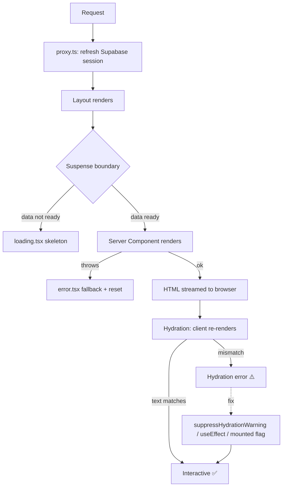

# Chapter 31 — Testing, Debugging & Error Handling

> Shipping a feature is the easy part. Shipping a feature that *stays* shipped — that survives refactors, weird inputs, and 2 a.m. production traffic — is what separates a hobbyist from a professional. This chapter is where Viby grows a spine.

## What you'll learn

- How to **debug the App Router** like a surgeon: where code actually runs (server vs. client), and how to read the right logs
- How **error boundaries** (`error.tsx`, `global-error.tsx`) and **loading boundaries** (`loading.tsx`, Suspense) catch failures and stalls gracefully
- What a **hydration mismatch** really is — and the exact bug Viby's `TimeAgo` component hit, plus how we fixed it
- A realistic **testing pyramid**: unit (Vitest), integration (Testing Library), and end-to-end (Playwright) — and which to use when
- **Structured logging** that survives the leap from `console.log` to production

## Prerequisites

- Chapter 6 (Next.js App Router fundamentals) and Chapter 8 (Server vs. Client Components) — non-negotiable here
- Chapter 16 (Auth, sessions, RLS) and Chapter 17 (Server Actions) — we'll test and harden them
- Chapter 24 (Activity Feed) — the `TimeAgo` and `PostCard` components live here
- Comfort running terminal commands and reading a stack trace

---

## Theory

### Where does my code even run?

The single biggest source of App Router confusion is forgetting that your code runs in **two different universes**. A Server Component executes once, on a machine in a data center, and streams HTML to the browser. A Client Component (`"use client"`) executes there *too* (for the initial HTML), and *then again* in the browser to become interactive.

Think of it like a **theater production**. The Server Component is the *script and the printed program* — written once, handed to the audience. The Client Component is the *live actor* — they perform from that same script, but they breathe, move, and react. Debugging means first asking: **am I looking at the script or the actor?** A `console.log` in a Server Component prints to your **terminal**. The same log in a Client Component prints to the **browser console**. Confuse the two and you'll stare at an empty console for an hour.

### Errors and the boundary metaphor

A React app is a tree. When a component throws during render, React unwinds the whole subtree above it — by default, all the way to a blank white screen. An **error boundary** is a circuit breaker: it stops the cascade at a known point and shows a fallback instead of taking down the building. The App Router gives you this declaratively. Drop an `error.tsx` into a route folder and Next wraps that segment in a boundary automatically. One bad post in the feed no longer nukes the whole tab bar.

**Loading boundaries** are the same idea for *time* instead of *failure*. When a Server Component awaits slow data, a `loading.tsx` (which is just a Suspense fallback) shows instantly while the real content streams in behind it. The mental model: error boundaries catch *what broke*, Suspense boundaries cover *what's not ready yet*.

### Hydration: the script must match the performance

Hydration is React attaching event listeners to server-rendered HTML. For it to work, **the HTML React produces on the client during the first render must byte-for-byte match what the server sent**. If they differ, React panics — it can't tell which version is "right" — and you get the dreaded *"Hydration failed because the server rendered HTML didn't match the client."*

The classic trigger is **anything non-deterministic**: `Date.now()`, `Math.random()`, `window`, locale-dependent formatting, or reading `localStorage` during render. The server renders at 10:00:00 and says "2m ago"; the client hydrates at 10:00:01 and computes "3m ago" — mismatch. We'll see Viby's real version of this below.

### The testing pyramid

You can't manually click every flow on every commit. Tests do it for you. The industry model is a **pyramid**: a wide base of fast **unit tests** (pure functions, one thing each), a thinner band of **integration tests** (a component plus its real children), and a few precious **end-to-end tests** (a real browser walking a full user journey). The ratio matters: e2e tests are slow and flaky, so you want *few but high-value* ones — the signup → onboarding → first connection path, not every button.

---

## In practice

We're on Next.js 16, React 19, Tailwind v4, Supabase via `@supabase/ssr`. All code below targets that stack.

### 1. The hydration bug Viby actually hit

Early on, the feed rendered relative timestamps with a naive component:

```tsx
// ❌ The buggy version — DO NOT ship this
export function TimeAgo({ iso }: { iso: string }) {
  return <span>{timeAgo(iso)}</span>; // timeAgo() calls Date.now() internally
}
```

`timeAgo` uses `Date.now()`. The server computed the label at request time; the browser recomputed it milliseconds (or minutes, behind a CDN cache) later. Result: a console full of hydration errors on every feed load. Here's the fix we actually shipped (`components/common/TimeAgo.tsx`):

```tsx
"use client";

import { useEffect, useState } from "react";
import { timeAgo } from "@/lib/utils";

/**
 * Relative timestamps depend on the current time, which differs between the
 * server render and client hydration — a guaranteed mismatch. We render the
 * initial value with suppressHydrationWarning and refresh it on the client.
 */
export function TimeAgo({ iso, className }: { iso: string; className?: string }) {
  const [label, setLabel] = useState(() => timeAgo(iso));

  useEffect(() => {
    setLabel(timeAgo(iso));
    const id = setInterval(() => setLabel(timeAgo(iso)), 60_000);
    return () => clearInterval(id);
  }, [iso]);

  return (
    <span className={className} suppressHydrationWarning>
      {label}
    </span>
  );
}
```

Two things make this correct:

1. **`suppressHydrationWarning`** tells React, for *this element only*, "I know the text may differ across server and client — don't warn." This is the *sanctioned* escape hatch, not a hack. Use it surgically on the element whose content is intentionally time-dependent.
2. The `useEffect` runs **only on the client**, after hydration, so it can freely call `Date.now()` and even tick every 60 seconds without ever causing a mismatch.

The general escape hatch for "client-only" values is the mounted flag:

```tsx
const [mounted, setMounted] = useState(false);
useEffect(() => setMounted(true), []);
if (!mounted) return null; // or a stable skeleton
```

Use `suppressHydrationWarning` when the *shape* matches but the *text* differs (timestamps); use the mounted flag when the element shouldn't render server-side at all (e.g. something reading `localStorage`).

### 2. Error boundaries per route segment

`error.tsx` must be a Client Component — it receives the error and a `reset()` function to retry the segment. Here's one for the feed (`app/(app)/feed/error.tsx`):

```tsx
"use client";

import { useEffect } from "react";
import { Button } from "@/components/ui/button";

export default function FeedError({
  error,
  reset,
}: {
  error: Error & { digest?: string };
  reset: () => void;
}) {
  useEffect(() => {
    // Send to your logger; `digest` correlates with the server-side stack.
    console.error("[feed] render error", error.digest, error.message);
  }, [error]);

  return (
    <div className="flex flex-col items-center gap-4 py-20 text-center">
      <p className="text-2xl">😵‍💫</p>
      <p className="text-sm text-neutral-500">
        Your feed hit a snag. It&apos;s not you, it&apos;s us.
      </p>
      <Button onClick={reset}>Try again</Button>
    </div>
  );
}
```

`error.tsx` only catches errors *below* it in the tree, and **not** in the layout at the same level. To catch a crash in the root layout itself, use `app/global-error.tsx` (it must render its own `<html>` and `<body>`):

```tsx
"use client";

export default function GlobalError({ reset }: { reset: () => void }) {
  return (
    <html lang="en">
      <body className="grid min-h-dvh place-items-center bg-white">
        <button onClick={reset} className="text-[#FF6FB5] underline">
          Reload Viby
        </button>
      </body>
    </html>
  );
}
```

### 3. Loading boundaries with Suspense

A `loading.tsx` is the zero-config Suspense fallback for the whole segment. For the feed, show skeleton cards in Viby's pink-on-white aesthetic (`app/(app)/feed/loading.tsx`):

```tsx
export default function FeedLoading() {
  return (
    <div className="space-y-4 p-4">
      {Array.from({ length: 4 }).map((_, i) => (
        <div key={i} className="animate-pulse rounded-2xl bg-neutral-100 p-4">
          <div className="mb-3 h-4 w-1/3 rounded bg-neutral-200" />
          <div className="h-24 rounded-xl bg-neutral-200" />
        </div>
      ))}
    </div>
  );
}
```

For finer control — say, streaming the feed while the profile header renders instantly — wrap just the slow part in `<Suspense>`:

```tsx
import { Suspense } from "react";

export default async function FeedPage() {
  return (
    <>
      <FeedHeader /> {/* instant */}
      <Suspense fallback={<FeedLoading />}>
        <FeedStream /> {/* async Server Component, streams in */}
      </Suspense>
    </>
  );
}
```

### 4. Defensive Server Actions

Server Actions are public HTTP endpoints in disguise — never trust the input. Notice how Viby's `saveProfile` already returns a typed result instead of throwing, so the client can show a friendly toast (`app/actions/profile.ts`):

```ts
"use server";

import { createClient } from "@/lib/supabase/server";

export async function saveProfile(input: ProfileEdit) {
  const supabase = await createClient();
  const {
    data: { user },
  } = await supabase.auth.getUser();
  if (!user) return { ok: false as const, error: "Not signed in" };

  const { error } = await supabase
    .from("profiles")
    .update({ display_name: input.displayName /* ...rest */ })
    .eq("id", user.id);

  if (error) return { ok: false as const, error: error.message };
  return { ok: true as const };
}
```

The pattern — **return a discriminated union (`{ ok: true } | { ok: false, error }`) rather than throwing** — means the error boundary is your *last* line of defense, not your first. Predictable failures get handled inline; only the truly unexpected ones bubble up to `error.tsx`.

### 5. Unit tests with Vitest

Install the toolchain:

```bash
npm i -D vitest @vitejs/plugin-react jsdom \
  @testing-library/react @testing-library/jest-dom @testing-library/user-event
```

```ts
// vitest.config.ts
import { defineConfig } from "vitest/config";
import react from "@vitejs/plugin-react";
import { resolve } from "node:path";

export default defineConfig({
  plugins: [react()],
  test: { environment: "jsdom", globals: true, setupFiles: ["./vitest.setup.ts"] },
  resolve: { alias: { "@": resolve(__dirname, ".") } },
});
```

```ts
// vitest.setup.ts
import "@testing-library/jest-dom/vitest";
```

Pure functions are the cheapest, highest-leverage tests. Lock down `timeAgo` (`lib/utils.test.ts`):

```ts
import { describe, it, expect, vi, afterEach } from "vitest";
import { timeAgo } from "@/lib/utils";

describe("timeAgo", () => {
  afterEach(() => vi.useRealTimers());

  it("says 'just now' under a minute", () => {
    vi.setSystemTime(new Date("2026-05-30T12:00:00Z"));
    expect(timeAgo("2026-05-30T11:59:30Z")).toBe("just now");
  });

  it("formats hours and days", () => {
    vi.setSystemTime(new Date("2026-05-30T12:00:00Z"));
    expect(timeAgo("2026-05-30T09:00:00Z")).toBe("3h");
    expect(timeAgo("2026-05-28T12:00:00Z")).toBe("2d");
  });
});
```

`vi.setSystemTime` freezes `Date.now()`, making a time-dependent function deterministic — the same trick that *prevents* the hydration class of bug also makes it *testable*.

### 6. Integration test of a Client Component

Render `PostCard` with its real children and assert behavior (`components/feed/PostCard.test.tsx`):

```tsx
import { render, screen } from "@testing-library/react";
import userEvent from "@testing-library/user-event";
import { PostCard } from "@/components/feed/PostCard";

it("toggles the like count when tapped", async () => {
  const post = { id: "p1", author: "Mia", body: "anyone climb?", likes: 3, createdAt: new Date().toISOString() };
  render(<PostCard post={post} />);

  await userEvent.click(screen.getByRole("button", { name: /like/i }));
  expect(screen.getByText("4")).toBeInTheDocument();
});
```

Test what the *user* sees (`getByRole`, `getByText`), never internal state. If a refactor keeps the behavior, the test keeps passing — that's the whole point.

### 7. End-to-end with Playwright

```bash
npm i -D @playwright/test && npx playwright install
```

```ts
// e2e/connect.spec.ts
import { test, expect } from "@playwright/test";

test("a new user discovers and connects with someone", async ({ page }) => {
  await page.goto("/discover");
  await expect(page.getByRole("heading", { name: /discover/i })).toBeVisible();

  await page.getByRole("button", { name: /connect/i }).first().click();
  await expect(page.getByText(/request sent/i)).toBeVisible();
});
```

One golden-path e2e test per critical journey. They're slow — run them in CI and before release, not on every save.

### 8. Structured logging

`console.log` is fine in dev but useless in production (no context, no levels, no correlation). Wrap it once so you can swap in a real sink (Vercel Logs, Sentry, Axiom) later without touching call sites (`lib/logger.ts`):

```ts
type Level = "debug" | "info" | "warn" | "error";

function log(level: Level, msg: string, meta?: Record<string, unknown>) {
  const entry = { level, msg, at: new Date().toISOString(), ...meta };
  // In prod, JSON lines are machine-parseable; in dev, readable.
  console[level === "debug" ? "log" : level](
    process.env.NODE_ENV === "production" ? JSON.stringify(entry) : `[${level}] ${msg}`,
    process.env.NODE_ENV === "production" ? "" : meta ?? "",
  );
}

export const logger = {
  info: (m: string, meta?: Record<string, unknown>) => log("info", m, meta),
  warn: (m: string, meta?: Record<string, unknown>) => log("warn", m, meta),
  error: (m: string, meta?: Record<string, unknown>) => log("error", m, meta),
};
```

Now `logger.error("saveProfile failed", { userId: user.id, error: error.message })` gives you searchable, structured events instead of a lonely string.

---

## Architecture / diagram

How a request flows through Viby's safety nets — from proxy auth refresh down to the boundaries that catch trouble:



---

## Best practices & pitfalls

- **Do** ask "server or client?" *first* when debugging — check the terminal for server logs, the browser console for client logs. Most lost hours are looking in the wrong place.
- **Do** return typed `{ ok }` results from Server Actions; reserve `throw` for the genuinely exceptional. Boundaries are a safety net, not flow control.
- **Don't** slap `suppressHydrationWarning` on whole subtrees to silence errors — that hides real bugs. Apply it to the single element whose content is *intentionally* non-deterministic.
- **Don't** read `window`, `localStorage`, or `Date.now()` during render in a component that runs on the server. Move it into `useEffect`.
- **Do** put `error.tsx` and `loading.tsx` at *meaningful* segments (feed, chat, profile) so one failure doesn't blank the whole shell — but remember `error.tsx` can't catch its sibling `layout.tsx`.
- **Don't** test implementation details (state, props, internals). Test what the user sees and does.
- **Do** keep e2e tests few and golden-path; lean on unit and integration for coverage. An inverted pyramid (lots of e2e) is slow and flaky.
- **Don't** ship `console.log`. Route everything through one `logger` so production has structure and you have one place to add a real sink.

---

## Exercises

1. **Reproduce the bug.** Temporarily replace `TimeAgo` with the naive `<span>{timeAgo(iso)}</span>` version, load `/feed`, and read the hydration error in the console. Then revert and confirm it's gone. Understanding the failure cements the fix.
2. **Add a chat error boundary.** Create `app/(app)/chat/[id]/error.tsx` with a "Couldn't load this conversation" fallback and a working `reset()` button styled in brand pink.
3. **Cover the matching logic.** Write a Vitest suite for `lib/matching.ts` (the discover algorithm from Chapter 22). Include an edge case: two profiles with zero shared interests should score 0, not `NaN`.
4. **Stream the feed.** Wrap the async feed list in `<Suspense>` with the skeleton fallback, and prove the header paints before the posts by throttling the network in DevTools.
5. **Harden a Server Action.** Add input validation (reject empty `displayName`, cap `bio` length) to `saveProfile` and write an integration test asserting it returns `{ ok: false }` for bad input.

---

## Mini-project — A typed `<ErrorState>` + tested logger pipeline

Build a small, reusable resilience kit for Viby:

1. Create `components/common/ErrorState.tsx` — a Client Component taking `{ title, message, onRetry }`, styled with the bubblegum-pink retry button and a friendly emoji. Use it as the body of *both* `app/(app)/feed/error.tsx` and `app/(app)/chat/[id]/error.tsx` so every boundary looks consistent.
2. Wire `lib/logger.ts` (from §8) into each `error.tsx`'s `useEffect`, logging `error.digest` plus the segment name.
3. Add a Vitest test for `logger` that spies on `console.error` (via `vi.spyOn`) and asserts that `logger.error("boom", { userId: "u1" })` produces valid JSON containing `userId` when `NODE_ENV === "production"`.
4. Add one Playwright test that forces the feed action to fail (e.g. point it at a bad route) and asserts your `ErrorState` title appears and the retry button is clickable.

When you're done, you'll have a failure path that's *designed*, *consistent*, *logged*, and *tested* — the exact difference between a demo and a product.

---

## Key takeaways

- App Router code runs in two places; **always determine server vs. client before debugging**, and look in the matching console.
- `error.tsx` / `global-error.tsx` are circuit breakers; `loading.tsx` / `Suspense` cover not-yet-ready data. Place them at meaningful segments.
- **Hydration mismatches** come from non-deterministic render values. Viby's `TimeAgo` fix — `suppressHydrationWarning` plus a client-side `useEffect` — is the canonical pattern.
- Favor the **testing pyramid**: many fast unit tests, fewer integration tests, a handful of golden-path e2e tests. Freeze time with `vi.setSystemTime` to make time-dependent code deterministic.
- Server Actions should **return typed results**, not throw, and everything should flow through one **structured logger**.

**Up next — Chapter 32: Performance & Optimization**, where we make Viby not just correct, but *fast*: bundle splitting, image optimization, caching, and squeezing the App Router for buttery-smooth Gen-Z scroll.
