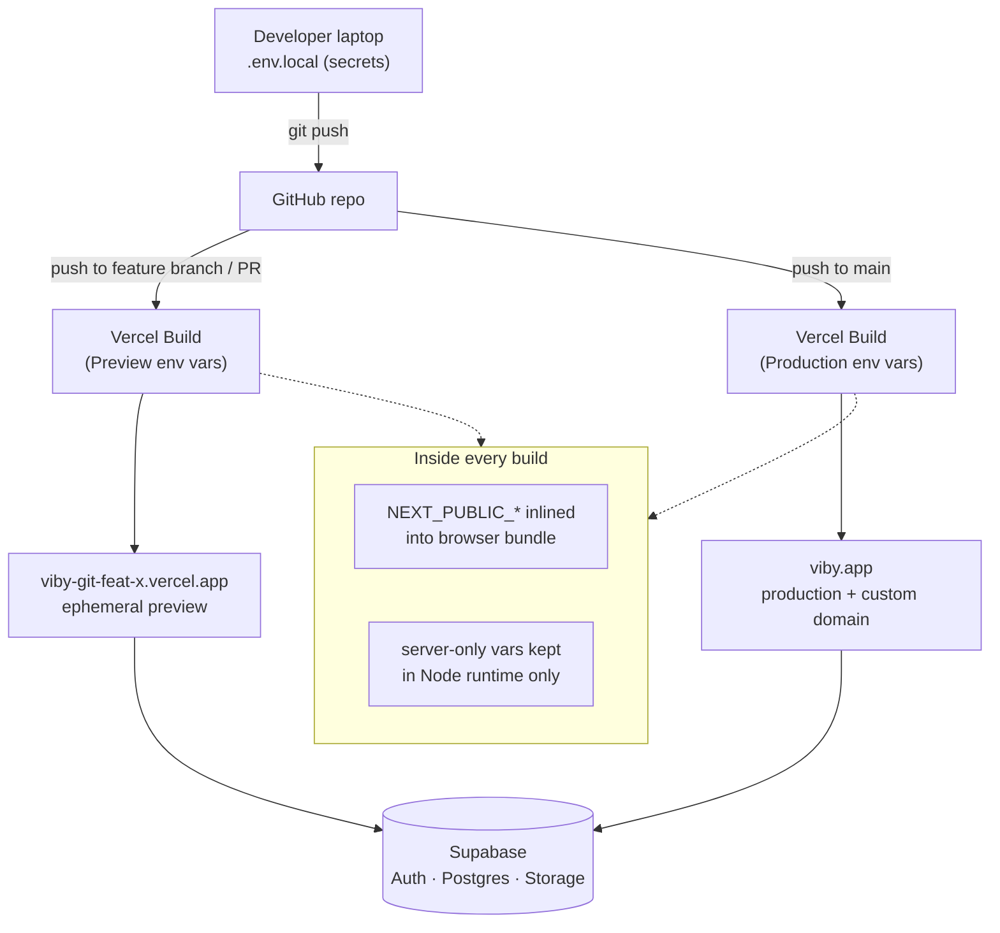

# Chapter 32 — Environment, Config & Deploying to Vercel

> Your app finally leaves your laptop and meets the world — let's make that moment boring, repeatable, and safe.

You've built Viby. It runs beautifully at `localhost:3000`. But a social-discovery app that only *you* can open isn't a product — it's a rehearsal. This chapter is the dress rehearsal becoming opening night: we'll wire up configuration the professional way, produce a real production build, and ship Viby to Vercel with both preview and production environments plus a custom domain.

## What you'll learn

- The difference between **public** and **server-only** environment variables, and why mixing them up leaks secrets
- How `.env.local`, `.env`, and Vercel's environment system fit together
- How to run and read a real **production build** (`next build`) and what changes vs. dev
- Deploying Viby to Vercel two ways: the **CLI** and **GitHub** integration
- How **preview** deployments differ from **production**, and how to use them in a team
- Attaching a **custom domain** with HTTPS

## Prerequisites

- Chapter 8 (Next.js App Router & Server Components) — you'll lean on the server/client boundary here
- Chapter 19 (Supabase Auth with `@supabase/ssr`) — we configure its keys for production
- Chapter 27 (`proxy.ts` for edge logic) — we'll confirm it ships correctly
- A GitHub account and the Vercel free (Hobby) tier — both free

---

## Theory

### Why environment variables exist

Imagine your app's *recipe* (the code) and its *ingredients list for this kitchen* (the configuration). The recipe is identical whether you cook at home or in a restaurant. The ingredients — which Supabase project, which database URL, which API keys — change per kitchen. **Environment variables** are how we keep the recipe fixed while swapping ingredients between your laptop, a teammate's laptop, a preview deploy, and production.

Hard-coding your Supabase keys into a `.ts` file is like writing your home address on every copy of the recipe and then handing the recipe to strangers. Config belongs *outside* the code.

### The one rule that prevents most disasters: public vs. server

This is the single most important idea in the chapter, so let's be precise.

In Next.js, an environment variable is exposed to the **browser** only if its name begins with `NEXT_PUBLIC_`. Everything else stays **server-side** and is never shipped in the JavaScript bundle.

- `NEXT_PUBLIC_SUPABASE_URL` → safe to expose. The browser needs it to talk to Supabase.
- `NEXT_PUBLIC_SUPABASE_ANON_KEY` → safe to expose. It's the *anonymous* key, designed for the client and protected by Row-Level Security (you set this up in Chapter 20).
- `SUPABASE_SERVICE_ROLE_KEY` → **never** prefix this with `NEXT_PUBLIC_`. It bypasses RLS and can read/write any row. If it lands in the browser bundle, anyone can pull your entire users table.

The analogy: `NEXT_PUBLIC_` is the lobby of an apartment building — public, fine for strangers to see. Everything without the prefix is behind the locked front door of an apartment. The prefix is the *only* thing deciding which side of that door a value lives on. Get it wrong and you either break the app (a secret the browser needed wasn't exposed) or leak a master key.

A subtle gotcha: `NEXT_PUBLIC_` values are **inlined at build time**. They're baked into the bundle when `next build` runs, not read fresh at runtime. Change one, and you must rebuild.

### The `.env` file family

Next.js loads several files automatically. Order of precedence (highest wins):

```
.env.local        ← your machine's secrets, NEVER committed
.env.production    ← committed, non-secret production defaults
.env.development   ← committed, non-secret dev defaults
.env               ← committed, shared non-secret defaults
```

The golden rule: **`.env.local` is git-ignored and holds anything secret.** Everything committed should be safe for the whole world to read.

---

## In practice

### 1. Define Viby's local environment

Create `.env.local` at the project root:

```bash
# .env.local — git-ignored, never commit this file

# Public: shipped to the browser, protected by RLS
NEXT_PUBLIC_SUPABASE_URL="https://abcdefgh.supabase.co"
NEXT_PUBLIC_SUPABASE_ANON_KEY="eyJhbGciOiJIUzI1NiIs..."
NEXT_PUBLIC_SITE_URL="http://localhost:3000"

# Server-only: NEVER prefixed with NEXT_PUBLIC_
SUPABASE_SERVICE_ROLE_KEY="eyJhbGciOiJIUzI1NiIs...service..."
```

Confirm `.gitignore` already ignores it (Next.js scaffolds this for you):

```gitignore
# .gitignore
.env*.local
```

### 2. Validate config at startup (fail loud, fail early)

A missing variable in production is a 3am pager incident. Catch it the moment the server boots instead. Create a typed, validated config module:

```typescript
// lib/env.ts
import { z } from "zod";

const serverSchema = z.object({
  SUPABASE_SERVICE_ROLE_KEY: z.string().min(1),
});

const publicSchema = z.object({
  NEXT_PUBLIC_SUPABASE_URL: z.string().url(),
  NEXT_PUBLIC_SUPABASE_ANON_KEY: z.string().min(1),
  NEXT_PUBLIC_SITE_URL: z.string().url(),
});

// Public vars must be referenced statically so Next.js can inline them.
export const publicEnv = publicSchema.parse({
  NEXT_PUBLIC_SUPABASE_URL: process.env.NEXT_PUBLIC_SUPABASE_URL,
  NEXT_PUBLIC_SUPABASE_ANON_KEY: process.env.NEXT_PUBLIC_SUPABASE_ANON_KEY,
  NEXT_PUBLIC_SITE_URL: process.env.NEXT_PUBLIC_SITE_URL,
});

// Only parse server vars on the server — guard so the browser never touches them.
export const serverEnv =
  typeof window === "undefined"
    ? serverSchema.parse({
        SUPABASE_SERVICE_ROLE_KEY: process.env.SUPABASE_SERVICE_ROLE_KEY,
      })
    : ({} as z.infer<typeof serverSchema>);
```

Now your Supabase browser client (from Chapter 19) reads from validated config:

```typescript
// lib/supabase/client.ts
import { createBrowserClient } from "@supabase/ssr";
import { publicEnv } from "@/lib/env";

export function createClient() {
  return createBrowserClient(
    publicEnv.NEXT_PUBLIC_SUPABASE_URL,
    publicEnv.NEXT_PUBLIC_SUPABASE_ANON_KEY,
  );
}
```

And the server client uses `getAll`/`setAll` cookie handlers — the only correct pattern with `@supabase/ssr`:

```typescript
// lib/supabase/server.ts
import { createServerClient } from "@supabase/ssr";
import { cookies } from "next/headers";
import { publicEnv } from "@/lib/env";

export async function createClient() {
  const cookieStore = await cookies(); // async in Next.js 16

  return createServerClient(
    publicEnv.NEXT_PUBLIC_SUPABASE_URL,
    publicEnv.NEXT_PUBLIC_SUPABASE_ANON_KEY,
    {
      cookies: {
        getAll() {
          return cookieStore.getAll();
        },
        setAll(cookiesToSet) {
          try {
            cookiesToSet.forEach(({ name, value, options }) =>
              cookieStore.set(name, value, options),
            );
          } catch {
            // Called from a Server Component — safe to ignore; proxy.ts refreshes.
          }
        },
      },
    },
  );
}
```

The service-role key only ever appears in trusted server code — for example a Server Action that needs to bypass RLS for an admin task:

```typescript
// app/admin/actions.ts
"use server";

import { createClient as createAdminClient } from "@supabase/supabase-js";
import { publicEnv, serverEnv } from "@/lib/env";

export async function banUser(userId: string) {
  // service_role bypasses RLS — server-only, never in a "use client" file
  const admin = createAdminClient(
    publicEnv.NEXT_PUBLIC_SUPABASE_URL,
    serverEnv.SUPABASE_SERVICE_ROLE_KEY,
  );

  const { error } = await admin
    .from("profiles")
    .update({ banned: true })
    .eq("id", userId);

  if (error) throw new Error("Could not ban user");
}
```

### 3. Run a real production build

Dev mode (`next dev`) is forgiving: hot reload, unminified, extra warnings. Production is the truth. Run it locally before you ever deploy:

```bash
npm run build   # runs `next build`
npm run start   # serves the production build on :3000
```

`next build` type-checks, lints, statically pre-renders what it can, and inlines every `NEXT_PUBLIC_` value. If a public env var is missing, **the build is where you'll find out** — exactly what you want. Read the output: it tells you which routes are static (`○`), dynamic (`ƒ`), and how big each bundle is. A surprise dynamic route often means you accidentally read a cookie or header in a page you expected to be static.

### 4. Deploy via the Vercel CLI

The fastest path from laptop to live URL:

```bash
npm i -g vercel
vercel login

# First run links the folder to a Vercel project (answer the prompts)
vercel              # creates a PREVIEW deployment

vercel --prod       # promotes to PRODUCTION
```

Push your environment variables to Vercel so the cloud build has them. You can do this per environment:

```bash
vercel env add SUPABASE_SERVICE_ROLE_KEY production
vercel env add NEXT_PUBLIC_SUPABASE_URL production
# ...repeat for preview and development as needed

# Pull cloud env vars down into a local .env.local for parity:
vercel env pull .env.local
```

### 5. Deploy via GitHub (the way real teams ship)

The CLI is great for solo experiments, but the professional default is **git-based deploys**. Connect once and every push becomes a deployment:

1. Push Viby to a GitHub repo.
2. In the Vercel dashboard: **Add New → Project → Import** your repo.
3. Vercel auto-detects Next.js — no build config needed.
4. Add your environment variables in **Settings → Environment Variables**, choosing the **Production**, **Preview**, and **Development** scopes per variable.
5. Deploy.

From now on:

- **Push to `main`** → Production deployment.
- **Open a Pull Request** → unique Preview deployment with its own URL.

Vercel even comments the preview URL on the PR so reviewers can click and test the actual running app.

---

## Architecture / diagram



The key insight the diagram encodes: **the same code** flows down both paths; only the **environment variables injected at build time** differ. Public vars get inlined into the bundle; secrets stay in the Node runtime and never reach the browser.

---

## Best practices & pitfalls

- **Do** keep `.env.local` git-ignored. **Don't** ever commit a service-role key — if you do, rotate it immediately in the Supabase dashboard.
- **Do** prefix browser-needed values with `NEXT_PUBLIC_`. **Don't** prefix secrets with it "just to make the error go away."
- **Do** set `NEXT_PUBLIC_SITE_URL` per environment so OAuth redirects and email links point to the right host. A preview deploy redirecting to `localhost` is a classic broken-auth bug.
- **Do** run `npm run build` locally before pushing. The cloud build will fail on the same TypeScript and lint errors — find them on your machine first.
- **Don't** assume changing a `NEXT_PUBLIC_` value in the dashboard updates the live site. It's inlined at build time — you must **redeploy**.
- **Do** add your production and preview domains to **Supabase → Authentication → URL Configuration** (Site URL + Redirect URLs). Auth silently fails otherwise.
- **Don't** read secrets in a `"use client"` component or pass them as props from a Server Component — props are serialized to the browser.
- **Do** trust `proxy.ts` to deploy automatically; Vercel runs it at the edge with no extra config. **Don't** rename it to `middleware.ts` — Next.js 16's convention here is `proxy.ts`.
- **Do** use Preview deployments as your QA environment for every PR. **Don't** test risky changes by pushing straight to `main`.

---

## Exercises

1. **Audit the boundary.** Add a `console.log(process.env.SUPABASE_SERVICE_ROLE_KEY)` inside a `"use client"` component, run `npm run build && npm run start`, open the browser, and confirm it logs `undefined`. Then move it to a Server Action and confirm it's present on the server. Delete both logs when done.

2. **Break the build on purpose.** Remove `NEXT_PUBLIC_SUPABASE_URL` from `.env.local` and run `npm run build`. Read the Zod error from `lib/env.ts`. Restore it. You've just proven your fail-loud guard works.

3. **Two environments, two values.** In the Vercel dashboard, set `NEXT_PUBLIC_SITE_URL` to different values for Preview and Production. Deploy both and confirm a page that renders `publicEnv.NEXT_PUBLIC_SITE_URL` shows the correct host in each.

4. **Ship a preview from a PR.** Create a branch, change Viby's hero headline, open a PR, and click the Vercel preview link in the PR comment to see your change live before merging.

5. **(Stretch) Custom domain.** Buy or reuse a domain, add it under **Vercel → Settings → Domains**, set the DNS records Vercel shows you, and confirm HTTPS provisions automatically. Update `NEXT_PUBLIC_SITE_URL` and the Supabase redirect URLs to match.

---

## Mini-project — A "Build Info" badge for Viby

Ship a tiny diagnostics widget that proves your environment wiring is correct in every deployment. It shows which environment the running build belongs to and the git commit it was built from — invaluable when a teammate asks "is the fix live yet?"

Vercel injects [system environment variables](https://vercel.com) automatically — including `VERCEL_ENV` (`production` | `preview` | `development`) and `VERCEL_GIT_COMMIT_SHA`. Expose just what the badge needs by re-mapping them to public vars in `next.config.ts`:

```typescript
// next.config.ts
import type { NextConfig } from "next";

const nextConfig: NextConfig = {
  env: {
    NEXT_PUBLIC_VERCEL_ENV: process.env.VERCEL_ENV ?? "development",
    NEXT_PUBLIC_COMMIT_SHA: process.env.VERCEL_GIT_COMMIT_SHA ?? "local",
  },
};

export default nextConfig;
```

Then build the badge as a client component with a subtle Framer Motion entrance:

```tsx
// components/build-badge.tsx
"use client";

import { motion, AnimatePresence } from "framer-motion";
import { useState } from "react";

const env = process.env.NEXT_PUBLIC_VERCEL_ENV;
const sha = (process.env.NEXT_PUBLIC_COMMIT_SHA ?? "local").slice(0, 7);

export function BuildBadge() {
  const [open, setOpen] = useState(true);

  // Hide in production so end users never see it.
  if (env === "production") return null;

  return (
    <AnimatePresence>
      {open && (
        <motion.button
          onClick={() => setOpen(false)}
          initial={{ opacity: 0, y: 12 }}
          animate={{ opacity: 1, y: 0 }}
          exit={{ opacity: 0, y: 12 }}
          whileTap={{ scale: 0.95 }}
          className="fixed bottom-4 left-4 z-50 rounded-full bg-[--color-brand] px-3 py-1.5 text-xs font-semibold text-white shadow-lg"
        >
          {env} · {sha}
        </motion.button>
      )}
    </AnimatePresence>
  );
}
```

Define the brand token in your Tailwind v4 theme (no `tailwind.config.js`):

```css
/* app/globals.css */
@import "tailwindcss";

@theme {
  --color-brand: #ff6fb5;
}
```

Drop it into your root layout so it appears on previews and locally, but auto-hides in production:

```tsx
// app/layout.tsx
import { BuildBadge } from "@/components/build-badge";

export default function RootLayout({
  children,
}: {
  children: React.ReactNode;
}) {
  return (
    <html lang="en">
      <body>
        {children}
        <BuildBadge />
      </body>
    </html>
  );
}
```

Open a PR, click the preview URL, and you'll see a bubblegum-pink badge reading `preview · a1b2c3d`. Merge to `main`, visit production, and it's gone. You've now got a visible, deploy-aware signal — and proof that your public/server boundary and environment scoping all work end to end.

---

## Key takeaways

- Config lives **outside** code in environment variables; the recipe stays fixed while ingredients change per environment.
- `NEXT_PUBLIC_` is the *only* switch deciding browser vs. server exposure — and public values are **inlined at build time**, so changing them means redeploying.
- `.env.local` is git-ignored and holds secrets; everything committed must be safe for the world.
- Validate env vars at startup so missing config fails the build, not production at 3am.
- Vercel ships the **same code** to preview and production, differing only by injected env vars; PRs get free preview URLs and `main` is production.
- Add your deploy domains to Supabase's auth URL config, and remember `proxy.ts` deploys to the edge automatically.

**Up next — Chapter 33: Observability & Error Tracking,** where we wire Viby up with logging, performance monitoring, and Sentry so you *know* when something breaks before your users tell you.
