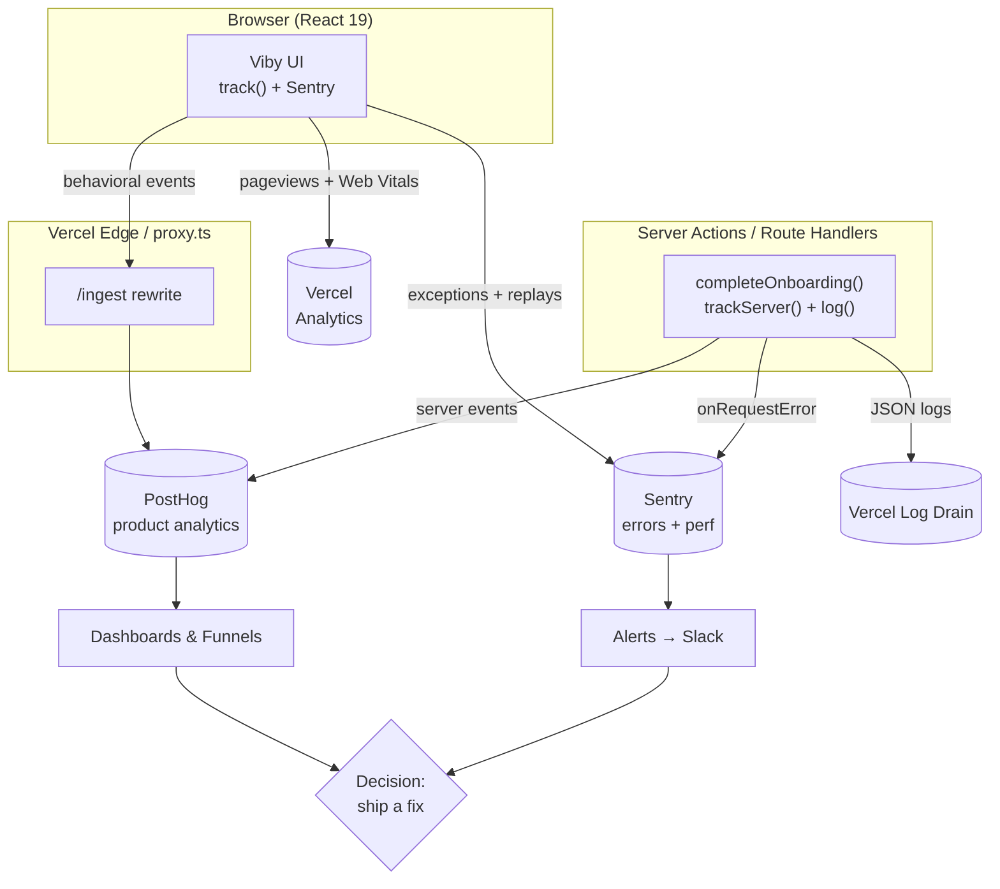

# Chapter 34 — Monitoring, Logging & Analytics

> You can't fix what you can't see — once Viby is live, your real users become your best (and most brutal) QA team.

## What you'll learn

- The three pillars of observability — **logs, metrics, traces** — and how they differ
- Wiring **Sentry** into Next.js 16 for error tracking and performance monitoring
- Reading Vercel's built-in **Web Analytics** and **Speed Insights** (Core Web Vitals)
- Capturing meaningful **product events** (not vanity metrics) with PostHog
- Doing privacy-respectful **server-side event tracking** from Server Actions
- Building a lightweight ops dashboard from Supabase data
- Closing the loop: turning a funnel drop-off into a shipped fix

## Prerequisites

- Chapter 9 (Server Components & Server Actions) — we'll instrument actions
- Chapter 12 (`proxy.ts` request handling) — we'll tag requests there
- Chapter 31 (Deploying to Vercel) — analytics ride on the deployment
- Chapter 33 (Environment variables & secrets) — DSNs and keys live in env

---

## Theory

When Viby ran on `localhost`, you *were* the monitoring system: you saw every error in the terminal, every slow render in DevTools. In production, thousands of strangers on flaky phones across the world hit your app and you see... nothing. Unless you build the nerves to feel it.

**Observability** is the property of a system that lets you ask new questions about its behavior *without shipping new code*. It rests on three pillars:

- **Logs** — discrete, timestamped events. "User `a1b2` failed to upload an avatar at 14:03." Like a diary: great for *what exactly happened* in one case.
- **Metrics** — numbers aggregated over time. "Avatar uploads: p95 latency 1.2s, error rate 0.4%." Like a car dashboard: great for *how healthy is the whole system right now*.
- **Traces** — the path of a single request across functions and services. "This signup took 900ms: 120ms in `proxy.ts`, 600ms in Supabase auth, 180ms rendering." Like a flight recorder: great for *where the time went*.

Sitting on top of these are two business-facing layers:

- **Error tracking** turns raw exceptions into grouped, deduplicated, alertable *issues* with stack traces and user context. The difference between "something broke 4,000 times" and "*this one null check* broke for 4,000 users on iOS Safari."
- **Product analytics** answers *why people behave the way they do*: Do new users find their first community? Where does the onboarding funnel leak?

A useful mental model: **operational telemetry** (errors, latency, uptime) tells you whether the *machine* is healthy; **product analytics** tells you whether the *experience* is working. You need both. A perfectly stable app that nobody completes onboarding in is still failing.

One rule above all: **measure what changes a decision.** "Total signups: 41,300" feels good but changes nothing. "Onboarding completion dropped from 68% to 51% after Tuesday's release" sends you to a specific PR. The first is a vanity metric; the second closes the loop.

---

## In practice

### 1. Error tracking & performance with Sentry

Sentry is the industry standard for error tracking and has first-class Next.js support. Install and run the wizard, then we'll look at the files it expects.

```bash
npm install @sentry/nextjs
npx @sentry/wizard@latest -i nextjs
```

In Next.js 16's App Router, client and edge config live in `instrumentation-client.ts` and `instrumentation.ts` (the wizard wires `next.config.ts` for you). Here's a hand-tuned client config for Viby:

```ts
// instrumentation-client.ts
import * as Sentry from "@sentry/nextjs";

Sentry.init({
  dsn: process.env.NEXT_PUBLIC_SENTRY_DSN,
  // Sample 10% of transactions for perf monitoring in prod; 100% locally.
  tracesSampleRate: process.env.NODE_ENV === "production" ? 0.1 : 1.0,
  // Session Replay: record 10% of sessions, 100% of sessions WITH an error.
  replaysSessionSampleRate: 0.1,
  replaysOnErrorSampleRate: 1.0,
  integrations: [
    Sentry.replayIntegration({
      // Privacy first: never leak DMs or emails into a replay.
      maskAllText: true,
      blockAllMedia: true,
    }),
  ],
  environment: process.env.VERCEL_ENV ?? "development",
});

// Required in Next.js 16 so navigation transactions are captured.
export const onRouterTransitionStart = Sentry.captureRouterTransitionStart;
```

```ts
// instrumentation.ts — runs on the server & edge runtimes
import * as Sentry from "@sentry/nextjs";

export async function register() {
  if (process.env.NEXT_RUNTIME === "nodejs") {
    await import("./sentry.server.config");
  }
  if (process.env.NEXT_RUNTIME === "edge") {
    await import("./sentry.edge.config");
  }
}

export const onRequestError = Sentry.captureRequestError;
```

The `onRequestError` export is the magic hook: Next.js 16 calls it for every uncaught Server Component / Server Action / route handler error, so you get server stack traces automatically.

Now, **context is everything**. A naked stack trace is a riddle; a stack trace tagged with the user and the community they were viewing is a bug report. Identify the user once you know who they are:

```ts
// lib/observability/identify.ts
import * as Sentry from "@sentry/nextjs";
import type { User } from "@supabase/supabase-js";

export function identifyUser(user: User | null) {
  if (!user) {
    Sentry.setUser(null);
    return;
  }
  // Send the id — NEVER the email or phone. Privacy by default.
  Sentry.setUser({ id: user.id });
}
```

When you *expect* an error might happen (a third-party image host timing out, say), capture it explicitly instead of swallowing it:

```ts
// In a Viby avatar-upload Server Action
"use server";

import * as Sentry from "@sentry/nextjs";
import { createServerClient } from "@supabase/ssr";

export async function uploadAvatar(formData: FormData) {
  try {
    // ...supabase storage upload...
  } catch (error) {
    Sentry.captureException(error, {
      tags: { feature: "profile", action: "avatar_upload" },
    });
    return { ok: false, message: "Couldn't save your photo — try again." };
  }
}
```

### 2. Vercel Web Analytics & Speed Insights

Vercel gives you privacy-friendly traffic analytics and real-user **Core Web Vitals** (LCP, INP, CLS) with two small packages and zero cookies.

```bash
npm install @vercel/analytics @vercel/speed-insights
```

Drop both components into the root layout — they're Client Components that Vercel renders as tiny scripts:

```tsx
// app/layout.tsx
import { Analytics } from "@vercel/analytics/next";
import { SpeedInsights } from "@vercel/speed-insights/next";

export default function RootLayout({
  children,
}: {
  children: React.ReactNode;
}) {
  return (
    <html lang="en">
      <body>
        {children}
        <Analytics />
        <SpeedInsights />
      </body>
    </html>
  );
}
```

That's it — deploy, and the Vercel dashboard fills with pageviews and field-data Web Vitals from your *actual* users (far more honest than a Lighthouse score on your fast laptop).

### 3. Product analytics with PostHog

For *behavioral* events we'll use PostHog. Initialize it client-side and expose a typed `track` helper so event names stay consistent — drifting event names ("signup", "Sign Up", "signed_up") are the silent killer of analytics.

```tsx
// app/providers.tsx
"use client";

import posthog from "posthog-js";
import { PostHogProvider } from "posthog-js/react";
import { useEffect } from "react";

export function AnalyticsProvider({ children }: { children: React.ReactNode }) {
  useEffect(() => {
    posthog.init(process.env.NEXT_PUBLIC_POSTHOG_KEY!, {
      api_host: "/ingest", // proxy through our own domain (see proxy.ts)
      person_profiles: "identified_only",
      capture_pageview: false, // App Router needs manual pageviews
    });
  }, []);

  return <PostHogProvider client={posthog}>{children}</PostHogProvider>;
}
```

```ts
// lib/analytics/events.ts — the single source of truth for event names
import posthog from "posthog-js";

// A closed union means a typo becomes a compile error, not a lost insight.
type VibyEvent =
  | { name: "onboarding_started"; props?: Record<string, never> }
  | { name: "interests_selected"; props: { count: number } }
  | { name: "community_joined"; props: { communityId: string; source: "search" | "suggested" } }
  | { name: "first_post_created"; props: { communityId: string } };

export function track<E extends VibyEvent>(event: E["name"], props?: E["props"]) {
  posthog.capture(event, props);
}
```

```tsx
// Using it in a "Join community" button
"use client";

import { track } from "@/lib/analytics/events";

export function JoinButton({ communityId }: { communityId: string }) {
  return (
    <button
      className="rounded-full bg-brand px-5 py-2 font-semibold text-white"
      onClick={() => {
        track("community_joined", { communityId, source: "suggested" });
        // ...call the join Server Action...
      }}
    >
      Join
    </button>
  );
}
```

The `bg-brand` utility comes from our Tailwind v4 theme token defined in CSS:

```css
/* app/globals.css */
@import "tailwindcss";

@theme {
  --color-brand: #ff6fb5;
}
```

### 4. Proxying analytics through your own domain

Ad-blockers eat requests to `posthog.com`, silently destroying 20–40% of your data. Route them through a first-party path using Viby's `proxy.ts` (Next.js 16's middleware-style file) so requests go to `viby.app/ingest`:

```ts
// proxy.ts
import { NextResponse, type NextRequest } from "next/server";

export function proxy(request: NextRequest) {
  if (request.nextUrl.pathname.startsWith("/ingest")) {
    const url = new URL(request.url);
    const target = "https://us.i.posthog.com";
    return NextResponse.rewrite(
      new URL(url.pathname.replace("/ingest", "") + url.search, target),
    );
  }
  return NextResponse.next();
}

export const config = {
  matcher: ["/ingest/:path*"],
};
```

### 5. Server-side events & structured logging

Some events should *never* depend on a browser — money, signups, and anything you'd hate to lose to an ad-blocker. Fire those from the server with `posthog-node`, and emit a structured JSON log line that Vercel's log drains can parse:

```ts
// lib/analytics/server.ts
import { PostHog } from "posthog-node";

const client = new PostHog(process.env.NEXT_PUBLIC_POSTHOG_KEY!, {
  host: "https://us.i.posthog.com",
  flushAt: 1, // serverless is short-lived — don't batch
  flushInterval: 0,
});

export async function trackServer(
  distinctId: string,
  event: string,
  properties?: Record<string, unknown>,
) {
  client.capture({ distinctId, event, properties });
  await client.flush(); // ensure it sends before the function freezes
}
```

```ts
// lib/observability/log.ts — structured logs beat console.log("here")
type Level = "info" | "warn" | "error";

export function log(level: Level, message: string, meta: Record<string, unknown> = {}) {
  // One JSON object per line = queryable in Vercel/Datadog/Logflare.
  console[level === "error" ? "error" : "log"](
    JSON.stringify({ level, message, ts: new Date().toISOString(), ...meta }),
  );
}
```

```ts
// app/(auth)/actions.ts
"use server";

import { trackServer } from "@/lib/analytics/server";
import { log } from "@/lib/observability/log";

export async function completeOnboarding(userId: string, interestCount: number) {
  // ...persist to Supabase...
  await trackServer(userId, "onboarding_completed", { interestCount });
  log("info", "onboarding_completed", { userId, interestCount });
  return { ok: true };
}
```

---

## Architecture / diagram



The loop is the point: telemetry flows up from client and server into tools, tools surface dashboards and alerts, and those drive the *next* code change — which you then measure again.

---

## Best practices & pitfalls

- **Do** sample performance traces in production (`tracesSampleRate: 0.1`). 100% sampling at scale is expensive and rarely more insightful.
- **Do** define event names in one typed file. **Don't** sprinkle raw string literals across components — typos silently fragment your funnels.
- **Don't** log PII. No emails, phone numbers, DM contents, or full auth tokens in Sentry, PostHog, or logs. Send IDs and let your DB resolve the rest.
- **Do** mask text and media in Session Replay. A replay that captures someone's private messages is a breach waiting to happen.
- **Don't** rely on client-only events for critical funnels — ad-blockers and crashed tabs lose them. Mirror the load-bearing ones server-side.
- **Do** proxy analytics through a first-party route, or accept losing a chunk of data to blockers.
- **Don't** alert on everything — alert fatigue means real fires get ignored. Page a human only for user-facing breakage (error-rate spikes, p95 latency cliffs).
- **Do** set `flushAt: 1` for `posthog-node` in serverless; otherwise events vanish when the function freezes.
- **Don't** confuse a Lighthouse score (lab) with Speed Insights (field). Optimize for the real-user numbers.

---

## Exercises

1. **Tag the request.** In `proxy.ts`, read the `user-agent` and attach an `is_mobile` boolean as a request header, then surface it as a Sentry tag. (Easy)
2. **Funnel it.** Instrument the full onboarding flow — `onboarding_started` → `interests_selected` → `community_joined` → `first_post_created` — and build a PostHog funnel. Where's the biggest drop? (Medium)
3. **Custom Web Vital.** Use the `useReportWebVitals` hook to send INP to PostHog as a custom event, so you can correlate poor responsiveness with specific pages. (Medium)
4. **Synthetic check.** Write a Vercel Cron route handler that pings `/api/health`, and have it `Sentry.captureMessage` if Supabase is unreachable. (Hard)
5. **Cohort retention.** Build a PostHog retention report answering: of users who `community_joined`, what fraction return and post within 7 days? (Hard)

---

## Mini-project — The Viby Onboarding Health dashboard

Build an internal `/admin/health` page (gated to admins) that closes the loop end-to-end.

**Requirements:**

1. Instrument the onboarding funnel with the four typed events from Exercise 2, mirroring `onboarding_completed` server-side via `trackServer`.
2. Create a Supabase view `onboarding_daily` that aggregates, per day: signups, completed onboardings, and completion rate.
3. Build a Server Component that reads the view and renders a simple bar chart of the last 14 days' completion rate.
4. Wrap each bar in a Framer Motion `motion.div` with a staggered `initial={{ scaleY: 0 }}` → `animate={{ scaleY: 1 }}` entrance so the dashboard feels alive.
5. Add a Sentry alert: if the onboarding Server Action's error rate exceeds 2% over 5 minutes, post to a Slack channel.

**Stretch:** annotate the chart with deploy timestamps (pull from the Vercel API) so a completion-rate dip lines up visibly with the release that caused it — the literal picture of closing the loop.

You'll know it works when you can answer, in one glance, "Is onboarding healthier or worse than last week, and did our last deploy help?"

---

## Key takeaways

- Observability stands on **logs, metrics, and traces**; error tracking and product analytics build the business view on top.
- **Sentry** (`instrumentation-client.ts` + `onRequestError`) gives you grouped errors, performance, and replays across client and server.
- **Vercel Analytics + Speed Insights** deliver cookieless traffic data and real-user Core Web Vitals for free.
- **PostHog** with a single typed `track()` helper keeps event names clean; mirror critical events **server-side** and **proxy** through your own domain to survive ad-blockers.
- Never log PII; sample traces; alert only on user-facing pain.
- The whole point is the **loop**: measure → surface → decide → ship → measure again.

**Up next — Chapter 35: Scaling & Performance Optimization**, where we take everything these dashboards reveal and make Viby fast and cheap under real load.
