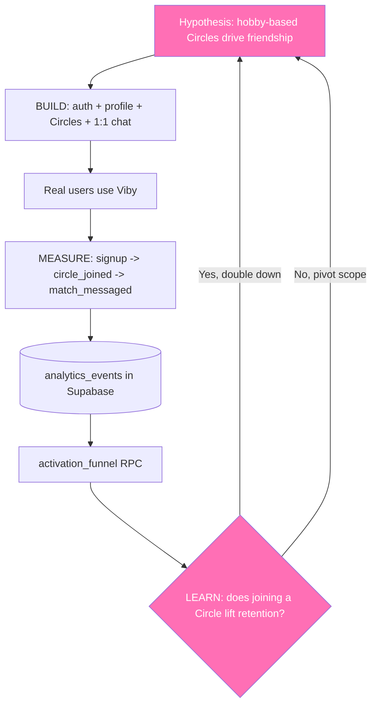

# Chapter 35 — MVP Strategy & Product Thinking

> You don't ship a product. You ship a hypothesis — and then you go find out if you were right.

## What you'll learn

- What an MVP actually is (and the three things people mistake it for)
- How to scope ruthlessly so you ship in weeks, not quarters
- Problem/solution fit vs. product/market fit — and why the order matters
- The Build–Measure–Learn loop, made concrete with instrumentation
- Two prioritization frameworks you'll reach for constantly: RICE and MoSCoW
- Exactly how **Viby** was scoped from a wishlist of 40 features down to a shippable core

## Prerequisites

- You've built Viby's core flows: auth (Chapter 11), profiles, the discovery feed, and Realtime chat (Chapters 22–28)
- You're comfortable with Server Components, Server Actions, and the `@supabase/ssr` clients
- Nice to have: the analytics groundwork from Chapter 31 — we'll lean on event tracking here

---

## Theory

### What an MVP really is

MVP stands for **Minimum Viable Product**. Every word is load-bearing, and most beginners get two of the three wrong.

- **Minimum** — the *smallest* thing you can build. Not "small but polished everywhere." Smallest.
- **Viable** — it must actually deliver the core value. A car with no engine is minimum, but it's not viable. A skateboard is.
- **Product** — a real person uses it and gets a real outcome. A landing page that collects emails is a *test*, not yet a product.

The famous analogy (from Henrik Kniberg): if the goal is *transportation*, don't ship a wheel, then a chassis, then a half-car, then a car. Each intermediate step is useless — nobody can ride a chassis. Instead ship a **skateboard**, then a scooter, then a bike, then a motorbike, then a car. Every step is *usable* and teaches you something about how people actually want to move.

```
WRONG: wheel -> axle -> chassis -> car      (nothing works until the end)
RIGHT: skateboard -> scooter -> bike -> car (every step is rideable & teaches you)
```

An MVP is **not**:

- A prototype (throwaway, internal, proves a technical risk)
- A beta (a near-complete product, just earlier)
- "Version 1 with fewer features" (that's just a smaller waterfall)

An MVP **is**: the smallest experiment that lets you learn whether real users get real value — *before* you've spent six months building the wrong thing.

### Problem/solution fit comes before product/market fit

There are two milestones, in order:

1. **Problem/solution fit** — "Do people actually have this problem, and does my approach plausibly solve it?" This is qualitative. You learn it from interviews, a clickable prototype, a concierge MVP.
2. **Product/market fit (PMF)** — "Is there a market that pulls the product out of my hands?" This is quantitative: retention curves that flatten instead of decaying to zero, organic growth, people upset if you took it away.

The number-one startup killer is building a beautiful solution to a problem nobody has. For Viby, the problem hypothesis is sharp: *"Adults past college find it genuinely hard to make new platonic friends who share their hobbies."* Notice it's **not** dating — that's a deliberate scoping decision that shapes every feature.

### The Build–Measure–Learn loop

Eric Ries's *Lean Startup* loop is the engine of product thinking:

```
        ┌──────────┐
        │  LEARN   │◀────────────┐
        └────┬─────┘             │
   (insights)│                   │(data)
        ┌────▼─────┐        ┌─────┴────┐
        │  BUILD   │───────▶│ MEASURE  │
        └──────────┘ (code) └──────────┘
```

The trick everyone misses: you go around the loop **backwards** when planning. Start from what you want to **learn**, decide what to **measure** to learn it, then build the *minimum* needed to generate that measurement. Building first and asking "what should we measure?" afterward is how you ship features that move nothing.

Each loop should produce a **validated learning** — a sentence like: *"Users who join a Circle in their first session retain at 3x the rate of those who don't."* That sentence changes your roadmap. A loop that produces only "we shipped it" produced nothing.

### Prioritization: turning opinions into decisions

When everyone in the room has a favorite feature, you need a shared scoring rubric so the loudest voice doesn't win.

**RICE** scores each idea: `(Reach × Impact × Confidence) / Effort`.

- **Reach** — how many users per quarter does it touch?
- **Impact** — per-user effect (3 = massive, 1 = medium, 0.25 = minimal)
- **Confidence** — how sure are you? (100% / 80% / 50%)
- **Effort** — person-weeks

**MoSCoW** buckets scope for a single release: **M**ust / **S**hould / **C**ould / **W**on't. The discipline is the **Won't** column — writing down what you're explicitly *not* doing this cycle is the whole point.

---

## In practice

Theory is worthless without instrumentation. An MVP you can't measure is just a guess with a deploy URL. Let's wire the **Measure** half of the loop into Viby.

### 1. A typed, minimal analytics event

Keep your event vocabulary tiny and intentional. For the MVP you might track only a handful of events — the ones tied to your core learning question.

```ts
// lib/analytics/events.ts
export type VibyEvent =
  | { name: "signup_completed"; props: { method: "email" | "oauth" } }
  | { name: "circle_joined"; props: { circleId: string; hobby: string } }
  | { name: "match_messaged"; props: { matchId: string } }
  | { name: "discovery_card_swiped"; props: { direction: "save" | "skip" } };

export type EventName = VibyEvent["name"];
```

### 2. Record events with a Server Action

Write events to Supabase from a Server Action. Note the `@supabase/ssr` `createServerClient` with `getAll`/`setAll` cookie handlers — the modern, correct API.

```ts
// app/actions/track.ts
"use server";

import { cookies } from "next/headers";
import { createServerClient } from "@supabase/ssr";
import type { VibyEvent } from "@/lib/analytics/events";

export async function trackEvent(event: VibyEvent) {
  // Next.js 16: cookies() is async — await it.
  const cookieStore = await cookies();

  const supabase = createServerClient(
    process.env.NEXT_PUBLIC_SUPABASE_URL!,
    process.env.NEXT_PUBLIC_SUPABASE_ANON_KEY!,
    {
      cookies: {
        getAll: () => cookieStore.getAll(),
        setAll: (cookiesToSet) => {
          cookiesToSet.forEach(({ name, value, options }) =>
            cookieStore.set(name, value, options)
          );
        },
      },
    }
  );

  const {
    data: { user },
  } = await supabase.auth.getUser();

  await supabase.from("analytics_events").insert({
    user_id: user?.id ?? null,
    name: event.name,
    props: event.props,
  });
}
```

### 3. Fire it from a client component

The discovery feed is a client component (it needs gestures via Framer Motion). When a user saves or skips a card, we record it — that swipe ratio is a *measurement* feeding the loop.

```tsx
// components/discovery/swipe-card.tsx
"use client";

import { motion, useMotionValue, useTransform } from "framer-motion";
import { trackEvent } from "@/app/actions/track";

export function SwipeCard({ profile }: { profile: { id: string; name: string } }) {
  const x = useMotionValue(0);
  const rotate = useTransform(x, [-200, 200], [-12, 12]);
  const opacity = useTransform(x, [-200, 0, 200], [0.4, 1, 0.4]);

  function onDragEnd(_: unknown, info: { offset: { x: number } }) {
    if (Math.abs(info.offset.x) < 120) return; // not a decisive swipe
    const direction = info.offset.x > 0 ? "save" : "skip";
    // Fire-and-forget: measurement must never block the interaction.
    void trackEvent({ name: "discovery_card_swiped", props: { direction } });
  }

  return (
    <motion.div
      style={{ x, rotate, opacity }}
      drag="x"
      dragConstraints={{ left: 0, right: 0 }}
      onDragEnd={onDragEnd}
      className="rounded-3xl bg-white p-6 shadow-lg"
    >
      <h3 className="text-xl font-semibold text-[--color-brand]">{profile.name}</h3>
    </motion.div>
  );
}
```

### 4. The brand token, defined the Tailwind v4 way

That `[--color-brand]` resolves to a token defined in CSS — **no `tailwind.config.js`** in Tailwind v4.

```css
/* app/globals.css */
@import "tailwindcss";

@theme {
  --color-brand: #ff6fb5; /* Viby bubblegum pink */
  --color-brand-ink: #1f2937;
}
```

### 5. Read the funnel back

The point of measuring is to *learn*. A simple Server Component dashboard turns raw events into the activation funnel that tells you whether the MVP works.

```tsx
// app/(admin)/funnel/page.tsx  — Server Component, no "use client"
import { cookies } from "next/headers";
import { createServerClient } from "@supabase/ssr";

export default async function FunnelPage() {
  const cookieStore = await cookies();
  const supabase = createServerClient(
    process.env.NEXT_PUBLIC_SUPABASE_URL!,
    process.env.NEXT_PUBLIC_SUPABASE_ANON_KEY!,
    {
      cookies: {
        getAll: () => cookieStore.getAll(),
        setAll: () => {}, // read-only page; no cookies to write
      },
    }
  );

  // One RPC that returns counts per funnel step (defined in SQL).
  const { data: funnel } = await supabase.rpc("activation_funnel");

  return (
    <div className="mx-auto max-w-md space-y-3 p-6">
      <h1 className="text-2xl font-bold text-[--color-brand]">Activation funnel</h1>
      {funnel?.map((step: { label: string; count: number }) => (
        <div key={step.label} className="flex justify-between rounded-xl bg-pink-50 p-4">
          <span>{step.label}</span>
          <span className="font-mono">{step.count}</span>
        </div>
      ))}
    </div>
  );
}
```

> Gate this admin route in `proxy.ts` (Viby's middleware-style file from Chapter 18) so only staff session cookies reach `/funnel`. Don't ship a public dashboard of your raw metrics.

---

## Architecture / diagram

How Viby's MVP scope maps onto the Build–Measure–Learn loop:



The loop is a *cycle*, not a line. Each pass tightens the hypothesis or kills it.

---

## Best practices & pitfalls

**Do**

- Write your learning goal *before* you write code. "We'll learn X by measuring Y."
- Keep an explicit **Won't-do-this-cycle** list. Saying no is the job.
- Instrument the core funnel on day one — retroactive analytics is guesswork.
- Ship to *real* users fast, even 10 of them. Ten engaged users beat a thousand imaginary ones.
- Measure **retention**, not just signups. A flattening retention curve is the only real signal of PMF.

**Don't**

- Don't confuse "minimum" with "low quality." The slice you ship must feel premium — just *narrow*.
- Don't build features because a competitor has them. Build for *your* hypothesis.
- Don't gold-plate the parts no one has validated (Viby's video calls, gamified badges — all v2).
- Don't let analytics block the UI. Track fire-and-forget (`void trackEvent(...)`).
- Don't ship a metrics dashboard publicly or skip auth on `/funnel`.
- Don't mistake *activity* (we shipped 8 features!) for *progress* (we learned 1 true thing).

---

## Exercises

1. **Scope the cut.** List 10 features you'd *want* in Viby. Sort them into MoSCoW buckets for a 3-week MVP. Defend your "Won't" column in two sentences each.
2. **RICE a feature.** Pick "voice notes in chat." Estimate Reach, Impact, Confidence, Effort and compute its RICE score. Compare it to "profile photo cropping." Which ships first?
3. **Add an event.** Extend the `VibyEvent` union with `profile_completed` and fire it from the profile form's Server Action. Keep the type exhaustive.
4. **Write the learning sentence.** For the discovery swipe data, write the one-sentence validated learning you'd hope to extract, and the SQL query that would confirm or deny it.
5. **(Stretch)** Build a `retention_cohort` Supabase RPC that buckets users by signup week and reports week-1 return rate. Render it in a Server Component.

---

## Mini-project: The Viby "One-Metric Dashboard"

Build a single Server Component page, `/insights`, that answers **one** question: *Do users who join a Circle in their first session come back?*

**Steps**

1. Create the `analytics_events` table in Supabase with columns `id`, `user_id`, `name`, `props jsonb`, `created_at default now()`, and Row Level Security allowing inserts for authenticated users.
2. Wire `trackEvent` (above) into your signup action (`signup_completed`) and Circle join action (`circle_joined`).
3. Write a SQL function `circle_retention()` returning two numbers: 7-day return rate for users who fired `circle_joined` in session one vs. those who didn't.
4. Render both numbers side by side with the Viby pink token, plus a one-line verdict: *"Joining a Circle lifts week-1 retention by N%."*
5. Protect `/insights` in `proxy.ts`.

**Definition of done:** the page renders a single comparison and a plain-English verdict. If the verdict surprises you, congratulations — you just closed a Build–Measure–Learn loop.

---

## Key takeaways

- An MVP is the **smallest experiment** that delivers real value and produces validated learning — not a small waterfall.
- Chase **problem/solution fit first**, then product/market fit; retention is your truest PMF signal.
- Plan the **Build–Measure–Learn** loop *backwards*: learn → measure → build the minimum.
- Use **RICE** to rank ideas and **MoSCoW** to scope a release; the **Won't** column is sacred.
- Viby was scoped to one hypothesis — *hobby-based Circles create friendships* — and everything off that path (dating, video, badges) was deliberately deferred.
- Instrument from day one; activity is not progress.

**Up next — Chapter 36: Growth, Analytics & Retention Engineering**, where we turn these raw events into cohort retention curves, activation metrics, and the growth loops that make Viby spread.
