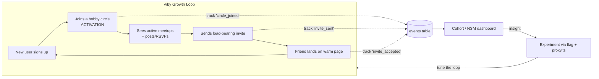

# Chapter 36 — Growth, Retention, Scaling & Engineering Workflows

> You shipped a beautiful app. Now let's make it *grow*, *keep* the people who join, and survive the day 50,000 of them show up at once.

This is the chapter where Viby stops being a project and starts behaving like a *startup*. Code quality got you to launch. Growth loops, retention discipline, and a calm engineering workflow get you to traction.

## What you'll learn

- **Growth loops & network effects** — why some products compound and most don't, and how to design loops into Viby.
- **Activation & retention metrics** — the North Star, the AARRR funnel, cohort retention curves, and how to instrument them.
- **Virality** — the viral coefficient (k-factor), invite loops, and why "share" buttons usually fail.
- **Scaling** — the product (database, realtime, caching) and the team (ownership, on-call).
- **Modern startup engineering workflows** — trunk-based git, fast reviews, CI/CD on Vercel, and feature flags so you can ship daily without fear.

## Prerequisites

- Chapters 1–10: the Next.js 16 App Router, Server Components, and TypeScript foundations.
- Chapter 14–18: Supabase Auth, PostgreSQL, RLS, and Realtime.
- Chapter 28: Viby's "Find your people" discovery feed and the hobby-match graph.
- Chapter 33–35: deployment to Vercel and basic observability.

---

## Theory

### Growth loops beat funnels

A **funnel** is linear: an ad sends a stranger in one end, a fraction trickles out the other as a user. You pay for every new person. A **growth loop** is circular: the *output* of using the product becomes the *input* that brings the next person.

> Analogy: a funnel is a bucket you keep pouring water into. A loop is a sourdough starter — feed it once and it keeps making more of itself.

Viby's natural loop:

```
A new user joins → finds a hobby circle (e.g. "Bouldering Berlin")
→ posts a meetup → invites 2 friends who also boulder
→ those friends join, see the circle is alive → they post → invite more
```

Every active user *manufactures the reason* for the next user to join. That's a loop. Funnels you buy; loops you build.

### Network effects (the moat)

A **network effect** means the product gets *more valuable* as more people use it. Viby's value is "find people near you who share your hobby." With 3 users in your city, that's worthless. With 3,000, it's magic. This is why social-discovery is hard to start (the *cold-start problem*) but defensible once warm — a competitor with better code but no users still loses.

Beat cold-start by going **narrow and dense**: don't launch "everyone, everywhere." Launch *one hobby in one city* until it's saturated, then expand. Density, not breadth, creates the magic moment.

### Activation, retention, and the North Star

- **Activation** is the moment a new user first feels the value — the "aha." For Viby it's not signup; it's *joining a circle and seeing it's active*. Define it precisely, because everything optimizes toward it.
- **Retention** is whether they come back. It's the single best predictor of a real business. A leaky bucket can't be filled by more marketing.
- **North Star Metric (NSM)**: the one number that captures delivered value. For Viby: **Weekly Connected Users** — users who had a real interaction (joined a circle, RSVP'd, or messaged) in the last 7 days. Not signups, not page views — *value delivered*.

The classic frame is **AARRR** ("pirate metrics"): Acquisition → Activation → Retention → Referral → Revenue.

### Virality and the k-factor

The **viral coefficient `k`** = (invites sent per user) × (conversion rate per invite).

- `k > 1`: each user brings more than one new user → exponential growth (rare, magical).
- `k < 1`: invites *amplify* other channels but don't sustain growth alone — still hugely valuable.

A "Share to Instagram" button is almost always `k ≈ 0`. What works is an invite that is **load-bearing**: the recipient gets something real (a pre-joined circle, a friend already inside). Make the invite *part of using the product*, not a bolt-on.

### Scaling — product and team

- **Product**: add database indexes before you need them, push reads to caches, keep Realtime channels scoped, and move slow work to background jobs.
- **Team**: as you grow past ~3 engineers, informal coordination breaks. You need **clear ownership**, small PRs, automated checks, and a deploy process anyone can run safely at 5pm on a Friday.

---

## In practice

### 1. Instrument activation with a typed event helper

Track events from a single, typed module so naming stays consistent. We log to a Supabase `events` table (cheap, queryable) and could fan out to a product-analytics tool later.

```sql
-- supabase/migrations/0042_events.sql
create table public.events (
  id          bigint generated always as identity primary key,
  user_id     uuid references auth.users (id) on delete set null,
  name        text not null,
  props       jsonb not null default '{}'::jsonb,
  created_at  timestamptz not null default now()
);

create index events_name_created_idx on public.events (name, created_at desc);
create index events_user_idx on public.events (user_id, created_at desc);

alter table public.events enable row level security;

-- Users may insert their own events; reads are server/service-role only.
create policy "insert own events" on public.events
  for insert to authenticated
  with check (auth.uid() = user_id);
```

A Server Action is the clean way to record events — it runs on the server, so the service context and cookies are already available.

```ts
// app/_actions/track.ts
"use server";

import { createServerClient } from "@supabase/ssr";
import { cookies } from "next/headers";

export type VibyEvent =
  | "signup_completed"
  | "circle_joined"      // our activation event
  | "meetup_rsvp"
  | "message_sent"
  | "invite_sent"
  | "invite_accepted";

export async function track(name: VibyEvent, props: Record<string, unknown> = {}) {
  const cookieStore = await cookies();

  const supabase = createServerClient(
    process.env.NEXT_PUBLIC_SUPABASE_URL!,
    process.env.NEXT_PUBLIC_SUPABASE_ANON_KEY!,
    {
      cookies: {
        getAll: () => cookieStore.getAll(),
        setAll: (toSet) =>
          toSet.forEach(({ name, value, options }) =>
            cookieStore.set(name, value, options),
          ),
      },
    },
  );

  const {
    data: { user },
  } = await supabase.auth.getUser();

  await supabase.from("events").insert({ user_id: user?.id ?? null, name, props });
}
```

Fire activation right where it happens — when a user joins a circle:

```ts
// app/circles/[id]/_actions/join.ts
"use server";

import { revalidatePath } from "next/cache";
import { track } from "@/app/_actions/track";
import { getServerClient } from "@/lib/supabase/server";

export async function joinCircle(circleId: string) {
  const supabase = await getServerClient();
  const { error } = await supabase
    .from("circle_members")
    .insert({ circle_id: circleId });

  if (error) return { ok: false as const, error: error.message };

  await track("circle_joined", { circleId }); // ← activation moment
  revalidatePath(`/circles/${circleId}`);
  return { ok: true as const };
}
```

### 2. Measure retention with a cohort query

Retention is best read as a **cohort curve**: group users by the week they signed up, then see what fraction were "connected" in each later week.

```sql
-- Weekly retention by signup cohort
with cohorts as (
  select id as user_id, date_trunc('week', created_at) as cohort_week
  from auth.users
),
activity as (
  select distinct user_id, date_trunc('week', created_at) as active_week
  from public.events
  where name in ('circle_joined', 'meetup_rsvp', 'message_sent')
)
select
  c.cohort_week,
  count(distinct c.user_id)                                   as cohort_size,
  (extract(epoch from (a.active_week - c.cohort_week)) / 604800)::int as week_offset,
  count(distinct a.user_id)                                   as retained
from cohorts c
join activity a on a.user_id = c.user_id and a.active_week >= c.cohort_week
group by 1, 3
order by 1, 3;
```

A healthy social product shows a retention curve that *flattens* (a stable plateau of returning users), not one that decays to zero. The plateau is your real business.

### 3. A load-bearing invite loop

Make the invite deliver value. The link pre-loads the friend's name *and* the circle, so the recipient lands on a warm, half-finished action — not a cold marketing page.

```ts
// app/_actions/invite.ts
"use server";

import { track } from "@/app/_actions/track";
import { getServerClient } from "@/lib/supabase/server";

export async function createInvite(circleId: string) {
  const supabase = await getServerClient();
  const {
    data: { user },
  } = await supabase.auth.getUser();
  if (!user) return { ok: false as const };

  const { data, error } = await supabase
    .from("invites")
    .insert({ circle_id: circleId, inviter_id: user.id })
    .select("token")
    .single();

  if (error) return { ok: false as const };

  await track("invite_sent", { circleId });
  const url = `${process.env.NEXT_PUBLIC_SITE_URL}/i/${data.token}`;
  return { ok: true as const, url };
}
```

The landing route is a Server Component. In Next.js 16 the route `params` are async — you `await` them:

```tsx
// app/i/[token]/page.tsx
import { notFound } from "next/navigation";
import { getServerClient } from "@/lib/supabase/server";
import { AcceptInvite } from "./accept-invite";

export default async function InvitePage({
  params,
}: {
  params: Promise<{ token: string }>;
}) {
  const { token } = await params; // ← async params
  const supabase = await getServerClient();

  const { data: invite } = await supabase
    .from("invites")
    .select("circle:circles(id, name, member_count), inviter:profiles(display_name)")
    .eq("token", token)
    .single();

  if (!invite) notFound();

  return (
    <main className="mx-auto max-w-md p-6 text-center">
      <p className="text-muted-foreground text-sm">
        {invite.inviter.display_name} invited you to
      </p>
      <h1 className="text-2xl font-bold text-pink">{invite.circle.name}</h1>
      <p className="text-muted-foreground mt-1 text-sm">
        {invite.circle.member_count} people already inside
      </p>
      <AcceptInvite token={token} circleId={invite.circle.id} />
    </main>
  );
}
```

```tsx
// app/i/[token]/accept-invite.tsx
"use client";

import { useTransition } from "react";
import { motion } from "framer-motion";
import { acceptInvite } from "@/app/_actions/accept-invite";

export function AcceptInvite({ token, circleId }: { token: string; circleId: string }) {
  const [pending, start] = useTransition();

  return (
    <motion.button
      whileTap={{ scale: 0.96 }}
      disabled={pending}
      onClick={() => start(() => acceptInvite(token, circleId))}
      className="bg-pink mt-6 w-full rounded-full px-6 py-3 font-semibold text-white disabled:opacity-60"
    >
      {pending ? "Joining…" : "Join the circle"}
    </motion.button>
  );
}
```

The brand token comes from Tailwind v4's CSS-first `@theme` — no `tailwind.config.js`:

```css
/* app/globals.css */
@import "tailwindcss";

@theme {
  --color-pink: #ff6fb5;
  --color-muted-foreground: oklch(0.55 0.02 320);
}
```

### 4. Ship safely with feature flags + a proxy

A simple env/cookie flag lets you merge unfinished growth experiments to `main` without exposing them. In Next.js 16 we use **`proxy.ts`** (not `middleware.ts`) for edge-level logic like cohort bucketing:

```ts
// proxy.ts  (project root)
import { NextResponse, type NextRequest } from "next/server";

export function proxy(request: NextRequest) {
  const response = NextResponse.next();

  // Sticky 50/50 experiment bucket for an invite-banner test.
  if (!request.cookies.has("exp_invite_banner")) {
    const bucket = Math.random() < 0.5 ? "control" : "variant";
    response.cookies.set("exp_invite_banner", bucket, {
      maxAge: 60 * 60 * 24 * 90,
      httpOnly: false,
      sameSite: "lax",
    });
  }
  return response;
}

export const config = { matcher: ["/((?!_next|api|.*\\..*).*)"] };
```

```ts
// lib/flags.ts
export function isEnabled(flag: string): boolean {
  // Comma-separated list in the Vercel env, e.g. FLAGS="new_feed,invite_banner"
  return (process.env.FLAGS ?? "").split(",").includes(flag);
}
```

### 5. CI/CD that runs on every PR

```yaml
# .github/workflows/ci.yml
name: CI
on:
  pull_request:
  push:
    branches: [main]

jobs:
  check:
    runs-on: ubuntu-latest
    steps:
      - uses: actions/checkout@v4
      - uses: actions/setup-node@v4
        with: { node-version: 22, cache: npm }
      - run: npm ci
      - run: npm run lint
      - run: npx tsc --noEmit
      - run: npm test -- --run
      - run: npm run build
```

Vercel builds a **preview deployment** for every PR automatically. The flow: open PR → CI runs the checks above *and* Vercel posts a live preview URL → reviewer clicks it → merge to `main` → Vercel promotes to production. Green checks plus a working preview is your safety net.

---

## Architecture / diagram



The loop creates the data; the data drives the experiment; the experiment tunes the loop. That cycle — not any single feature — is what compounds.

---

## Best practices & pitfalls

- **Do** define one activation event and one North Star, and write them on the wall. **Don't** chase vanity metrics (signups, page views) — they go up even as the product dies.
- **Do** read retention as a *cohort curve*. **Don't** trust a single "active users" number; it hides whether you're retaining or just acquiring faster than you churn.
- **Do** make invites deliver value to *both* sides. **Don't** ship a generic "Share" button and call it virality — `k ≈ 0`.
- **Do** go narrow and dense to beat cold-start. **Don't** launch a social-discovery app to "everyone" at once.
- **Do** keep PRs small (< ~400 lines) and merge daily behind flags. **Don't** sit on a 3,000-line branch for two weeks — it will rot and the review will be useless.
- **Do** add DB indexes for the queries you actually run (see the `events` indexes). **Don't** premature-optimize architecture you have no traffic for.
- **Do** put events behind RLS and never log secrets/PII into `props`. **Don't** trust client-reported user IDs — resolve the user server-side as `track` does.
- **Do** let CI gate merges and Vercel previews catch visual regressions. **Don't** deploy straight from your laptop.

---

## Exercises

1. **Define & log.** Pick Viby's activation event (defend your choice in a comment) and ensure `track("circle_joined", …)` fires exactly once per user's first join — guard against double-counting on re-join.
2. **Cohort chart.** Run the retention SQL, export to CSV, and chart the curve. Does it flatten or decay? Write one sentence on what that implies.
3. **k-factor.** From the `events` table, compute `k = invites_sent_per_user × accept_rate` over the last 30 days using `invite_sent` and `invite_accepted`. Is Viby's loop sustaining, amplifying, or dead?
4. **Flagged experiment.** Use the `exp_invite_banner` cookie from `proxy.ts` to show an invite banner only to the `variant` bucket, and compare `invite_sent` rates between buckets.
5. **Harden the pipeline.** Add a CI step that fails the build if `npx tsc --noEmit` finds errors *or* if any new file lacks a test, and require the check before merge in branch protection.

---

## Mini-project — The Viby Growth Dashboard

Build a `/admin/growth` Server Component page (gate it to admin users via RLS/role) that shows three live numbers and one chart, all from the `events` table:

1. **North Star** — Weekly Connected Users (distinct `user_id` with any of `circle_joined`/`meetup_rsvp`/`message_sent` in the last 7 days).
2. **Activation rate** — of users who signed up in the last 14 days, the % that fired `circle_joined` within 24h.
3. **k-factor** — `invite_sent` and `invite_accepted` over 30 days.
4. **Retention curve** — render the cohort query from section 2 as a small line chart (a `<motion.path>` is a fun, on-brand way to animate it in).

Requirements: all data fetched in Server Components (no client secrets), a Server Action to refresh, and the page protected so only admins can load it. When you can watch these four numbers move after shipping a change, you're running Viby like a startup — not a side project.

---

## Key takeaways

- **Loops compound; funnels leak.** Design Viby so using it produces the next user.
- **Network effects are the moat** — win cold-start by going narrow and dense.
- **One activation event, one North Star, cohort retention.** That trio tells you the truth.
- **Virality is load-bearing invites,** not share buttons; measure with the k-factor.
- **Scale the product** with indexes, caches, and scoped Realtime — **scale the team** with small PRs, ownership, and automation.
- **Ship daily, safely:** trunk-based git, fast small reviews, CI gates, Vercel previews, and feature flags behind `proxy.ts`.

**Up next — Chapter 37: Monetization & Sustainable Business Models**, where we turn Viby's engaged, retained network into revenue without breaking the trust that made it grow.
